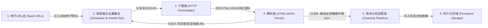
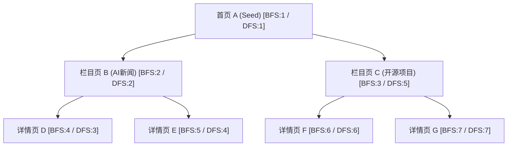
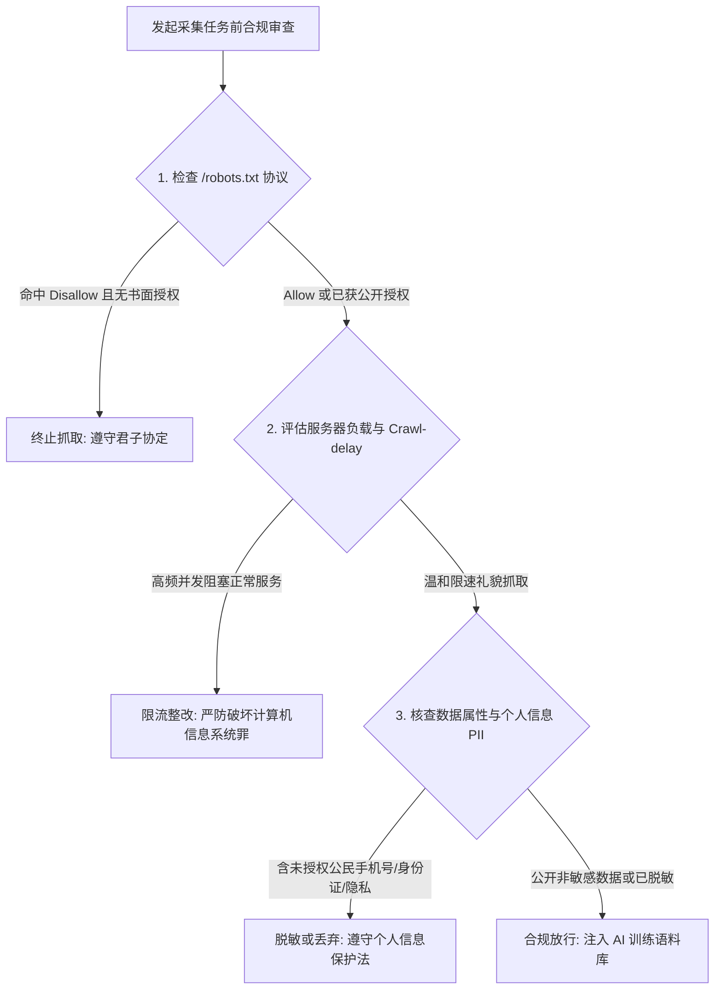

# 网络爬虫导论与数据合规基石

## Summary

本章作为全书的导入篇，首先从人工智能与大模型对高质量训练语料的迫切需求切入，系统阐述网络爬虫的定义、核心分类（通用爬虫、聚焦爬虫、增量爬虫）与标准工程流水线。随后重点剖析 URL 种子队列管理、广度优先（BFS）与深度优先（DFS）遍历策略，并深入解读 `robots.txt` 君子协议、`Sitemap` 网站地图以及《数据安全法》《个人信息保护法》等合规边界。学完本章后，学生将建立起清晰的爬虫工程全局观与合法合规采集意识。

## Concepts Covered

This chapter covers the following 20 concepts from the learning graph:

| Concept | Concept Impact Score |
|---------|-----------------------|
| Python编程基础 | 10664 |
| 计算机网络基础 | 21624 |
| Web浏览器基础 | 12017 |
| HTML文档结构基础 | 8902 |
| 数据结构与集合基础 | 2641 |
| 文件系统与IO基础 | 53 |
| 数据合规与伦理意识 | 195 |
| 万维网与超文本传输 | 10924 |
| 网络爬虫定义与核心价值 | 3599 |
| 通用搜索引擎爬虫 | 1 |
| 聚焦主题网络爬虫 | 10 |
| 增量式更新爬虫 | 8 |
| 深层网页与暗网数据概念 | 1 |
| 网络爬虫标准工作流 | 3551 |
| URL种子队列与待抓取池 | 22 |
| 网页抓取广度优先策略 | 4 |
| 网页抓取深度优先策略 | 1 |
| Robots协议与语法规范 | 163 |
| Sitemap网站地图解析 | 1 |
| 数据安全法与个人信息保护 | 31 |

## Prerequisites

This chapter assumes only the prerequisites listed in the [course description](../../course-description.md).

---

## 1. 人工智能时代的数据燃料与先修技术基石

在生成式人工智能（Generative AI）与大语言模型（Large Language Models, LLM）席卷全球的今天，算法模型、算力集群与高质量数据构成了推动人工智能发展的三大核心支柱。对于人工智能技术应用专业的学习者而言，无论是训练一个垂直领域的图像分类器、微调一个面向医疗或法律问答的行业大模型，还是构建一个能够实时回答企业最新政策的检索增强生成（RAG, Retrieval-Augmented Generation）知识库，第一步永远是**获取真实、丰富、干净的领域数据**。然而，互联网上超过 90% 的高价值信息并非以现成的 `.csv` 或数据库压缩包形式提供下载，而是分散在数十亿个动态变化的网页之中。如何自动化、规模化、合规化地将这些网页转化为结构化的 AI 数据集，正是《网络爬虫技术》所要解决的核心工程命题。

在正式编写第一个爬虫程序之前，我们需要先梳理并对齐本课程赖以建立的六项先修技术基石。这些基石概念贯穿全书所有章节，决定了我们如何用代码模拟人类访问网页并存储结果。

### 1.1 计算机网络基础与万维网超文本传输

**计算机网络基础**是理解一切远程数据采集的物理与逻辑前提。互联网上的每一台服务器和客户端计算机都通过 **IP 地址（Internet Protocol Address）** 进行唯一寻址（例如 `93.184.216.34`），并通过 **域名系统（DNS, Domain Name System）** 将人类易记的域名（如 `example.com`）翻译为机器可路由的 IP 地址。当两台主机建立通信时，数据并非瞬间整体送达，而是通过 **TCP/IP 协议栈**拆分为一个个数据包，经过端口号（Port，如 HTTP 默认使用 `80` 端口，HTTPS 默认使用 `443` 端口）准确交付给目标服务器上的 Web 服务进程。如果把目标网站比作一座藏书丰富的图书馆，那么 IP 地址与端口就是这座图书馆的精确经纬度坐标与大门编号，而 TCP 连接则是修通在你与图书馆之间的专用双向公路。

建立在计算机网络之上的最成功应用便是**万维网与超文本传输（World Wide Web & Hypertext Transfer）**。万维网由蒂姆·伯纳斯-李（Tim Berners-Lee）提出，其核心思想是通过 **超链接（Hyperlink）** 将全球各地的文档连接成一张巨大的信息网。在这张网中，每一个资源都拥有一个全局唯一的地址标识符——**统一资源定位符（URL, Uniform Resource Locator）**；客户端与服务器之间则遵循 **超文本传输协议（HTTP/HTTPS）**，采用“一问一答（Request-Response）”的同步模式交换超文本文档。网络爬虫之所以被称为“蜘蛛（Spider）”，正是因为它顺着万维网页面中纵横交错的 URL 超链接，从一个网页爬向另一个网页。

### 1.2 Web浏览器基础与HTML文档结构基础

在日常使用互联网时，人类用户通过 Chrome、Edge 或 Firefox 等浏览器访问网页。掌握**Web浏览器基础**对于爬虫工程师至关重要，因为浏览器本质上就是一个可视化的 HTTP 客户端兼代码渲染引擎。当你向浏览器地址栏输入一个网址并按下回车键时，浏览器依次完成三件核心工作：

1. **网络请求发送**：根据 URL 向远端服务器发起 HTTP 请求报文，携带当前浏览器身份标识（`User-Agent`）与本地状态凭证（`Cookie`）。
2. **源码接收与解析**：接收服务器返回的 HTML、CSS、JavaScript 及 JSON 数据流，并将纯文本的 HTML 解析为内存中的树状对象模型。
3. **视图渲染与交互**：执行 JavaScript 脚本，计算页面布局样式，最终将五彩斑斓的图文界面绘制在屏幕像素上。

网络爬虫的核心哲学就是**“在代码中扮演浏览器”**——在绝大多数静态数据采集场景下，爬虫只需要执行第 1 步和第 2 步，直接从源码中提取文字，从而省去了耗费大量内存与算力的第 3 步像素绘制过程，使采集速度比人工点击快上千倍。

为了从服务器返回的源码中提取目标字段，我们必须扎实掌握**HTML文档结构基础**。**超文本标记语言（HTML, HyperText Markup Language）** 使用成对的尖括号标签（Tags）来赋予文本语义和层级结构。一个标准的 HTML 元素由开始标签、属性（Attributes）、文本内容（Text Content）和结束标签组成。例如，在 `<a href="https://ai.example.edu/news/101.html" class="news-link">人工智能专业实训基地揭牌</a>` 这段代码中，`<a>` 是标签名，`href` 和 `class` 是属性名，双引号内的网址和类名是属性值，而夹在中间的中文标题则是元素文本。多个标签层层嵌套，构成了树状的 **文档对象模型（DOM, Document Object Model）**：

- `<html>` 是整棵树的根节点；
- `<head>` 包含网页标题 `<title>`、字符编码 `<meta charset="utf-8">` 等元数据；
- `<body>` 承载所有可见正文，如标题 `<h1>`~`<h6>`、段落 `<p>`、区块容器 `<div>`、列表 `<ul>/<li>` 以及数据表格 `<table>/<tr>/<td>`。

爬虫的“解析（Parsing）”过程，本质上就是利用 `class`、`id` 等属性作为路标，在 DOM 树中精准定位到包含目标数据的标签节点。

### 1.3 Python编程基础、数据结构与文件IO

为什么 Python 能够成为全球网络爬虫与人工智能数据工程的绝对统治语言？这源于其极简的语法表达力与极其繁荣的第三方生态。在本教材中，我们依托**Python编程基础**构建所有采集逻辑。一段健壮的爬虫代码离不开四大核心语法特性的支撑：

- **字符串处理与切片**：对采集到的原始文本执行 `.strip()` 去除首尾空白、`.replace()` 替换噪点字符、`.split()` 按分隔符切分字段。
- **函数与模块化封装**：将请求发送、页面解析、数据清洗拆分为职责单一的函数（如 `fetch_html(url)`、`parse_items(html)`），提高代码复用率。
- **面向对象编程（OOP）**：理解类（Class）与实例（Instance）的概念，这是后续使用 Scrapy 框架编写自定义 `Spider` 子类的语法基础。
- **异常捕获机制（`try...except...finally`）**：网络环境充满不确定性（断网、超时、目标网页改版缺失某个标签），使用异常处理可以确保单条数据解析失败时爬虫不会整体崩溃退出。

在爬虫运行过程中，内存中的 URL 列表、待去重的网址以及提取出的结构化记录都需要依托**数据结构与集合基础**进行高效管理。Python 内置的四大容器在爬虫中各司其职：

1. **列表（`list`）与双端队列（`collections.deque`）**：按顺序存放待抓取的 URL 队列或同一页面提取出的多条商品记录，支持高效的头部弹出与尾部追加。
2. **字典（`dict`）**：以键值对（Key-Value）形式天然映射 HTTP 请求头（Headers）、URL 查询参数以及单条结构化数据（例如 `{"title": "Python爬虫", "price": 59.0}`），并且可以直接无缝转换为工业界标准的 JSON 格式。
3. **集合（`set`）**：底层基于哈希表（Hash Table）实现，支持 $O(1)$ 时间复杂度的极速查找与天然去重，是单机爬虫用来记录“已访问 URL 指纹（Visited URLs）”、防止死循环重复抓取的首选结构。
4. **元组（`tuple`）**：具备不可变性（Immutable），常用于固定配置项或数据库批量写入的参数行绑定。

最后，采集并清洗干净的数据不能只停留在内存里（程序结束即丢失），必须通过**文件系统与IO基础**持久化落地到磁盘中。在 Python 中，我们使用 `with open(filepath, mode, encoding="utf-8") as f:` 上下文管理器来安全地读写文件，它能保证即便写入中途发生异常，文件句柄也能被自动关闭。在编写爬虫文件 IO 时，必须严格区分两种模式：

- **文本模式（`"w"` 覆盖写 / `"a"` 追加写）**：用于保存 HTML 源码、CSV 表格或 JSON Lines（`.jsonl`）语料文件，**必须显式指定 `encoding="utf-8"`**（或在生成 Excel 兼容 CSV 时使用 `"utf-8-sig"`），否则在 Windows 系统下默认使用 GBK 编码极易引发 `UnicodeEncodeError` 报错或中文乱码。
- **二进制模式（`"wb"`）**：用于保存图片（`.jpg`/`.png`）、音频（`.mp3`）、视频（`.mp4`）或 PDF 文档等非文本字节流（`bytes`）。

在进入下一节之前，我们先通过一段综合了上述先修概念的纯正 Python 基础示例，演示如何在本地模拟“从一段原始 HTML 字符串中解析课程信息、利用集合去重并持久化保存为 JSON Lines 语料文件”的完整微缩闭环。在下面的代码中，`raw_pages` 模拟了采集到的两段网页源码，`seen_codes` 是一个用于过滤重复课程编号的 `set` 集合，最终结果通过 UTF-8 编码写入磁盘文件：

```python
import json
import re
from collections import deque

# 1. 使用双端队列 deque 管理待处理的模拟网页源码 (数据结构基础)
raw_pages = deque([
    '<div class="course" data-id="AI101"><h3>网络爬虫技术</h3><span class="credit">4.0</span></div>',
    '<div class="course" data-id="AI102"><h3>深度学习应用</h3><span class="credit">3.5</span></div>',
    '<div class="course" data-id="AI101"><h3>网络爬虫技术(重复页)</h3><span class="credit">4.0</span></div>',
])

# 2. 使用集合 set 存储已处理的课程代码，实现 O(1) 复杂度去重
seen_codes: set[str] = set()
cleaned_records: list[dict] = []

while raw_pages:
    html_snippet = raw_pages.popleft()
    try:
        # 3. 提取 HTML 属性与标签文本 (HTML文档结构基础 + Python字符串正则)
        code_match = re.search(r'data-id="([^"]+)"', html_snippet)
        title_match = re.search(r"<h3>([^<]+)</h3>", html_snippet)
        credit_match = re.search(r'<span class="credit">([^<]+)</span>', html_snippet)

        if not (code_match and title_match and credit_match):
            continue

        course_code = code_match.group(1).strip()
        # 判断是否已采集过该课程
        if course_code in seen_codes:
            print(f"[跳过重复] 课程编号 {course_code} 已存在于去重集合中")
            continue

        seen_codes.add(course_code)
        record = {
            "course_code": course_code,
            "title": title_match.group(1).strip(),
            "credit": float(credit_match.group(1)),
        }
        cleaned_records.append(record)
    except ValueError as err:
        print(f"[数据转换异常] {err}")

# 4. 使用上下文管理器将结果持久化为大模型标准 JSONL 格式 (文件系统与IO基础)
output_path = "ai_courses_dataset.jsonl"
with open(output_path, mode="w", encoding="utf-8") as f:
    for item in cleaned_records:
        f.write(json.dumps(item, ensure_ascii=False) + "\n")

print(f"✅ 成功清洗并写入 {len(cleaned_records)} 条唯一样本至 {output_path}")
```

下表总结了这六大先修基石概念在网络爬虫工程中的具体映射关系：

| 先修基石概念 | 核心技术要素 | 在网络爬虫工程中的直接作用 |
|---|---|---|
| **计算机网络基础** | IP 地址、DNS 域名解析、端口、TCP/IP 协议栈 | 定位目标 Web 服务器并建立可靠的底层字节流传输通道 |
| **万维网与超文本传输** | URL 统一资源定位符、HTTP/HTTPS 请求-响应模型、超链接 | 定义待采集资源的唯一地址与客户端-服务器标准通信契约 |
| **Web浏览器基础** | 网络请求发送、DOM 树构建、JS 引擎执行、DevTools | 作为爬虫模拟的标杆参照物，并提供抓包与页面结构逆向调试工具 |
| **HTML文档结构基础** | 标签（Tags）、属性（`id`/`class`/`href`）、DOM 树嵌套 | 提供静态网页数据的结构化载体，是 CSS 选择器与 XPath 解析的对象 |
| **Python编程基础** | 字符串处理、函数封装、面向对象类继承、`try...except` | 编写高可读性、模块化、具备容错恢复能力的采集与解析控制逻辑 |
| **数据结构与集合基础** | `deque` 队列、`dict` 字典、`set` 哈希集合、`tuple` 元组 | 高效调度待抓取 URL 队列、封装 JSON 数据载荷并实现 $O(1)$ 内存去重 |
| **文件系统与IO基础** | `with open()` 上下文、UTF-8 编码控制、文本与二进制流模式 | 将内存中的采集成果无乱码地落盘保存为 CSV、JSONL 或多媒体文件 |

---

## 2. 网络爬虫定义、核心价值与分类体系

### 2.1 网络爬虫定义与核心价值

**网络爬虫定义与核心价值**可以概括为：**网络爬虫（Web Crawler / Web Scraper / Web Spider）是一种按照预设的工程规则与算法逻辑，模拟客户端自动向万维网服务器发起网络请求、获取响应数据、解析并提取目标信息，同时根据需要自动发现新 URL 链接以持续扩展采集范围的计算机程序。** 这里需要区分两个在工业界经常混用但侧重点略有差异的术语：

- **Web Crawler（网络爬行器/蜘蛛）**：侧重于“广度遍历与链接发现”，强调顺着页面上的 `<a>` 标签超链接在全网或站内不断巡游（如百度、Google 的搜索引擎蜘蛛）。
- **Web Scraper（网页抓取器/数据提取器）**：侧重于“精准结构化提取”，强调从特定目标网页或 API 接口中把商品价格、新闻正文、学术论文摘要或问答对剥离出来，清洗为干净的数据表。

在人工智能技术应用专业领域，网络爬虫的核心价值体现在以下四个核心场景：

1. **大语言模型预训练语料库构建（Pre-training Corpus）**：如开源界的 Common Crawl 项目，通过大规模爬虫采集数百亿个网页，经过清洗去重后形成数万亿 Token 的文本语料，支撑起 DeepSeek、Qwen、Llama 等底座大模型的语言理解与常识能力。
2. **垂直领域指令微调数据集采集（SFT Dataset）**：通用大模型往往缺乏细分行业（如农业病虫害防治、工业设备故障排查、地方税务法规）的专业知识。通过编写聚焦爬虫采集专业技术论坛、政务公开问答库与行业百科，可以高效构造形如 `{"instruction": "...", "input": "...", "output": "..."}` 的微调训练集。
3. **检索增强生成（RAG）实时外部知识库同步**：大模型的参数知识具有静态截止日期。通过部署定时增量爬虫，持续采集企业内部文档站、行业招投标公告或最新技术文档并转化为向量数据库切片，能够让 AI 助手实时回答最新发生的事态并消除“模型幻觉（Hallucination）”。
4. **多模态训练数据集与商业智能监测（Multimodal & BI）**：自动化采集图文配对样本（Image-Alt Pairs）用于训练视觉-语言模型（如 CLIP、Stable Diffusion），或持续监测电商平台价格波动、社交媒体與情情感倾向。

### 2.2 网络爬虫的三大核心分类

根据采集目标范围、遍历策略与时间调度机制的不同，工程界将网络爬虫划分为三大基本类型：**通用搜索引擎爬虫**、**聚焦主题网络爬虫**与**增量式更新爬虫**。

1. **通用搜索引擎爬虫（General-Purpose Web Crawler）**  
   通用爬虫服务于 Google、Bing、百度等全网搜索引擎。它的目标是尽可能把整个互联网上所有公开可访问的网页全部下载回来，建立全网倒排索引。通用爬虫从一批门户网站种子 URL 出发，无差别地提取页面中的所有外链，对服务器带宽、分布式存储（PB 级）和 URL 去重算法要求极高，但对单个页面内部的具体业务字段（如哪个数字是价格、哪个数字是库存）不做深度结构化拆分。
2. **聚焦主题网络爬虫（Focused / Topical Web Crawler）**  
   聚焦爬虫是我们日常在人工智能数据工程中编写得最多的一类爬虫。它不再漫无目的地抓取全网，而是围绕**特定主题、特定网站或特定业务字段**进行定向采集（例如：专门采集某开源社区中带有 `Python` 标签的技术问答，或者专门采集某医药数据库的药品说明书）。聚焦爬虫包含两个关键特征：一是在提取链接时通过 URL 正则规则或页面文本相关性过滤掉无关链接（如广告链接、关于我们页面）；二是针对目标页面编写精细的 XPath 或 CSS 选择器解析规则，直接产出结构化字典。
3. **增量式更新爬虫（Incremental Web Crawler）**  
   无论是新闻资讯站、政策发布网还是社区论坛，网站内容都在随时间不断新增或修改。如果每天都把目标网站的历史十万篇文章重新抓取一遍，不仅浪费自身高达 99% 的网络带宽与算力，还会给目标网站服务器造成毫无必要的负载冲击。**增量式更新爬虫**专门解决这一痛点：它通过比对 URL 历史去重集合（如 Redis 指纹库）、检查文章列表页的发布时间戳（`publish_time`）、或者读取 HTTP 响应头中的 `Last-Modified` 与 `ETag` 标识，**只抓取上次采集之后新发布的网页或发生内容变更的网页**。在构建实时更新的 AI 资讯监控与 RAG 动态知识库时，增量爬虫是工程落地的标准形态。

### 2.3 表层网页与深层网页、暗网数据概念

在规划爬虫采集范围时，还必须理解互联网信息冰山模型的分层结构，即表层网页（Surface Web）与**深层网页与暗网数据概念（Deep Web & Dark Web）**：

- **表层网页（Surface Web）**：指能够被传统搜索引擎通过超链接直接爬行并建立索引的公开静态页面，仅占互联网数据总量的约 4%~10%。
- **深层网页（Deep Web）**：指无法通过简单的静态超链接直接访问，必须通过**表单查询提交、登录身份认证、动态异步 API 调用或付费授权**才能显现的海量数据库内容（例如：中国知网的学术文献库、12306 的实时余票查询结果、需要登录后才能查看的个人订单页、通过滚动异步加载的社交媒体评论）。深层网页占据了互联网 90% 以上的数据量，且数据质量极高，是我们学习第 5 章（API 逆向）和第 6 章（Playwright 动态自动化）的核心攻关对象。
- **暗网（Dark Web）**：指需要特殊加密代理软件（如 Tor 洋葱路由、I2P）和特殊协议才能访问的匿名网络空间。**需要严正声明的是：暗网充斥着大量违法犯罪交易与恶意木马，本教材讨论的数据采集技术严格限定在合法公开的表层网页与经授权合规的深层网页（Deep Web）范畴内，绝不涉及任何暗网非法采集。**

下表对比了三类核心网络爬虫与不同网页层级的工程特征：

| 爬虫类型 | 采集范围与目标 | 核心技术难点 | 典型 AI 应用场景 |
|---|---|---|---|
| **通用搜索引擎爬虫** | 全网公开表层网页，追求最大覆盖率 | 亿级 URL 去重、极高并发带宽控制、网页权重排序（PageRank） | 底座大模型（LLM）通用预训练语料（如 Common Crawl） |
| **聚焦主题网络爬虫** | 特定垂直领域或指定站点，追求高准召率与结构化提取 | 页面 DOM 结构精准解析、主题相关性过滤、异构字段对齐 | 垂直行业大模型微调（SFT）数据集、特定多模态图文集 |
| **增量式更新爬虫** | 监控目标站点的最新新增或变更内容，追求低延迟与低冗余 | 增量边界判定（时间戳/指纹/状态头）、定时调度与断点续爬 | 企业级 RAG 检索增强知识库实时同步、实时财经/舆情监测 |

---

## 3. 网络爬虫标准工作流与图遍历策略

### 3.1 网络爬虫标准工作流

无论是一个只有 30 行代码的简单 Python 脚本，还是一个运行在数十台服务器上的 Scrapy 分布式集群，其内部执行逻辑都严格遵循同一套**网络爬虫标准工作流（Standard Web Scraping Workflow）**。理解这一标准闭环，能帮助你在遇到任何复杂采集需求时迅速拆解模块。标准工作流由五个核心阶段构成闭环：

1. **阶段一：URL 种子调度与去重（URL Seeding & Scheduling）**  
   爬虫从预设的一个或多个起始网址——即**种子 URL（Seed URLs）**（例如某新闻网站的列表首页 `https://news.example.com/ai/page/1`）开始运行。调度器（Scheduler）从**待抓取队列（Frontier Queue）**中取出一个 URL，首先查询**已抓取指纹集合（Visited Set）**；如果该 URL 已经被处理过，则直接丢弃以避免死循环；如果是全新的 URL，则将其标记并移交下载器。
2. **阶段二：网络请求与网页下载（HTTP Request & Downloading）**  
   下载器（Downloader）根据 URL 构造标准的 HTTP 请求报文（附加伪装的 `User-Agent`、必要的 `Cookie` 或代理 IP），通过网络发送给目标 Web 服务器，并接收服务器返回的响应报文（HTML 源码、JSON 字符串或二进制媒体流）。如果遇到临时网络波动或 `429/503` 状态码，下载器会按策略执行延迟退避重试。
3. **阶段三：内容解析与双路提取（Parsing & Dual Extraction）**  
   解析器（Parser）接收下载好的网页内容，通过 CSS 选择器、XPath 或 JSON 解析器执行**双路提取**：
   - **第一路（提取业务数据 Items）**：剥离出我们真正关心的结构化目标字段（如文章标题、正文、发布时间、作者）。
   - **第二路（提取后续链接 New URLs）**：提取页面中的“下一页”按钮链接或文章详情页链接，经过作用域与格式过滤后，回传给阶段一的**待抓取队列**，从而驱动爬虫持续自动运转。
4. **阶段四：数据清洗与结构化校验（Data Cleaning & Validation）**  
   刚从网页上剥离下来的原始字段往往夹杂着 HTML 残留标签、多余的换行符 `\n\t`、全角空格或格式不一的日期字符串。数据管道（Pipeline）负责剔除这些噪声、统一单位格式，并校验必填字段是否完整。
5. **阶段五：持久化存储（Persistent Storage）**  
   清洗合格的结构化数据被最终写入本地文件（CSV、JSONL、Parquet）或数据库（SQLite、MySQL、MongoDB、向量数据库），完成整个采集生命周期。

在查看下方的交互式流程图之前，请先牢记上述五个阶段的组件名称（`Seed URLs`、`Scheduler & Visited Set`、`Downloader`、`Parser`、`Pipeline & Storage`）以及“解析器既产出业务数据又回流新链接”这一核心双路分支机制。

#### Diagram: Standard Web Crawler Workflow Architecture



<details markdown="1">
<summary>Standard Web Crawler Workflow Architecture</summary>
Type: workflow
**sim-id:** standard-crawler-workflow<br/>
**Library:** Mermaid<br/>
**Status:** Specified<br/>
**Bloom Level:** Understand<br/>
**Bloom Verb:** explain<br/>
**Learning Objective:** The learner will explain the role of each of the six stages in the standard web crawler workflow and trace how newly discovered URLs cycle back to the scheduler.

**Prerequisites:** URL, HTTP request, HTML DOM parsing, Visited Set deduplication, persistent storage (all defined in Section 1 and Section 3.1 above).

**Evidence of Mastery:** After clicking each of the six workflow nodes to inspect its input, output, and failure mode, the learner answers two diagnostic questions by clicking the responsible component node: (1) "Which component prevents the crawler from entering an infinite loop when two pages link to each other?" and (2) "Which component splits the raw HTML response into structured data items and newly discovered URLs?" Mastery is answering both questions correctly on the first attempt.

**Misconceptions:** (1) A crawler finishes after downloading a single URL without feeding discovered links back to the queue. (2) Deduplication happens only after data is written to the database rather than at the URL scheduler before downloading.

**Instructional Rationale:** A clickable workflow diagram where each stage reveals concrete input/output data payloads allows learners to trace the closed feedback loop of URL discovery before answering diagnostic questions about component responsibilities.

**Content:**

Workflow nodes and the exact details revealed when clicked:

| Node ID | Node Label | Input Payload | Output Payload | Core Responsibility & Failure Mode (revealed on click) |
|---|---|---|---|---|
| `N1` | `1. 种子URL池 (Seed URLs)` | 人工配置的起始网址列表 `["https://site.edu/list?p=1"]` | 初始待抓取 URL 流 | 作为整个爬虫工程的启动入口；若种子 URL 失效或拼写错误，爬虫将无法启动。 |
| `N2` | `2. 调度器与去重集合 (Scheduler & Visited Set)` | 种子 URL 或解析器回流的新 URL | 确认未抓取过的唯一待抓 URL | 维护先进先出队列（Queue）与哈希去重集合（Visited Set）；拦截重复 URL 防止无限循环。 |
| `N3` | `3. 下载器 (HTTP Downloader)` | 唯一待抓 URL 与 Headers/Proxy 配置 | `Response` 对象（状态码 `200` + HTML/JSON 字节流） | 发起真实 HTTP/HTTPS 网络请求；处理连接超时、403/429 状态码与指数退避重试。 |
| `N4` | `4. 解析器 (HTML/JSON Parser)` | 原始 HTML 文档或 JSON 响应文本 | 分支 A：新发现的 URL 列表；分支 B：原始业务数据字典 `Item` | 构建 DOM 树并执行 XPath/CSS 选择器，同时承担“发现新链接”与“提取目标字段”双重职责。 |
| `N5` | `5. 清洗与校验管道 (Cleaning Pipeline)` | 原始业务数据字典 `Raw Item` | 标准化、去噪后的合规 `Cleaned Item` | 剥离残留 HTML 标签、归一化空白字符與日期格式、执行 Pydantic 字段类型强校验。 |
| `N6` | `6. 持久化存储 (Persistent Storage)` | 清洗合格的结构化 `Cleaned Item` | 磁盘文件（`.jsonl`/`.csv`）或数据库记录（MySQL/MongoDB） | 将内存数据安全落盘并执行唯一索引幂等更新（UPSERT），供下游 AI 训练读取。 |

Directed connections between nodes:
- `N1` -> `N2` (label: `注入初始种子网址`)
- `N2` -> `N3` (label: `分发未访问URL`)
- `N3` -> `N4` (label: `交付HTML/JSON响应源码`)
- `N4` -> `N2` (label: `分支A：回流新发现的链接URL`)
- `N4` -> `N5` (label: `分支B：推送提取的业务字段Item`)
- `N5` -> `N6` (label: `写入校验合格的干净数据`)

Diagnostic Questions:
- Question 1: "当页面 A 包含指向页面 B 的链接，而页面 B 又包含指向页面 A 的链接时，哪个组件负责阻止爬虫陷入无限死循环抓取？" -> Correct Node: `N2` (`2. 调度器与去重集合 (Scheduler & Visited Set)`). Why: 调度器中的 Visited Set 会在发起网络下载前检查 URL 是否已存在，从而直接拦截已访问过的页面。
- Question 2: "哪个组件负责将下载器返回的原始 HTML 源码一分为二，同时产生『待继续跟进的新链接』和『结构化业务字段字典』？" -> Correct Node: `N4` (`4. 解析器 (HTML/JSON Parser)`). Why: 解析器通过 DOM 选择器分别提取导航链接（送回调度器）与正文业务数据（送往清洗管道）。

**Provenance:** From Chapter 1 Section 3.1 ("网络爬虫标准工作流").

**Rules:** Every node must be clicked at least once in exploration mode before the two diagnostic questions unlock, or the learner may switch directly to quiz mode. In quiz mode, clicking a node submits it as the answer to the active question.

**Learner Activity:**

1. The learner clicks each of the six workflow nodes (`N1` through `N6`) to inspect its input payload, output payload, and core responsibility in the detail panel.
2. The learner traces the feedback arrow from `N4` (`解析器`) back to `N2` (`调度器与去重集合`) and observes how pagination and detail links re-enter the queue.
3. The learner answers Question 1 and Question 2 by clicking the corresponding workflow node on the diagram.

**Feedback:** Two diagnostic questions in fixed order, two attempts per question. Correct: "正确！该组件正是负责此项核心职责。" Incorrect: displays the "Why" explanation from the Content table above and highlights the data flow between `N4`, `N2`, and `N5`. After the second incorrect attempt, the correct node is highlighted and its explanation is shown. Score shown as "已掌握诊断题：n / 2".

**Starting State:** All six workflow nodes are displayed with their directional labels, `N1` (`1. 种子URL池`) is selected by default showing its input/output panel, and the prompt reads: "点击流程图中的各个组件查看其输入输出数据流，然后完成下方两道架构诊断题。"

**Chapter Anchors:** Section 3.1 defines the five conceptual stages mapped across these six component nodes, explicitly highlighting the dual extraction branches of the Parser (`N4` -> `N2` and `N4` -> `N5`).
</details>

### 3.2 URL种子队列、广度优先（BFS）与深度优先（DFS）策略

在爬虫工作流中，**URL种子队列与待抓取池（URL Seed Queue & Frontier Pool）** 是控制爬虫行进方向的调度大脑。当一个列表页包含 20 篇新闻详情页链接和 1 个“下一页”链接时，爬虫到底应该先把第 1 页的 20 篇详情全部抓完再去抓第 2 页，还是一路顺着某篇新闻里的“相关推荐”链接一直往下钻？这取决于我们在调度器中采用哪种图遍历算法：**网页抓取广度优先策略（Breadth-First Search, BFS）** 还是 **网页抓取深度优先策略（Depth-First Search, DFS）**。

假设我们将一个小型网站的链接结构抽象为一棵包含 7 个页面的有向图，起始种子节点为首页 `A`：

- 首页 `A` 包含两个栏目页链接：`B`（AI 新闻栏目）和 `C`（开源项目栏目）；
- 栏目页 `B` 包含两篇详情页链接：`D` 和 `E`；
- 栏目页 `C` 包含两篇详情页链接：`F` 和 `G`。

1. **网页抓取广度优先策略（BFS — 层级推进）**  
   广度优先策略的核心原则是**“先近后远、逐层扫荡”**——即先抓完距离种子节点跳数（Depth）为 1 的所有页面，再抓取跳数为 2 的页面，以此类推。在代码实现上，BFS 使用 **先进先出队列（FIFO Queue，即 `collections.deque` 的 `append()` 入队 + `popleft()` 出队）**。  
   在上述 7 节点网站图中，BFS 的精确访问顺序为：**`A → B → C → D → E → F → G`**。  
   **工程优势**：BFS 是绝大多数通用爬虫与列表分页爬虫的首选策略，因为它能保证爬虫优先采集距离首页最近的核心目录页与高价值页面，不会因为某个页面里的外链嵌套过深而迷失在边缘角落里。
2. **网页抓取深度优先策略（DFS — 纵深钻取）**  
   深度优先策略的核心原则是**“一条路走到黑，碰壁再回溯”**——即顺着当前页面的第一个未访问链接一直往深处抓取，直到某个页面没有任何新的子链接（到达叶子节点）或达到预设的最大深度阈值（`max_depth`）时，才回退到上一层继续抓取其他分支。在代码实现上，DFS 使用 **后进先出栈（LIFO Stack，即使用列表或 `deque` 的 `append()` 入栈 + `pop()` 从尾部弹出栈顶）**。为了使左分支 `B` 先于右分支 `C` 被弹出访问，我们将子链接按逆字母序压入栈中。  
   在同一个 7 节点网站图中，DFS 的精确访问顺序为：**`A → B → D → E → C → F → G`**。  
   **工程优势**：当我们需要完整追踪某个树状分类目录（如“省 → 市 → 区 → 街道”四级行政区划树）或顺着单条线索完成全链路深挖时，DFS 能够让同一个子分类下的数据在时间上连续产出。

下面这段代码完整对比了在同一个网站链接图 `SITE_GRAPH` 上，仅通过改变弹出位置（`popleft()` 队列头 vs. `pop()` 栈顶）实现 BFS 与 DFS 抓取调度的过程：

```python
from collections import deque

# 模拟网站页面超链接拓扑图：键为当前页面，值为页面中包含的子链接列表
SITE_GRAPH: dict[str, list[str]] = {
    "A": ["B", "C"],
    "B": ["D", "E"],
    "C": ["F", "G"],
    "D": [],
    "E": [],
    "F": [],
    "G": [],
}


def crawl_bfs(graph: dict[str, list[str]], seed: str) -> list[str]:
    """广度优先抓取策略 (BFS)：使用 FIFO 队列 (append + popleft)"""
    queue = deque([seed])
    visited: set[str] = {seed}
    visit_order: list[str] = []

    while queue:
        current_url = queue.popleft()  # 从队列头部取出最早加入的 URL
        visit_order.append(current_url)

        for link in graph.get(current_url, []):
            if link not in visited:
                visited.add(link)
                queue.append(link)  # 追加到队列尾部
    return visit_order


def crawl_dfs(graph: dict[str, list[str]], seed: str) -> list[str]:
    """深度优先抓取策略 (DFS)：使用 LIFO 栈 (append + pop)"""
    stack = deque([seed])
    visited: set[str] = {seed}
    visit_order: list[str] = []

    while stack:
        current_url = stack.pop()  # 从栈顶取出最新加入的 URL
        visit_order.append(current_url)

        # 逆序压栈，确保正序第一个链接位于栈顶优先被访问
        for link in reversed(graph.get(current_url, [])):
            if link not in visited:
                visited.add(link)
                stack.append(link)
    return visit_order


if __name__ == "__main__":
    print("BFS 广度优先抓取顺序:", " -> ".join(crawl_bfs(SITE_GRAPH, "A")))
    # 输出: A -> B -> C -> D -> E -> F -> G
    print("DFS 深度优先抓取顺序:", " -> ".join(crawl_dfs(SITE_GRAPH, "A")))
    # 输出: A -> B -> D -> E -> C -> F -> G
```

理解了 FIFO 队列与 LIFO 栈在 URL 调度中的区别后，请通过下方的交互式微仿真亲自预测 BFS 与 DFS 在每一步出队/出栈时所访问的下一个网页节点。

#### Diagram: Web Crawler BFS and DFS Traversal Predictor



<details markdown="1">
<summary>Web Crawler BFS and DFS Traversal Predictor</summary>
Type: microsim
**sim-id:** crawler-bfs-dfs-predictor<br/>
**Library:** p5.js<br/>
**Status:** Specified<br/>
**Bloom Level:** Analyze<br/>
**Bloom Verb:** differentiate<br/>
**Learning Objective:** The learner will differentiate breadth-first search (BFS) from depth-first search (DFS) web crawling strategies by predicting the next URL node visited at each step from the visible queue or stack state.

**Prerequisites:** URL Seed Queue, Visited Set, FIFO Queue (`popleft`), LIFO Stack (`pop`), Breadth-First Search (BFS), Depth-First Search (DFS) (all defined in Section 3.2 above).

**Evidence of Mastery:** Across two 6-step traversal challenges (first BFS, then DFS on the same 7-page website graph), the learner clicks the graph node they predict the crawler will fetch next at each step. A prediction is correct when it matches the visit order in Content. Mastery is completing both BFS and DFS traversals with at most 1 incorrect prediction per traversal (at least 5 of 6 correct in BFS and at least 5 of 6 correct in DFS).

**Misconceptions:** (1) BFS follows the left branch (`A -> B -> D`) all the way to the leaf page before visiting sibling category `C`. (2) DFS visits all immediate child links of the root page (`B` and `C`) before descending into detail page `D`.

**Instructional Rationale:** Analyze-level differentiation requires learners to actively apply the FIFO queue rule (`popleft` from front) versus the LIFO stack rule (`pop` from top) by committing a next-node prediction before each step advances, rather than passively watching an automated traversal animation.

**Content:**

Website link graph structure (7 pages, root seed is `A`):
- Nodes and labels:
  - `A`: `首页 A (Seed)`
  - `B`: `栏目页 B (AI新闻)`
  - `C`: `栏目页 C (开源项目)`
  - `D`: `详情页 D`
  - `E`: `详情页 E`
  - `F`: `详情页 F`
  - `G`: `详情页 G`
- Directed Edges: `A -> B`, `A -> C`, `B -> D`, `B -> E`, `C -> F`, `C -> G`.
- Complete BFS step-by-step trace (FIFO Queue, `popleft` from front, append unvisited children in alphabetical order to back):

| Step | Previously Visited | Current Queue (Front -> Back) | Correct Next Node to Click | Queue After Step |
|---|---|---|---|---|
| 1 | `A` | `[B, C]` | `B` | `[C, D, E]` |
| 2 | `A, B` | `[C, D, E]` | `C` | `[D, E, F, G]` |
| 3 | `A, B, C` | `[D, E, F, G]` | `D` | `[E, F, G]` |
| 4 | `A, B, C, D` | `[E, F, G]` | `E` | `[F, G]` |
| 5 | `A, B, C, D, E` | `[F, G]` | `F` | `[G]` |
| 6 | `A, B, C, D, E, F` | `[G]` | `G` | `[]` (Complete) |

- Complete DFS step-by-step trace (LIFO Stack, `pop` from top, push unvisited children in reverse alphabetical order so alphabetically first child sits on top of stack):

| Step | Previously Visited | Current Stack (Top -> Bottom) | Correct Next Node to Click | Stack After Step |
|---|---|---|---|---|
| 1 | `A` | `[B, C]` (Top is `B`) | `B` | `[D, E, C]` (Top is `D`) |
| 2 | `A, B` | `[D, E, C]` (Top is `D`) | `D` | `[E, C]` (Top is `E`) |
| 3 | `A, B, D` | `[E, C]` (Top is `E`) | `E` | `[C]` (Top is `C`) |
| 4 | `A, B, D, E` | `[C]` (Top is `C`) | `C` | `[F, G]` (Top is `F`) |
| 5 | `A, B, D, E, C` | `[F, G]` (Top is `F`) | `F` | `[G]` (Top is `G`) |
| 6 | `A, B, D, E, C, F` | `[G]` (Top is `G`) | `G` | `[]` (Complete) |

**Provenance:** Matches the `SITE_GRAPH`, `crawl_bfs`, and `crawl_dfs` worked code example in Chapter 1 Section 3.2.

**Rules:** Seed node `A` starts already visited at Step 1. In BFS mode, the next node visited is always the front (first) element of the Current Queue, and its unvisited child nodes are appended to the back in alphabetical order. In DFS mode, the next node visited is always the top (first) element of the Current Stack, and its unvisited child nodes are pushed onto the top in reverse alphabetical order so the alphabetically first child is at the top. A node is added to the Visited Set when it enters the queue/stack and is never enqueued/pushed twice.

**Learner Activity:**

1. In Mode 1 (BFS Challenge), node `A` is marked visited and the FIFO Queue displays `[B, C]`. The learner clicks the graph node they predict BFS will fetch next.
2. Upon clicking a node, the sim checks the prediction, updates the Visited list and the FIFO Queue display, and prompts for the next step until all 7 nodes (`A -> B -> C -> D -> E -> F -> G`) are visited.
3. The learner activates Mode 2 (DFS Challenge) on the same 7-node graph. Node `A` is marked visited and the LIFO Stack displays `[B, C]` (with `B` at the top). The learner predicts each of the 6 steps (`A -> B -> D -> E -> C -> F -> G`).
4. After both traversals finish, both completed visit sequences are displayed side by side for comparison.

**Feedback:** Two traversals of 6 predictions each, fixed order, 1 attempt per step. Correct prediction: "正确！已抓取节点 <node>，当前已访问序列更新。" Incorrect prediction in BFS: "预测有误：广度优先（BFS）使用先进先出队列，总是从队首取出最早入队的节点（当前队首为 <correct_node>），必须先扫完当前层级才会进入下一层。" Incorrect prediction in DFS: "预测有误：深度优先（DFS）使用后进先出栈，总是从栈顶弹出最新压入的节点（当前栈顶为 <correct_node>），会沿着当前分支一直深入到底部叶子节点后再回溯。" After a wrong prediction, the sim automatically advances using the correct node so the learner can continue the remaining steps. Separate score counters show `BFS 预测正确: n / 6` and `DFS 预测正确: n / 6`.

**Starting State:** Mode 1 (BFS) is active, node `A` is marked as visited (`Step 1 of 6`), the FIFO Queue panel shows `队首 -> [B, C] <- 队尾`, and the question prompt reads: "BFS 已抓取首页 A，观察当前队列状态，请点击爬虫下一个将要抓取的页面节点。"

**Chapter Anchors:** Section 3.2 explicitly states the 7 nodes `A` through `G`, the BFS visit order `A -> B -> C -> D -> E -> F -> G`, and the DFS visit order `A -> B -> D -> E -> C -> F -> G`.
</details>

---

## 4. 数据合规基石：Robots协议、Sitemap与法律法规红线

### 4.1 数据合规与伦理意识

在掌握了网络爬虫的强大自动化能力之后，每一位人工智能专业的学生都必须牢记一句话：**“技术可行（Can do）绝不等于法律允许（May do）。”** 在早期互联网野蛮生长阶段，曾发生过多起由于开发者缺乏**数据合规与伦理意识（Data Compliance & Ethical Awareness）**，编写恶性高频爬虫拖垮目标网站服务器、非法抓取公民个人隐私信息倒卖、或原封不动抄袭竞争对手核心商业数据库而承担刑事责任（如“非法获取计算机信息系统数据罪”、“侵犯公民个人信息罪”）的真实司法判例。

一个负责任的 AI 数据工程师在启动任何爬虫项目前，必须遵循三项基本工程伦理准则：

1. **尊重网站意愿（Respect Opt-Out）**：严格检查并遵守目标网站根目录下的 `robots.txt` 协议声明与服务条款（Terms of Service）。
2. **控制采集速率（Rate Limiting & Politeness）**：绝不发起超出目标服务器正常承载能力的高并发洪泛请求；在请求之间设置合理的礼貌延迟（如每次请求间隔 1~3 秒），优先选择在目标网站业务低峰期（如凌晨）进行大规模语料同步，避免对正常人类用户访问造成干扰（即避免构成变相的 DDoS 拒绝服务攻击）。
3. **恪守数据用途边界（Purpose Limitation）**：采集的数据仅用于合法的学术研究、AI 模型统计训练或经授权的业务分析，绝不采集、存储或传播未脱敏的个人身份信息（PII）与受版权严密保护的付费专有内容。

### 4.2 Robots协议与语法规范

**Robots协议与语法规范（Robots Exclusion Protocol）**，全称为“网络爬虫排除标准”（2022 年正式成为互联网工程任务组标准 RFC 9309），是网站所有者放置在网站根目录下的一份纯文本文件，固定访问路径为 `https://<域名>/robots.txt`（例如 `https://www.baidu.com/robots.txt`）。它就像张贴在图书馆大门口的《访客借阅须知》，明确告知各类爬虫机器人：本网站的哪些目录允许抓取，哪些目录禁止入内。

一份标准的 `robots.txt` 文件由一个或多个规则块组成，每个规则块包含以下核心指令字段：

- **`User-agent`**：指定该规则块适用的爬虫名称（机器人标识符）。例如 `User-agent: Baiduspider` 表示仅针对百度爬虫生效；`User-agent: GPTBot` 针对 OpenAI 的大模型语料爬虫；而 **`User-agent: *` 中的星号通配符表示对所有未单独点名的网络爬虫均生效**。
- **`Disallow`**：指定禁止爬虫访问的相对路径前缀。
  - `Disallow: /admin/` 表示禁止抓取 `/admin/` 目录及其下属的所有子页面；
  - `Disallow: /private` 表示禁止抓取以 `/private` 开头的所有路径；
  - `Disallow: /` 表示**禁止抓取全站任何页面**；
  - `Disallow:`（冒号后面为空）表示**允许抓取全站所有页面**。
- **`Allow`**：当某个父目录被 `Disallow` 禁止时，用于单独豁免允许抓取其下的某个子路径。例如同时配置 `Disallow: /api/` 和 `Allow: /api/public/`，意味着除了 `/api/public/` 下的公开接口外，其余 `/api/` 路径一律禁止爬取（遵循**最长路径匹配优先**或特定豁免优先原则）。
- **`Crawl-delay`**：建议爬虫在两次连续请求之间保持的最小等待秒数（例如 `Crawl-delay: 5` 表示每次抓取至少间隔 5 秒）。
- **`Sitemap`**：直接指明本网站的 XML 网站地图文件地址，方便爬虫快速定位全站有效链接。

### 4.3 Sitemap网站地图解析

与用来“划定禁区”的 `robots.txt` 相反，**Sitemap网站地图解析（Sitemap XML Parsing）** 是网站主动为爬虫提供的“官方导航清单”。许多网站为了帮助搜索引擎更快收录新发布的文章，会在 `/sitemap.xml` 中按标准 XML 格式列出全站所有公开页面的 URL、最后修改时间（`<lastmod>`）、更新频率（`<changefreq>`）和权重优先级（`<priority>`）：

```xml
<?xml version="1.0" encoding="UTF-8"?>
<urlset xmlns="http://www.sitemaps.org/schemas/sitemap/0.9">
  <url>
    <loc>https://ai.example.edu/articles/2026-llm-dataset.html</loc>
    <lastmod>2026-10-18</lastmod>
    <changefreq>daily</changefreq>
    <priority>0.8</priority>
  </url>
</urlset>
```

对于爬虫开发者而言，**先检查目标站点是否存在 `sitemap.xml` 是一条极佳的工程捷径**：如果目标网站提供了包含全量文章链接与 `<lastmod>` 最后更新日期的 Sitemap，我们甚至不需要去翻爬几百页的列表页，直接解析这一个 XML 文件就能拿到全站所有详情页 URL，并能根据 `<lastmod>` 轻松实现增量更新采集！

Python 标准库中的 `urllib.robotparser.RobotFileParser` 模块为我们提供了开箱即用的 `robots.txt` 解析与权限判定能力。在下面的代码示例中，我们模拟加载一份目标网站的 `robots.txt` 文本，并使用 `.can_fetch(useragent, url)` 方法在爬虫发起请求前自动校验合规性：

```python
from urllib.robotparser import RobotFileParser

# 模拟从 https://ai.example.edu/robots.txt 获取到的规则文本
ROBOTS_TXT_CONTENT = """
User-agent: BadBot
Disallow: /

User-agent: *
Disallow: /admin/
Disallow: /user/profile/
Allow: /user/profile/public
Crawl-delay: 2

Sitemap: https://ai.example.edu/sitemap.xml
"""


def check_crawl_permission(
    robots_text: str, bot_name: str, target_urls: list[str]
) -> None:
    """使用标准库 RobotFileParser 自动审计目标 URL 是否允许爬取"""
    rp = RobotFileParser()
    # parse() 接收按行切分的字符串列表
    rp.parse(robots_text.strip().splitlines())

    delay = rp.crawl_delay(bot_name)
    print(f"🤖 当前爬虫标识: {bot_name} | 建议抓取间隔 Crawl-delay: {delay} 秒")
    print(f"🗺️ 发现 Sitemap 列表: {rp.site_maps()}")

    for url in target_urls:
        allowed = rp.can_fetch(bot_name, url)
        status = "✅ 允许爬取 (ALLOW)" if allowed else "🚫 禁止爬取 (BLOCK)"
        print(f"  {status} -> {url}")


if __name__ == "__main__":
    test_urls = [
        "https://ai.example.edu/news/index.html",
        "https://ai.example.edu/admin/dashboard",
        "https://ai.example.edu/user/profile/secret",
        "https://ai.example.edu/user/profile/public/bio",
    ]
    check_crawl_permission(ROBOTS_TXT_CONTENT, "AIStudentBot/1.0", test_urls)
```

### 4.4 数据安全法与个人信息保护

除了技术层面的 `robots.txt` 协议，我国近年来已建立起完善的数据安全与网络空间治理法律体系。作为人工智能技术应用专业的从业者，必须清晰掌握**数据安全法与个人信息保护**的四大法律红线（《中华人民共和国网络安全法》《中华人民共和国数据安全法》《中华人民共和国个人信息保护法》及《生成式人工智能服务管理暂行办法》）：

1. **公民个人隐私信息（PII）绝对红线**：凡涉及自然人的姓名、身份证号、手机号码、家庭住址、生物识别特征、医疗健康记录、行踪轨迹、金融账户等**个人信息**，未经个人明确单独同意，严禁任何爬虫进行自动化抓取、存储或用于 AI 模型训练。哪怕这些信息因某个网站配置疏漏而处于公开可访问状态，擅自批量爬取依然涉嫌构成《刑法》第二百五十三条之一的**“侵犯公民个人信息罪”**。
2. **计算机信息系统安全红线**：严禁采用暴力破解密码、伪造未授权身份凭证、利用系统漏洞绕过服务器安全防护措施的方式获取非公开数据；严禁以超高并发请求干扰目标网站正常经营服务，否则可能触犯《刑法》第二百八十五条**“非法获取计算机信息系统数据罪”**或第二百八十六条**“破坏计算机信息系统罪”**。
3. **知识产权与不正当竞争红线**：受《著作权法》保护的独创性付费作品，或构成竞争对手核心商业利益的平台数据（如某点评网站耗费巨资积累的商户评论库、某征信平台的企业风控数据），若未经许可通过技术手段大规模搬运并用于直接商业替代，将触发《反不正当竞争法》下的巨额民事索赔。
4. **生成式 AI 训练语料合规义务**：根据《生成式人工智能服务管理暂行办法》第七条规定，用于训练大模型的预训练和微调语料来源必须合法，不得侵害他人依法享有的知识产权，涉及个人信息的应当取得个人同意或符合法律规定的匿名化脱敏要求。

!!! warning "AI 数据采集工程『合规自检四问』（写代码前必做）"
    在针对任何目标网站动手编写爬虫脚本之前，请务必逐条核对以下四道安全闸门：

    1. **查协议**：目标网站的 `/robots.txt` 与用户服务协议（ToS）是否明确禁止抓取该路径？
    2. **看性质**：拟采集的数据属于“公开非敏感信息”（如公开新闻、开源代码、政府公开统计公报），还是涉及“个人隐私（PII）、商业秘密或付费墙后受版权保护内容”？
    3. **控速率**：是否配置了合理的请求间隔（如 `time.sleep(2)`）与并发上限，确保绝不影响目标网站对正常用户的服务？
    4. **做脱敏**：采集后的文本在进入 AI 训练集前，是否经过了正则与命名实体识别（NER）清洗，彻底擦除了偶然夹杂的手机号、邮箱、身份证号等敏感字段？

在完成了对 `robots.txt` 语法规则与数据合规四问的学习后，请通过下方的交互式合规审计仿真器，对 8 个真实的 AI 数据采集请求场景逐一做出“允许采集（ALLOW）”或“拦截禁止（BLOCK）”的工程裁决。

#### Diagram: Robots.txt and AI Data Compliance Auditor



<details markdown="1">
<summary>Robots.txt and AI Data Compliance Auditor</summary>
Type: microsim
**sim-id:** robots-compliance-auditor<br/>
**Library:** p5.js<br/>
**Status:** Specified<br/>
**Bloom Level:** Evaluate<br/>
**Bloom Verb:** judge<br/>
**Learning Objective:** The learner will judge whether 8 candidate web scraping requests are compliant (ALLOW) or non-compliant (BLOCK) by evaluating them against a displayed `robots.txt` policy and Chinese data protection law criteria.

**Prerequisites:** `robots.txt` directives (`User-agent`, `Disallow`, `Allow`, `Crawl-delay`), longest-prefix path matching, Personal Identifiable Information (PII), Chinese Data Security Law and Personal Information Protection Law (all defined in Sections 4.1–4.4 above).

**Evidence of Mastery:** For each of the 8 scraping request cards, the learner commits a binary judgment (`✅ 允许合规采集 ALLOW` or `🚫 违规必须拦截 BLOCK`) and selects the primary reason category (`符合公开与Robots规则` / `违反Robots协议路径禁令` / `触犯个人信息与隐私红线` / `并发过高破坏系统服务`). Mastery is judging at least 7 of the 8 scenarios correctly on the first attempt.

**Misconceptions:** (1) If a webpage containing citizens' phone numbers and ID card numbers is publicly accessible without login, it is legal to scrape it for AI training. (2) When both `Disallow: /user/profile/` and `Allow: /user/profile/public` appear in `robots.txt`, the `Disallow` rule always blocks the `/user/profile/public/bio` subpath. (3) If a path is allowed by `robots.txt`, sending 2,000 requests per second is acceptable.

**Instructional Rationale:** Evaluate-level judgment requires learners to weigh technical protocol rules (`robots.txt` path matching and `Crawl-delay`) alongside legal/ethical boundaries (PII protection and server load impact) on concrete engineering scenarios and receive immediate legal/technical feedback on each decision.

**Content:**

Reference `robots.txt` policy displayed in the auditor panel for `https://portal.example.edu/robots.txt`:

```text
User-agent: BadBot
Disallow: /

User-agent: *
Disallow: /admin/
Disallow: /user/profile/
Allow: /user/profile/public
Crawl-delay: 2

Sitemap: https://portal.example.edu/sitemap.xml
```

The 8 candidate scraping request scenarios evaluated by the learner (fixed order):

| # | Request Scenario Shown to Learner | Correct Judgment | Primary Reason Category | Feedback & Explanation (Why) |
|---|---|---|---|---|
| 1 | 爬虫 `AIStudentBot` 以每 3 秒 1 次的速率抓取 `https://portal.example.edu/news/2026-ai.html` 公开学院新闻正文 | `ALLOW` | `符合公开与Robots规则` | `/news/` 未被 `Disallow` 限制，请求间隔 3 秒满足 `Crawl-delay: 2` 要求，且内容为公开非敏感新闻。 |
| 2 | 爬虫 `AIStudentBot` 访问 `https://portal.example.edu/admin/login` 尝试采集后台管理页面结构 | `BLOCK` | `违反Robots协议路径禁令` | `robots.txt` 中明确声明了 `Disallow: /admin/`，禁止任何爬虫抓取后台管理目录。 |
| 3 | 爬虫 `AIStudentBot` 以每 2.5 秒 1 次的速率抓取 `https://portal.example.edu/user/profile/public/teacher-bio` 公开教师简介 | `ALLOW` | `符合公开与Robots规则` | 虽然 `/user/profile/` 被禁止，但 `Allow: /user/profile/public` 遵循最长路径匹配豁免了公开子目录，且速率合规。 |
| 4 | 爬虫 `BadBot` 请求抓取 `https://portal.example.edu/news/index.html` 首页公开文章列表 | `BLOCK` | `违反Robots协议路径禁令` | `robots.txt` 专门针对 `User-agent: BadBot` 配置了 `Disallow: /` 全站禁令，专属规则优先于 `*` 通配符。 |
| 5 | 爬虫 `AIStudentBot` 在未获授权情况下抓取某公开论坛帖子中意外泄露的 5,000 条真实学生姓名、手机号与身份证号列表 | `BLOCK` | `触犯个人信息与隐私红线` | 即使页面公开可访问且未被 `robots.txt` 禁止，批量抓取未授权公民个人敏感信息（PII）直接违反《个人信息保护法》与《刑法》。 |
| 6 | 爬虫 `AIStudentBot` 读取并解析 `https://portal.example.edu/sitemap.xml` 获取全站公开文章链接与最后更新时间 | `ALLOW` | `符合公开与Robots规则` | `Sitemap` 是网站在 `robots.txt` 中主动公开引导爬虫读取的导航索引文件，优先利用 Sitemap 是推荐的礼貌采集实践。 |
| 7 | 爬虫 `AIStudentBot` 抓取允许访问的 `/news/` 目录，但开启了 500 个并发线程且设置请求间隔为 0 秒（每秒发起 1,500 次请求） | `BLOCK` | `并发过高破坏系统服务` | 完全无视 `Crawl-delay: 2` 声明，超高频洪泛请求会耗尽目标服务器带宽与连接池，涉嫌构成破坏计算机信息系统行为。 |
| 8 | 爬虫 `AIStudentBot` 抓取 `https://portal.example.edu/user/profile/private-grades` 学生私有成绩单页面 | `BLOCK` | `违反Robots协议路径禁令` | 该路径匹配 `Disallow: /user/profile/` 且不在 `Allow` 豁免范围内，同时私有成绩单也属于受保护的个人隐私数据。 |

**Provenance:** Scenarios 1–4 and 6, 8 match the `ROBOTS_TXT_CONTENT` worked example in Chapter 1 Section 4.3; Scenarios 5 and 7 directly apply the legal red lines in Section 4.4.

**Rules:** A scenario is judged correct only when the binary decision (`ALLOW` or `BLOCK`) matches the `Correct Judgment` column in Content. Selecting the `Primary Reason Category` provides secondary diagnostic confirmation. Under RFC 9309 `robots.txt` matching rules, a more specific `User-agent` block (`BadBot`) overrides the wildcard (`*`), and within a block, a longer matching path (`Allow: /user/profile/public`) overrides a shorter prefix (`Disallow: /user/profile/`). Legal red lines (PII and DDoS-level rate abuse) always force `BLOCK` even if `robots.txt` path matching would otherwise permit the URL.

**Learner Activity:**

1. The learner inspects the reference `robots.txt` file on the left and reads Scenario Card 1 on the right.
2. The learner selects the Primary Reason Category and clicks either `✅ 允许合规采集 (ALLOW)` or `🚫 违规必须拦截 (BLOCK)`.
3. The sim immediately evaluates the judgment, displays the detailed legal/protocol explanation from the Content table, and advances to the next scenario until all 8 cards are audited.
4. At the end of the 8 scenarios, an audit summary table shows all 8 cases with their rulings and the learner's final accuracy score.

**Feedback:** 8 scenarios in fixed order, 1 committed attempt per scenario. Correct judgment: "裁决正确！" followed by the `Feedback & Explanation (Why)` text. Incorrect judgment: "裁决有误（正确裁决应为 <Correct Judgment>）：" followed by the `Feedback & Explanation (Why)` text exposing the specific protocol or legal misconception. Running counter shown at top: `合规审计进度：第 k / 8 题 | 当前正确数：n`.

**Starting State:** The reference `robots.txt` policy for `portal.example.edu` is displayed alongside Scenario Card 1 (`AIStudentBot` fetching `/news/2026-ai.html` at 1 request per 3 seconds), with the prompt: "请对照左侧 robots.txt 协议与数据安全法规，对该采集请求做出合规裁决。"

**Chapter Anchors:** The `robots.txt` rules (`BadBot`, `/admin/`, `/user/profile/`, `/user/profile/public`, `Crawl-delay: 2`, `sitemap.xml`) and tested URLs match the Python `RobotFileParser` code listing in Section 4.3 and the four-point compliance checklist in Section 4.4.
</details>

---

## 5. 本章小结与思考练习

### 5.1 核心要点回顾

- **AI 数据的源头活水**：网络爬虫是连接互联网海量非结构化网页与人工智能结构化训练集（LLM 预训练语料、垂直领域 SFT 微调集、RAG 实时向量知识库）的核心工程桥梁。
- **七大先修基石协同**：计算机网络（IP/DNS/TCP）、万维网与 HTTP 协议、Web 浏览器工作原理、HTML DOM 树结构、Python 编程与异常处理、队列/字典/集合数据结构以及 UTF-8 文件 IO，共同构成了网络爬虫的技术底座。
- **三大爬虫分类与数据冰山**：通用爬虫追求全网广度覆盖，聚焦爬虫追求特定主题的精准结构化提取，增量爬虫追求只抓新增与变更内容以节省带宽；爬虫工程应聚焦于合法的表层网页与经授权的深层网页（Deep Web），严禁触碰暗网。
- **五阶段标准工作流与图遍历**：种子调度（含 `Visited` 集合去重）$\rightarrow$ 网络下载 $\rightarrow$ 双路解析（提取业务字段 `Item` + 回流新发现 `URL`）$\rightarrow$ 数据清洗校验 $\rightarrow$ 持久化存储；广度优先（BFS）基于先进先出队列（`popleft`）逐层抓取，深度优先（DFS）基于后进先出栈（`pop`）纵深抓取。
- **合规伦理是生命线**：动笔写代码前必须执行“合规自检四问”，使用 `urllib.robotparser` 解析并尊重 `robots.txt` 与 `Sitemap`，坚决不触碰公民个人隐私（PII）、暴力绕过鉴权与高频攻击服务器的法律红线。

### 5.2 思考与自测练习

??? question "思考题 1：为什么在爬虫调度器中，我们使用 Python 的 `set`（集合）而不是 `list`（列表）来存储『已访问过的 URL（Visited URLs）』？"
    当爬虫累计抓取了 100 万个网页时，每遇到一个新链接都需要判断 `if url in visited:`。如果使用 `list`（列表），Python 需要从头到尾顺序扫描比对，查找时间复杂度为 $O(N)$，越抓越慢；而 `set`（集合）底层基于哈希表（Hash Table）实现，无论集合里有 10 个还是 100 万个网址，判断 `url in visited` 的平均时间复杂度始终是常数级 $O(1)$，且天然保证元素不重复。

??? question "思考题 2：在采集一个包含『新闻列表分页（第1页~第100页）』和『每页20篇新闻详情页』的网站时，应该优先选择广度优先（BFS）还是深度优先（DFS）策略？为什么？"
    应当优先选择**广度优先策略（BFS）**（或按层级优先级调度）。因为新闻详情页里往往包含“相关推荐新闻”的交叉链接，如果采用无深度限制的 DFS，爬虫会顺着第一篇新闻里的相关推荐无限钻下去，导致迟迟无法回到列表页抓取第 1 页剩下的 19 篇新闻。而使用 BFS 能确保先稳定遍历列表层级和距离首页仅有 1~2 跳的正文页面。

??? question "思考题 3：某公开招聘网站无需登录即可在网页上看到求职者公开填写的简历姓名与联系电话，且该网站的 `robots.txt` 为空（未禁止抓取）。请问能否编写爬虫批量采集这些简历中的姓名和电话用于训练 AI 电销机器人？"
    **绝对不能！** `robots.txt` 未禁止仅代表网站在技术协议层面未设防，但求职者的姓名与联系电话属于受《中华人民共和国个人信息保护法》与《刑法》严格保护的**公民个人信息（PII）**。未经个人信息主体明确同意，擅自批量抓取并用于商业营销或 AI 训练，直接涉嫌构成“侵犯公民个人信息罪”。
