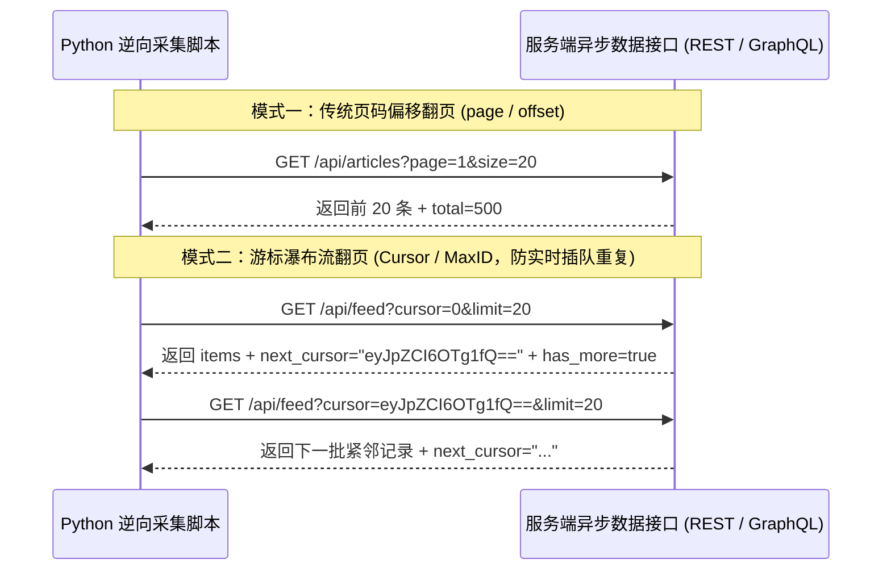
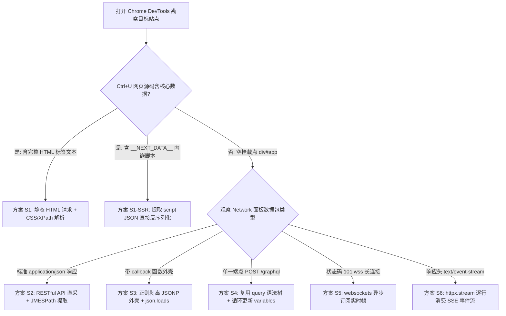

# 异步加载与Web接口逆向采集

## Summary

现代主流网站广泛采用前后端分离（SPA/CSR）架构，核心业务数据不再直接写入初始 HTML，而是通过异步 API 动态加载。本章深入对比服务端渲染（SSR）与客户端渲染（CSR），讲解如何利用 Chrome DevTools 的 XHR/Fetch 过滤器与全局关键字搜索快速定位隐藏的 JSON 数据接口。围绕页码/Offset 分页、Cursor 游标瀑布流分页、毫秒级时间戳、复杂 POST Payload、CORS 跨域、GraphQL 单端点查询以及 WebSocket/SSE 实时流数据展开实战，让学生掌握“绕过繁琐 DOM 解析、直取底层结构化 JSON”的高效采集范式。

## Concepts Covered

This chapter covers the following 20 concepts from the learning graph:

| Concept | Concept Impact Score |
|---------|-----------------------|
| 服务端渲染SSR与客户端渲染CSR架构 | 307 |
| AJAX异步JavaScript与XML通信原理 | 194 |
| XHR对象与Fetch现代异步API对比 | 112 |
| RESTful架构风格与Web接口设计 | 73 |
| JSON数据序列化格式与嵌套结构 | 71 |
| Python内置json模块与字典互转 | 63 |
| JSONPath与JMESPath深层数据抽取 | 1 |
| JSONP跨域回调原理与字符串剥离 | 1 |
| DevTools中XHR过滤器与接口快速定位 | 107 |
| DevTools全局搜索关键字反查API | 45 |
| URL查询参数页码与Offset分页逆向 | 54 |
| Cursor游标分页与瀑布流MaxID机制 | 2 |
| 时间戳参数Time与毫秒级构造 | 25 |
| 复杂POST请求Payload载荷逆向复向 | 18 |
| API自定义请求头X-Requested-With分析 | 1 |
| CORS跨域资源共享与Options预检请求 | 1 |
| GraphQL查询语言与单端点接口采集 | 1 |
| WebSocket全双工长连接实时数据抓取 | 2 |
| SSE服务端推送事件流数据采集 | 1 |
| 异步API直采与DOM解析工程选型评估 | 17 |

## Prerequisites

This chapter builds on concepts from:

- [Chapter 1: 网络爬虫导论与数据合规基石](../01-intro-and-ethics/index.md)
- [Chapter 2: Web前端基石与HTTP通信原理](../02-web-and-http-fundamentals/index.md)
- [Chapter 3: Python网络请求核心编程](../03-python-http-requests/index.md)
- [Chapter 4: 静态网页结构化解析与正则提取](../04-static-html-parsing/index.md)

---

## 1. 现代Web渲染架构演进与异步通信基石

在前四章中，我们建立了一套清晰的静态网页采集工作流：向目标网址发送 HTTP 请求 $\rightarrow$ 获取完整的 HTML 文本 $\rightarrow$ 使用 CSS 选择器或 XPath 从 DOM 树中提取文字。然而，当你满怀信心地将这套代码应用到主流电商平台、短视频信息流、社交评论区或大模型开源排行榜时，往往会遭遇一个令人困惑的现象：**在 Chrome 浏览器里明明能看到满屏的商品价格和用户评论，用 `F12` 元素检查器（Elements）也能点中对应的 `<div>` 标签，但用 Python 的 `requests` 或 `httpx` 请求回来的 `response.text` 里却空空如也，只剩下一行孤零零的 `<div id="app"></div>` 和几个 `<script>` 标签。**

为什么浏览器看得到数据，而你的爬虫却抓不到？要彻底解开这个谜团，并且化劣势为优势——掌握比解析 HTML 快上十倍的**“Web 接口直采（API Scraping）”**绝技，我们必须先从现代 Web 前端架构的根本性演进讲起。

### 1.1 服务端渲染SSR与客户端渲染CSR架构

在 Web 技术发展的不同阶段，网页数据的组装位置经历了从“服务器端”向“浏览器客户端”的重大迁移，由此形成了两种截然不同的架构模式：**服务端渲染SSR与客户端渲染CSR架构（Server-Side Rendering vs. Client-Side Rendering）**。

1. **服务端渲染（SSR, Server-Side Rendering）**  
   在传统的 Web 开发模式（如早期的 PHP、JSP、Django 模板或现代 Next.js/Nuxt.js 的 SSR 模式）中，当浏览器向服务器请求 `https://news.example.edu/list` 时，Web 服务器会在后台直接查询数据库，将查询出的 20 条新闻标题、发布时间和正文摘要直接填入 HTML 模板的 `<li>` 和 `<p>` 标签中，拼装成一份**包含完整业务数据的成品 HTML 文档**返回给客户端。  
   **爬虫视角**：对于 SSR 页面，初次 HTTP 响应的 `View Page Source`（右键“查看网页源代码”）与 `Inspect`（F12“检查”面板中的实时 DOM 树）几乎完全一致。这是第 4 章静态 DOM 解析器（BeautifulSoup、parsel）的天然主场。

2. **客户端渲染（CSR, Client-Side Rendering）与单页应用（SPA）**  
   随着 Vue.js、React、Angular 等现代前端框架的普及，工业界广泛转向了**前后端分离（Frontend-Backend Separation）**架构。在这种模式下，当用户首次访问网址时，服务器返回的初始 HTML 只是一个不包含任何具体业务数据的**“空壳骨架（HTML Skeleton）”**（通常只有 `<div id="app"></div>`）以及打包好的 JavaScript 应用脚本（如 `app.bundle.js`）。随后，浏览器执行这段 JS 脚本，在后台悄悄向后端的数据接口（API）发起二次异步网络请求；后端 API 直接返回纯结构化的 **JSON 数据**；最后，前端 JS 引擎在浏览器内存中动态创建 DOM 节点，把 JSON 里的商品标题和价格“挂载（Mount）”到页面上呈现给用户。  
   **爬虫视角**：在 CSR 架构下，`requests.get(url)` 拿到的只是第 1 步那个还没有执行 JS 的空壳 HTML！但请换个角度思考：既然浏览器也是通过向后端某个 API 网址请求 JSON 数据才拿到内容的，**如果我们能直接找到那个隐藏的 API 网址，用 Python 直接请求该 API，岂不是连复杂的 HTML 标签都不用解析，直接就能拿到最干净、最标准的 JSON 字典？** 这正是本章“Web 接口逆向采集”的核心指导思想。

!!! tip "3 秒快速鉴别网页是 SSR 还是 CSR"
    在浏览器中打开目标网页，按快捷键 `Ctrl + U`（Windows）或右键选择**“查看网页源代码（View Page Source）”**，然后按 `Ctrl + F` 搜索页面上肉眼可见的某条具体数据（如某件商品的名称 `"RTX 4090"` 或某条评论文字）：

    - **如果能搜到**：说明数据直接包含在初始 HTML 响应中，属于 **SSR（或静态内联 JSON）**，可直接用第 3、4 章的方法抓取。
    - **如果搜不到（只有 `<div id="app"></div>`）**：说明数据是由后续 JavaScript 异步加载渲染的，属于 **CSR 动态页面**，应立即打开 DevTools 网络面板寻找异步 API 接口。

### 1.2 AJAX异步通信原理与XHR/Fetch现代API对比

支撑客户端渲染（CSR）在后台静默拉取数据的核心技术，便是 **AJAX异步JavaScript与XML通信原理（Asynchronous JavaScript and XML）**。在 AJAX 出现之前，网页要想获取新数据（比如翻到评论区第 2 页），必须重新刷新整个浏览器页面，导致屏幕闪烁并浪费大量带宽重复下载相同的导航栏与样式表。AJAX 的革命性在于：**它允许浏览器中的 JavaScript 脚本在不刷新当前页面的前提下，在后台异步向服务器发送 HTTP 请求并接收响应数据，随后仅对网页的局部 DOM 区域进行无缝更新。** 尽管早期的名字里带有“XML”，但在现代 Web 工程中，AJAX 传输的数据格式已经 99% 被更轻量、更易解析的 **JSON** 所取代。

在浏览器底层，JavaScript 发起 AJAX 异步请求主要依赖两代标准接口：**XHR对象与Fetch现代异步API对比（XMLHttpRequest vs. Fetch API）**：

- **第一代标准：`XMLHttpRequest`（简称 XHR）**  
  自 IE5 时代引入并沿用至今的经典异步通信对象。它采用基于事件回调（Event Callbacks，如 `xhr.onreadystatechange`）的编程模型。主流第三方网络库 **Axios**（Vue/React 项目中最常用的请求库）以及早期的 `jQuery.ajax` 底层封装的都是 `XMLHttpRequest` 对象。
- **第二代标准：`Fetch API`（现代原生异步接口）**  
  HTML5 与 ES6 时代推出的现代替代方案，直接挂载在全局 `window.fetch()` 函数上。它原生基于 `Promise` 与 `async/await` 语法设计，支持流式响应读取（`ReadableStream`），代码更加简洁，且默认在跨域请求中采用更严格的凭证控制策略。

对于爬虫工程师而言，虽然我们不需要手写前端页面，但理解 XHR 与 Fetch 的区别有两个直接的实战价值：第一，在 Chrome 开发者工具（DevTools）的 Network 面板中，这两类请求都被归类在 **`Fetch/XHR`** 过滤标签下；第二，后续在第 7 章进行 JavaScript 逆向调试（如 Hook 拦截加密参数或下 XHR 断点）时，必须清楚目标网站底层调用的究竟是 `XMLHttpRequest.prototype.send` 还是 `window.fetch`。

### 1.3 RESTful架构风格与Web接口设计

当前后端分离成为主流后，后端工程师如何规范地设计成百上千个数据接口？工业界普遍遵循由 Roy Fielding 提出的 **RESTful架构风格与Web接口设计（Representational State Transfer）**。RESTful 的核心哲学是**“万物皆资源（Resources），用 URL 定位资源名词，用 HTTP 请求方法（Verbs）表达对资源的操作动作”**：

1. **资源路径语义化（使用复数名词而非动词）**：接口 URL 通常包含统一的前缀与版本号，例如 `/api/v1/courses` 代表课程资源集合，`/api/v1/courses/105` 代表编号为 `105` 的单门课程，`/api/v1/courses/105/reviews` 代表该课程下的评价列表。
2. **HTTP 方法映射 CRUD 操作**：
   - `GET`：查询/获取资源（爬虫 80% 以上的列表与详情采集均针对 `GET` 接口）；
   - `POST`：新建资源，或在复杂多条件筛选、加密参数传输时作为查询载体（爬虫中剩余 20% 的搜索与分页接口采用 `POST`）；
   - `PUT` / `PATCH`：全量替换或局部更新资源；
   - `DELETE`：删除资源。
3. **无状态通信与标准响应结构**：每次请求都包含服务器理解该请求所需的全部信息（如分页参数、身份 Token），响应体通常采用统一的 JSON 包装信封格式，例如 `{"code": 200, "message": "success", "data": {...}}`。

熟悉 RESTful 命名规律后，爬虫工程师常常能实现“举一反三”：当你抓包发现某门课程详情的接口是 `GET https://api.example.edu/v2/courses/1001` 时，无需回到列表页点击，只需在循环中改变末尾的资源 ID（`1001`、`1002`、`1003`...），或者尝试访问 `GET https://api.example.edu/v2/courses?page=1&size=50`，往往就能直接批量拉取整个数据库表！

下表汇总对比了 SSR 与 CSR 渲染模式以及 XHR 与 Fetch 异步通信机制的核心技术特征：

| 对比维度 | 服务端渲染 (SSR) | 客户端渲染 (CSR / SPA) | XHR (`XMLHttpRequest`) | 现代 `Fetch API` |
|---|---|---|---|---|
| **核心工作原理** | 服务器将数据库数据填入 HTML 模板，返回完整成品网页 | 服务器仅返回空壳 HTML 与 JS，由浏览器异步请求 API 并动态挂载 DOM | 基于事件监听对象（`onload`/`onerror`）发起异步 HTTP 请求 | 基于 ES6 `Promise` 与 `ReadableStream` 的现代原生异步函数 |
| **`Ctrl+U` 网页源码** | **包含**完整的业务文字与标签结构 | **不包含**业务数据，仅有 `<div id="app"></div>` 等挂载点 | 不适用（运行于 JS 内存） | 不适用（运行于 JS 内存） |
| **最佳爬虫采集策略** | 直接请求网页 URL + CSS/XPath 静态 DOM 解析 | **逆向定位底层 JSON API 接口**，用 `httpx` 直接请求 JSON | 在 DevTools 勾选 `Fetch/XHR` 过滤；可通过 `XHR Breakpoints` 断点拦截 | 在 DevTools 勾选 `Fetch/XHR` 过滤；可通过重写 `window.fetch` 进行 Hook |
| **数据结构化程度** | 低（数据散落在复杂的 HTML 视觉标签与样式类中） | **极高**（后端 API 直接返回类型明确的 JSON 键值字典） | 响应体通常通过 `xhr.responseText` 或 `JSON.parse()` 读取 | 响应体通过 `await response.json()` 异步解析为对象 |

---

## 2. JSON/JSONP序列化解析与深层路径抽取

一旦我们绕过表层的 HTML 页面，直接对接网站的后端 API，服务器返回给我们的将不再是满篇尖括号的 HTML，而是结构严谨的数据序列化文本。熟练处理 JSON、JSONP 以及多层嵌套字典的高效抽取，是接口采集的基本功。

### 2.1 JSON数据序列化格式与Python内置json模块

**JSON数据序列化格式与嵌套结构（JavaScript Object Notation）** 是目前全互联网 API 通信与大模型训练数据集（如 `.json` 与 `.jsonl`）的事实标准。JSON 是一种完全独立于编程语言的轻量级纯文本数据交换格式，仅由两种基本结构组合而成：**对象（Object，用花括号 `{}` 包裹的无序键值对集合）**与**数组（Array，用方括号 `[]` 包裹的有序值列表）**。

在编写爬虫解析 JSON 时，务必牢记 **JSON 规范与 Python 字典字面量的四处关键语法差异**（这也是为什么不能直接用 Python 的 `eval()` 去解析 JSON 字符串的原因）：

1. **键名与字符串必须使用双引号 `"`**：JSON 标准中严禁使用单引号 `'` 包裹键名或字符串，且对象或数组的最后一个元素后面**绝不能有多余的尾随逗号（Trailing Comma）**。
2. **布尔值小写**：JSON 中使用小写的 `true` 和 `false`，对应 Python 中的首字母大写 `True` 和 `False`。
3. **空值表示**：JSON 中使用 `null` 表示空值，对应 Python 中的 `None`。
4. **注释限制**：标准 JSON 格式不支持任何 `//` 或 `#` 注释。

在 Python 中，我们通过**Python内置json模块与字典互转**来实现 JSON 文本与原生数据结构（`dict`/`list`）之间的双向转换，以及使用 HTTP 客户端自带的 `.json()` 快捷方法：

- **`json.loads(s: str) -> dict | list`**（Load String，反序列化）：将网络响应返回的 JSON 格式**字符串**解析为 Python 内存中的字典或列表。在 `requests` 或 `httpx` 中，调用 `response.json()` 底层自动执行的就是 `json.loads(response.text)`。
- **`json.dumps(obj, ensure_ascii=False, indent=2) -> str`**（Dump String，序列化）：将 Python 字典或列表转换为 JSON 格式**字符串**。注意：**在保存中文语料时，必须设置 `ensure_ascii=False`**，否则所有中文字符都会被转义为难以阅读的 `\u4e2d\u6587` Unicode 编码！
- **`json.load(fp)` 与 `json.dump(obj, fp, ensure_ascii=False)`**：直接针对打开的文件句柄 `fp` 进行读取或写入。

### 2.2 JSONPath与JMESPath深层数据抽取

真实的工业级 API（例如微博动态接口、淘宝商品详情接口或 GraphQL 响应）返回的 JSON 往往具有极深的嵌套层级（动辄 6~10 层 `{ "data": { "result": { "cards": [ { "mblog": { "user": { "screen_name": "..." } } } ] } } }`）。如果完全使用 Python 原生的 `data["data"]["result"]["cards"][0]["mblog"]["user"]["screen_name"]` 逐层硬编码取值，只要某一条记录中间缺少某个键或者值为 `None`，程序就会立刻抛出 `KeyError` 或 `TypeError: 'NoneType' object is not subscriptable` 导致爬虫中断。

为了优雅、安全地从深层嵌套 JSON 中批量提取字段（就像用 XPath 提取 HTML 一样），工程界广泛采用**JSONPath与JMESPath深层数据抽取**技术。其中，**JMESPath**（需安装 `pip install jmespath`，也是 AWS CLI 等工业级工具内置的 JSON 查询语言）语法极为精炼且天然具备空值安全保护——当路径上的某个键不存在时，它会平缓地返回 `None` 而不会抛出异常崩溃：

- **点号链式取值**：`data.course.instructor.name` 直接穿透多层字典；
- **列表切片与通配符投影（`[*]`）**：`data.items[*].title` 会自动遍历 `items` 数组中的每一个字典，提取出所有元素的 `title` 字段并组装为一个扁平的 Python 列表；
- **条件过滤表达式（`[?condition]`）**：`data.items[?price < `100`].title` 可以直接在抽取阶段过滤出价格低于 100 元的商品标题（注意字面量数值在 JMESPath 中用反引号 `` `100` `` 包裹，字符串用单引号 `'AI'` 包裹）；
- **多字段重塑字典（MultiSelect Hash）**：`data.items[*].{id: item_id, name: title, author: user.nickname}` 能够在一次查询中把深层异构的 JSON 直接拍平（Flatten）为我们所需的标准字典列表！

### 2.3 JSONP跨域回调原理与字符串剥离

在采集一些历史悠久的门户网站（如部分财经行情接口、早期政务查询系统、百度搜索建议词接口或新浪/东方财富的部分老接口）时，你常常会看到接口响应并不是以 `{` 开头的纯 JSON，而是长成下面这副模样：

```javascript
jQuery1124089234789_1729400000123({"code": 0, "msg": "ok", "items": [{"symbol": "SH600519", "price": 1528.50}]});
```

这种格式如果直接调用 `response.json()`，必然会触发 `json.decoder.JSONDecodeError: Expecting value: line 1 column 1 (char 0)` 错误。这就是经典的 **JSONP跨域回调原理与字符串剥离（JSON with Padding）**。

- **为什么会有 JSONP？** 在现代 CORS 跨域标准普及之前，浏览器的“同源策略（Same-Origin Policy）”严禁网页通过 `XMLHttpRequest` 请求不同域名下的接口，但却允许 `<script src="https://api.other.com/quote?callback=myFunc">` 标签跨域加载 JavaScript 脚本。于是前后端约定：前端在 URL 参数里传一个回调函数名（如 `callback=jQuery123`），后端把真正的 JSON 数据作为参数塞进这个函数调用括号里返回（即 `jQuery123({...});`），浏览器加载后便会自动执行该函数拿到数据。
- **爬虫如何破解与剥离 JSONP？** 爬虫不是浏览器，根本不需要执行什么 JS 回调函数！我们有两种处理方案：
  1. **首选技巧**：直接尝试删掉 URL 查询参数里的 `callback=xxx`（或将其改为空），部分后端接口就会自动退化为返回纯净的 JSON；
  2. **通用剥离技巧**：使用正则表达式 `re.search(r"^[^(]*?\((.*)\)[^)]*$", text, re.DOTALL)` 或字符串 `.find("(")` 与 `.rfind(")")` 定位最外层括号，精准剥离掉头部的函数名和尾部的 `);`，再将中间包裹的纯净 JSON 字符串交给 `json.loads()` 解析。

下面这段完整可运行的 Python 代码综合演示了“剥离 JSONP 包装外壳”、“使用内置 `json` 模块反序列化”以及“利用 `jmespath` 从复杂多层嵌套的 AI 论文接口数据中一次性提取并拍平目标字段”的标准工程实现。在代码中，`strip_jsonp` 函数负责安全提取括号内的 JSON 主体，`extract_papers_with_jmespath` 则展示了列表投影与条件过滤的威力：

```python
import json
import re
from typing import Any
import jmespath  # 需安装: pip install jmespath

# 模拟从某学术门户采集到的带 JSONP 回调外壳的深层嵌套响应文本
RAW_JSONP_RESPONSE = """/**/callback_jsonp_1729412000({
    "status": 200,
    "meta": {"request_id": "req-9981", "total_count": 3},
    "data": {
        "feed": {
            "papers": [
                {
                    "paper_id": "arXiv:2601.00101",
                    "title": "DeepSeek-R2: Scaling Reinforcement Learning for Reasoning",
                    "metrics": {"citations": 420, "is_open_access": true},
                    "authors": [{"name": "Liang W.", "org": "DeepSeek"}, {"name": "Chen Z.", "org": "PKU"}]
                },
                {
                    "paper_id": "arXiv:2601.00205",
                    "title": "Legacy Rule-Based Web Scraper without LLM",
                    "metrics": {"citations": 12, "is_open_access": false},
                    "authors": [{"name": "Smith J.", "org": "LabX"}]
                },
                {
                    "paper_id": "arXiv:2601.00319",
                    "title": "Autonomous Browser Agents with Multimodal Vision",
                    "metrics": {"citations": 185, "is_open_access": true},
                    "authors": [{"name": "Zhang Y.", "org": "Tsinghua"}]
                }
            ]
        }
    }
});"""


def strip_jsonp(raw_text: str) -> dict[str, Any]:
    """安全剥离 JSONP 回调函数外壳并反序列化为 Python 字典"""
    cleaned = raw_text.strip()
    # 如果已经是标准 JSON 对象或数组，直接解析
    if cleaned.startswith(("{", "[")):
        return json.loads(cleaned)

    # 匹配最外层左括号 '(' 到最后一个右括号 ')' 之间的 JSON 主体
    match = re.search(r"^[^(]*?\((.*)\)[^)]*$", cleaned, flags=re.DOTALL)
    if not match:
        raise ValueError("无法从响应文本中识别合法的 JSON 或 JSONP 结构")
    json_body = match.group(1).strip()
    return json.loads(json_body)


def extract_papers_with_jmespath(payload: dict[str, Any]) -> dict[str, Any]:
    """使用 JMESPath 从深层嵌套字典中执行投影、拍平与条件过滤"""
    # 1. 提取所有论文并重塑为扁平字典结构（自动取第一作者姓名 authors[0].name）
    flatten_expr = (
        "data.feed.papers[*].{"
        "id: paper_id, "
        "title: title, "
        "first_author: authors[0].name, "
        "citations: metrics.citations"
        "}"
    )
    all_papers = jmespath.search(flatten_expr, payload)

    # 2. 条件过滤：仅提取开源 (is_open_access == true) 且引用量 >= 100 的高影响力论文标题
    high_impact_expr = (
        "data.feed.papers[?metrics.is_open_access == `true` && metrics.citations >= `100`].title"
    )
    high_impact_titles = jmespath.search(high_impact_expr, payload)

    return {
        "flattened_records": all_papers,
        "high_impact_open_papers": high_impact_titles,
    }


if __name__ == "__main__":
    parsed_dict = strip_jsonp(RAW_JSONP_RESPONSE)
    result = extract_papers_with_jmespath(parsed_dict)

    print("=== 1. JMESPath 拍平后的结构化数据集 ===")
    print(json.dumps(result["flattened_records"], ensure_ascii=False, indent=2))

    print("\n=== 2. 筛选出的高引开源论文标题 ===")
    for idx, title in enumerate(result["high_impact_open_papers"], start=1):
        print(f"  [{idx}] {title}")
```

---

## 3. Chrome DevTools接口逆向定位与分页规律破解

知道了 CSR 网页的数据来自后台 JSON 接口，接下来的核心工程问题是：**打开一个拥有上百个网络请求的复杂网页，如何像侦探一样在 30 秒内精准揪出真正承载业务数据的那个 API 请求，并破解它的翻页与参数构造规律？**

### 3.1 DevTools中XHR过滤器与全局搜索关键字反查API

在 Chrome 或 Edge 浏览器中按 `F12` 打开开发者工具并切换到 **`Network`（网络）** 面板，这是爬虫工程师最核心的逆向作战室。熟练结合 **DevTools中XHR过滤器与接口快速定位** 与 **DevTools全局搜索关键字反查API**，可以解决 95% 的接口寻址问题：

1. **第一招：勾选 `Fetch/XHR` 过滤器 + 触发交互（顺藤摸瓜法）**  
   - 打开 `Network` 面板，确认左上角录制按钮为红色亮起状态，勾选 **`Preserve log`（保留日志）** 防止页面跳转清空记录。
   - 在过滤栏中点击 **`Fetch/XHR`**（立刻过滤掉占总数 80% 以上的图片 `Img`、样式表 `CSS`、字体 `Font` 等无关噪音）。
   - 点击左上角的 🚫（`Clear network log`）清空现有列表，然后在网页上点击“下一页”、“加载更多”或切换筛选分类。此时 `Network` 面板中刚刚新跳出来的 1~3 个请求，几乎 100% 就是我们要找的目标数据接口！点击该请求，切换到右侧的 **`Preview`（预览）** 标签页，即可直观展开树状 JSON 验证数据。
2. **第二招：使用全局搜索 `Ctrl + Shift + F` 反查关键字（以果推因法）**  
   有时候网站在首屏加载时一次性发起了四五十个 XHR 请求，或者数据根本不是通过常规命名的接口返回的，挨个点开 `Preview` 查看犹如大海捞针。此时应当使用**全局响应内容反查法**：
   - 在网页上复制一段极具辨识度的具体文字（例如某件商品的独特型号 `"A100-SXM4-80GB"` 或某位用户的昵称）；
   - 将鼠标焦点放在 `Network` 面板内部，按下快捷键 **`Ctrl + Shift + F`**（Mac 为 `Cmd + Option + F`）唤出左侧的 **`Search`（网络全局搜索）** 侧边栏；
   - 粘贴刚才复制的关键字并回车。DevTools 会瞬间扫描所有已捕获请求的响应体（Response Body），并直接列出包含该文字的请求名称及所在行号！点击匹配结果，即可一键跳转到对应的 API 请求。
3. **第三招：一键生成 Python 代码（`Copy as cURL`）**  
   定位到目标请求后，右键点击该请求 $\rightarrow$ **`Copy`** $\rightarrow$ **`Copy as cURL (bash)`**，即可将该请求的完整 URL、Method、所有 Request Headers、Cookie 以及 POST 请求体完整复制出来。你可以将其粘贴到开源转换工具（如 `curlconverter.com`）或直接对照编写 `httpx` 请求代码，快速验证哪个请求头或参数是必不可少的。

### 3.2 页码/Offset分页、Cursor游标瀑布流与毫秒级时间戳

找到了第 1 页的 API 接口只是第一步，要批量采集全量数据，必须逆向分析该接口的查询参数（Query String Parameters）或载荷规律。现代 Web API 的分页与防缓存参数主要分为三大模式：

1. **URL查询参数页码与Offset分页逆向（Page/Size vs. Offset/Limit）**  
   这是传统分页组件（底部带有 `1, 2, 3 ... 50` 页码按钮）最常用的两套数学映射模型：
   - **页码模式（`page` + `page_size`/`size`/`per_page`）**：直接指定第几页和每页条数，例如 `?page=1&size=20`、`?page=2&size=20`。
   - **偏移量模式（`offset`/`start` + `limit`/`count`）**：直接对应底层 SQL 数据库的 `LIMIT <limit> OFFSET <offset>` 语句，表示“跳过前 `offset` 条记录，向后取 `limit` 条记录”。假设每页固定返回 $L = 20$ 条数据，那么第 $p$ 页（$p \ge 1$）的起始偏移量计算公式严格满足：
     \[ \text{offset} = (p - 1) \times L \]
     因此，第 1 页为 `offset=0&limit=20`，第 2 页为 `offset=20&limit=20`，第 3 页为 `offset=40&limit=20`。  
   **实战提速技巧**：许多后端接口默认 `limit=10` 或 `size=20`，但并未在服务端严格锁死上限。在爬虫中你可以尝试将 `limit` 调大到 `50` 或 `100`（如 `?offset=0&limit=100`），如果服务器正常返回了 100 条记录，你的采集请求次数就能直接减少 80%！

2. **Cursor游标分页与瀑布流MaxID机制（Cursor / MaxID / NextToken Pagination）**  
   为什么刷抖音、小红书、微博、知乎或 X（Twitter）时，页面底部没有“第 1 页、第 2 页”的按钮，而是采用无限向下滚动的“瀑布流（Infinite Feed）”？  
   因为在每秒都有成百上千条新内容发布的实时高并发系统中，如果使用传统的 `offset` 分页，当你正在看第 1 页（前 20 条）的短短 5 秒钟内，数据库顶部又新插入了 5 条新动态；此时你请求第 2 页（`offset=20`），原本排在第 16~20 名的 5 条旧动态就会被挤到第 21~25 名，导致你在第 2 页**重复抓取到刚才已经看过的 5 条数据（数据漂移）**，而且当 `offset` 达到百万级时，数据库执行深分页扫描（`OFFSET 1000000`）性能极差。  
   为了解决深分页性能与数据漂移问题，现代信息流 API 全面采用 **Cursor 游标分页（或 `max_id` / `next_cursor` / `search_after` 机制）**：
   - **核心原理**：第 1 次请求时不传游标（或传 `cursor=0`）；服务器返回前 20 条数据的同时，会在响应 JSON 的顶层元数据中附带一个指向本页最后一条记录位置的游标令牌（例如 `"next_cursor": "1729410882_99182"`、`"max_id": "5089123456"`，或者直接取 `data.items[-1].id`）以及一个布尔标志 `"has_more": true`。
   - **链式推进规则**：爬虫必须采用 `while has_more:` 循环，**从上一页的 JSON 响应中提取出 `next_cursor`，并将其作为下一页请求的参数发回给服务器**，直到响应中的 `has_more` 变为 `false` 或 `next_cursor` 为空为止。这意味着游标分页必须前后串联执行，无法像 `offset` 分页那样预先生成 100 个 URL 并发抓取。

3. **时间戳参数Time与毫秒级构造（Unix Timestamp Parameters）**  
   在观察 API 的 URL 或请求头时，你经常会看到名为 `_t`、`ts`、`timestamp`、`t` 或 `_` 的一串 10 位或 13 位纯数字参数。这是从 **UTC 时间 1970 年 1 月 1 日 00:00:00（Unix 纪元）** 起经过的秒数或毫秒数，在接口中主要承担两大作用：一是防止浏览器或 CDN 缓存旧响应（Cache Busting），二是作为接口防重放攻击（Anti-Replay）的时效性校验基准（若请求时间戳与服务器当前时间相差超过 60 秒则直接拒绝请求）。在 Python 中构造这两种时间戳的标准公式如下：
   - **10 位秒级时间戳（Seconds）**：`int(time.time())`，例如 `1729412000`；
   - **13 位毫秒级时间戳（Milliseconds，JavaScript `Date.now()` 标准格式）**：`int(time.time() * 1000)`，例如 `1729412000123`。

### 3.3 复杂POST载荷、X-Requested-With与CORS跨域预检

除了 `GET` 查询参数，许多企业级搜索接口（如政府采购招标网、裁判文书检索、机票酒店多条件筛选）采用 `POST` 请求提交复杂的筛选条件，并在请求头与跨域机制上设下校验关卡：

1. **复杂POST请求Payload载荷逆向复现**  
   在 DevTools 的 `Payload`（载荷）面板中查看 `POST` 请求时，务必先看 `Headers` 里的 `Content-Type`，以此决定在 `httpx` 中使用 **`data=`** 还是 **`json=`** 参数：
   - 若 `Content-Type: application/x-www-form-urlencoded`，在 DevTools 中显示为 `Form Data`，代表键值对被编码为 `keyword=AI&page=1&sort=desc`，在 Python 中必须传入 **`data=payload_dict`**；
   - 若 `Content-Type: application/json`，在 DevTools 中显示为 `Request Payload`（可展开的 JSON 对象，常包含嵌套的过滤数组如 `{"filters": [{"field": "category", "values": ["LLM", "CV"]}], "page": {"num": 1, "size": 20}}`），在 Python 中必须传入 **`json=payload_dict`**，由 `httpx` 自动完成 JSON 序列化并附上正确的 `Content-Type` 头。
2. **API自定义请求头X-Requested-With分析**  
   很多时候你明明复制了正确的 URL 和参数，但服务器却返回了一段 HTML 错误页或 `403 Forbidden`。此时请仔细检查请求头中是否包含：
   ```http
   X-Requested-With: XMLHttpRequest
   ```
   这是 jQuery 等前端框架在发起 AJAX 请求时自动附加的标志性自定义请求头。许多传统后端框架（如 Django、Spring MVC、ThinkPHP）会通过检查 `request.headers.get("X-Requested-With") == "XMLHttpRequest"` 来判断当前请求究竟是普通的浏览器地址栏访问还是合法的前端 AJAX 调用。在爬虫的 `headers` 字典中补上这一行，往往就能瞬间通关！同时，请务必一并带上 `Referer`（标明该 API 是从哪个前端页面发起的）和 `Origin` 请求头。
3. **CORS跨域资源共享与Options预检请求（Cross-Origin Resource Sharing & Preflight）**  
   当网页前端域名为 `https://www.shop.com`，而它请求的 API 域名为 `https://api.shop.com` 时，两者主机名不同，构成了**跨域请求（Cross-Origin Request）**。当浏览器发起带有自定义请求头（如 `Authorization`、`X-Sign`）或 `Content-Type: application/json` 的跨域请求时，你在 DevTools 的 `Network` 面板中常常会看到**同一个 URL 连续出现了两条一模一样的请求**：
   - 第一条请求的 Method 是 **`OPTIONS`**，状态码为 `204 No Content`，没有任何返回数据；
   - 第二条请求的 Method 才是真正的 **`POST` 或 `GET`**，携带着完整的 JSON 响应。  
   **核心原理解析**：第一条 `OPTIONS` 请求是浏览器为了遵守安全规范自动发出的**“CORS 预检请求（Preflight Request）”**，用来询问服务器：“我来自 `https://www.shop.com`，能否向你发送带有 `application/json` 的跨域请求？”服务器在响应头中返回 `Access-Control-Allow-Origin: https://www.shop.com` 表示允许后，浏览器才会发出第二条真正的业务请求。  
   **爬虫避坑指南**：**同源策略（Same-Origin Policy）与 CORS 预检完全是浏览器为了保护用户安全而实施的客户端自我限制！** 我们的 Python 爬虫直接运行在操作系统套接字之上，不受浏览器同源策略约束。因此，**在编写爬虫时，完全忽略 DevTools 里的 `OPTIONS` 预检请求，只针对第二条真正的 `GET`/`POST` 请求编写代码即可**（但有时需要在请求头中保留 `Origin: https://www.shop.com` 以通过后端的来源白名单校验）。

在阅读下方的 Python 实战代码之前，我们先通过一个交互式分页仿真器，直观对比 `Offset/Limit` 偏移量分页与 `Cursor/MaxID` 瀑布流游标分页在请求参数构造上的核心差异。

#### Diagram: API Pagination Reverse Engineering Simulator



<details markdown="1">
<summary>API Pagination Reverse Engineering Simulator</summary>
Type: microsim
**sim-id:** api-pagination-simulator<br/>
**Library:** p5.js<br/>
**Status:** Specified<br/>
**Bloom Level:** Apply<br/>
**Bloom Verb:** construct<br/>
**Learning Objective:** The learner will construct the exact query parameters (`offset`, `limit`, and `cursor`) required to fetch consecutive pages across both Offset/Limit pagination and Cursor-based waterfall pagination APIs.

**Prerequisites:** Query string parameters, Offset/Limit pagination formula ($\text{offset} = (p - 1) \times L$), Cursor/MaxID waterfall pagination (`next_cursor`, `has_more`), 13-digit millisecond timestamp (all defined in Section 3.2 above).

**Evidence of Mastery:** Across 4 pagination construction challenges (2 in Offset/Limit mode and 2 in Cursor/MaxID waterfall mode), the learner inputs or selects the exact parameter values for the next HTTP API request based on the target page number or the previous JSON response envelope. Mastery is solving at least 3 of the 4 challenges correctly on the first attempt.

**Misconceptions:** (1) In Offset/Limit pagination with `limit=20`, Page 1 starts at `offset=1` and Page 3 starts at `offset=3` instead of `offset=0` and `offset=40`. (2) In Cursor waterfall pagination, the client can jump directly to Page 4 by multiplying the first cursor by 4 instead of reading `next_cursor` from the previous JSON response.

**Instructional Rationale:** Apply-level parameter construction requires learners to calculate numeric offsets from page numbers and extract dynamic cursor tokens from realistic JSON response envelopes before firing the simulated API request.

**Content:**

Adjustable exploration parameters in Offset Mode:
| Quantity | Min | Max | Step | Default | Unit |
|---|---|---|---|---|---|
| Target Page `p` | 1 | 10 | 1 | 1 | page |
| Page Size `limit` (`L`) | 10 | 50 | 10 | 20 | items |

Total dataset size in simulator database: 75 AI open-source project records (IDs `proj_1001` through `proj_1075`).

The 4 pagination construction challenges (fixed order):

| # | Mode | Scenario & Previous Response Context Shown to Learner | Correct Request Parameters | Feedback & Explanation (Why) |
|---|---|---|---|---|
| 1 | `Offset/Limit` | 采集第 1 页数据，每页条数 `limit = 20`。请构造第 1 页的 `offset` 与 `limit` 参数。 | `offset=0&limit=20` | 根据公式 $\text{offset} = (p - 1) \times L$，当 $p = 1, L = 20$ 时，$\text{offset} = (1 - 1) \times 20 = 0$（从第 0 条偏移即第 1 条记录开始读取）。 |
| 2 | `Offset/Limit` | 保持每页条数 `limit = 20` 不变，现在需要直接采集第 3 页（即第 41~60 条记录）。请构造 `offset` 与 `limit` 参数。 | `offset=40&limit=20` | 当 $p = 3, L = 20$ 时，$\text{offset} = (3 - 1) \times 20 = 40$，跳过前两页共 40 条记录。 |
| 3 | `Cursor/MaxID` | 瀑布流第 1 页响应返回：`{"has_more": true, "next_cursor": "cur_1020_ts17294100", "items": [{"id": "proj_1001"}, ..., {"id": "proj_1020"}]}`。请构造获取下一批瀑布流数据的 `cursor` 参数。 | `cursor=cur_1020_ts17294100` | 游标分页不按页码数字递增，必须从上一页 JSON 响应的 `next_cursor` 字段中原样提取游标令牌传入下一次请求。 |
| 4 | `Cursor/MaxID` | 瀑布流连续抓取到最后一批时，服务器返回：`{"has_more": false, "next_cursor": "", "items": [{"id": "proj_1061"}, ..., {"id": "proj_1075"}]}`。此时爬虫应当执行什么动作？ | `STOP_CRAWLING` (`停止循环，分页已全部采集完毕`) | 当响应中的 `has_more` 为 `false` 且 `next_cursor` 为空字符串时，代表已到达瀑布流底部，继续请求将导致死循环或报错。 |

**Provenance:** Matches the Offset formula $\text{offset} = (p - 1) \times L$ and Cursor waterfall state machine defined in Chapter 5 Section 3.2.

**Rules:** In Offset Mode, `offset = (p - 1) * L`, returning records from index `offset + 1` to `min(offset + L, 75)`. When `offset >= 75`, the returned `items` array is empty `[]`. In Cursor Mode, each response returns 20 records, `next_cursor` is the token of the last record in the batch, and `has_more` is `true` when remaining records `> 0` and `false` when remaining records `== 0`.

**Learner Activity:**

1. The learner reads Challenge 1 and Challenge 2 in Offset/Limit mode, sets `offset` and `limit`, and clicks `发送 API 请求 (Send Request)` to inspect the returned record slice.
2. The learner transitions to Challenge 3 and Challenge 4 in Cursor waterfall mode, inspects the previous JSON response panel, and selects the next `cursor` parameter or loop termination action.
3. After completing all 4 challenges, the learner can freely adjust `p` (1 to 10) and `limit` (10 to 50) to observe how increasing `limit` from 20 to 50 reduces total HTTP requests needed to cover all 75 records from 4 requests down to 2 requests.

**Feedback:** 4 challenges in fixed order, 2 attempts per challenge. Correct: "参数构造正确！服务器成功返回对应批次的 JSON 数据。" Incorrect: displays the `Feedback & Explanation (Why)` text from the Content table above. After the second wrong attempt, the correct parameter string is filled in and explained. Score counter shows `分页逆向挑战得分: n / 4`.

**Starting State:** Challenge 1 (`Offset/Limit` Mode, Target Page `p = 1`, `limit = 20`) is active with input fields for `offset` and `limit`, showing the prompt: "任务 1/4：目标数据库共有 75 条开源项目记录，每页取 20 条，请构造请求第 1 页数据的 offset 与 limit 参数。"

**Chapter Anchors:** Section 3.2 specifies the exact formula $\text{offset} = (p - 1) \times L$ with the sequence `offset=0&limit=20` (Page 1), `offset=20&limit=20` (Page 2), `offset=40&limit=20` (Page 3), and the `while has_more:` cursor loop using `next_cursor`.
</details>

下面这段 Python 代码展示了如何封装一个兼具 **`Offset/Limit` 分页**与 **`Cursor` 游标瀑布流分页**能力的工业级异步 API 采集器，并在请求中自动注入 13 位毫秒级时间戳 `_t`、自定义请求头 `X-Requested-With: XMLHttpRequest` 与复杂 JSON 筛选载荷：

```python
import time
from typing import Any
import httpx


def build_ajax_headers(origin_url: str, referer_url: str) -> dict[str, str]:
    """构造标准 AJAX 异步接口请求头，包含 X-Requested-With 与跨域来源标识"""
    return {
        "User-Agent": (
            "Mozilla/5.0 (Windows NT 10.0; Win64; x64) "
            "AppleWebKit/537.36 (KHTML, like Gecko) Chrome/130.0.0.0 Safari/537.36"
        ),
        "Accept": "application/json, text/plain, */*",
        "X-Requested-With": "XMLHttpRequest",  # 标识当前请求为前端 AJAX 异步调用
        "Origin": origin_url,
        "Referer": referer_url,
    }


def crawl_cursor_waterfall_mock() -> list[dict[str, Any]]:
    """
    演示基于 Cursor 游标与毫秒级时间戳的瀑布流 POST 接口连续采集逻辑
    (使用内置 Mock Transport 模拟服务端分页响应，可直接脱机运行)
    """
    # 模拟服务端数据库中的 3 批瀑布流数据
    mock_batches = {
        "init": {
            "code": 0,
            "has_more": True,
            "next_cursor": "cur_batch_2_8891",
            "items": [{"id": "post_101", "title": "大模型RAG切片策略对比"}, {"id": "post_102", "title": "vLLM推理加速实战"}],
        },
        "cur_batch_2_8891": {
            "code": 0,
            "has_more": True,
            "next_cursor": "cur_batch_3_9920",
            "items": [{"id": "post_103", "title": "JSONPath与JMESPath评测"}, {"id": "post_104", "title": "Playwright反检测指南"}],
        },
        "cur_batch_3_9920": {
            "code": 0,
            "has_more": False,
            "next_cursor": "",
            "items": [{"id": "post_105", "title": "Scrapy分布式Redis队列实践"}],
        },
    }

    def mock_api_handler(request: httpx.Request) -> httpx.Response:
        # 校验 X-Requested-With 请求头
        if request.headers.get("X-Requested-With") != "XMLHttpRequest":
            return httpx.Response(403, json={"code": 403, "msg": "Missing X-Requested-With header"})
        import json as _json

        body = _json.loads(request.content.decode("utf-8"))
        cursor_key = body.get("cursor") or "init"
        return httpx.Response(200, json=mock_batches.get(cursor_key, {"code": 404}))

    headers = build_ajax_headers("https://feed.example.edu", "https://feed.example.edu/explore")
    collected_items: list[dict[str, Any]] = []
    current_cursor: str = "init"
    has_more: bool = True
    batch_num: int = 0

    with httpx.Client(transport=httpx.MockTransport(mock_api_handler), headers=headers) as client:
        while has_more:
            batch_num += 1
            # 构造 13 位毫秒级时间戳参数
            ts_ms = int(time.time() * 1000)
            # 构造复杂 POST JSON Payload 载荷
            payload = {
                "cursor": current_cursor,
                "limit": 2,
                "filters": {"category": "AI_Engineering", "sort": "latest"},
                "_t": ts_ms,
            }

            resp = client.post(
                f"https://api.example.edu/v1/feed/stream?_t={ts_ms}",
                json=payload,  # 自动序列化为 application/json
            )
            resp.raise_for_status()
            data = resp.json()

            items = data.get("items", [])
            collected_items.extend(items)
            print(
                f"[第 {batch_num} 批] 时间戳 _t={ts_ms} | 传入游标={current_cursor!r} "
                f"-> 获取 {len(items)} 条数据 | 下一页游标={data.get('next_cursor')!r}"
            )

            # 更新游标与循环终止条件
            has_more = bool(data.get("has_more"))
            current_cursor = data.get("next_cursor", "")
            if not current_cursor:
                break

    return collected_items


if __name__ == "__main__":
    all_posts = crawl_cursor_waterfall_mock()
    print(f"\n✅ 瀑布流游标采集完成，共获取 {len(all_posts)} 条动态：")
    for post in all_posts:
        print(f"  - {post['id']}: {post['title']}")
```

---

## 4. 新一代接口协议：GraphQL、WebSocket与SSE流式采集

随着前端交互复杂度的提升和生成式 AI 应用的爆发，传统的 RESTful `GET/POST` 接口已不再是唯一的通信形态。在 GitHub、知乎、Shopify 等平台中广泛使用的 **GraphQL**，在金融行情、直播间弹幕中使用的 **WebSocket**，以及在 ChatGPT、DeepSeek 等大模型对话界面中逐字吐出回答的 **SSE（Server-Sent Events）**，构成了现代爬虫工程师必须掌握的三大新一代接口协议。

### 4.1 GraphQL查询语言与单端点接口采集

在传统 RESTful 架构中，获取一个用户的基本资料、他发布的文章列表以及每篇文章的前三条评论，往往需要连续请求 `/api/users/1`、`/api/users/1/posts` 等多个不同 URL 的接口，且每个接口都会返回几十个我们根本用不上的冗余字段（称为 Over-fetching）。

由 Meta（Facebook）开源的 **GraphQL查询语言与单端点接口采集** 彻底颠覆了这一模式：

1. **全站共享唯一端点（Single Endpoint）**：整个网站的所有数据查询通常只通过同一个固定的 `POST` 地址（例如 `POST https://api.example.com/graphql`）完成。
2. **按需声明字段（Ask for What You Need）**：客户端在 `POST` 请求的 JSON 载荷中发送三个标准键：
   - **`operationName`**：当前查询操作的名称（如 `"GetRepositoryList"`）；
   - **`query`**：一段类 JSON 结构的 GraphQL 查询描述字符串，明确列出本次只需要服务器返回哪些字段（例如只要求返回仓库的 `name`、`stargazerCount` 和 `primaryLanguage { name }`）；
   - **`variables`**：一个标准的 Python 字典，存放分页游标（`after`）、每页条数（`first: 20`）或搜索关键词等动态变量。
3. **爬虫逆向优势**：在采集 GraphQL 接口时，我们**完全不需要修改那段长长的 `query` 查询语法字符串**，只需从 DevTools 的 `Payload` 面板中把 `query` 原封不动地复制为 Python 的多行字符串，然后在循环中仅修改 **`variables` 字典里的分页或筛选变量**，即可用极简的代码精准获取高度定制化的结构化数据！甚至你还可以在 `query` 字符串中删掉不需要的耗时字段，让目标服务器响应得更快。

### 4.2 WebSocket全双工长连接实时数据抓取

无论是 RESTful 还是 GraphQL，本质上都遵循 HTTP 的“客户端问一句、服务器答一句”半双工短连接模式。但如果要采集**毫秒级跳动的股票/加密货币实时成交行情、体育赛事实时比分、在线多人协同状态或直播间高速滚动的弹幕流**，让客户端每隔 0.1 秒发起一次 HTTP 轮询（Polling）会产生极其恐怖的请求头开销与延迟。

为此，现代实时应用普遍采用 **WebSocket全双工长连接实时数据抓取（RFC 6455）**：

- **协议握手与升级（Handshake & Upgrade）**：客户端首先发起一个携带 `Connection: Upgrade` 和 `Upgrade: websocket` 请求头的特殊 HTTP 请求；服务器返回状态码 **`101 Switching Protocols`** 后，底层的 TCP 连接便保持不断开，正式升级为 `ws://`（明文）或 **`wss://`（TLS 加密，等同于 HTTPS）** 全双工双向通道。
- **帧消息双向收发与心跳保活（Ping/Pong Heartbeat）**：连接建立后，客户端和服务器可以随时主动向对方推送轻量级的数据帧（Text Frame 或 Binary Frame）。为了防止中间网关因长时间无数据交互而切断空闲连接，客户端通常需要每隔 15~30 秒向服务端发送一次心跳包（如 `{"type": "ping"}`）。
- **DevTools 逆向定位**：在 `Network` 面板中点击 **`WS`**（WebSocket）过滤按钮，刷新页面即可看到状态码为 `101` 的长连接请求；点击该请求并切换到右侧的 **`Messages`（消息）** 标签页，绿色向上箭头 `↑` 代表前端发出的订阅指令（如 `{"action": "subscribe", "channel": "ticker.BTC-USDT"}`），白色/橙色向下箭头 `↓` 则是服务器源源不断推送过来的实时数据帧！在 Python 中，我们使用 `websockets` 异步库即可轻松复现这一订阅与接收过程。

### 4.3 SSE服务端推送事件流数据采集

当你使用 ChatGPT、Claude、DeepSeek 或通义千问等网页版 AI 助手时，为什么大模型的回答能够像打字机一样一个词一个词地实时流式输出（Streaming），但它并没有使用复杂的 WebSocket 协议？答案就是 **SSE服务端推送事件流数据采集（Server-Sent Events）**。

SSE 是一种基于标准 HTTP 协议的**“客户端单向发起请求 $\rightarrow$ 服务端持续单向推送文本事件流”**的轻量级长连接技术，特别契合 AI 大模型流式生成、实时新闻快讯推送和后台任务进度条更新等“只需服务端往客户端推数据”的场景：

- **标志性响应头**：服务器返回的 HTTP 状态码依然是普通的 `200 OK`，但响应头中固定包含：
  ```http
  Content-Type: text/event-stream; charset=utf-8
  Cache-Control: no-cache
  Connection: keep-alive
  ```
- **标准事件流报文格式**：响应体由一个个以两个连续换行符 `\n\n` 分隔的事件块组成，每一行以 `event:`、`id:` 或最核心的 **`data:`** 前缀开头。在大模型接口中，每一行通常形如：
  ```text
  data: {"id": "chat-1", "delta": {"content": "网络"}}

  data: {"id": "chat-1", "delta": {"content": "爬虫"}}

  data: [DONE]
  ```
- **Python 流式采集技巧**：在采集 SSE 接口时，**绝不能直接调用普通的 `httpx.get(url)` 等待整个响应结束**（因为流式连接可能持续几十秒甚至永远不断开），而必须使用 **`with client.stream("POST", url, ...) as response:`** 开启流式读取模式，通过 `for line in response.iter_lines():` 逐行实时消费以 `data: ` 开头的数据块，并在遇到 `data: [DONE]` 时主动退出循环。

下面这段代码完整演示了如何使用 `httpx` 发送 **GraphQL 单端点参数化查询**，以及如何使用 **`client.stream()` 流式读取并拼接 SSE（`text/event-stream`）实时推送的大模型流式响应**。代码内置了仿真传输层，无需外部网络即可直接运行验证：

```python
import json
from typing import Any
import httpx


def fetch_graphql_repositories(client: httpx.Client, category: str, first: int = 2) -> list[dict[str, Any]]:
    """
    演示 GraphQL 单端点接口采集：保持 query 字符串不变，仅通过 variables 字典传递动态参数
    """
    graphql_query = """
    query SearchAIRepos($category: String!, $first: Int!, $after: String) {
      searchRepos(category: $category, first: $first, after: $after) {
        pageInfo { hasNextPage endCursor }
        nodes { name stars license }
      }
    }
    """
    payload = {
        "operationName": "SearchAIRepos",
        "query": graphql_query.strip(),
        "variables": {"category": category, "first": first, "after": None},
    }
    resp = client.post("https://api.example.edu/graphql", json=payload)
    resp.raise_for_status()
    result = resp.json()
    return result["data"]["searchRepos"]["nodes"]


def consume_sse_stream(client: httpx.Client, prompt: str) -> str:
    """
    演示 SSE (text/event-stream) 服务端推送事件流的逐行流式采集与拼接
    """
    collected_tokens: list[str] = []
    # 关键：使用 client.stream() 上下文管理器逐行读取事件流，避免阻塞等待全量响应
    with client.stream(
        "POST",
        "https://api.example.edu/v1/chat/stream",
        json={"prompt": prompt, "stream": True},
        headers={"Accept": "text/event-stream"},
    ) as response:
        response.raise_for_status()
        for raw_line in response.iter_lines():
            line = raw_line.strip()
            # 忽略空行与以冒号开头的 SSE 心跳注释行 (: keep-alive)
            if not line or line.startswith(":"):
                continue
            if line.startswith("data:"):
                data_str = line[len("data:") :].strip()
                if data_str == "[DONE]":
                    print("\n[SSE 流结束信号] 收到 [DONE]，停止读取。")
                    break
                chunk_obj = json.loads(data_str)
                token = chunk_obj.get("delta", {}).get("content", "")
                print(token, end="", flush=True)
                collected_tokens.append(token)

    return "".join(collected_tokens)


# 构造本地 Mock 传输层用于演示 GraphQL 与 SSE 响应
def _mock_protocol_router(request: httpx.Request) -> httpx.Response:
    if request.url.path == "/graphql":
        return httpx.Response(
            200,
            json={
                "data": {
                    "searchRepos": {
                        "pageInfo": {"hasNextPage": False, "endCursor": "cur_2"},
                        "nodes": [
                            {"name": "crawl4ai", "stars": 18500, "license": "Apache-2.0"},
                            {"name": "Scrapy", "stars": 53200, "license": "BSD-3-Clause"},
                        ],
                    }
                }
            },
        )
    if request.url.path == "/v1/chat/stream":
        sse_lines = [
            ": keep-alive heartbeat\n\n",
            'data: {"id": "1", "delta": {"content": "直接请求"}}\n\n',
            'data: {"id": "2", "delta": {"content": "底层 JSON 接口"}}\n\n',
            'data: {"id": "3", "delta": {"content": "比解析 DOM 快 10 倍！"}}\n\n',
            "data: [DONE]\n\n",
        ]
        return httpx.Response(
            200,
            headers={"Content-Type": "text/event-stream; charset=utf-8"},
            content="".join(sse_lines).encode("utf-8"),
        )
    return httpx.Response(404)


if __name__ == "__main__":
    with httpx.Client(transport=httpx.MockTransport(_mock_protocol_router)) as mock_client:
        print("=== 1. GraphQL 单端点查询结果 ===")
        repos = fetch_graphql_repositories(mock_client, category="WebScraping")
        for r in repos:
            print(f"  📦 {r['name']} (⭐ {r['stars']} | 协议: {r['license']})")

        print("\n=== 2. SSE 实时事件流逐字采集 ===")
        print("收到流式输出: ", end="")
        full_text = consume_sse_stream(mock_client, "为什么优先选API采集？")
        print(f"完整拼接文本: {full_text}")
```

如果遇到真正需要双向发送订阅指令的 **WebSocket (`wss://`)** 实时行情或弹幕流接口，标准异步采集模板如下所示（使用 `websockets` 库，`pip install websockets`）：

```python
import asyncio
import json
# import websockets  # 实际连接远程 wss:// 服务器时取消注释


async def subscribe_realtime_ticker_demo() -> None:
    """WebSocket 全双工长连接实时数据抓取标准工程模板"""
    wss_url = "wss://stream.example.com/ws/market"
    subscribe_msg = json.dumps({"action": "subscribe", "channel": "AI_INDEX_TICKER"})
    print(f"🔌 准备连接 WebSocket 端点: {wss_url}")
    print(f"📤 发送订阅帧 (↑): {subscribe_msg}")

    # 真实环境下的标准异步上下文写法：
    # async with websockets.connect(wss_url, ping_interval=20) as ws:
    #     await ws.send(subscribe_msg)
    #     async for message in ws:
    #         data = json.loads(message)
    #         print("📥 收到实时推送帧 (↓):", data)


if __name__ == "__main__":
    asyncio.run(subscribe_realtime_ticker_demo())
```

---

## 5. 异步API直采与DOM解析工程选型评估

学到这里，你手里已经握有了两套截然不同的数据采集武器：第 4 章的**“HTML 静态/动态 DOM 解析”**与本章的**“Web 异步 API 接口直采”**（以及下一章即将学习的 Playwright 无头浏览器渲染）。在真实的商业或科研采集项目中，面对一个全新的目标网站，优秀的工程师绝不是盲目动手写代码，而是先做一次**异步API直采与DOM解析工程选型评估（API Scraping vs. DOM Parsing Trade-off Evaluation）**。

让我们从四个核心工程维度对这两种范式进行量化对比：

1. **单次传输带宽与响应速度（Bandwidth & Latency）**  
   一份完整的电商商品列表 HTML 页面（加上内联脚本与冗余标签）体积通常在 `150 KB ~ 800 KB` 之间；而后端 API 返回的纯 JSON 数据包只包含核心业务字段，体积往往只有 **`5 KB ~ 25 KB`**，带宽消耗降低 90% 以上，单机并发吞吐量（QPS）轻松达到每秒数百次请求。
2. **字段结构化质量与解析稳定性（Data Quality & Maintenance）**  
   HTML 是为了“视觉排版”设计的，价格可能被拆成 `<span class="yen">¥</span><b class="num">99</b>`，且一旦前端设计师改版微调了 CSS 类名（如把 `.item-box` 改成 `.card-v2`），XPath/CSS 选择器就会大面积失效。相反，后端 API 是为了前后端以及手机 App 共同调用而设计的**数据契约**，不仅直接给出 `"price": 99.0` 的浮点数类型，而且常常包含网页 UI 上被折叠或隐藏的额外高价值字段（如精确到秒的创建时间 `created_at`、作者真实 UID、商品库存余量 `stock_count`），并且后端接口结构往往半年到数年都保持稳定不变！
3. **逆向工程门槛与反爬对抗成本（Reverse Engineering Cost）**  
   既然 API 直采这么好，为什么不把所有爬虫都写成 API 直采？因为部分高防网站会对 API 接口施加严密的**参数签名加密（如 URL 中携带动态计算的 `sign`、`token`、`a_bogus`）**或响应体 AES 加密。如果逆向破解一段混淆 JS 签名算法需要耗费你整整 5 天时间，而你只需要一次性采集 500 页数据，那么直接使用第 6 章的 Playwright 浏览器自动化（或配合 `page.on("response")` 拦截）显然比死磕 JS 加密算法更具工程性价比（ROI）。
4. **五大黄金选型决策准则**：
   - **准则一**：只要目标数据通过明文或简单参数（页码、`offset`、`cursor`、时间戳）的 RESTful/GraphQL JSON 接口传输，**无脑优先选择“异步 API 直采”**。
   - **准则二**：如果目标页面是纯静态或标准 SSR 页面（`Ctrl+U` 源码中直接包含完整文本，无独立 JSON 接口），**选择“直接请求 HTML + `parsel`/`selectolax` 静态 DOM 解析”**。
   - **准则三**：有些现代 SSR 框架（如 Next.js、Nuxt.js）虽然在首屏返回 HTML，但同时会在页面底部塞入一个 `<script id="__NEXT_DATA__" type="application/json">{...}</script>` 标签，里面装满了首屏完整的结构化 JSON 状态树！遇到这种情况，**用 CSS 选择器取出 `script#__NEXT_DATA__::text` 再直接 `json.loads()`**，兼具静态请求的简单与 JSON 解析的精准！
   - **准则四**：对于实时行情、高频弹幕或 AI 流式输出，分别采用 **`websockets` 长连接**或 **`httpx.stream()` SSE 流式采集**。
   - **准则五**：当 API 接口存在极高强度的动态混淆签名（如复杂 WebAssembly/VMP 签名）且采集规模不大时，转入第 6 章的 **Playwright 浏览器自动化与响应截获**。

下表总结了五大采集协议与技术路线的工程选型对照矩阵：

| 网页/接口形态 | 协议与特征标志 | 典型数据包大小 | 解析方式 | 吞吐性能 | 逆向调试难度 | 适用典型场景 |
|---|---|---|---|---|---|---|
| **传统 SSR 静态网页** | `GET` 返回 `text/html`，`Ctrl+U` 可搜到正文 | 100~500 KB | `parsel` (CSS/XPath) | 高 (50~200 req/s) | ⭐ 极低 | 传统新闻门户、政务公告、静态博客、百科词条 |
| **SSR 内联状态树 (`__NEXT_DATA__`)** | HTML 底部内嵌 `<script type="application/json">` | 100~400 KB | 提取 `<script>` 文本后 `json.loads()` | 高 (50~200 req/s) | ⭐⭐ 低 | 基于 Next.js / Nuxt.js 构建的现代电商与资讯首屏 |
| **RESTful / AJAX JSON 接口** | `Fetch/XHR` 面板可见，`application/json` | **5~30 KB** | `resp.json()` + `jmespath` | **极高 (200~800 req/s)** | ⭐⭐ 中等（需分析分页与请求头） | 前后端分离 SPA 网站、移动端 H5 接口、评论与商品列表 |
| **GraphQL 单端点接口** | `POST /graphql`，载荷含 `query` 与 `variables` | **5~25 KB** | 修改 `variables` 字典 + `resp.json()` | **极高 (200~500 req/s)** | ⭐⭐ 中等（直接复用 `query`） | GitHub、知乎、海外新型 SaaS 与开源社区 |
| **WebSocket / SSE 实时流** | `101 Switching Protocols` (`wss://`) 或 `text/event-stream` | 帧级 (< 1 KB/帧) | `websockets` 异步迭代或 `httpx.stream()` | 实时毫秒级推送 | ⭐⭐⭐ 较高（需维护长连接与心跳） | 金融股票实时行情、直播间弹幕流、大模型流式对话接口 |

在进入本章小结之前，请通过下方的交互式工程选型决策器，根据 6 个真实网站的 DevTools 抓包特征为其匹配最优的数据采集技术方案。

#### Diagram: Web Scraping Protocol and Strategy Decision Matrix



<details markdown="1">
<summary>Web Scraping Protocol and Strategy Decision Matrix</summary>
Type: diagram
**sim-id:** api-vs-dom-decision-matrix<br/>
**Library:** html<br/>
**Status:** Specified<br/>
**Bloom Level:** Evaluate<br/>
**Bloom Verb:** select<br/>
**Learning Objective:** The learner will select the optimal web scraping protocol and parsing strategy for 6 real-world target inspection profiles by evaluating their DevTools Network signatures, payload formats, and pagination mechanisms.

**Prerequisites:** SSR vs. CSR architecture, RESTful JSON API, JSONP padding, GraphQL (`query`/`variables`), WebSocket (`101 Switching Protocols`), SSE (`text/event-stream`), `__NEXT_DATA__` inline state (all defined in Sections 1–5 above).

**Evidence of Mastery:** For each of the 6 target website DevTools inspection cards, the learner selects one of 6 scraping strategy options. A selection is correct when it matches the `Optimal Strategy` column in Content. Mastery is selecting the correct strategy for at least 5 of the 6 targets on the first attempt.

**Misconceptions:** (1) Whenever a website uses React or Next.js, the scraper must launch a headless browser even if a clean JSON API or `<script id="__NEXT_DATA__">` tag is directly available. (2) A response starting with `callback_1729({...})` can be parsed directly with `response.json()` without stripping the JSONP wrapper. (3) An `OPTIONS` preflight request seen in DevTools must be manually re-sent by the Python scraper before every `POST` request.

**Instructional Rationale:** Evaluate-level strategy selection trains learners to diagnose authentic DevTools diagnostic clues (`Ctrl+U` source view, `Content-Type`, HTTP status codes, and payload keys) and choose the highest-efficiency, lowest-overhead engineering approach.

**Content:**

The 6 selectable strategy options available to the learner:
- `S1`: `静态 HTML 请求 + CSS/XPath 解析 (SSR DOM Parsing)`
- `S2`: `RESTful JSON 接口直采 + JMESPath 抽取 (AJAX API Scraping)`
- `S3`: `剥离外层回调函数壳 + json.loads 解析 (JSONP Stripping)`
- `S4`: `复用 query 字符串 + 循环修改 variables 字典 (GraphQL POST)`
- `S5`: `建立 wss:// 异步长连接 + 发送订阅帧与心跳 (WebSocket Streaming)`
- `S6`: `使用 httpx.stream() 逐行读取 data: 事件块 (SSE Event Stream)`

The 6 target website inspection cards evaluated by the learner (fixed order):

| # | Target Inspection Profile Shown to Learner | Correct Strategy | Feedback & Engineering Rationale (Why) |
|---|---|---|---|
| 1 | **某省政府政策公报网**：按 `Ctrl+U` 查看网页源码可直接搜到所有公报标题与正文段落；`Network -> Fetch/XHR` 面板为空。 | `S1` | 页面属于典型的服务端渲染（SSR）静态 HTML，无异步数据接口，直接使用 `httpx` + `parsel` (CSS/XPath) 解析即可。 |
| 2 | **某垂直电商商品瀑布流页面**：`Ctrl+U` 源码只有 `<div id="app"></div>`；向下滚动时 `Fetch/XHR` 面板捕获到 `GET /api/v2/goods?cursor=8920&_t=1729412000123`，响应头为 `application/json`，内含 5 层嵌套字典。 | `S2` | 典型的客户端渲染（CSR）异步接口，直接用 `httpx` 携带游标与毫秒时间戳请求 JSON 接口，并配合 `jmespath` 抽取字段，速度比解析 DOM 快 10 倍以上。 |
| 3 | **某老牌财经门户实时股票报价接口**：请求 URL 为 `GET /quote?code=SH600519&cb=jQuery183_991`，响应文本为 `jQuery183_991({"name":"贵州茅台","price":1528.5});`。 | `S3` | 响应体被包裹在 `jQuery183_991(...);` 函数调用中，属于典型的 JSONP 跨域格式，需先用正则剥离最外层括号后再调用 `json.loads()`。 |
| 4 | **某开源代码托管平台趋势榜**：翻页时始终向同一个地址 `POST /graphql` 发送请求，Payload 包含固定的 `operationName`、`query` 字符串以及随翻页变化的 `variables: {"first": 20, "after": "Y3Vyc29yOjIw"}`。 | `S4` | 标准的 GraphQL 单端点接口，无需改动复杂的 `query` 语法树，只需在 Python 中循环更新 `variables["after"]` 游标即可。 |
| 5 | **某数字货币交易所毫秒级成交明细看板**：`Network -> WS` 面板中存在一条状态码为 `101 Switching Protocols` 的 `wss://` 连接，其 `Messages` 面板每秒收到数十条最新成交推送帧。 | `S5` | 状态码 `101` 与 `wss://` 协议表明该数据通过 WebSocket 全双工长连接实时推送，应使用 `websockets` 库建立长连接并发送订阅消息。 |
| 6 | **某企业内部 AI 知识库智能问答接口**：发起提问后收到状态码 `200`，响应头为 `Content-Type: text/event-stream`，响应体按行持续返回 `data: {"delta": "..."}` 直到出现 `data: [DONE]`。 | `S6` | `text/event-stream` 与 `data:` 前缀是服务端推送事件（SSE）的标准特征，应使用 `httpx.Client.stream()` 逐行迭代读取并拼接文本。 |

**Provenance:** Synthesizes the architectural and protocol diagnostic criteria from Chapter 5 Sections 1.1, 2.3, 3.2, 4.1, 4.2, 4.3, and 5.

**Rules:** Each card accepts one committed strategy selection (`S1` through `S6`). A selection is correct when it matches the `Correct Strategy` column in Content.

**Learner Activity:**

1. The learner inspects Target Profile Card 1 (`某省政府政策公报网`), reviews its `Ctrl+U` and `DevTools Network` diagnostic clues, and selects one of the 6 scraping strategies (`S1`–`S6`).
2. Upon submitting the selection, the matrix displays the engineering rationale and reveals the relative bandwidth and speed comparison for that target.
3. The learner progresses through all 6 target profile cards and reviews the completed 6-case architecture summary table at the end.

**Feedback:** 6 target cards in fixed order, 2 attempts per card. Correct: "选型精准！" followed by the `Feedback & Engineering Rationale (Why)` text. Incorrect: "选型有误：" followed by the diagnostic hint pointing out the key protocol clue in the card (`Ctrl+U` visibility, `jQuery(...)` wrapper, `/graphql` payload, `101 Switching Protocols`, or `text/event-stream`). After the second wrong attempt, the correct strategy is highlighted and explained. Score counter shows `工程选型评估得分: n / 6`.

**Starting State:** Target Profile Card 1 (`某省政府政策公报网`) is displayed with its DevTools inspection clues and the 6 selectable strategy buttons (`S1`–`S6`), posing the question: "请根据下方 DevTools 抓包诊断特征，为该采集目标选择最高效、最稳定的工程实现方案。"

**Chapter Anchors:** Matches the five golden selection criteria and the five-row protocol comparison table in Section 5, as well as the worked code examples for JSONP (`strip_jsonp`), Cursor waterfall (`crawl_cursor_waterfall_mock`), GraphQL (`fetch_graphql_repositories`), and SSE (`consume_sse_stream`).
</details>

---

## 6. 本章小结与思考练习

### 6.1 核心要点回顾

- **SSR 与 CSR 架构分水岭**：服务端渲染（SSR）在初始 HTML 中直接包含业务数据（`Ctrl+U` 可见）；客户端渲染（CSR/SPA）仅返回空壳 HTML，依靠浏览器执行 JS 发起 AJAX（`XMLHttpRequest` 或现代 `Fetch API`）异步请求后端 RESTful JSON 接口并动态挂载 DOM。
- **JSON、JSONP 与 JMESPath 抽取**：牢记 JSON 标准与 Python 字典的四大差异（双引号、`true/false`、`null`、无尾逗号），保存中文 JSON 时必加 `ensure_ascii=False`；遇到 `callback({...});` 格式的 JSONP 响应先剥离最外层括号再反序列化；面对深层嵌套 JSON，使用 `jmespath` 的投影（`[*]`）、过滤（`[?...]`）与多字段重塑语法可避免繁琐的 `KeyError` 异常处理。
- **DevTools 逆向定位与分页规律**：利用 `Network -> Fetch/XHR` 过滤器和 `Ctrl+Shift+F` 全局响应关键字反查可快速揪出隐藏 API；区分页码分页、`Offset/Limit` 偏移量分页（$\text{offset} = (p - 1) \times L$）与瀑布流 `Cursor/MaxID` 游标链式分页；熟练构造 10 位秒级 `int(time.time())` 与 13 位毫秒级 `int(time.time() * 1000)` 时间戳，补齐 `X-Requested-With: XMLHttpRequest` 请求头，并忽略浏览器独有的 `OPTIONS` 跨域预检请求。
- **三大现代数据流协议**：针对 GraphQL（`POST /graphql`）直接复用 `query` 字符串并循环修改 `variables` 字典；针对 WebSocket（`101 Switching Protocols`，`wss://`）使用 `websockets` 建立全双工长连接收发数据帧；针对大模型常见的 SSE（`text/event-stream`）使用 `httpx.stream()` 逐行迭代解析 `data:` 事件块。

### 6.2 思考与自测练习

??? question "思考题 1：为什么在采集小红书、微博、抖音等无限下拉瀑布流接口时，不能像传统分页那样用多线程同时并发请求第 1 页到第 100 页？"
    因为这类高并发实时信息流接口普遍采用 **Cursor 游标分页（或 `max_id` / `next_cursor` 机制）** 而非固定数学公式的 `offset` 分页。在游标分页中，请求第 $N$ 页所需的 `cursor` 令牌是由服务器在第 $N-1$ 页的 JSON 响应中动态生成并返回的（且往往带有时效性或加密签名）。在拿到第 1 页的响应之前，客户端根本无法预知第 2 页及后续页面的 `cursor` 值，因此单条瀑布流链路必须按 `while has_more:` 顺序串行推进（若需提高并发，应在“多个不同搜索关键词或多个不同博主主页”的维度上进行并发，而不是在单个游标链条内部并发）。

??? question "思考题 2：在 Chrome DevTools 的 Network 面板中抓包时，发现每次点击搜索按钮都会产生两条请求：第一条是 `OPTIONS https://api.site.com/search`（状态码 204），第二条是 `POST https://api.site.com/search`（状态码 200）。在编写 Python 爬虫时，我们需要先用 `client.options()` 发送一次请求吗？为什么？"
    **完全不需要！** 第一条 `OPTIONS` 请求是浏览器为了执行 **CORS（跨域资源共享）安全策略**而自动发起的“预检请求（Preflight Request）”，用于向服务器确认当前前端网页域名是否有权发起携带自定义头或 `application/json` 的跨域调用。Python 爬虫作为独立的 HTTP 客户端直接与服务器通信，根本不存在浏览器的“同源策略”限制。因此爬虫只需直接构造第二条 `POST` 请求（必要时在 `headers` 中附上 `Origin` 和 `Referer`）即可直接拿到数据，省去了一半的网络往返开销。

??? question "思考题 3：当使用 `json.dumps(data)` 将包含中文的 Python 字典写入 `.jsonl` 文件时，打开文件发现所有的中文都变成了 `\u4eba\u5de5\u667a\u80fd`，请问是什么原因导致的？应当如何修复？"
    这是因为 `json.dumps()` 函数的默认参数是 `ensure_ascii=True`，它会强制把所有非 ASCII 字符（包括中文、日文、Emoji 等）转义为 `\uXXXX` 形式的 Unicode 编码以确保纯 ASCII 传输兼容性。修复方法非常简单：在调用时显式传入 **`json.dumps(data, ensure_ascii=False)`**，同时确保外层 `open()` 函数指定了 **`encoding="utf-8"`**，即可直接输出清晰可读的原生中文字符。
