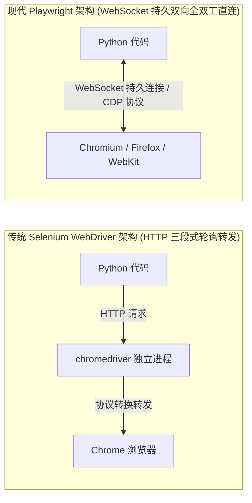
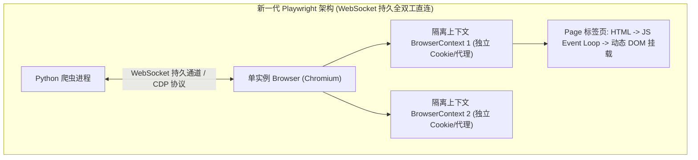
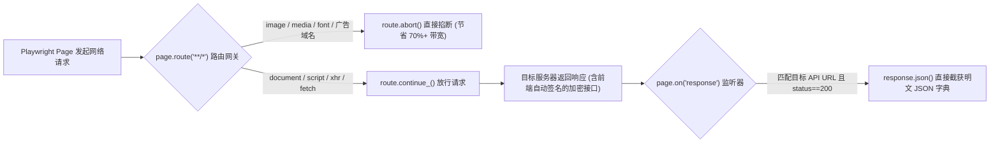

# 动态渲染网页与Playwright浏览器自动化

## Summary

面对重度依赖 JavaScript 动态渲染与复杂用户交互的网页，浏览器自动化是不可或缺的攻坚利器。本章从 Blink 渲染引擎的关键渲染路径与 JS 事件循环出发，全面引入新一代自动化框架 Playwright，对比其相较于传统 Selenium WebDriver 的架构优势。内容涵盖 `BrowserContext` 上下文隔离、`Locator` 智能定位器、Auto-Waiting 自动等待机制、无限滚动懒加载触发、Iframe 与弹窗处理、`storage_state` 免密登录态复用、静态资源路由屏蔽（`route`）、`on_response` 接口直接截获以及混合工具 DrissionPage，助学生兼顾动态采集的开发效率与运行性能。

## Concepts Covered

This chapter covers the following 22 concepts from the learning graph:

| Concept | Concept Impact Score |
|---------|-----------------------|
| 浏览器渲染引擎Blink关键渲染路径 | 112 |
| JavaScript事件循环与动态DOM挂载 | 45 |
| 无头浏览器Headless概念与演进历程 | 65 |
| Selenium与Playwright架构对比 | 64 |
| Playwright安装与浏览器驱动管理 | 59 |
| Browser与Context多上下文隔离 | 56 |
| Page页面生命周期与goto导航控制 | 46 |
| Playwright智能定位器Locator语法 | 18 |
| 显式等待与Auto-Waiting自动等待 | 12 |
| 页面加载状态与networkidle等待 | 7 |
| 模拟鼠标Click与键盘Fill交互 | 4 |
| 执行自定义JS脚本page.evaluate | 5 |
| 页面滚动触底与无限懒加载触发 | 1 |
| Iframe内嵌框架定位与上下文切换 | 1 |
| 多标签页弹窗与Dialog对话框处理 | 1 |
| storage_state登录态持久化复用 | 2 |
| route路由拦截与屏蔽静态资源 | 12 |
| 监听on_response直接截获API响应 | 6 |
| 网页全屏截图与PDF渲染导出 | 2 |
| CDP开发者协议底层控制基础 | 3 |
| DrissionPage混合自动化模式 | 1 |
| 动态渲染资源控制与浏览器池复用 | 2 |

## Prerequisites

This chapter builds on concepts from:

- [Chapter 1: 网络爬虫导论与数据合规基石](../01-intro-and-ethics/index.md)
- [Chapter 2: Web前端基石与HTTP通信原理](../02-web-and-http-fundamentals/index.md)
- [Chapter 3: Python网络请求核心编程](../03-python-http-requests/index.md)
- [Chapter 4: 静态网页结构化解析与正则提取](../04-static-html-parsing/index.md)
- [Chapter 5: 异步加载与Web接口逆向采集](../05-ajax-and-api-scraping/index.md)

---

## 1. 现代浏览器渲染原理与自动化架构演进

在第 5 章中，我们学习了直接逆向分析 AJAX 接口的高效采集方法。但在真实工业场景中，我们经常会遇到以下三类棘手局面：第一，目标网站的前端请求参数经过了极其复杂的 WebAssembly 或多层混淆 JS 加密，逆向还原算法的研发周期远超项目排期；第二，数据必须在完成复杂的鼠标悬停、滑块拖拽、分步表单填写或滚动触底交互后才会触发加载；第三，采集任务本身就需要截取网页渲染后的可视化全屏快照或生成高保真 PDF 归档。在这些场景下，直接驱动真实浏览器内核完成渲染与交互的**浏览器自动化（Browser Automation）**技术便成为最佳工程解。

### 1.1 浏览器渲染引擎 Blink 关键渲染路径与 JS 事件循环

要高效操控浏览器，首先必须理解它从收到 HTML 字节流到在屏幕上绘制出像素的底层过程，即**浏览器渲染引擎 Blink 关键渲染路径（Critical Rendering Path, CRP）**。以 Chromium 内核搭载的 Blink 渲染引擎与 V8 JavaScript 引擎为例，加载一个现代单页应用（SPA）经历以下五个核心阶段：

1. **构建 DOM 树（DOM Construction）**：网络线程接收到首包 HTML（往往只有一个空的 `<div id="app"></div>`）后，HTML 解析器将其解析为基础 DOM 树。
2. **构建 CSSOM 树（CSSOM Construction）**：解析外部 `.css` 样式表与内联样式，生成 CSS 对象模型树。
3. **执行 JavaScript 与事件循环（JavaScript Event Loop & Dynamic DOM Mounting）**：当解析遇到 `<script src="app.bundle.js">` 时，V8 引擎启动 **JavaScript 事件循环与动态 DOM 挂载**。主线程先执行同步宏任务（Macro-task），发起异步 `fetch` / `XHR` 网络请求；当后端 JSON 响应返回后，回调函数作为微任务（Micro-task）进入队列，由 Vue/React 框架在内存中计算出虚拟 DOM（Virtual DOM）差异，最终调用浏览器原生 API（如 `document.createElement`、`appendChild`）将成百上千个商品或新闻节点动态挂载到 `<div id="app">` 下。
4. **合成渲染树与布局（Render Tree & Layout）**：Blink 将 DOM 树与 CSSOM 树合并为渲染树（自动剔除 `display: none` 的不可见节点），并计算每个元素在视口（Viewport）中的精确几何坐标与宽高。
5. **分层与光栅化绘制（Paint & Composite）**：由 GPU 进程将图层光栅化为位图像素。

!!! info "爬虫性能优化的关键启示"
    对于数据采集而言，我们真正需要的只是前 3 步（构建 DOM + 执行 JS 拿到动态挂载的数据或截获 API 响应），而第 4、5 步（下载高清大图、加载字体文件、执行 CSS 动画与 GPU 光栅化绘制）纯属消耗 CPU 和带宽的无用功。后续我们将通过**无头模式（Headless）**与**静态资源路由拦截（Route Interception）**砍掉多余的渲染开销，让浏览器爬虫提速 3～5 倍。

### 1.2 无头浏览器演进与 Selenium vs Playwright 架构对比

早期的浏览器自动化必须弹出一个肉眼可见的桌面图形窗口（Headed 模式），无法部署在没有显示器与桌面环境的 Linux 云服务器上。为此诞生了**无头浏览器 Headless 概念与演进历程**：所谓无头浏览器，是指剥离了图形用户界面（GUI 窗口外壳），但完整保留了底层网络栈、Blink 渲染引擎和 V8 JS 引擎的浏览器运行模式。从早年已停止维护的 PhantomJS，到 2017 年 Chrome 官方原生的 `--headless` 模式，再到如今与有头模式共享完全相同渲染管线的 `--headless=new`，无头浏览器已成为服务端动态采集的标配底座。

在自动化控制框架层面，理解 **Selenium 与 Playwright 架构对比** 是技术选型的关键。由微软开源的新一代框架 **Playwright** 之所以在爬虫与 AI 智能体领域全面取代传统的 Selenium，核心源于其底层通信协议的代际跨越：



| 对比维度 | 传统 Selenium (WebDriver) | 新一代 Playwright | 对爬虫工程的实际影响 |
| :--- | :--- | :--- | :--- |
| **底层通信协议** | 基于 HTTP 的单向请求-响应（需经过独立 WebDriver 驱动进程中转） | **基于 WebSocket 的持久全双工连接（直通 CDP 协议）** | Playwright 操作延迟低至毫秒级，且浏览器可主动向 Python 推送网络包事件 |
| **驱动版本管理** | 极易因本地 Chrome 自动升级导致 `chromedriver` 版本不匹配报错 | **内置一键式隔离浏览器管理（`playwright install`）** | 彻底告别驱动版本地狱，开箱即用 |
| **多会话并发隔离** | 必须启动多个重量级浏览器实例（每个占数百 MB 内存） | **原生支持轻量级 `BrowserContext` 上下文隔离** | 单个浏览器进程内毫秒级创建几十个独立 Cookie/代理会话 |
| **元素等待机制** | 需手写大量繁琐的 `WebDriverWait` 显式等待或 `time.sleep` | **内置智能 Auto-Waiting 自动等待引擎** | 点击或提取前自动校验元素可见、稳定、可交互，大幅降低脚本崩溃率 |
| **网络层拦截能力** | 原生不支持（需额外挂载缓慢的 `selenium-wire` 中间人代理） | **原生支持 `page.route` 改写请求与 `on("response")` 截获响应** | 可直接屏蔽图片广告并从底层无损捞取解密后的 JSON 接口数据 |

#### Diagram: Selenium 与 Playwright 通信架构及渲染生命周期对比器



<details markdown="1">
<summary>Interactive MicroSim: Selenium 与 Playwright 通信架构及渲染生命周期对比器</summary>

Type: microsim

**sim-id:** ch06-selenium-vs-playwright-arch<br/>
**Library:** p5.js<br/>
**Status:** Specified<br/>
**Bloom Level:** Understand<br/>
**Bloom Verb:** Compare<br/>
**Learning Objective:** The learner will compare the multi-hop HTTP WebDriver architecture of Selenium with the persistent bidirectional WebSocket/CDP architecture of Playwright across page navigation, dynamic DOM mounting, and API response interception.

**Prerequisites:** 浏览器渲染引擎Blink关键渲染路径, JavaScript事件循环与动态DOM挂载, Selenium与Playwright架构对比

**Evidence of Mastery:**
- 能够解释为什么 Playwright 无需启动中间代理服务器就能直接通过 `page.on("response")` 实时收到浏览器推送的 AJAX JSON 数据包
- 能够区分页面加载生命周期中 `commit`、`domcontentloaded`、`load` 与 `networkidle` 四个触发时机在关键渲染路径上的精确位置

**Misconceptions:**
- 误以为 `page.goto(url)` 返回时页面里所有的异步 AJAX 数据都已经渲染完毕（默认 `load` 事件仅代表静态资源加载完成，复杂异步接口可能仍在请求中）
- 认为开启多个 `BrowserContext` 会像启动多个 Chrome 进程一样耗尽服务器内存

**Instructional Rationale:**
将双方的底层通信链路与浏览器的关键渲染路径（HTML -> JS Event Loop -> XHR -> DOM Mounting -> Paint）做成同步双轨动画，让学习者直观看到每一步指令下发、等待与事件回传的延迟差异。

**Content:**
- 上半轨：Selenium HTTP Request -> WebDriver Binary -> Browser 的三段式往返动画与轮询等待耗时计
- 下半轨：Playwright WebSocket 双工管道动画，展示 `Browser -> BrowserContext -> Page` 三级树形层级与实时 `response` 事件流推送
- 底部时间轴：标注 `domcontentloaded`（HTML 解析完成）、`load`（图片样式加载完成）与 `networkidle`（500ms 内无活跃网络连接）三个核心路标

**Provenance:** 依据本章第 1 节与第 2 节架构原理构建。

**Rules:**
- 当用户点击“启用 Route 屏蔽图片与字体”开关时，时间轴上的 `load` 耗时瞬间缩短 65%，并动态刷新内存占用读数
- 当模拟动态 SPA 网页加载时，直观展示在 `domcontentloaded` 时刻立即读取 DOM 会拿到空列表，而在 `Locator` 自动等待或 `networkidle` 后能拿到完整数据

**Learner Activity:**
1. 切换“传统 Selenium 轮询”与“Playwright WebSocket 事件驱动”模式，发起 10 次连续交互指令并对比总往返延迟。
2. 在渲染时间轴上拖拽采样探针，观察不同 `wait_until` 参数下 DOM 树节点的挂载状态。

**Feedback:**
- 动态显示通信往返次数（RTT）、内存开销（MB）与采集成功率。

**Starting State:**
默认处于双轨对比视图，模拟访问一个包含异步 XHR 商品列表接口的 SPA 页面，直观展示 Playwright 截获异步响应包的全过程。

**Chapter Anchors:** 1.1 浏览器渲染引擎 Blink 关键渲染路径与 JS 事件循环, 1.2 无头浏览器演进与 Selenium vs Playwright 架构对比
</details>

---

## 2. Playwright 核心层级、智能定位器与自动等待

### 2.1 安装、驱动管理与 `Browser` / `Context` / `Page` 三级隔离架构

进行 **Playwright 安装与浏览器驱动管理** 只需两条命令：先安装 Python 客户端库，再下载预编译的专用浏览器内核（推荐仅安装 Chromium 以节省磁盘空间）：

```bash
pip install playwright
playwright install chromium
```

Playwright 提供了同步（`playwright.sync_api`）与异步（`playwright.async_api`）两套完全对称的 API。在架构设计上，它采用严密的 **`Browser` 与 `Context` 多上下文隔离** 及 **`Page` 页面生命周期与 `goto` 导航控制** 三级模型：

1. **`Browser`（浏览器进程实例）**：对应操作系统中一个真实的 Chromium 进程，启动成本高（耗时约 0.5～1 秒，占用百兆内存）。在一个爬虫进程中通常只需启动**一个** `Browser` 实例。
2. **`BrowserContext`（浏览器上下文 / 隐身沙盒）**：在同一个 `Browser` 内部创建的完全隔离的独立会话空间，好比浏览器的“无痕窗口”。不同 `Context` 之间的 Cookie、`localStorage`、缓存、窗口尺寸、User-Agent 乃至代理 IP **完全物理隔离、互不串号**，但创建和销毁一个 `Context` 仅需几毫秒且几乎不占额外内存！这是实现多账号并发采集的核心设计。
3. **`Page`（标签页）**：归属于某个 `Context` 下的单个浏览器标签页，负责具体的 `page.goto()` 导航、DOM 定位与交互。

在调用 `page.goto(url, wait_until=...)` 时，理解 **页面加载状态与 `networkidle` 等待** 的四个枚举值至关重要：
- `"commit"`：收到 HTTP 响应头、准备开始接收文档字节流时即视为完成（最快，但 DOM 尚未生成）。
- `"domcontentloaded"`：初始 HTML 文档已被解析为 DOM 树，不等待样式表、图片和子框架加载。**在配合后续 `Locator` 明确等待特定元素出现时，推荐使用此选项以获得最高采集速度**。
- `"load"`（默认值）：等待 HTML 及所有引用的样式表、脚本、图片等静态资源全部加载完成。
- `"networkidle"`：等待页面在至少 **500 毫秒内没有任何活跃的网络连接**。适合不知道具体目标元素选择器、希望等所有异步 AJAX 接口都请求完毕后再一次性提取源码的场景（但注意：若网页包含长轮询、视频流或心跳统计包，`networkidle` 会一直卡死直至超时！）。

### 2.2 智能定位器 `Locator` 与 Auto-Waiting 自动等待机制

在早期自动化脚本中，开发者习惯调用 `find_element` 立即返回一个静态的 DOM 元素句柄；如果在这一瞬间异步数据还没刷出来，代码就会直接抛出 `NoSuchElementException`，或者在后续点击时因页面重绘抛出 `StaleElementReferenceException`。

Playwright 彻底革新了这一模式，引入了 **Playwright 智能定位器 `Locator` 语法** 与 **显式等待与 Auto-Waiting 自动等待**机制：

- **`Locator` 是惰性的“查找配方”而非静态节点**：当你执行 `btn = page.locator("button.submit-btn")` 时，Playwright 并没有去浏览器里找元素，而只是记录下了“如何找到这个按钮”的规则。每次你对 `btn` 执行 `.click()` 或 `.inner_text()` 时，它都会在最新的 DOM 树上重新按规则寻址，彻底消除了节点过期失效问题。
- **支持丰富的语义化与链式定位**：除了直接传入 CSS 选择器或 XPath（如 `page.locator("//div[@class='card']")`），还支持 `page.get_by_text("下一页")`、`page.get_by_role("button", name="登录")`、`page.get_by_placeholder("请输入手机号")` 以及链式过滤 `.filter(has_text="自营")`。
- **内置 Auto-Waiting 自动等待**：在对 `Locator` 执行点击或输入前，Playwright 会自动在后台轮询检查该元素是否已挂载到 DOM、是否可见（Visible）、是否已停止动画位移（Stable）、是否未被遮罩层挡住（Receives Events）以及是否已启用（Enabled）。只有全部满足时才会真正触发动作。当我们需要在提取网页源码前显式等待某个核心数据区块渲染就绪时，只需调用 `page.locator(".data-row").first.wait_for(state="visible", timeout=10000)` 即可。

---

## 3. 复杂用户交互模拟与页面上下文控制

### 3.1 鼠标键盘交互、自定义 JS 执行与无限滚动懒加载

面对需要深度交互的动态页面，Playwright 提供了全套拟人操控 API：

1. **模拟鼠标 `Click` 与键盘 `Fill` 交互**：
   - `locator.click(delay=50)`：模拟真实鼠标移动至元素中心并按下抬起；`locator.hover()` 触发鼠标悬停下拉菜单。
   - `locator.fill("人工智能")`：清空输入框并一次性填入文本（速度快）；若目标网站监听了键盘按键时间间隔以检测机器人，则应改用 `locator.press_sequentially("人工智能", delay=120)` 模拟真人逐字敲击键盘，并用 `page.keyboard.press("Enter")` 敲击回车键。
2. **执行自定义 JS 脚本 `page.evaluate`**：
   - 通过 `page.evaluate("() => window.__INITIAL_STATE__")` 可以在浏览器当前页面的上下文中直接运行任意 JavaScript 代码，并将执行结果（数字、字符串、字典、列表）自动序列化传回 Python！无论是读取加密函数生成的全局变量、强制移除挡在屏幕中间的登录弹窗遮罩层，还是读取 `document.body.scrollHeight` 网页总高度，都离不开 `page.evaluate`。
3. **页面滚动触底与无限懒加载触发**：
   - 如今大量资讯流（如头条、小红书、知乎）与电商搜索页采用“无限滚动懒加载（Infinite Scroll）”设计——只有当用户将滚动条拉到底部时，前端才会触发下一页 AJAX 请求。我们可以通过在循环中调用 `page.evaluate("window.scrollTo(0, document.body.scrollHeight)")` 或 `page.mouse.wheel(0, 3000)`，并对比滚动前后的页面高度或卡片数量来实现自动翻页。

### 3.2 Iframe 内嵌框架、多标签页弹窗与登录态持久化

在企业级网页中，还有三类常见的容器与状态管理难题：

- **`Iframe` 内嵌框架定位与上下文切换**：许多网站的登录框、视频播放器或第三方验证码被包裹在 `<iframe>` 子文档标签中。由于 `<iframe>` 拥有独立的 DOM 树，直接在主 `page` 上定位永远找不到里面的元素。在 Playwright 中无需像 Selenium 那样反复 `switch_to.frame` 和 `switch_to.default_content`，只需使用 `frame = page.frame_locator("iframe#login-frame")`，即可直接链式调用 `frame.locator("input#username").fill("admin")`。
- **多标签页弹窗与 `Dialog` 对话框处理**：
  - 当点击某个链接会通过 `target="_blank"` 打开新标签页时，使用 `with context.expect_page() as new_page_info:` 上下文管理器即可精准捕获新弹出的 `Page` 对象。
  - 当网页弹出原生 JS `alert()`、`confirm()` 或 `prompt()` 阻塞对话框时，通过注册事件监听器 `page.on("dialog", lambda dialog: dialog.accept())` 即可自动点击确定放行。
- **`storage_state` 登录态持久化复用**：账号登录往往伴随复杂的验证码校验。一旦我们在首次运行时通过扫码或人工辅助完成了登录，只需调用一行 `context.storage_state(path="auth_state.json")`，Playwright 就会将当前上下文中所有的 **Cookies 与 `localStorage` 键值对**完整导出为 JSON 文件。后续每次启动爬虫时，直接传入 `browser.new_context(storage_state="auth_state.json")`，即可直接以已登录身份秒开目标后台，实现免密登录态持久化复用！

下面展示一个融合了 `storage_state` 会话加载、无限滚动触底加载与 `page.evaluate` 的完整实战代码：

```python
import json
from pathlib import Path
from playwright.sync_api import sync_playwright, BrowserContext

STATE_FILE = Path("auth_state.json")

def create_authenticated_context(playwright_instance, headless: bool = True) -> tuple:
    """创建支持免密登录态复用的隔离浏览器上下文"""
    browser = playwright_instance.chromium.launch(headless=headless)
    context_kwargs = {
        "viewport": {"width": 1440, "height": 900},
        "user_agent": (
            "Mozilla/5.0 (Windows NT 10.0; Win64; x64) "
            "AppleWebKit/537.36 (KHTML, like Gecko) Chrome/130.0.0.0 Safari/537.36"
        ),
    }
    # 若本地已存在导出的登录态文件，则直接挂载恢复会话
    if STATE_FILE.exists():
        context_kwargs["storage_state"] = str(STATE_FILE)

    context: BrowserContext = browser.new_context(**context_kwargs)
    return browser, context

def scrape_infinite_scroll_feed(target_url: str, max_scrolls: int = 5) -> list[dict]:
    """模拟页面滚动触底触发懒加载，并提取动态挂载的资讯卡片"""
    with sync_playwright() as p:
        browser, context = create_authenticated_context(p, headless=True)
        page = context.new_page()

        # 自动接受可能弹出的原生 JS 弹窗
        page.on("dialog", lambda dialog: dialog.accept())

        # 导航至目标页，仅等待 DOM 树构建完成即可开始定位
        page.goto(target_url, wait_until="domcontentloaded", timeout=30000)
        page.locator(".feed-card").first.wait_for(state="visible", timeout=10000)

        last_height = page.evaluate("() => document.body.scrollHeight")
        for step in range(1, max_scrolls + 1):
            # 执行 JS 滚动至页面最底部
            page.evaluate("() => window.scrollTo(0, document.body.scrollHeight)")
            # 等待新数据渲染使页面高度增加
            page.wait_for_timeout(1200)
            new_height = page.evaluate("() => document.body.scrollHeight")
            print(f"第 {step} 次滚动触底: 页面高度 {last_height}px -> {new_height}px")
            if new_height == last_height:
                print("已到达页面最底部，无更多懒加载内容。")
                break
            last_height = new_height

        # 使用 page.evaluate 在浏览器端一次性提取所有卡片数据并返回给 Python
        items = page.evaluate(
            """() => {
                return Array.from(document.querySelectorAll('.feed-card')).map(card => ({
                    title: card.querySelector('.title')?.innerText?.trim() || '',
                    author: card.querySelector('.author')?.innerText?.trim() || '',
                    likes: card.querySelector('.like-count')?.innerText?.trim() || '0'
                }));
            }"""
        )

        # 保存最新登录态供下次运行复用
        context.storage_state(path=str(STATE_FILE))
        browser.close()
        return items
```

---

## 4. 网络层拦截、CDP 协议与混合自动化进阶

如果仅仅把 Playwright 当作一个“模拟点击再提取 HTML 源码”的笨重工具，那就浪费了它最强大的半壁江山。通过接管浏览器的底层网络层，我们可以实现“**浏览器负责自动跑通加密签名发包，Python 直接在半路截获干净的 JSON 响应**”的降维打击。

### 4.1 `route` 路由拦截屏蔽静态资源与 `on_response` 直接截获 API

在 Playwright 中，网络层操控主要依赖两大核心机制：

1. **`route` 路由拦截与屏蔽静态资源**：
   通过 `page.route("**/*", handler)`，浏览器发出的每一个网络请求（HTML、CSS、图片、字体、媒体流、统计脚本）都会先经过我们的回调函数审批。通过检查 `route.request.resource_type`，如果是 `"image"`、`"media"`、`"font"` 或 `"stylesheet"`，直接调用 `route.abort()` 将其掐断；如果是核心文档或异步接口，则调用 `route.continue_()` 放行。这一招能砍掉网页 70% 以上的网络流量与 GPU 解码负担！
2. **监听 `on_response` 直接截获 API 响应**：
   当遇到第 5 章中提到的复杂加密签名接口时，我们完全不需要去逆向它的 JS 加密算法！只需注册 `page.on("response", handle_response)` 监听器：当我们在页面上点击“下一页”按钮时，浏览器会自动执行网页自带的加密 JS 并向服务器发送合法请求；一旦服务器返回 JSON 数据包，我们的 `handle_response` 函数就会在同一毫秒内直接调用 `response.json()` 拿到解密后的纯净结构化字典，连 HTML 解析都省了！

#### Diagram: Playwright 网络路由拦截与 API 响应截获流水线



<details markdown="1">
<summary>Interactive MicroSim: Playwright 网络路由拦截与 API 响应截获流水线</summary>

Type: microsim

**sim-id:** ch06-network-route-interceptor<br/>
**Library:** p5.js<br/>
**Status:** Specified<br/>
**Bloom Level:** Analyze<br/>
**Bloom Verb:** Differentiate<br/>
**Learning Objective:** The learner will differentiate browser network request resource types (`document`, `script`, `xhr`/`fetch`, `image`, `font`, `media`) and configure `page.route` rules alongside `page.on("response")` listeners to maximize scraping throughput while capturing encrypted API payloads.

**Prerequisites:** route路由拦截与屏蔽静态资源, 监听on_response直接截获API响应, Selenium与Playwright架构对比

**Evidence of Mastery:**
- 能够正确配置 `route.abort()` 屏蔽非必要静态资源，同时避免误杀导致异步接口无法触发的核心 `.js` 脚本（`resource_type == "script"`）
- 能够通过 URL 特征与 `response.status == 200` 在 `on("response")` 事件流中精准过滤并提取目标 JSON 数据包

**Misconceptions:**
- 为了追求极致速度把 `script`（JavaScript 脚本）也加入 `route.abort()` 黑名单，结果导致网页完全无法发起任何 `xhr`/`fetch` 异步数据请求
- 在 `on("response")` 中不加 `if "/api/" in response.url` 过滤就直接对所有图片和 HTML 调用 `response.json()`，引发大量解析异常

**Instructional Rationale:**
用可视化分流管道模拟浏览器发出的 6 类并发网络数据包。学习者扮演“网关调度员”，通过勾选拦截规则开关观察无效流量被 `abort()` 丢弃、核心 `script` 与 `xhr` 顺畅通行并在回程被 `on_response` 探针无损分流提取为 JSON 的全过程。

**Content:**
- 左侧发射器：模拟打开某电商商品搜索页时瞬间并发产生的 45 个网络请求（含 28 张商品大图、4 个 WebFont 字体、6 个广告追踪脚本、3 个核心业务 JS、4 个带复杂 `sign` 签名的 `fetch` 商品数据接口）
- 中间网关阀门：6 类 `resource_type` 与自定义 URL 黑名单勾选框
- 右侧双仪表盘：带宽消耗（MB）/ 加载耗时（秒）统计表 + 实时截获的 JSON 数据预览框

**Provenance:** 依据本章第 4.1 节网络拦截与接口监听技术设计。

**Rules:**
- 若用户误勾选屏蔽 `script`，页面区的动态挂载动画立即中断并弹出红色告警：“核心业务 JS 被阻断，XHR 请求未触发！”
- 当正确屏蔽 `image`、`media`、`font` 且开启 `/api/search` 响应监听时，总流量下降 82%，JSON 预览框实时输出结构化商品列表

**Learner Activity:**
1. 先在“无拦截默认模式”下运行一次页面加载，记录总流量（14.2 MB）与耗时（4.8 秒）。
2. 配置 `page.route` 静态资源拦截规则与 `on_response` URL 过滤条件，在不破坏动态接口触发的前提下将单页耗时压缩至 1 秒以内。

**Feedback:**
- 实时统计节省的带宽百分比、截获的 API JSON 记录数以及规则配置的正确性诊断。

**Starting State:**
默认处于未开启路由拦截状态，画布中大量高带宽图片数据包造成管道拥堵；等待学习者启用静态资源过滤阀门。

**Chapter Anchors:** 4.1 route 路由拦截屏蔽静态资源与 on_response 直接截获 API
</details>

下面给出结合 **`route` 静态资源屏蔽**、**`on_response` 加密接口直接截获** 以及 **网页全屏截图与 PDF 渲染导出** 的工业级代码范式：

```python
from typing import Any
from playwright.sync_api import sync_playwright, Route, Response

# 定义需要屏蔽的静态资源类型集合（切勿屏蔽 script 和 xhr/fetch！）
BLOCKED_RESOURCE_TYPES = {"image", "media", "font", "stylesheet"}
# 定义常见的第三方广告与统计域名黑名单
BLOCKED_DOMAINS = ("google-analytics.com", "hm.baidu.com", "doubleclick.net")

def intercept_Encrypted_api_with_playwright(target_url: str) -> list[dict[str, Any]]:
    """
    利用 route 屏蔽静态资源提速，并通过 on_response 直接截获加密 API 返回的 JSON
    """
    captured_records: list[dict[str, Any]] = []

    def handle_route(route: Route) -> None:
        req = route.request
        if req.resource_type in BLOCKED_RESOURCE_TYPES or any(
            domain in req.url for domain in BLOCKED_DOMAINS
        ):
            route.abort()
        else:
            route.continue_()

    def handle_response(response: Response) -> None:
        # 仅监听状态码为 200 且 URL 包含目标业务接口路径的 XHR/Fetch 响应
        if (
            response.status == 200
            and response.request.resource_type in ("xhr", "fetch")
            and "/api/v2/products/list" in response.url
        ):
            try:
                payload = response.json()
                items = payload.get("data", {}).get("items", [])
                captured_records.extend(items)
                print(f"[on_response 截获] 成功从 {response.url} 提取 {len(items)} 条记录")
            except Exception as exc:
                print(f"JSON 解析跳过: {exc}")

    with sync_playwright() as p:
        browser = p.chromium.launch(headless=True)
        context = browser.new_context(viewport={"width": 1280, "height": 800})
        page = context.new_page()

        # 1. 注册路由拦截器与响应监听器
        page.route("**/*", handle_route)
        page.on("response", handle_response)

        # 2. 访问目标页并触发翻页点击（加密参数由浏览器自身 JS 自动计算完成）
        page.goto(target_url, wait_until="domcontentloaded")
        for page_num in range(1, 4):
            next_btn = page.locator("button.btn-next:not([disabled])")
            if next_btn.count() > 0:
                next_btn.click()
                page.wait_for_timeout(1000)

        # 3. 如需留存证据归档，可随时导出全屏长截图或 PDF（开启截图前需放行 stylesheet）
        # page.screenshot(path="archive_fullpage.png", full_page=True)
        # page.pdf(path="archive_report.pdf", format="A4")

        browser.close()
    return captured_records
```

### 4.2 CDP 开发者协议、DrissionPage 混合模式与浏览器池控制

在深入高阶对抗与大规模采集时，我们还需掌握三项底层与工程优化技术：

1. **CDP 开发者协议底层控制基础（Chrome DevTools Protocol）**：
   CDP 是 Chromium 内核暴露出的最底层调试与控制接口（我们平时按 F12 打开的开发者工具本身就是通过 CDP 与浏览器通信的）。在 Playwright 中，通过 `cdp_session = context.new_cdp_session(page)`，我们可以直接调用 `cdp_session.send("Page.addScriptToEvaluateOnNewDocument", {"source": "..."})` 在网页任何脚本执行前注入反检测补丁，或者调用 `Network.getResponseBody`、模拟移动端传感器地理位置与 CPU 节流。
2. **`DrissionPage` 混合自动化模式**：
   由国内开发者开源的 `DrissionPage` 是近年来在爬虫圈极受推崇的国产利器。它具有两大独创优势：第一，它**完全不依赖 WebDriver 驱动文件**，而是直接通过 CDP 协议接管本地日常使用的 Chrome 浏览器（甚至可以直接挂接你已经手动打开并登录好账号的浏览器端口 `ChromiumPage(9222)`），天然绕过绝大多数针对自动化驱动的特征检测；第二，它首创了 **`WebPage` 混合模式**——你可以先用浏览器模式（`d` 模式）完成复杂的滑块登录，然后调用一行 `page.change_mode()` 无缝将当前 Cookie 同步给内置的 `SessionPage`（底层封装 `requests` 的 `s` 模式），后续成千上万页的数据采集直接走高速 HTTP 数据包请求！
3. **动态渲染资源控制与浏览器池复用**：
   在生产环境中，切忌“每采集一个 URL 就执行一次 `chromium.launch()` 和 `browser.close()`”，频繁拉起浏览器进程会迅速耗尽服务器 CPU。正确的工程架构是维护一个常驻的 `Browser` 实例池，每个采集任务仅创建一个轻量级 `BrowserContext`（或限制最大并发 `Page` 数量，通常每核 CPU 分配 2～4 个并发 `Page`），并在单页面连续采集满 200 次后主动重建一次 `Context` 以释放 Chromium 累积的 DOM 内存碎片。

### 4.3 `DrissionPage` 混合模式与常驻浏览器池完整工程实战

为了直观展示 **`DrissionPage` 混合自动化模式** 以及 **`Playwright` 异步浏览器上下文池（Context Pool）** 在真实项目中的落地方式，下面分别给出两个生产级代码模板。

首先看 `DrissionPage` 的 `WebPage` 混合模式：在采集需要登录或带有动态 Cookie（如瑞数/加速乐生成的首包 Cookie）的站点时，先使用 `d` 模式（驱动真实 Chromium 浏览器）完成首屏渲染或登录，随后调用 `page.change_mode()` 切换至 `s` 模式（底层基于 `requests.Session`），系统会自动将浏览器中的 Cookie 与请求头无缝复制到 Session 中，使后续列表翻页采集速度提升 20 倍以上：

```python
from DrissionPage import WebPage, ChromiumOptions

def scrape_with_drission_hybrid_mode(login_url: str, api_list_url: str) -> list[dict]:
    """
    演示 DrissionPage 独创的 d 模式（浏览器渲染过盾/登录）与 s 模式（高速 HTTP 数据包）无缝切换
    """
    # 配置不加载图片并启用无头模式
    co = ChromiumOptions().headless(True).no_images(True)
    # 创建兼具浏览器控制与数据包收发能力的 WebPage 混合对象（默认处于 'd' 浏览器模式）
    page = WebPage(chromium_options=co)

    # 1. 在 'd' 模式下打开登录/风控校验页，让真实浏览器执行 JS 生成合法动态 Cookie
    page.get(login_url)
    page.wait.ele_displayed("css:.dashboard-ready", timeout=15)

    # 2. 一键切换至 's' 模式（底层自动将浏览器最新 Cookies 和 User-Agent 同步至 Session）
    page.change_mode("s")

    # 3. 此时后续所有 page.get() 均走极速 HTTP 请求，不再消耗任何浏览器渲染资源！
    results: list[dict] = []
    for p_num in range(1, 6):
        page.get(f"{api_list_url}?page={p_num}")
        if page.json:
            items = page.json.get("data", [])
            results.extend(items)
            print(f"[DrissionPage s模式] 第 {p_num} 页高速拉取成功，获取 {len(items)} 条记录")

    page.quit()
    return results
```

其次，当必须全程使用 Playwright 渲染采集数万个动态网页时，我们需要设计一个带信号量并发控制与周期性内存回收的**异步浏览器上下文池（Async BrowserContext Pool）**，彻底解决 Chromium 长时间运行导致的内存泄漏（OOM）问题：

```python
import asyncio
from typing import Any
from playwright.async_api import async_playwright, Browser, BrowserContext

class AsyncPlaywrightPool:
    """
    工业级 Playwright 异步浏览器池：
    支持 Semaphore 并发度限制、静态资源自动拦截、以及按采集次数自动重建 Context 释放内存
    """

    def __init__(self, max_concurrency: int = 4, max_pages_per_context: int = 100) -> None:
        self.semaphore = asyncio.Semaphore(max_concurrency)
        self.max_pages_per_context = max_pages_per_context
        self._Request_counter = 0
        self._browser: Browser | None = None
        self._context: BrowserContext | None = None
        self._lock = asyncio.Lock()

    async def start(self, pw) -> None:
        self._browser = await pw.chromium.launch(
            headless=True,
            args=["--disable-dev-shm-usage", "--no-sandbox", "--disable-gpu"],
        )
        await self._rebuild_context()

    async def _rebuild_context(self) -> None:
        """定期销毁旧 Context 并创建新 Context，彻底回收 Chromium V8 与 DOM 内存碎片"""
        if self._context is not None:
            await self._context.close()
        assert self._browser is not None
        self._context = await self._browser.new_context(viewport={"width": 1280, "height": 720})
        # 全局挂载静态资源拦截器
        await self._context.route(
            "**/*.{png,jpg,jpeg,gif,webp,svg,woff,woff2,mp4,mp3}",
            lambda route: route.abort(),
        )
        self._Request_counter = 0
        print("[BrowserPool] 已创建全新的隔离 BrowserContext 并挂载静态资源屏蔽规则")

    async def fetch_dynamic_page(self, url: str, wait_selector: str) -> dict[str, Any]:
        """在受控并发槽位中打开标签页、提取动态文本并确保关闭 Page 句柄"""
        async with self.semaphore:
            async with self._lock:
                self._Request_counter += 1
                if self._Request_counter >= self.max_pages_per_context:
                    await self._rebuild_context()
                assert self._context is not None
                page = await self._context.new_page()

            try:
                await page.goto(url, wait_until="domcontentloaded", timeout=20000)
                await page.locator(wait_selector).first.wait_for(state="visible", timeout=10000)
                title = await page.title()
                count = await page.locator(wait_selector).count()
                return {"url": url, "title": title, "item_count": count}
            finally:
                # 无论成功还是抛异常，必须在 finally 中关闭标签页防止句柄泄漏！
                await page.close()

    async def close(self) -> None:
        if self._context:
            await self._context.close()
        if self._browser:
            await self._browser.close()
```

---

## 5. 章节复习与实战思考题

??? question "1. 在使用 Playwright 进行多账号或高并发采集时，为什么强烈建议“单进程只启动一个 `Browser`，通过创建多个 `BrowserContext` 实现并发”，而不是启动多个 `Browser` 实例？"
    **参考解析**：
    启动一个 `Browser` 实例意味着在操作系统层面派生出一整套 Chromium 主进程、GPU 进程与网络进程，冷启动耗时约 500～1000 毫秒，且基础内存开销高达 150～300 MB。
    而 `BrowserContext` 是在同一个 Chromium 进程内部划分出的逻辑隔离沙盒：不同 `Context` 之间的 Cookie、`localStorage`、缓存以及代理 IP 完全隔离互不干扰，但创建和销毁一个 `Context` 仅需几毫秒、内存增量仅数 MB，从而在保证会话安全隔离的同时实现了十倍以上的并发密度。

??? question "2. 某同学为了加快 Playwright 采集速度，在 `page.route('**/*', handler)` 中把所有非 `document` 类型的请求全部 `route.abort()` 拦截掉了，结果发现页面一片空白且 `on_response` 根本抓不到任何数据。请问他误杀了哪两类关键资源？"
    **参考解析**：
    他误杀了 `script`（JavaScript 脚本文件）和 `xhr` / `fetch`（异步数据接口请求）。
    在现代 SPA 动态渲染网页中，初始 HTML（`document`）往往只有一个空的挂载点 `<div id="app"></div>`，必须先下载并执行核心业务 JS（`resource_type == "script"`），才能由 JS 引擎在事件循环中发起异步 API 请求（`resource_type in ("xhr", "fetch")`）并将数据渲染到页面上。因此，静态资源拦截名单只应包含 `image`、`media`、`font` 和 `stylesheet`。

??? question "3. 相比于等页面渲染完再用 `page.locator()` 从 DOM 树中提取文本，使用 `page.on('response', ...)` 直接截获后台 AJAX 响应有哪些显著优势？"
    **参考解析**：
    1. **数据更完整、精度更高**：网页前端界面往往只展示部分截断字段（例如价格被格式化、长文本被省略号截断、隐藏的商品内部 ID 和精确库存数未渲染在标签上），而后台返回的原始 JSON 响应包含了完整的全量业务字段。
    2. **免去繁琐的 DOM 定位与清洗**：直接调用 `response.json()` 即可拿到原生 Python 字典，无需编写复杂的 XPath/CSS 选择器，且不受前端微小样式改版的影响。
    3. **绕过复杂的前端加密逆向**：请求签名（`sign`/`token`）由浏览器自身的 JS 环境在点击翻页时自动计算并发送，Python 只需在回程“坐享其成”接收明文 JSON。
