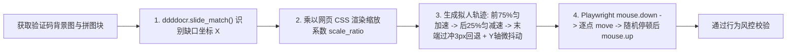
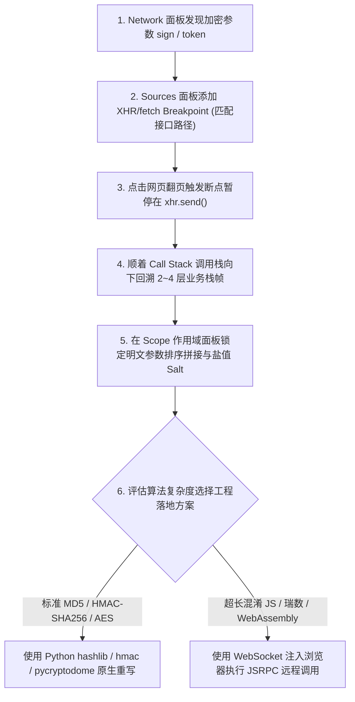

# 反爬虫机制原理与工程对抗策略

## Summary

在真实互联网环境中，爬虫与反爬虫是一场持续演进的攻防博弈。本章构建了完整的反爬虫纵深防御认知体系，逐层拆解请求头校验、IP 频率限制（429）与分布式高匿代理池设计、多账号 Cookie 池维护、WebDriver 自动化特征隐藏（Stealth）、Canvas/WebGL 硬件指纹与 TLS JA3 指纹伪装（`curl_cffi`）。同时深入实战 CSS 偏移还原、`TTFont` 自定义字体映射破解、`ddddocr` 图形/滑块验证码轨迹模拟，以及利用 DevTools 调用栈断点逆向 MD5/HMAC/AES 接口签名参数与 Node.js RPC 调用。

## Concepts Covered

This chapter covers the following 22 concepts from the learning graph:

| Concept | Concept Impact Score |
|---------|-----------------------|
| 网站反爬虫防御纵深体系概览 | 115 |
| User-Agent池与随机轮换策略 | 4 |
| 请求头顺序与完整性校验绕过 | 2 |
| IP频率限制Rate-Limiting与429 | 51 |
| 代理IP匿名度分级透明与高匿 | 6 |
| 数据中心代理住宅代理与隧道代理 | 5 |
| 高可用分布式代理IP池架构设计 | 4 |
| 动态Cookie生成与多账号Cookie池 | 1 |
| WebDriver特征检测与Stealth隐藏 | 2 |
| Canvas与WebGL硬件指纹识别原理 | 1 |
| TLS握手JA3指纹与curl_cffi伪装 | 1 |
| CSS样式偏移反爬与伪元素还原 | 2 |
| WebFont字体加密与TTFont映射还原 | 1 |
| 图形验证码原理与ddddocr识别 | 5 |
| 滑块验证码缺口定位与轨迹模拟 | 2 |
| 点选验证码与打码平台接口集成 | 2 |
| 前端JS代码混淆与AST反混淆基础 | 27 |
| XHR断点调试与调用栈CallStack追踪 | 26 |
| 请求签名Sign与MD5/SHA摘要逆向 | 24 |
| HMAC认证码与Base64参数还原 | 3 |
| 对称加密AES与非对称RSA参数解密 | 2 |
| Python调用Node执行JS与RPC远程调用 | 1 |

## Prerequisites

This chapter builds on concepts from:

- [Chapter 1: 网络爬虫导论与数据合规基石](../01-intro-and-ethics/index.md)
- [Chapter 2: Web前端基石与HTTP通信原理](../02-web-and-http-fundamentals/index.md)
- [Chapter 3: Python网络请求核心编程](../03-python-http-requests/index.md)
- [Chapter 4: 静态网页结构化解析与正则提取](../04-static-html-parsing/index.md)
- [Chapter 5: 异步加载与Web接口逆向采集](../05-ajax-and-api-scraping/index.md)
- [Chapter 6: 动态渲染网页与Playwright浏览器自动化](../06-browser-automation-playwright/index.md)

---

## 1. 网站反爬虫防御纵深体系与网络层特征伪装

在学习了 HTTP 请求、异步接口抓取与 Playwright 自动化之后，许多同学在面对真实商业站点（如主流电商、机票OTA、金融研报网）时，会发现原本在测试靶场运行良好的代码突然返回 `403 Forbidden`、`429 Too Many Requests`，或者弹出一道无法逾越的滑块验证码。要系统性地解决这些问题，绝不能靠零散地“搜一个报错改一行代码”，而必须先建立全局的**网站反爬虫防御纵深体系概览（Defense-in-Depth Anti-Scraping Architecture）**。

### 1.1 反爬虫五层纵深防御全景

现代大型互联网公司的风控网关（WAF，如 Cloudflare、阿里云盾、瑞数、Akamai）通常在从 TCP/TLS 握手到前端 DOM 渲染的完整链路上部署五道递进防线：

| 防御层级 | 核心风控检测指标 | 典型拦截表现 | 爬虫工程核心对抗策略 |
| :--- | :--- | :--- | :--- |
| **L1：网络与传输层** | 单 IP 并发速率（Rate-Limiting）、IP 机房段归属、**TLS 握手 JA3/JA4 指纹**、HTTP/2 帧特征 | 直接断开连接、返回 `403` / `429` 状态码 | 高匿隧道/住宅代理 IP 池、平滑限流器、使用 `curl_cffi` 模拟真实 Chrome TLS 指纹 |
| **L2：HTTP 协议与会话层** | `User-Agent` 异常、**请求头字段顺序与 `Sec-Ch-Ua` 一致性**、`Referer` 防盗链、动态加密 Cookie | 返回假数据、重定向至登录页或验证页 | 真实浏览器 UA 池、保持标准 Header 字典顺序、构建多账号动态 Cookie 池 |
| **L3：浏览器环境指纹层** | `navigator.webdriver` 标志、**Canvas / WebGL / Audio 硬件指纹**、CDP 协议注入痕迹 | 无头浏览器点击无响应、无限循环跳验证码 | `playwright-stealth` 抹除特征、DrissionPage 直连真实浏览器、指纹噪声注入 |
| **L4：人机交互与文本混淆层** | 图形/滑块/点选验证码、**CSS 样式偏移与伪元素**、**自定义 WebFont 字体加密（`.woff2`）** | 抓下来的价格数字变成乱码方块 `&#xe603;` | `ddddocr` 视觉识别、贝塞尔拟人轨迹拖拽、`fontTools (TTFont)` 解析字形映射 |
| **L5：接口参数加密与 JS 混淆层** | URL 签名参数（`sign` / `_signature`）、时间戳防重放、AES/RSA 载荷加密、JS AST 混淆 | 接口返回 `{"code": -401, "msg": "非法请求签名"}` | DevTools XHR 断点与调用栈回溯、Python 算法还原（MD5/HMAC/AES）或 Node.js RPC 远程调用 |

### 1.2 请求头校验绕过与 TLS 握手 JA3 指纹伪装（`curl_cffi`）

在 L2 HTTP 协议层，最基础的防御是校验请求头。实施 **`User-Agent` 池与随机轮换策略** 时，切忌随机拼凑过时的浏览器版本号（如 Chrome 70），而应维护一组主流桌面端（Windows / macOS Chrome 128+、Edge、Safari）的真实 UA 列表。更隐蔽的检测是 **请求头顺序与完整性校验绕过**：现代 Chrome 浏览器在发送请求时，不仅会自动附带 `sec-ch-ua`、`sec-ch-ua-platform`、`sec-fetch-site` 等客户端提示头（Client Hints），而且各个 Header 字段在 HTTP 报文中的排列顺序是固定的。如果 `User-Agent` 声称自己是 Chrome 130，却缺少 `sec-ch-ua` 头，或者 `User-Agent` 排在了 `Host` 前面，WAF 瞬间就能判定其为伪造请求。

然而，即便你将 HTTP 请求头复制得一字不差，依然有很多开启了 Cloudflare 五秒盾或高级 WAF 的网站会在建立连接的第一时间返回 `403`。这是因为风控系统在 HTTP 报文发送之前的 **TLS 握手阶段（Client Hello）** 就已经识破了你的 Python 身份——这就是 **TLS 握手 JA3 指纹与 `curl_cffi` 伪装**。

当客户端向 HTTPS 服务器发起连接时，会在 `TLS Client Hello` 包中明文发送自己支持的 TLS 版本、加密套件列表（Cipher Suites）、TLS 扩展（Extensions）、椭圆曲线（Elliptic Curves）及点格式。将这些字段的数值按顺序拼接并计算出的 32 位 MD5 哈希值，就叫做 **JA3 指纹**。Python 标准库 `urllib`、`requests`（底层依赖 `urllib3` + 系统 `OpenSSL`）以及 `httpx` 的默认加密套件排列与真实 Chrome 浏览器（底层使用 Google BoringSSL）截然不同，WAF 只需比对 JA3 黑名单即可秒封 Python 爬虫！

要彻底攻克 TLS 指纹识别，工程上最优雅的方案是使用 **`curl_cffi`** 库。它封装了专门定制的 `curl-impersonate`，不仅在底层完美复刻了真实 Chrome / Safari 的 TLS 握手 JA3/JA4 指纹，还一并模拟了 HTTP/2 的 SETTINGS 帧参数与请求头顺序，且 API 与 `requests` 几乎完全兼容：

```python
from curl_cffi import requests as cffi_requests

def fetch_protected_site(url: str) -> str:
    """
    使用 curl_cffi 的 impersonate 参数一键伪装真实 Chrome 124 的 TLS JA3 指纹与 HTTP/2 帧
    """
    # impersonate="chrome124" 会在底层自动配置与真实 Chrome 完全一致的 BoringSSL 套件与 Header 顺序
    with cffi_requests.Session(impersonate="chrome124") as session:
        response = session.get(
            url,
            headers={
                "Accept-Language": "zh-CN,zh;q=0.9,en;q=0.8",
                "Referer": "https://www.google.com/",
            },
            timeout=15,
        )
        response.raise_for_status()
        return response.text


if __name__ == "__main__":
    # 访问 TLS 指纹检测靶场验证伪装效果
    tls_check_url = "https://tls.browserleaks.com/json"
    print("TLS 指纹检测响应:", fetch_protected_site(tls_check_url)[:300])
```

---

## 2. IP 频率限制、高可用分布式代理池与 Cookie 池

### 2.1 IP 频率限制与代理 IP 分类选型

当单个公网 IP 在短时间内发起的请求数超过风控阈值（例如每分钟超过 60 次）时，网关会触发 **IP 频率限制 `Rate-Limiting` 与 `429`**（返回 `HTTP 429 Too Many Requests` 或封禁该 IP 数小时）。要突破单机 IP 的物理上限，就必须引入代理服务器（Proxy Server）。

在选购与配置代理时，首先需要理清 **代理 IP 匿名度分级透明与高匿** 的核心差异（主要取决于代理服务器向目标网站转发请求时如何设置 `X-Forwarded-For` 和 `Via` 响应头）：

1. **透明代理（Transparent Proxy）**：在 `Via` 头中坦白自己是代理，且在 `X-Forwarded-For` 中把你真实的本机公网 IP 原封不动地告诉目标网站。**完全没有反爬隐蔽作用**。
2. **普通匿名代理（Anonymous Proxy）**：隐藏了你的真实本机 IP，但仍在 HTTP 头中暴露了“当前请求使用了代理服务器”的特征，容易被严格的风控直接拦截。
3. **高匿代理（Elite / High-Anonymity Proxy）**：既完全抹除了你的真实 IP，又不添加任何代理特征头，在目标服务器看来就像是一个普通的独立终端用户在直接访问。**爬虫工程必须且只能使用高匿代理**。

同时，根据 IP 物理来源与调度方式的不同，我们需要掌握 **数据中心代理、住宅代理与隧道代理** 的选型权衡：

- **数据中心代理（Datacenter Proxy）**：采购自阿里云、腾讯云等云厂商机房的批量虚拟主机 IP。优点是价格极其低廉、带宽高、延迟低；缺点是机房 IP 段（ASN）是公开的，面对防爬极严的海外社交媒体或头部电商时容易被整段拉黑。
- **住宅代理（Residential Proxy）**：分配给真实家庭宽带（如电信、联通家庭光纤）或移动蜂窝网络（4G/5G 移动代理）的 IP。风控信誉度极高，极难被封杀，但按流量计费价格昂贵，适合攻克高价值核心目标。
- **隧道代理 / 动态转发代理（Tunnel Proxy）**：代理服务商提供一个固定的云端网关入口（如 `tunnel.proxy.com:16888`），爬虫无需在本地自己维护 IP 列表，只需将所有请求发往该固定入口，云端网关会在**每一次请求时自动在后台为你切换不同的高匿出口 IP**。

### 2.2 高可用分布式代理 IP 池与多账号 Cookie 池架构

在自建或整合多家短效 API 代理商时，由于短效代理 IP 的存活期往往只有 1～5 分钟，且随时可能中途失效，因此必须设计一套基于 Redis 有序集合（`ZSet`）的 **高可用分布式代理 IP 池架构设计**：

1. **采集与入库层（Fetcher）**：定时从代理商 API 拉取最新 IP，以初始分数 `score = 10` 写入 Redis 的 `ZSet`（键名为 `proxy_pool`）。
2. **异步拨测校验器（Validator）**：后台协程每隔 30 秒并发抽取池内所有代理访问目标站点健康检查页：若响应成功且延迟低于 2 秒，则将其分数直接置顶为 `100`；若超时或返回 `403`/`429`，则每次扣减 `20` 分，当分数跌破 `0` 分时直接从 `ZSet` 中调用 `ZREM` 剔除。
3. **调度接口层（Scheduler）**：爬虫工作节点优先从 `score >= 80` 的高质量区间内随机抽取代理投入使用。

同理，针对必须登录才能查看数据的平台（如微博搜索、企查查深度工商信息），如果只用一个账号的 Cookie 高频抓取，即便每秒换一个代理 IP，该账号本身也会因访问异常被封禁。为此需要构建与代理池架构完全同构的 **动态 Cookie 生成与多账号 Cookie 池**：通过维护数十个低权重采集子账号，由定时保活服务（结合 Playwright `storage_state` 或登录接口）定期刷新有效 Session/Cookie 存入 Redis 哈希表，并在爬虫每次发包时按“**固定账号绑定固定地区代理 IP**”的亲和性原则进行轮换，避免因“同一账号一秒内跨越十几个省份 IP 登录”触发异地登录风控。

---

## 3. 浏览器指纹隐藏、CSS 偏移与 WebFont 字体解密

### 3.1 `WebDriver` 特征检测与硬件指纹伪装

在使用第 6 章的 Playwright 或 Selenium 时，许多同学发现即使不用无头模式，一打开某些防护严密的网站还是被瞬间识别为机器人。这是因为浏览器内核在自动化受控状态下会暴露明显的 **WebDriver 特征检测与 Stealth 隐藏** 破绽：

最典型的特征就是全局变量 `window.navigator.webdriver` 的值在正常浏览器中为 `false`（或 `undefined`），而在自动化驱动下会被设为 `true`！此外，自动化环境中的 `navigator.plugins` 插件列表为空、`window.chrome` 对象缺失特定属性。在 Playwright 中，我们可以通过以下两步彻底隐藏自动化痕迹：
1. 在启动浏览器时传入命令行参数 `args=["--disable-blink-features=AutomationControlled"]`，从 Chromium C++ 底层关掉 `navigator.webdriver = true` 的注入。
2. 使用 `context.add_init_script()`（或集成开源库 `playwright-stealth`）在任何网页脚本执行前，预先覆写 `navigator` 属性并对 **Canvas 与 WebGL 硬件指纹识别原理** 施加微量随机像素噪声（Canvas 指纹原理是利用不同显卡驱动、操作系统字体渲染引擎在绘制隐藏 2D/3D 图形时产生的亚像素级色差生成唯一设备 Hash，通过在 `toDataURL` 返回前对个别像素点的 RGB 值加减 `1` 即可每次生成全新的合法硬件指纹）。

### 3.2 CSS 样式偏移与 WebFont 自定义字体映射还原

当网站既不想频繁弹验证码影响正常用户体验，又想阻止爬虫直接从 HTML 中提取核心数字（如大众点评的商户评分电话、猫眼电影的实时票房、汽车之家的配置参数、招聘网站的薪资）时，通常会采用前端视觉障眼法：

1. **CSS 样式偏移反爬与伪元素还原**：
   例如机票网站在 HTML 里写着 `<span>1</span><span>8</span><span>5</span><span>2</span>`（表面看是 `1852` 元），但通过内联样式 `<span style="position: relative; left: -16px">5</span>` 在视觉渲染时把数字 `5` 移到了 `8` 的前面（用户肉眼看到的是 `1582` 元），或者利用 `::before { content: "9"; }` 伪元素显示数字。对抗策略是：解析每个 `<span>` 的 `left` 像素偏移量，按 `(初始索引 * 字符宽度 + left偏移量)` 重新排序即可还原真实数字顺序。
2. **WebFont 字体加密与 `TTFont` 映射还原**：
   这是目前最普遍的高阶文本反爬手段。网页源码中的房价或票房显示的是一串私有 Unicode 编码实体（如 `&#xe603;&#xe60a;&#xe612;`），同时网页通过 `@font-face` 动态引入了一个自定义的 `.woff` 或 `.woff2` 字体文件。只有加载了该字体文件，浏览器才能把 `&#xe603;` 渲染成数字 `8`。更棘手的是，每次刷新页面，字体文件中编码与数字的对应关系都会动态打乱！

要自动化攻克动态 WebFont 加密，我们需要使用 Python 字体处理标准库 **`fontTools`（`from fontTools.ttLib import TTFont`）**。其核心破解原理是：把 `.woff2` 字体文件解析为 XML 轮廓结构，提取里面的 **`cmap`（字符编码到字形名称 GlyphName 的映射表）** 以及 **`glyf`（每个字形的二维几何坐标点序列）**；由于数字 `0~9` 的外观轮廓坐标是相对固定的（或者可以直接将每个字形渲染成小图片交给 `ddddocr` 识别），我们就能在毫秒级时间内建立起 `Unicode编码 -> 真实数字` 的字典并完成全文替换！

```python
import re
from io import BytesIO
from fontTools.ttLib import TTFont

def decrypt_webfont_numbers(
    html_text: str,
    font_bytes: bytes,
    glyph_coord_signature_map: dict[tuple, str],
) -> str:
    """
    使用 fontTools (TTFont) 解析动态 WebFont 字体文件，还原加密的 &#x...; 数字实体
    """
    font = TTFont(BytesIO(font_bytes))
    # 1. 获取 cmap 表：映射关系为 {unicode_int: glyph_name}，例如 {0xe603: 'uniE603'}
    cmap: dict[int, str] = font.getBestCmap()
    glyf_table = font["glyf"]

    # 2. 构建当前动态字体的 { '&#xe603;': '8' } 还原字典
    entity_to_digit: dict[str, str] = {}
    for code_point, glyph_name in cmap.items():
        if glyph_name == "x" or glyph_name not in glyf_table:
            continue
        glyph = glyf_table[glyph_name]
        # 提取字形前 5 个轮廓基准点坐标作为几何特征签名（也可渲染为 PIL Image 用 OCR 识别）
        coords_sig = tuple(glyph.coordinates[:5]) if hasattr(glyph, "coordinates") else ()
        if coords_sig in glyph_coord_signature_map:
            hex_entity = f"&#x{code_point:x};"
            entity_to_digit[hex_entity.lower()] = glyph_coord_signature_map[coords_sig]

    # 3. 批量替换 HTML 中的加密字符实体为真实明文数字
    def replace_match(match: re.Match) -> str:
        raw_entity = match.group(0).lower()
        return entity_to_digit.get(raw_entity, raw_entity)

    return re.sub(r"&#x[0-9a-fA-F]{4};", replace_match, html_text)
```

---

## 4. 验证码智能识别与拟人轨迹模拟实战

当请求频率触发中度风控或执行登录操作时，验证码（CAPTCHA，全自动区分计算机和人类的图灵测试）便会登场。

### 4.1 图形验证码原理与 `ddddocr` 识别

传统的 **图形验证码原理与 `ddddocr` 识别** 要求用户输入扭曲背景图片上的 4～6 位英数字符或算术题结果。在早年，开发者需要自己搭建深度学习训练环境训练 CRNN 模型；而如今，由国内安全研究员开源的 **`ddddocr`（带带弟弟 OCR）** 库已经内置了基于海量合成验证码预训练并导出为轻量级 **ONNX** 格式的离线推理模型，无需 GPU、仅需三行代码即可在 10 毫秒内完成通用英数验证码识别、滑块缺口目标检测与点选文字检测！

### 4.2 滑块验证码缺口定位、拟人轨迹与点选验证码

相比字符验证码，现代网站更青睐交互式的行为验证码：

1. **滑块验证码缺口定位与轨迹模拟**：
   滑块验证码由一张带有拼图阴影缺口的背景图（Background）和一张小拼图滑块（Target）组成。破解分为两步：
   - **第一步（视觉计算缺口水平距离 $X$）**：调用 `ddddocr.DdddOcr(det=False, ocr=False).slide_match(target_bytes, bg_bytes)`，底层利用边缘轮廓匹配算法直接返回缺口左上角的精确像素坐标 `{"target": [x1, y1, x2, y2]}`（若页面展示图片被 CSS 缩放，记得乘以 `页面渲染宽度 / 原图真实宽度` 的缩放比例）。
   - **第二步（拟人加减速拖拽轨迹模拟）**：拿到距离 $X$ 后，**绝对不能直接调用一句瞬移或匀速直线移动**！行为验证码后台会采集鼠标移动过程中的坐标序列 $(x_i, y_i, t_i)$，校验是否存在人类手臂肌肉特有的“**先加速启动 → 中途微调减速 → 越过终点 2~3 像素后再轻微回退对齐 → 伴随 Y 轴 1~2 像素随机抖动**”的生物动力学特征。
2. **点选验证码与打码平台接口集成**：
   对于“请依次点击图中的【春】【江】【水】【暖】”或高难度三维空间推理点选验证码，可先用 `ddddocr(det=True)` 框出所有文字的边界框（Bounding Box）再逐一识别比对；若遇到极高难度的定制商业验证码（如极验 Geetest v4 图标点选），在企业级生产中也可通过 HTTP POST Base64 图片对接第三方商业打码平台接口获取点击坐标序列。

#### Diagram: 滑块验证码生物动力学轨迹与风控评分模拟器



<details markdown="1">
<summary>Interactive MicroSim: 滑块验证码生物动力学轨迹与风控评分模拟器</summary>

Type: microsim

**sim-id:** ch07-slider-captcha-trajectory-sim<br/>
**Library:** p5.js<br/>
**Status:** Specified<br/>
**Bloom Level:** Apply<br/>
**Bloom Verb:** Simulate<br/>
**Learning Objective:** The learner will simulate and compare robotic linear slider trajectories against human-like ease-out deceleration trajectories with Y-axis jitter and overshoot correction to bypass behavioral CAPTCHA anomaly detection.

**Prerequisites:** 图形验证码原理与ddddocr识别, 滑块验证码缺口定位与轨迹模拟

**Evidence of Mastery:**
- 能够解释为什么匀速直线轨迹（恒定 $\Delta x / \Delta t$ 且 $\Delta y = 0$）会被风控模型以 99.9% 的置信度直接判定为自动化脚本
- 能够利用两段式匀变速运动公式或缓动函数（Ease-Out Cubic）构造带有过冲回退（Overshoot）与随机微抖动的轨迹点数组

**Misconceptions:**
- 误以为只要 `ddddocr` 算出的缺口坐标 $X$ 足够准，直接调用 `mouse.move(start_x + X, start_y)` 一步到位就能通过滑块验证
- 忘记考虑网页 `` 标签的 CSS 渲染宽度（如 `300px`）与下载下来的原始图片宽度（如 `600px`）之间的缩放比例系数

**Instructional Rationale:**
将滑块拼图界面与后台风控引擎看到的“速度-时间曲线（$v-t$ 图）”、“Y 轴抖动散点图”及“人机置信度仪表盘”同屏联动展示。学习者既可以亲自用鼠标拖一次观察人类真实曲线，也可以切换不同的算法轨迹生成器观察风控拦截原因。

**Content:**
- 左侧交互区：带随机缺口位置 $X \in [120, 240]$ 的滑块验证码画布与 `ddddocr` 边界框识别预览开关
- 右侧双图表：实时绘制水平瞬时速度曲线 $v_x(t)$ 与垂直抖动偏移曲线 $\Delta y(t)$
- 底部控制台：提供“模式 A：瞬移/匀速直线（机器特征）”、“模式 B：前加速后减速 + Y 轴抖动 + 过冲回退（拟人算法）”、“模式 C：真人鼠标手绘采样”三种模式切换及加速度参数滑块

**Provenance:** 基于本章第 4.2 节滑块验证码轨迹生成算法构建。

**Rules:**
- 当选择“模式 A（匀速直线）”时，即使拼图严丝合缝对准缺口，风控仪表盘依然亮红灯提示：“验证失败：检测到零方差恒定速度与零 Y 轴抖动（机器行为）！”
- 当选择“模式 B（拟人算法）”并正确应用缩放比例时，速度曲线呈现先快后慢的抛物线形态，验证通过并输出轨迹数组详情

**Learner Activity:**
1. 开启 `ddddocr` 缺口检测框，计算原始缺口坐标与 CSS 渲染宽度的缩放比。
2. 分别测试真人手动拖拽、匀速直线脚本与二阶段加减速拟人脚本，对比三者的 $v-t$ 曲线特征。

**Feedback:**
- 实时输出风控引擎的四项评分指标：位置对齐误差（px）、速度标准差、Y 轴微抖动熵值、总耗时合理性（350ms～1200ms）。

**Starting State:**
默认加载缺口距离为 `168px` 的拼图场景，开启 `ddddocr` 绿色定位框，默认选中“模式 B（拟人加减速算法）”供学习者一键点击演示。

**Chapter Anchors:** 4.1 图形验证码原理与 ddddocr 识别, 4.2 滑块验证码缺口定位、拟人轨迹与点选验证码
</details>

下面给出整合了 `ddddocr` 缺口识别与**先加速后减速 + 过冲回退 + Y 轴随机抖动**的完整 Python + Playwright 滑块破解代码：

```python
import random
import ddddocr
from playwright.sync_api import Page

def generate_human_track(distance: float) -> list[tuple[int, int, int]]:
    """
    生成符合人类手臂运动学特征的滑块轨迹列表: [(dx, dy, sleep_ms), ...]
    包含：前 75% 路程匀加速 -> 后 25% 路程匀减速 -> 末端过冲 3px 并回退校准
    """
    tracks: list[tuple[int, int, int]] = []
    current = 0.0
    # 前 3/4 路程加速，后 1/4 路程减速
    mid = distance * 0.75
    t = 0.2
    v = 0.0
    # 故意先多走 3 个像素制造人类视觉过冲
    target_with_overshoot = distance + 3.0

    while current < target_with_overshoot:
        a = random.uniform(2.5, 3.5) if current < mid else -random.uniform(3.0, 4.2)
        v0 = v
        v = v0 + a * t
        # 防止减速阶段速度变为负数导致死循环
        v = max(v, 1.5)
        move = v0 * t + 0.5 * a * (t ** 2)
        current += move
        dx = round(move)
        if dx > 0:
            dy = random.choice([-1, 0, 0, 0, 1])
            sleep_ms = random.randint(10, 22)
            tracks.append((dx, dy, sleep_ms))

    # 末端人类视觉微调：缓慢往回退 3 个像素精准对齐缺口
    for _ in range(3):
        tracks.append((-1, 0, random.randint(25, 45)))
    return tracks

def solve_slider_captcha(page: Page, bg_bytes: bytes, slice_bytes: bytes, scale_ratio: float = 1.0) -> None:
    """使用 ddddocr 计算缺口距离，并驱动 Playwright 鼠标按拟人轨迹完成拖拽"""
    slide_engine = ddddocr.DdddOcr(det=False, ocr=False, show_ad=False)
    res = slide_engine.slide_match(slice_bytes, bg_bytes, simple_target=True)
    # 乘以网页渲染尺寸与原图尺寸的缩放比例
    real_distance = res["target"][0] * scale_ratio

    slider_btn = page.locator(".slider-button")
    box = slider_btn.bounding_box()
    if not box:
        raise RuntimeError("未找到滑块按钮位置")

    # 移动至滑块中心并按下鼠标左键
    curr_x = box["x"] + box["width"] / 2
    curr_y = box["y"] + box["height"] / 2
    page.mouse.move(curr_x, curr_y)
    page.mouse.down()

    # 逐步执行拟人轨迹
    for dx, dy, sleep_ms in generate_human_track(real_distance):
        curr_x += dx
        curr_y += dy
        page.mouse.move(curr_x, curr_y)
        page.wait_for_timeout(sleep_ms)

    # 模拟人类松手前的短暂确认停顿
    page.wait_for_timeout(random.randint(120, 260))
    page.mouse.up()
```

---

## 5. 前端 JS 逆向调试、接口签名还原与 RPC 调用

在反爬虫体系的最深层（L5），目标网站的 API 接口要求在 URL 查询参数或请求头中携带动态计算的 `sign`、`token` 或加密 `payload`。只要你改动了页码 `page=2` 或离上一次请求超过了 60 秒，旧的 `sign` 就会立即失效。要彻底脱离笨重的浏览器、实现每秒数百并发的纯协议级采集，就必须掌握 **前端 JS 逆向工程**。

### 5.1 JS 代码混淆、XHR 断点与调用栈 `CallStack` 追踪

为了防止爬虫工程师轻易看懂前端加密逻辑，商业网站在发布前端代码前会进行 **前端 JS 代码混淆与 AST 反混淆基础** 处理：包括变量名重命名为 `_0x4a2b`、字符串数组抽取与十六进制编码、控制流平坦化（Control Flow Flattening，用巨大的 `switch-case` 循环打乱代码执行顺序）以及注入无限 `debugger` 反调试陷阱（可通过在 DevTools 中右键该行选择 **Never pause here** 或覆写 `Function.prototype.constructor` 一键绕过）。

面对几万行混淆过的 `vendor.bundle.js`，切忌从头硬读代码！标准逆向定位法是利用 **XHR 断点调试与调用栈 `CallStack` 追踪**：

1. 打开 Chrome 开发者工具（F12）切到 **Network -> Fetch/XHR**，观察加密参数名叫什么（假设为 `sign=8f3d9a...`）。
2. 切到 **Sources（源代码）** 面板，在右侧 **XHR/fetch Breakpoints** 栏点击 `+` 号，输入接口 URL 的路径特征（如 `/api/v1/items`）。
3. 在网页上点击“下一页”触发请求，浏览器会在 `xhr.send()` 发送网络包的那一瞬间自动暂停中断！
4. 查看右侧的 **Call Stack（调用栈）** 列表：顺着调用栈从栈顶（底层发送函数）往下逐层点击回溯 2～4 层，就能在 **Scope（作用域变量）** 面板中亲眼看到 `sign` 参数从明文字符串刚刚被计算出来的案发现场！

#### Diagram: DevTools XHR 断点回溯与接口签名逆向沙盒



<details markdown="1">
<summary>Interactive MicroSim: DevTools XHR 断点回溯与接口签名逆向沙盒</summary>

Type: microsim

**sim-id:** ch07-js-signature-reverse-lab<br/>
**Library:** p5.js<br/>
**Status:** Specified<br/>
**Bloom Level:** Analyze<br/>
**Bloom Verb:** Trace<br/>
**Learning Objective:** The learner will trace the browser Call Stack from an XHR breakpoint backward through obfuscated JavaScript frames to identify the plaintext string concatenation rule, secret salt, and cryptographic algorithm (`MD5`, `HMAC-SHA256`, or `AES-CBC`) used to generate the request `sign`.

**Prerequisites:** 前端JS代码混淆与AST反混淆基础, XHR断点调试与调用栈CallStack追踪, 请求签名Sign与MD5/SHA摘要逆向

**Evidence of Mastery:**
- 能够根据密文特征快速初判加密算法类型（如 32 位十六进制字符串通常对应 `MD5`，64 位对应 `SHA-256`，以 `=` 结尾且长度为 4 的倍数对应 `Base64` 或 `AES` 密文）
- 能够在 Call Stack 的多个栈帧之间切换，通过观察 Scope 局部变量从明文参数字典演变为最终 `sign` 的分界点锁定核心签名函数

**Misconceptions:**
- 停留在 Call Stack 最顶层的 `axios.dispatchRequest` 或原生 `XMLHttpRequest.send` 栈帧里找加密算法（此时 `sign` 早已被算好放进 `config.params` 里了，必须往下回溯调用者栈帧）
- 拼接字典参数计算签名时忽略了 `sorted(params.items())` 按键名字母顺序排序的步骤，导致计算出的哈希值与前端不一致

**Instructional Rationale:**
模拟一个高度还原的 Chrome DevTools Sources 调试器界面。学习者无需配置复杂的外部靶场，即可在交互式调用栈面板中逐层点击栈帧、查看 Scope 变量快照，并将逆向还原出的参数拼接公式填入右侧 Python 验证器完成通关。

**Content:**
- 左上面板：模拟混淆后的前端代码视图（支持点击“AST 一键美化还原”将 `_0x3f1a('0x2')` 还原为可读属性名 `CryptoJS.HmacSHA256`）
- 右上面板：5 层 Call Stack 调用栈（`send -> dispatchXhr -> requestInterceptor -> generateApiSign -> fetchPageList`）与实时 Scope 变量监视器
- 底部面板：Python `hashlib` / `hmac` / `pycryptodome` 签名比对器，实时对比前端生成的 `sign` 与 Python 还原出的 `sign`

**Provenance:** 依据本章第 5.1 与 5.2 节 JS 逆向调试方法论设计。

**Rules:**
- 当学习者点击 Call Stack 第 4 层 `generateApiSign` 时，代码区高亮显示参数按 ASCII 升序拼接并附加密钥盐值 `salt = "ai_spider_2026"` 的关键行，同时 Scope 面板展示拼接后的待哈希原文 `_rawStr`
- 当底部 Python 公式配置正确时，两侧输出的 32/64 位签名完全重合，点亮“逆向破解成功”徽章

**Learner Activity:**
1. 添加 `/api/quote` XHR 断点并点击“触发网页翻页”按钮使调试器暂停。
2. 在 Call Stack 中逐层向下回溯，找出 `timestamp`、`nonce` 与 `sign` 是在哪一层栈帧生成的。
3. 根据 Scope 面板中的明文拼接规则，在底部选择器中配置正确的排序方式、盐值与哈希函数。

**Feedback:**
- 针对错误的栈帧选择或漏掉字母序排序的操作给出逐步调试引导提示。

**Starting State:**
断点刚刚在栈顶 `XMLHttpRequest.send` 处触发暂停，等待学习者点击下方栈帧向业务层回溯。

**Chapter Anchors:** 5.1 JS 代码混淆、XHR 断点与调用栈 CallStack 追踪, 5.2 摘要签名（MD5/HMAC）、对称/非对称加密还原与 RPC 调用
</details>

### 5.2 摘要签名（MD5/HMAC）、对称/非对称加密还原与 RPC 调用

一旦通过调用栈锁定了生成签名的 JS 函数，我们通常会遇到以下三类标准密码学算法，均可使用 Python 标准库或 `pycryptodome`（`pip install pycryptodome`）完美复刻：

1. **请求签名 `Sign` 与 MD5/SHA 摘要逆向**：
   如果看到的签名永远是 **32 位十六进制字符串**（如 `e10adc3949ba59abbe56e057f20f883e`），99% 是 **MD5**；如果是 **40 位** 则是 **SHA-1**；如果是 **64 位** 则是 **SHA-256**。前端最经典的签名套路是：**将所有请求参数按 Key 的 ASCII 字母升序排序 → 拼接成 `k1=v1&k2=v2` 格式 → 在末尾加上当前毫秒级时间戳 `ts` 与一段写死在 JS 里的固定盐值（Salt） → 计算 MD5 摘要**。
2. **HMAC 认证码与 Base64 参数还原**：
   当源码中出现 `CryptoJS.HmacSHA256(message, secretKey)` 时，对应 Python 内置的 `hmac.new(secret_key.encode(), msg.encode(), hashlib.sha256).hexdigest()`。注意：有时前端会把二进制摘要转为 Base64 字符串（特征是包含大小写字母、`+`、`/` 且末尾常带 `=` 号填充），在 Python 中只需调用 `base64.b64encode(digest_bytes).decode()`。
3. **对称加密 AES 与非对称 RSA 参数解密**：
   当接口返回的整个 `data` 字段是一长串密文，或者 POST 请求体需要将 JSON 加密后发送时，最常见的是 **AES 对称加密**（通常为 `CBC` 或 `ECB` 模式，`PKCS7` 填充，需从 JS 中抠出 16/24/32 字节的密钥 `Key` 和 16 字节的初始向量 `IV`）或使用 **RSA 公钥**加密密码与 AES 密钥。
4. **Python 调用 Node 执行 JS 与 RPC 远程调用**：
   如果遇到魔改的私有加密算法或长达数万行的 WebAssembly / 瑞数动态虚拟化代码，用 Python 一行行重写算法的成本过高，此时有两条捷径：
   - **本地子进程调用 Node.js**：把混淆的加密 JS 函数抠出来补齐环境保存为 `sign.js`，在 Python 中通过 `subprocess.run(["node", "sign.js", arg1], capture_output=True, text=True)` 获取结果。
   - **浏览器 JSRPC 远程过程调用（终极杀器）**：完全不用抠代码也不用补环境！直接在打开了目标网页的真实浏览器控制台（或 Playwright 页面）中注入一小段 WebSocket 客户端脚本，将网页内部的加密函数挂载到 `window.myEncrypt = _0x4a2b`；Python 爬虫通过本地 WebSocket 服务端向浏览器发送待加密明文，由真实浏览器执行原汁原味的加密函数后再把 `sign` 秒传回 Python！

下面演示一套集成了 **MD5/HMAC 动态签名生成** 与 **AES-CBC 响应载荷解密** 的纯 Python 协议级逆向采集代码：

```python
import base64
import hashlib
import hmac
import json
import time
from typing import Any
from Crypto.Cipher import AES
from Crypto.Util.Padding import unpad

# 从前端混淆 JS 的 Scope 面板中逆向提取出的固定盐值与 AES 密钥/偏移量
API_SIGN_SALT = "AiSpider_Secret_Salt_2026"
HMAC_SECRET_KEY = b"Hmac_App_Key_9981"
AES_KEY = b"1234567890abcdef"  # 16 bytes (AES-128)
AES_IV = b"abcdef1234567890"   # 16 bytes

def build_signed_params(biz_params: dict[str, Any]) -> dict[str, Any]:
    """
    还原前端请求签名逻辑：参数按键名 ASCII 升序排列 + 毫秒时间戳 + Salt -> MD5 & HMAC-SHA256
    """
    params = dict(biz_params)
    params["timestamp"] = str(int(time.time() * 1000))

    # 1. 按 key 的字典序升序排序并拼接为 k1=v1&k2=v2
    sorted_items = sorted(params.items(), key=lambda item: item[0])
    canonical_query = "&".join(f"{k}={v}" for k, v in sorted_items)

    # 2. 拼接盐值并生成 32 位小写 MD5 sign
    raw_to_hash = f"{canonical_query}&salt={API_SIGN_SALT}"
    params["sign"] = hashlib.md5(raw_to_hash.encode("utf-8")).hexdigest()

    # 3. 同时演示生成 HMAC-SHA256 Base64 签名头
    hmac_digest = hmac.new(
        HMAC_SECRET_KEY, canonical_query.encode("utf-8"), hashlib.sha256
    ).digest()
    params["x_hmac_token"] = base64.b64encode(hmac_digest).decode("utf-8")
    return params

def decrypt_aes_cbc_payload(encrypted_base64: str) -> dict[str, Any]:
    """解密接口返回的 AES-128-CBC (PKCS7 Padding) 加密数据字段"""
    cipher_bytes = base64.b64decode(encrypted_base64)
    cipher = AES.new(AES_KEY, AES.MODE_CBC, iv=AES_IV)
    decrypted_bytes = unpad(cipher.decrypt(cipher_bytes), AES.block_size)
    return json.loads(decrypted_bytes.decode("utf-8"))


if __name__ == "__main__":
    # 验证参数签名生成
    signed = build_signed_params({"keyword": "大模型", "page": 1, "size": 20})
    print("生成的带签名请求参数:", json.dumps(signed, ensure_ascii=False, indent=2))
```

### 5.3 基于 Redis `ZSet` 的高可用分布式代理池与 JSRPC 桥接完整实现

在掌握了单项逆向技能后，工程落地中最核心的两个基础设施组件是：**基于 Redis 有序集合（`ZSet`）的自适应评分代理池**与**免扣代码的浏览器 WebSocket JSRPC 远程调用服务**。下面给出这两个核心模块的可运行代码实现：

```python
import asyncio
import json
import random
import redis.asyncio as aioredis
import httpx

class DistributedProxyPool:
    """
    基于 Redis ZSet 的高可用分布式代理 IP 池：
    Score 代表代理健康分（0~100），支持异步并发拨测与高分优先随机调度
    """

    def __init__(self, redis_url: str = "redis://localhost:6379/0", pool_key: str = "spider:proxy_zset") -> None:
        self.redis = aioredis.from_url(redis_url, decode_responses=True)
        self.pool_key = pool_key

    async def add_proxies(self, proxy_list: list[str], init_score: int = 20) -> None:
        """新拉取的短效代理以初始分数 20 写入 ZSet（仅当不存在时写入）"""
        mapping = {proxy: init_score for proxy in proxy_list}
        await self.redis.zadd(self.pool_key, mapping, nx=True)

    async def get_best_proxy(self) -> str | None:
        """优先从 80~100 分的高可用梯队中随机抽取一个代理 IP，若无则降级从全体池抽取"""
        elite_proxies = await self.redis.zrangebyscore(self.pool_key, min=80, max=100)
        if elite_proxies:
            return random.choice(elite_proxies)
        fallback_proxies = await self.redis.zrangebyscore(self.pool_key, min=1, max=79)
        return random.choice(fallback_proxies) if fallback_proxies else None

    async def report_result(self, proxy: str, is_success: bool) -> None:
        """根据采集反馈动态奖惩分数：成功直接置顶 100 分，失败扣减 25 分并在 <=0 时剔除"""
        if is_success:
            await self.redis.zadd(self.pool_key, {proxy: 100})
        else:
            new_score = await self.redis.zincrby(self.pool_key, -25, proxy)
            if new_score <= 0:
                await self.redis.zrem(self.pool_key, proxy)
                print(f"[ProxyPool] 代理 {proxy} 分数归零，已从 Redis 池中彻底移除")

    async def validate_single_proxy(self, proxy: str, test_url: str = "https://httpbin.org/ip") -> None:
        """异步拨测单个代理的连通性与匿名度"""
        try:
            async with httpx.AsyncClient(proxy=f"http://{proxy}", timeout=4.0) as client:
                resp = await client.get(test_url)
                await self.report_result(proxy, resp.status_code == 200)
        except Exception:
            await self.report_result(proxy, is_success=False)
```

---

## 6. 章节复习与实战思考题

??? question "1. 为什么在抓取开启了 Cloudflare 或高级 WAF 的 HTTPS 网站时，即便将 Chrome 开发者工具里的所有 Request Headers 完整复制到 `requests.get()` 中，依然会在第一时间收到 `403 Forbidden`？应当如何解决？"
    **参考解析**：
    这是因为高级 WAF 在 HTTP 报文传输之前的 **TLS 握手阶段（Client Hello）** 执行了 **TLS JA3/JA4 指纹识别**。Python 标准库及 `requests` 底层调用的 OpenSSL 在加密套件排列顺序、TLS 扩展列表以及随后的 HTTP/2 SETTINGS 帧参数上与真实的 Chrome 浏览器（基于 BoringSSL）存在明显差异，因此在握手瞬间即被识别为脚本工具。
    **解决方案**：使用 `curl_cffi` 库并指定 `impersonate="chrome124"`，从底层网络栈完整模拟真实 Chrome 的 TLS 握手特征与 HTTP/2 协议帧。

??? question "2. 面对每次刷新网页都会重新打乱编码顺序的动态 `.woff2` 字体反爬（WebFont 加密），为什么不能简单地写死一个 `{'&#xe603;': '8'}` 的静态字典？正确的自动化破解思路是什么？"
    **参考解析**：
    在动态 WebFont 反爬中，服务端每次返回 HTML 时都会实时生成（或从字体库中随机抽取）一个新的 `.woff2` 字体文件，同一个字符实体 `&#xe603;` 在上一次刷新时代表数字 `8`，下一次刷新时可能就变成了数字 `3`。
    **正确的自动化思路**：在每次请求 HTML 时同步下载其引用的最新 `.woff2` 字节流，用 `fontTools.ttLib.TTFont` 解析其 `cmap` 映射表与 `glyf` 字形轮廓表；通过比对字形的几何坐标点序列签名（或将字形渲染为图像调用 `ddddocr` 识别），在内存中动态构建当前页面的映射字典并完成正则替换。

??? question "3. 在逆向复杂的前端 JS 签名参数时，何时应该选择“用 Python 重写加密算法”，何时应该选择“通过 WebSocket 进行浏览器 JSRPC 远程调用”？"
    **参考解析**：
    - **选择用 Python 重写算法**：当通过 XHR 断点与 Call Stack 回溯发现加密逻辑属于标准密码学算法（如 MD5 加盐、HMAC-SHA256、标准 AES/RSA）时，用 Python 原生库（`hashlib`、`hmac`、`pycryptodome`）重写后没有任何外部进程依赖，单机即可轻松跑出上千 QPS 的极致并发吞吐量。
    - **选择浏览器 JSRPC 远程调用**：当遇到瑞数动态混淆、阿卡迈（Akamai）、WebAssembly 字节码或包含成百上千项浏览器环境指纹检测的超长私有加密函数时，强行抠代码补环境可能需要耗费数周时间；此时通过在真实浏览器页面注入几行 WebSocket 桥接代码直接调用原网页的加密函数，半小时内即可跑通整套采集链路。
