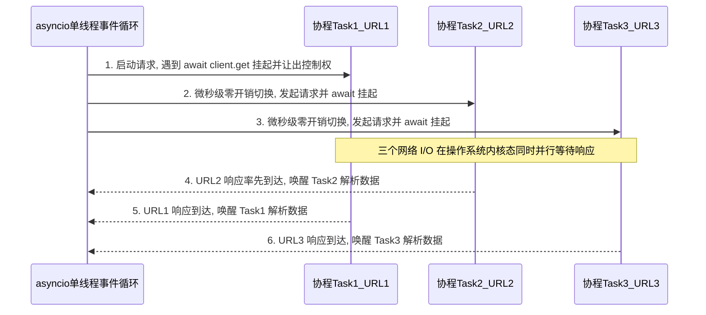

# 高性能并发与异步协程爬虫编程

## Summary

当采集规模从几百页跃升至百万级页面时，单线程同步阻塞爬虫将面临严重的性能瓶颈。本章从操作系统进程、线程与 Python 全局解释器锁（GIL）讲起，首先实战 `ThreadPoolExecutor` 线程池与 `queue.Queue` 生产者-消费者并发模型；随后重点攻克 Python `asyncio` 事件循环（Event Loop）与 `async/await` 协程编程，结合 `aiohttp`、`httpx.AsyncClient`、异步 Playwright 与 `aiofiles` 构建单机千级并发管道，并利用 `Semaphore` 信号量与 `aiolimiter` 令牌桶算法实现既快又稳的受控并发。

## Concepts Covered

This chapter covers the following 18 concepts from the learning graph:

| Concept | Concept Impact Score |
|---------|-----------------------|
| CPU密集型与网络IO密集型对比 | 267 |
| 同步阻塞请求性能瓶颈与吞吐分析 | 11 |
| 进程与线程概念及上下文切换开销 | 134 |
| Python全局解释器锁GIL影响剖析 | 133 |
| ThreadPoolExecutor线程池并发采集 | 10 |
| 线程安全队列Queue与生产者消费者 | 1 |
| ProcessPoolExecutor多进程并行解析 | 1 |
| 协程Coroutine概念与用户态切换 | 121 |
| asyncio事件循环Event-Loop原理 | 120 |
| async与await异步关键字语法规范 | 44 |
| asyncio.gather与Task并发任务编排 | 42 |
| aiohttp异步客户端与Session复用 | 36 |
| httpx.AsyncClient异步连接池调优 | 1 |
| Playwright异步API多页面并发渲染 | 4 |
| Semaphore信号量控制最大并发数 | 26 |
| 令牌桶算法与aiolimiter异步限流 | 2 |
| aiofiles异步非阻塞文件写入 | 1 |
| 多线程与异步协程爬虫压测对比 | 7 |

## Prerequisites

This chapter builds on concepts from:

- [Chapter 1: 网络爬虫导论与数据合规基石](../01-intro-and-ethics/index.md)
- [Chapter 2: Web前端基石与HTTP通信原理](../02-web-and-http-fundamentals/index.md)
- [Chapter 3: Python网络请求核心编程](../03-python-http-requests/index.md)
- [Chapter 4: 静态网页结构化解析与正则提取](../04-static-html-parsing/index.md)
- [Chapter 6: 动态渲染网页与Playwright浏览器自动化](../06-browser-automation-playwright/index.md)
- [Chapter 7: 反爬虫机制原理与工程对抗策略](../07-anti-scraping-and-countermeasures/index.md)

---

## 1. 性能瓶颈本质：I/O 密集型任务、进程线程与 GIL 锁

在前面的章节中，我们已经掌握了使用 `requests` 发起网络请求、使用 `parsel` 解析 HTML 以及应对常见反爬策略的完整技能。如果我们的任务只是抓取某高校官网的 50 篇通知公告，用一个简单的 `for` 循环逐页请求，不到 1 分钟就能顺利跑完。然而，在人工智能大语言模型（LLM）语料库建设或电商全品类价格监测等真实工业场景中，待采集的 URL 数量动辄达到**数十万乃至上千万级**。此时，传统的单线程顺序代码将遭遇毁灭性的性能墙。要打破这堵墙，我们必须深入计算机底层，厘清任务的物理属性与操作系统的并发调度机制。

### 1.1 CPU密集型与网络IO密集型对比及同步阻塞瓶颈分析

在计算机体系结构中，一切程序任务都可以根据其消耗的核心硬件资源划分为两大类：**CPU密集型与网络IO密集型对比（CPU-Bound vs. Network I/O-Bound Tasks）**。

1. **CPU 密集型任务（CPU-Bound / Compute-Bound）**  
   指程序绝大部分运行时间都在满负荷使用中央处理器（CPU）进行算术与逻辑运算。典型场景包括：大矩阵乘法与深度学习张量训练、高清视频编码转码、复杂图像滤波处理、大规模文本的复杂正则表达式回溯，以及对超大体积 HTML DOM 树（如单页数十兆字节的维基百科词条）进行深度 XPath 解析。在这类任务中，CPU 占用率接近 $100\%$，性能上限取决于 CPU 的核心数量与主频。
2. **网络 I/O 密集型任务（Network I/O-Bound）**  
   指程序绝大部分时间都在等待外部输入/输出（Input/Output）设备完成数据传输，尤其是等待网络网卡收发数据包或磁盘读写完成。**网络爬虫的下载阶段是教科书级别的极端网络 I/O 密集型任务。**

为了直观揭示**同步阻塞请求性能瓶颈与吞吐分析（Synchronous Blocking Bottleneck & Throughput Analysis）**，让我们拆解一次标准 HTTP 请求的耗时构成：

- 假设爬虫向远端服务器请求一个网页，**网络往返延迟与服务器处理耗时** $T_{\text{io}} = 200\text{ ms} = 0.200\text{ s}$（包含 DNS 查询、TCP 三次握手、TLS 握手、HTTP 请求报文传输、远端数据库查询及响应报文回传）；
- 当响应字节流到达本地内存后，CPU 执行 `parsel` 选择器提取标题与正文的**本地计算耗时**仅为 $T_{\text{cpu}} = 2\text{ ms} = 0.002\text{ s}$。

在传统的**同步阻塞（Synchronous Blocking）**模式下（如连续调用 `requests.get(url)`），当前代码必须死死卡在原地等待那漫长的 $200\text{ ms}$ 网络响应返回后，才能执行 $2\text{ ms}$ 的解析代码，然后再发起下一个请求。此时 CPU 的真实有效利用率 $\eta_{\text{cpu}}$ 为：

\[
\eta_{\text{cpu}} = \frac{T_{\text{cpu}}}{T_{\text{io}} + T_{\text{cpu}}} = \frac{2\text{ ms}}{200\text{ ms} + 2\text{ ms}} \approx 0.99\%
\]

这意味着在单线程同步爬虫运行期间，**高达 $99.01\%$ 的时间里，昂贵的 CPU 都处于无所事事的空转等待（Idle）状态！** 单线程同步爬虫的理论吞吐量（Throughput，每秒完成请求数 RPS）被死死限制在：

\[
\text{RPS}_{\text{sync}} = \frac{1}{T_{\text{io}} + T_{\text{cpu}}} \approx \frac{1}{0.202\text{ s}} \approx 4.95\text{ 页/秒}
\]

按照每秒约 5 页的速度计算，采集 $100\text{ 万}$（$10^6$）个网页需要耗费 $200,000\text{ 秒} \approx 55.6\text{ 小时}$（超过两天两夜）。如果网络延迟波动到 $500\text{ ms}$，耗时更会飙升至近一周。因此，爬虫性能优化的核心命题并非“让 CPU 算得更快”，而是**“如何把等待网络响应的那 $99\%$ 空闲时间利用起来，在同一时间窗口内同时发出并等待成百上千个网络请求”**。

### 1.2 进程与线程概念及上下文切换开销

为了实现多任务同时推进，现代操作系统提供了两个核心抽象层级：**进程与线程概念及上下文切换开销（OS Processes vs. Threads & Context Switching Overhead）**。在深入之前，请先区分两个极易混淆的术语：

- **并发（Concurrency）**：指在宏观时间段内，多个任务通过**交替轮流占用**计算资源来共同推进（例如单核 CPU 在等待请求 A 返回的空隙去发送请求 B）。
- **并行（Parallelism）**：指在同一物理时刻，多个任务在**多个不同的 CPU 物理核心**上真正同时执行运算。

操作系统管理并发与并行的两级载体分别是进程（Process）与线程（Thread）：

1. **进程（Process —— 资源分配的最小基本单位）**  
   当你运行一次 `python spider.py` 时，操作系统就会创建一个独立的 Python 进程。每个进程都拥有自己**完全独立的虚拟内存地址空间**（堆、栈、代码段、全局变量互不干扰）和独立的文件描述符表。一个进程崩溃不会直接导致另一个进程崩溃，安全性极高；但代价是进程创建慢、内存占用大（每个 Python 进程基础内存开销通常在 $20\text{ MB}\sim 50\text{ MB}$ 以上），且进程间通信（IPC）必须借助管道、队列或共享内存等特殊机制。
2. **线程（Thread —— CPU 调度执行的最小基本单位）**  
   线程存在于进程内部，一个进程可以开启多个线程。同一进程下的所有线程**共享该进程的内存空间与全局变量**，因此线程间交换数据极其方便（如直接读写同一个内存队列）。每个线程仅维护自己独立的调用栈（Stack，通常默认分配 $1\text{ MB}\sim 8\text{ MB}$ 栈空间）与 CPU 寄存器状态。
3. **内核态上下文切换开销（Kernel Context Switching Overhead）**  
   无论是进程还是操作系统原生线程（OS Native Thread），其调度权都掌握在**操作系统内核（OS Kernel）**手中。当操作系统决定暂停当前正在等待网络 I/O 的线程 A、转而唤醒就绪的线程 B 时，必须执行一次**用户态（User Space）$\leftrightarrow$ 内核态（Kernel Space）的上下文切换**：保存线程 A 的程序计数器与寄存器现场、刷新 CPU 缓存/TLB（进程切换时尤为昂贵）、加载线程 B 的上下文。每次内核级线程切换耗时约 $1\sim 5\text{ }\mu\text{s}$（微秒）。当线程数量控制在几十个以内时，这点开销微不足道；但如果盲目开启 $5,000$ 个操作系统线程，不仅单机内存（$5000 \times 2\text{ MB} \approx 10\text{ GB}$）会被瞬间撑爆，CPU 更会将绝大部分算力浪费在频繁的线程切换（Thrashing，颠簸现象）上，导致爬虫整体吞吐量断崖式下跌。

### 1.3 Python全局解释器锁GIL影响剖析

许多初学者在尝试用 Python 多线程加速代码时，都会听闻一个著名的术语：**Python全局解释器锁GIL影响剖析（Global Interpreter Lock, GIL）**。那么，GIL 究竟是什么？它会不会让多线程爬虫失效？

在我们日常使用的官方标准 **CPython 解释器**中，内存管理采用了非线程安全的**引用计数（Reference Counting）**机制。为了防止多个线程同时修改同一个 Python 对象的引用计数而导致内存损坏，CPython 设计了一把进程级别的互斥大锁——**全局解释器锁（GIL）**。GIL 的核心规则极其严格：**在同一个 Python 进程内部，任何物理时刻，最多只能有一个线程持有 GIL 并在 CPU 上执行 Python 字节码。** 即使你的服务器拥有 64 核 CPU，同一个 Python 进程里的 10 个线程也无法在 10 个核心上并行跑满计算。

!!! tip "核心工程破局点：为什么受 GIL 限制的 Python 多线程依然能大幅加速网络爬虫？"
    这是一个在面试与工程实践中极其关键的认知分水岭：

    - **对于 CPU 密集型任务（如纯数学计算、重度文本解析）**：由于线程一刻不停地在执行字节码，争夺 GIL 锁不仅无法利用多核并行，反而会因为频繁抢锁与切换比单线程还要慢！因此 CPU 密集型任务必须使用**多进程（`ProcessPoolExecutor`）**——每个子进程拥有自己独立的 Python 解释器与独立的 GIL，从而真正跑满多核 CPU。
    - **对于网络 I/O 密集型任务（如网络爬虫下载网页）**：CPython 解释器底层有一条黄金规则——**每当一个线程发起阻塞式系统 I/O 调用（如等待网卡 Socket 读取数据、等待磁盘写入、或调用 `time.sleep()`）之前，该线程会主动释放（Release）手中的 GIL 锁！** 一旦线程 A 释放了 GIL 进入网络等待，线程 B 就能立刻拿到 GIL 并发出第二个 HTTP 请求，随后线程 B 也释放 GIL，线程 C 接着发出第三个请求……当线程 A 的网络数据终于返回时，它再重新申请获取 GIL 执行那短短 $2\text{ ms}$ 的解析逻辑。

因此，在网络 I/O 占比高达 $99\%$ 的爬虫下载场景中，Python 多线程不仅**完全有效**，而且开启 $N$ 个工作线程（在合理范围内，如 $N=10\sim 50$）几乎可以将爬虫吞吐量线性提升接近 $N$ 倍！

---

## 2. 多线程与多进程并发采集实战

### 2.1 ThreadPoolExecutor线程池并发采集

在早期 Python 代码中，开发者常手动实例化 `threading.Thread` 来创建线程。但在爬虫工程中，如果有 $10,000$ 个 URL，绝不能一次性创建 $10,000$ 个线程。正确的工业级做法是使用 Python 标准库 `concurrent.futures` 提供的 **`ThreadPoolExecutor`线程池并发采集**。

**线程池（Thread Pool）**的设计思想是：预先创建固定数量（`max_workers`）的工作线程驻留在内存中，将成千上万个待抓取的 URL 作为任务放入池中排队，工作线程每抓完一个网页就自动从队列里领取下一个 URL，从而完全省去了反复创建和销毁线程的系统开销。`ThreadPoolExecutor` 提供了两种核心调度范式：

1. **`executor.map(func, urls)`**：语法最简洁，按输入列表 `urls` 的原始顺序依次返回每个网页的采集结果，适合批量静态列表抓取。
2. **`executor.submit(func, url)` 配合 `as_completed(futures)`**：`submit()` 立即返回一个代表未来结果的 `Future` 对象；将所有 `Future` 传入 `as_completed()` 迭代器后，**哪个网页先下载完成就先处理哪个（谁快谁先出）**，不会因为某一个慢网页卡住后续已完成结果的落盘，并且能针对单个任务独立捕获异常，是生产环境的首选模式。

在阅读下方的代码示例前，请注意关键参数与函数的作用：`max_workers=5` 将最大并发线程数限制为 5 个；`simulate_fetch_page(url, delay)` 模拟一个耗时 $0.2\text{ s}$ 的网络请求；`as_completed(future_to_url)` 实现了按完成先后顺序实时收集采集结果。

```python
import time
from concurrent.futures import ThreadPoolExecutor, as_completed


def simulate_fetch_page(url: str, io_delay: float = 0.2) -> dict[str, str | float]:
    """模拟单页网络 I/O 阻塞请求与轻量级解析"""
    # 在 time.sleep (模拟网络 Socket 等待) 期间，当前线程会主动释放 GIL 锁！
    time.sleep(io_delay)
    return {
        "url": url,
        "status": 200,
        "title": f"AI语料详情页 - {url.split('/')[-1]}",
        "cost_ms": round(io_delay * 1000, 1),
    }


def run_sync_vs_threadpool(urls: list[str], max_workers: int = 5) -> None:
    """对比单线程同步抓取与 ThreadPoolExecutor 线程池并发抓取耗时"""
    # 1. 传统单线程同步顺序抓取
    t0 = time.perf_counter()
    sync_results = [simulate_fetch_page(u) for u in urls]
    sync_elapsed = time.perf_counter() - t0
    print(f"🐢 [单线程同步] 抓取 {len(sync_results)} 页耗时: {sync_elapsed:.2f} 秒")

    # 2. 使用 ThreadPoolExecutor + as_completed 并发抓取
    t1 = time.perf_counter()
    concurrent_results: list[dict] = []
    # 使用 with 上下文管理器确保所有线程任务执行完毕后安全回收线程池
    with ThreadPoolExecutor(max_workers=max_workers) as executor:
        # 提交所有 URL 任务，建立 Future 对象到原始 URL 的映射字典
        future_to_url = {executor.submit(simulate_fetch_page, u): u for u in urls}

        # as_completed 会在任意一个线程完成下载时立即产出该 Future
        for future in as_completed(future_to_url):
            target_url = future_to_url[future]
            try:
                data = future.result()
                concurrent_results.append(data)
            except Exception as exc:
                print(f"❌ 抓取异常 [{target_url}]: {exc}")

    pool_elapsed = time.perf_counter() - t1
    speedup = sync_elapsed / pool_elapsed
    print(
        f"🚀 [线程池并发 (workers={max_workers})] 抓取 {len(concurrent_results)} 页耗时: "
        f"{pool_elapsed:.2f} 秒 (提速比: {speedup:.1f}x)"
    )


if __name__ == "__main__":
    sample_urls = [f"https://corpus.example.edu/doc/{i}" for i in range(1, 21)]
    run_sync_vs_threadpool(sample_urls, max_workers=5)
```

运行上述脚本可以看到：抓取 20 个单页耗时 $0.2\text{ s}$ 的网址，单线程同步模式需要 **$4.02\text{ 秒}$**，而开启 `max_workers=5` 的线程池仅需 **$0.81\text{ 秒}$**，提速比精准达到 **$5.0\text{ 倍}$**！

### 2.2 线程安全队列Queue与生产者消费者模型

`ThreadPoolExecutor` 非常适合在启动前就已经明确知道所有待抓取 URL 列表的场景。但在全站爬虫或两级联动采集中，**一组线程正在不断抓取列表页并解析出新的详情页 URL，另一组线程则需要实时消费这些新 URL 并把提取出的业务字段写入文件**。如果多个线程同时对普通的 Python `list` 执行读写操作，极易引发数据竞争（Race Condition）。

为此，Python 标准库提供了 **`queue.Queue`——线程安全队列与生产者消费者模型（Thread-Safe Queue & Producer-Consumer Pattern）**。`queue.Queue` 内部已经封装好了互斥锁（Mutex Lock）与条件变量，支持多生产者线程（Producer，负责网络下载或新链接发现）与多消费者线程（Consumer，负责数据解析或统一落盘）安全地并发交换数据。其三大核心协调方法必须成对掌握：

- **`q.put(item)`**：生产者将一个任务推入队列尾部（若设置了队列容量上限 `maxsize` 且已满，生产者会自动阻塞等待，从而天然防止内存溢出 OOM）。
- **`q.get()`**：消费者从队列头部安全取出一个任务（若队列为空，消费者会自动挂起等待）。
- **`q.task_done()` 与 `q.join()`**：每当消费者完整处理完一个从队列取出的任务后，必须调用一次 `q.task_done()` 向队列发送完成信号；主线程调用 `q.join()` 则会一直阻塞，直到队列中所有曾入队的任务全部收到 `task_done()` 确认为止。此外，工程上常采用向队列推入 `None`（称为**哨兵对象 Sentinel / 毒丸 Poison Pill**）的方式通知消费者线程优雅退出循环。

### 2.3 ProcessPoolExecutor多进程并行解析

正如 1.3 节所剖析的，当我们的爬虫下载回了数千个体积庞大、结构复杂的 HTML 文档，或者需要对提取出的海量正文字段执行密集的中文分词、正则清洗与 SimHash 指纹计算时，**解析阶段就转变成了典型的 CPU 密集型瓶颈**。受制于 GIL 锁，此时增加再多线程也无法利用多核 CPU 加速解析。

标准解决方案是引入 `concurrent.futures` 中的 **`ProcessPoolExecutor`多进程并行解析**。它的 API 接口（`submit`、`map`、`as_completed`）与 `ThreadPoolExecutor` 几乎完全一致，但底层会启动多个独立的操作系统子进程（默认数量等于机器的 CPU 逻辑核心数 `os.cpu_count()`）。在工业级混合架构中，我们通常采用**“多线程/异步协程负责高并发网络 I/O 下载 + `ProcessPoolExecutor` 多进程池负责重度 CPU 解析与清洗”**的协同流水线。

下面这段代码完整演示了两部分核心技能：一是使用 `queue.Queue` 构建“3 个下载生产者线程 + 2 个解析消费者线程”的线程安全流水线；二是展示如何定义一个顶层纯函数 `cpu_heavy_parse(raw_html)` 并交由 `ProcessPoolExecutor` 实现多核并行解析（注意：多进程传递的函数与参数必须支持 `pickle` 序列化，且必须在 `if __name__ == "__main__":` 保护块内启动）：

```python
import queue
import re
import threading
import time
from concurrent.futures import ProcessPoolExecutor


# 1. 定义供 ProcessPoolExecutor 调用的顶层 CPU 密集型解析函数
def cpu_heavy_parse(raw_html: str) -> dict[str, int]:
    """模拟针对大型 HTML 文本的高强度正则提取与词频统计 (CPU-Bound)"""
    words = re.findall(r"[a-zA-Z0-9_\u4e00-\u9fa5]+", raw_html)
    # 模拟重度 CPU 计算（如文本特征哈希计算）
    checksum = sum( ord(ch) * idx for idx, word in enumerate(words[:500]) for ch in word )
    return {"word_count": len(words), "checksum": checksum}


# 2. 基于 queue.Queue 的多线程生产者-消费者爬虫管道
def run_producer_consumer_pipeline() -> None:
    url_queue: queue.Queue[str | None] = queue.Queue(maxsize=20)
    html_queue: queue.Queue[tuple[str, str] | None] = queue.Queue(maxsize=20)
    parsed_items: list[dict] = []
    lock = threading.Lock()

    def downloader_worker(worker_id: int) -> None:
        """生产者线程：从 url_queue 取网址下载，将源码推入 html_queue"""
        while True:
            url = url_queue.get()
            if url is None:  # 收到哨兵毒丸信号，安全退出线程
                url_queue.task_done()
                break
            time.sleep(0.05)  # 模拟网络 I/O 延迟
            fake_html = f"<html><body><h1>文档 {url}</h1><p>人工智能语料内容...</p></body></html>"
            html_queue.put((url, fake_html))
            url_queue.task_done()

    def parser_worker(worker_id: int) -> None:
        """消费者线程：从 html_queue 取源码，提取结构化结果"""
        while True:
            item = html_queue.get()
            if item is None:
                html_queue.task_done()
                break
            url, html = item
            stats = cpu_heavy_parse(html)
            with lock:
                parsed_items.append({"url": url, **stats})
            html_queue.task_done()

    # 启动 3 个下载线程与 2 个解析线程
    num_downloaders, num_parsers = 3, 2
    dl_threads = [
        threading.Thread(target=downloader_worker, args=(i,))
        for i in range(num_downloaders)
    ]
    ps_threads = [
        threading.Thread(target=parser_worker, args=(i,))
        for i in range(num_parsers)
    ]
    for t in dl_threads + ps_threads:
        t.start()

    # 注入 10 个待抓取种子 URL
    for idx in range(1, 11):
        url_queue.put(f"https://ai.example.edu/paper/{idx}")

    # 等待所有 URL 下载完毕，随后投放毒丸终止下载线程
    url_queue.join()
    for _ in range(num_downloaders):
        url_queue.put(None)
    for t in dl_threads:
        t.join()

    # 等待所有 HTML 解析完毕，随后投放毒丸终止解析线程
    html_queue.join()
    for _ in range(num_parsers):
        html_queue.put(None)
    for t in ps_threads:
        t.join()

    print(f"✅ [Queue 生产者-消费者] 安全处理完成 {len(parsed_items)} 条记录")


if __name__ == "__main__":
    run_producer_consumer_pipeline()

    # 演示 ProcessPoolExecutor 多进程并行解析大批次 HTML
    batch_htmls = [f"<div>AI大模型训练语料段落 {i} " * 200 + "</div>" for i in range(8)]
    with ProcessPoolExecutor(max_workers=2) as proc_pool:
        results = list(proc_pool.map(cpu_heavy_parse, batch_htmls))
    print(f"⚙️ [ProcessPoolExecutor] 多核并行解析完成 {len(results)} 份大型文档")
```

---

## 3. 异步协程革命：`asyncio` 事件循环与 `async/await` 编程

虽然 `ThreadPoolExecutor` 已经能将爬虫速度提升数倍至数十倍，但正如我们在 1.2 节计算的，操作系统原生线程的栈内存开销（每线程数 MB）与内核态上下文切换成本，决定了单机线程池的并发上限通常止步于 **$50\sim 200$ 并发**。如果我们想要在一台普通笔记本电脑上同时保持 **$1,000\sim 5,000$ 个并发网络连接**，该怎么办？答案就是彻底抛弃多线程的内核态抢占式调度，迈入现代 Python 爬虫的皇冠技术——**异步协程（Asynchronous Coroutines）**。

### 3.1 协程Coroutine概念与用户态切换

**协程Coroutine概念与用户态切换（Coroutines & User-Space Cooperative Switching）**，全称为“协同式微线程（Cooperative Micro-threads）”。与操作系统线程相比，协程具有三个颠覆性的工程特征：

1. **完全运行在单线程用户态（Single-Threaded User Space）**：成千上万个协程全部运行在**同一个操作系统线程**内部！当协程 A 暂停并切换到协程 B 时，完全不需要陷入操作系统内核态，仅需在 Python 用户态内存中交换几个栈帧指针，**单次切换耗时仅为纳秒（$\text{ns}$）级**，比操作系统线程切换快上百倍。
2. **极致的轻量级内存占用**：一个操作系统线程动辄占用 $1\text{ MB}\sim 8\text{ MB}$ 栈内存，而一个 Python 协程对象在内存中仅占用约 **$2\text{ KB}\sim 4\text{ KB}$**。这意味着在单机内同时开启 $10,000$ 个协程，仅消耗约 $30\text{ MB}$ 内存！
3. **协作式主动让出控制权（Cooperative Multitasking）**：操作系统线程采用“抢占式调度”（随时可能被内核强行打断，因此需要加锁防冲突）；而协程采用“协作式调度”——**除非当前协程在遇到网络 I/O 等待时显式通过 `await` 关键字主动让出（Yield）CPU 控制权，否则没有任何其他协程能中途打断它**。由于全程只在单线程内顺序交替执行，协程在非 `await` 语句块之间修改共享字典或集合时更加安全可控。

### 3.2 asyncio事件循环Event-Loop原理

如果所有协程都在单线程里运行，是谁在负责监听哪一个网页的网络数据包已经到达网卡、并唤醒对应的协程继续执行呢？这个核心调度中枢就是 **`asyncio`事件循环Event-Loop原理（Event Loop & I/O Multiplexing）**。

`asyncio` 事件循环的底层依托于操作系统提供的高性能 **I/O 多路复用技术（I/O Multiplexing）**——在 Linux 下是 `epoll`，在 macOS/BSD 下是 `kqueue`，在 Windows 下是 `IOCP`。我们可以把事件循环想象成一位技艺高超的国际象棋大师，同时与 100 名棋手进行车轮战：

1. 大师（单线程 Event Loop）走到第 1 台棋桌（协程 1）前，花 $1\text{ ms}$ 走一步棋（发出 HTTP 请求报文），并把该网络连接的套接字（Socket）注册到操作系统的 `epoll/IOCP` 监听器上；
2. 在等待第 1 名对手思考（等待远端服务器经过 $200\text{ ms}$ 网络返回响应）期间，**大师绝不会呆立在 1 号桌前苦等**，而是立即挂起协程 1，转身走到 2 号桌（协程 2）发出第 2 个请求，接着去 3 号桌、4 号桌……
3. 当操作系统底层网卡收到 1 号桌或 5 号桌返回的 HTTP 响应字节流时，`epoll/IOCP` 会立刻触发就绪事件通知事件循环；大师随即回到对应的棋桌前，从上次 `await` 暂停的那一行代码处精准恢复该协程的执行，完成网页解析。

### 3.3 async与await异步关键字语法规范

Python 通过 **`async`与`await`异步关键字语法规范** 将上述复杂的事件循环机制封装成了极其优雅的原生语法：

- **`async def func_name():`**：使用 `async def` 定义的函数称为**协程函数（Coroutine Function）**。**极易踩坑点**：直接调用 `coro = fetch(url)` **并不会执行函数体内的任何代码**，它只是返回一个尚未运行的协程对象（Coroutine Object）。要真正启动顶层协程，必须使用 `asyncio.run(main())`。
- **`await <awaitable>`**：`await` 关键字只能在 `async def` 函数内部使用。它的含义是：**“在此处暂停当前协程的执行，将控制权交还给 `asyncio` 事件循环去跑其他就绪任务；直到右侧的可等待对象（如异步网络请求、异步文件写入或 `asyncio.sleep`）完成后，再拿着返回结果从这里继续往下走。”**
- **`async with` 与 `async for`**：分别表示异步上下文管理器（在进入 `__aenter__` 和退出 `__aexit__` 时自动支持 `await`，如安全管理异步连接池 `ClientSession`）和异步迭代器（在每次迭代获取下一块流式数据时自动 `await`）。

!!! danger "异步协程爬虫『头号死穴』：严禁在 `async def` 中混用同步阻塞调用！"
    这是初学者编写异步爬虫时最常犯的致命错误：在 `async def` 函数内部写下了 `time.sleep(2)` 或 `requests.get(url)`！
    请牢记：`asyncio` 的一切并发魔力都建立在遇到 I/O 时通过 `await` **主动向事件循环让出控制权**之上。如果你调用了传统的同步阻塞函数 `requests.get()` 或 `time.sleep()`，它根本不会通知事件循环，而是直接把**唯一的那个操作系统主线程死死卡住**！一旦主线程被阻塞，整个事件循环里的其他 999 个协程将全部陷入假死停摆，你的异步爬虫瞬间退化成最慢的单线程同步爬虫！
    **铁律对照表**：

    - 严禁使用 `time.sleep(n)` $\rightarrow$ 必须替换为 **`await asyncio.sleep(n)`**；
    - 严禁使用 `requests.get(url)` $\rightarrow$ 必须替换为 **`aiohttp`** 或 **`httpx.AsyncClient`**；
    - 严禁在大吞吐循环中直接使用同步阻塞 `open().write()` $\rightarrow$ 替换为 **`aiofiles.open()`**。

### 3.4 asyncio.gather与Task并发任务编排

在编写异步爬虫时，另一个高频误区是**“在 `for` 循环中直接逐个 `await`”**：

```python
# ❌ 错误示范：在循环里直接 await，本质上还是等第1个抓完再发第2个（完全串行！）
for url in urls:
    html = await fetch(url)
```

要让所有请求在同一时刻并发飞出去，必须掌握 **`asyncio.gather`与`Task`并发任务编排**：

1. **`asyncio.create_task(coro)`**：将一个协程对象包装成 `Task` 任务并**立即注册到事件循环的就绪队列中开始后台调度执行**，而无需等待它完成即可继续往下走。
2. **`await asyncio.gather(*tasks, return_exceptions=True)`**：接收一组协程或 `Task` 对象，将它们**同时并发调度到事件循环中运行**，并等待全部完成后按传入顺序返回结果列表。
   - **生产环境必加参数 `return_exceptions=True`**：默认情况下（`return_exceptions=False`），只要并发的 100 个 URL 中有 1 个 URL 抛出网络超时异常，`gather` 就会立刻向上抛出异常中断主流程；而设置 **`return_exceptions=True`** 后，单个失败任务的异常对象会被作为普通元素放进返回列表中，其余 99 个正常任务不受任何影响！

下面这段代码完整展示了“错误的循环内串行 `await`”与“正确的 `create_task` + `asyncio.gather(..., return_exceptions=True)` 并发任务编排”在耗时与容错处理上的巨大差异：

```python
import asyncio
import time


async def mock_async_fetch(url: str, delay: float = 0.2) -> dict[str, str]:
    """模拟异步非阻塞网络请求协程"""
    # 使用 await asyncio.sleep 主动将控制权交还给 Event Loop
    await asyncio.sleep(delay)
    if "bad-link" in url:
        raise TimeoutError(f"请求超时: {url}")
    return {"url": url, "content": f"<html>{url} 的正文内容</html>"}


async def main() -> None:
    urls = [
        "https://ai.example.edu/p/1",
        "https://ai.example.edu/p/2",
        "https://ai.example.edu/bad-link",  # 故意混入一个会超时的异常链接
        "https://ai.example.edu/p/4",
        "https://ai.example.edu/p/5",
    ]

    # 1. 反面教材：在 for 循环中直接 await（退化为串行等待，总耗时 = 5 * 0.2s = 1.0s）
    t0 = time.perf_counter()
    for u in urls[:3]:
        try:
            await mock_async_fetch(u, delay=0.2)
        except TimeoutError:
            pass
    print(f"⚠️ [错误示范：循环内直接 await] 抓取 3 页串行耗时: {time.perf_counter() - t0:.2f} 秒")

    # 2. 正确范式：使用 create_task + asyncio.gather(return_exceptions=True) 并发编排
    t1 = time.perf_counter()
    tasks = [asyncio.create_task(mock_async_fetch(u, delay=0.2)) for u in urls]

    # return_exceptions=True 确保单个任务报错不会中断其余并发任务
    results = await asyncio.gather(*tasks, return_exceptions=True)
    elapsed = time.perf_counter() - t1

    success_list: list[dict] = []
    for url, res in zip(urls, results):
        if isinstance(res, Exception):
            print(f"  🛡️ [容错拦截] {url} 采集失败 -> {res}")
        else:
            success_list.append(res)

    print(
        f"⚡ [正确示范：asyncio.gather 并发] 同时抓取 {len(urls)} 页总耗时: "
        f"{elapsed:.2f} 秒 (成功 {len(success_list)} 页)"
    )


if __name__ == "__main__":
    asyncio.run(main())
```

在进入下一节工业级异步 HTTP 客户端实战之前，我们先通过下方的交互式微仿真对比“单线程同步阻塞”、“多线程池并发”与“单线程 `asyncio` 异步协程”三种模型在时间轴上的任务推进规律与吞吐量表现。

#### Diagram: Synchronous vs Threaded vs Asyncio Event Loop Concurrency Simulator



<details markdown="1">
<summary>Synchronous vs Threaded vs Asyncio Event Loop Concurrency Simulator</summary>
Type: microsim
**sim-id:** concurrency-model-timeline-simulator<br/>
**Library:** p5.js<br/>
**Status:** Specified<br/>
**Bloom Level:** Analyze<br/>
**Bloom Verb:** compare<br/>
**Learning Objective:** The learner will compare total elapsed time, throughput (pages/s), and CPU utilization across synchronous blocking, `ThreadPoolExecutor` multi-threading, and `asyncio` coroutine execution models for a configurable batch of web scraping tasks.

**Prerequisites:** Network I/O latency ($T_{\text{io}}$), CPU parsing time ($T_{\text{cpu}}$), synchronous blocking, `ThreadPoolExecutor` (`max_workers`), `asyncio` Event Loop, `await` cooperative yielding (all defined in Sections 1.1–3.4 above).

**Evidence of Mastery:** Across 3 diagnostic scenarios, the learner calculates and predicts the total elapsed time (to within $\pm 0.1\text{ s}$) or identifies which concurrency model achieves the target throughput with the lowest memory footprint before running the timeline trace. Mastery is answering all 3 scenario challenges correctly within at most 2 attempts per challenge.

**Misconceptions:** (1) Increasing CPU clock speed significantly reduces the runtime of a single-threaded synchronous scraper when network I/O latency is $200\text{ ms}$ and CPU parse time is $2\text{ ms}$. (2) `asyncio` coroutines achieve speedups by running on multiple CPU cores simultaneously rather than overlapping network I/O waits on a single thread. (3) Calling blocking `time.sleep()` inside an `async def` coroutine still allows other coroutines to run concurrently.

**Instructional Rationale:** Analyze-level comparison requires learners to compute how I/O waiting intervals overlap across worker lanes or coroutine slots and commit a quantitative prediction before inspecting the animated timeline bars.

**Content:**

Adjustable model parameters in free exploration mode:

| Quantity | Min | Max | Step | Default | Unit |
|---|---|---|---|---|---|
| 待抓取网页总数 $N$ | 10 | 100 | 10 | 20 | 页 (pages) |
| 单页网络 I/O 延迟 $T_{\text{io}}$ | 0.10 | 0.50 | 0.10 | 0.20 | s |
| 单页 CPU 解析耗时 $T_{\text{cpu}}$ | 0.002 | 0.010 | 0.002 | 0.002 | s |
| 并发度 $C$ (线程数或协程并发槽位) | 1 | 20 | 1 | 5 | 并发槽 (slots) |

Three execution models compared side by side:
1. `Model A: 单线程同步阻塞 (requests)`: Always processes 1 page at a time sequentially ($C = 1$). Memory overhead: $25\text{ MB}$ base process.
2. `Model B: 多线程池并发 (ThreadPoolExecutor)`: Processes up to $C$ pages per wave, releasing the GIL during $T_{\text{io}}$. Memory overhead: $25\text{ MB} + C \times 2.0\text{ MB}$ OS thread stacks.
3. `Model C: 单线程异步协程 (asyncio + aiohttp)`: Overlaps $C$ coroutines on 1 OS thread via Event Loop `await` switching during $T_{\text{io}}$. Memory overhead: $25\text{ MB} + C \times 0.003\text{ MB}$ coroutine frames.

Three diagnostic challenges (fixed order):

| # | Scenario Parameters | Question Prompt | Correct Answer | Tolerance / Rule | Feedback When Wrong |
|---|---|---|---|---|---|
| 1 | $N = 20$ 页, $T_{\text{io}} = 0.20\text{ s}$, $T_{\text{cpu}} = 0.002\text{ s}$, 并发度 $C = 5$ | 在 `ThreadPoolExecutor(max_workers=5)` 下，20 个网页分 4 批（$\lceil 20 / 5 \rceil = 4$）完成网络 I/O 等待，请计算总耗时约为多少秒？ | `0.84` s (or `0.81`–`0.85` s) | Numeric input within $\pm 0.10\text{ s}$ of $0.84\text{ s}$ | 20 个网页由 5 个线程分 4 波并发等待 I/O（$4 \times 0.20\text{ s} = 0.80\text{ s}$），加上总计 $20 \times 0.002\text{ s} = 0.04\text{ s}$ 的 GIL 串行 CPU 解析时间，总耗时约为 $0.84\text{ 秒}$，而非单线程的 $4.04\text{ 秒}$。 |
| 2 | $N = 100$ 页, $T_{\text{io}} = 0.20\text{ s}$, $T_{\text{cpu}} = 0.002\text{ s}$, 并发度 $C = 20$ | 当并发度设为 $C = 20$ 时，对比 `ThreadPoolExecutor` 与 `asyncio` 协程：哪一种方案在保持约 $83\text{ 页/秒}$ 高吞吐量的同时，仅需单线程用户态切换且新增内存不足 $0.1\text{ MB}$？ | `Model C: 单线程异步协程 (asyncio + aiohttp)` | Exact selection among Models A, B, C | `ThreadPoolExecutor` 开启 20 个操作系统线程需额外消耗约 $40\text{ MB}$ 栈内存并伴随内核态切换；而 `asyncio` 在单线程内切换 20 个协程仅增加约 $0.06\text{ MB}$ 内存。 |
| 3 | $N = 10$ 页, $T_{\text{io}} = 0.20\text{ s}$, 开发者在 `async def` 中错误使用了同步 `time.sleep(0.20)` 代替 `await asyncio.sleep(0.20)` | 此时开启 10 个协程并发执行 `asyncio.gather`，实际总耗时将变成多少秒？ | `2.02` s | Numeric input within $\pm 0.10\text{ s}$ of $2.02\text{ s}$ | 在协程中调用同步阻塞的 `time.sleep(0.20)` 不会向事件循环让出控制权，导致单线程 Event Loop 被彻底卡死，10 个协程退化为完全串行执行：$10 \times (0.20 + 0.002) = 2.02\text{ 秒}$！ |

**Provenance:** Derived directly from the analytical equations in Chapter 8 Section 1.1 and the timing benchmarks in Sections 2.1 and 3.4.

**Rules:**
- For `Model A (Sync)`: $\text{Total Time} = N \times (T_{\text{io}} + T_{\text{cpu}})$.
- For `Model B (ThreadPool)` and `Model C (Asyncio)` with concurrency $C$: number of waves $W = \lceil N / C \rceil$. Since CPU parsing holds the GIL or runs on the single event loop thread while I/O waits overlap across $C$ concurrent slots, $\text{Total Time} = W \times T_{\text{io}} + N \times T_{\text{cpu}}$.
- Throughput $\text{RPS} = N / \text{Total Time}$.
- CPU Utilization $\eta_{\text{cpu}} = (N \times T_{\text{cpu}}) / \text{Total Time} \times 100\%$.
- When the "Blocking `time.sleep` bug" toggle is active in Model C, $C$ is forced to $1$ because the event loop cannot switch during $T_{\text{io}}$.

**Learner Activity:**

1. The learner reads Challenge 1 ($N=20, T_{\text{io}}=0.20\text{ s}, C=5$), types the predicted total time in seconds, and submits the check.
2. The sim renders the three timeline Gantt charts showing I/O wait segments and CPU parse segments, confirming the $4.04\text{ s}$ (Sync) vs. $0.84\text{ s}$ (Concurrent) contrast.
3. The learner completes Challenges 2 and 3, observing the memory comparison bar and the effect of the blocking call bug on the Event Loop timeline.
4. After completing the 3 challenges, the learner adjusts the sliders ($N, T_{\text{io}}, T_{\text{cpu}}, C$) in free exploration mode to observe how RPS and CPU utilization scale with concurrency.

**Feedback:** 3 challenges in fixed order, 2 attempts per challenge. Correct: "计算与分析完全正确！" followed by the model metrics. Incorrect: displays the corresponding `Feedback When Wrong` explanation from the Content table. After the second wrong attempt, the exact answer and formula breakdown are revealed. Score counter displays `并发模型分析闯关：n / 3`.

**Starting State:** Challenge 1 is active with parameters preset to $N = 20, T_{\text{io}} = 0.20\text{ s}, T_{\text{cpu}} = 0.002\text{ s}, C = 5$. Model A shows a completed $4.04\text{ s}$ bar, while Models B and C await the learner's time prediction with the prompt: "请计算在 5 并发槽位下抓取 20 页所需的总耗时（秒），然后点击验证运行时间轴对比。"

**Chapter Anchors:** Matches Section 1.1 ($T_{\text{io}} = 200\text{ ms}$, $T_{\text{cpu}} = 2\text{ ms}$, $\eta_{\text{cpu}} \approx 0.99\%$), Section 2.1 (20 pages with `max_workers=5` taking $\sim 0.81\text{ s}$ vs. $\sim 4.02\text{ s}$ sync), and Section 3.3 (blocking `time.sleep` inside `async def` stalls the entire Event Loop).
</details>

---

## 4. 异步网络请求生态：`aiohttp`、`httpx` 与异步 Playwright

理解了 `asyncio` 事件循环与 `async/await` 语法后，我们需要将底层的阻塞式 `requests` 库替换为真正支持异步非阻塞 Socket 通信的工业级客户端库。目前 Python 异步爬虫生态呈现出 **`aiohttp`**、**`httpx`** 与 **异步 Playwright** 三驾马车并驾齐驱的格局。

### 4.1 aiohttp异步客户端与Session复用

**`aiohttp`异步客户端与Session复用（`aiohttp.ClientSession` Reuse）** 是 Python 异步 HTTP 领域历史最悠久、单机吞吐性能最极致的核心库（安装命令：`pip install aiohttp`）。在使用 `aiohttp` 编写高并发爬虫时，有三条必须严格遵守的工程规范：

1. **全局复用唯一的 `aiohttp.ClientSession`**  
   **严禁在每个单页抓取函数内部新建 `ClientSession()`！** 因为 `ClientSession` 内部维护着底层的 **TCP 连接池（`TCPConnector`）**、DNS 缓存和 Cookie 罐。如果每抓一个网页都新建一个 Session，不仅无法复用 HTTP Keep-Alive 长连接（每次都要重新经历昂贵的 TCP 三次握手与 TLS 握手），更会在高并发下迅速耗尽操作系统的本地临时端口（Ephemeral Ports）与文件描述符。正确做法是在 `main()` 函数顶层通过 `async with aiohttp.ClientSession(...) as session:` 创建一个全局会话，并将其作为参数传递给所有并发子任务。
2. **注意响应读取方法是协程（需加 `await`）**  
   在同步 `requests` 中，`resp.text` 是属性，`resp.json()` 是普通方法；而在 `aiohttp` 中，读取响应体字节流同样是一个网络 I/O 过程，因此**必须写成 `html = await resp.text()`、`data = await resp.json()` 或 `raw_bytes = await resp.read()`**。
3. **显式配置 `ClientTimeout` 与 `TCPConnector`**  
   通过 `aiohttp.ClientTimeout(total=10, connect=3)` 设置总超时与连接建立超时，并通过 `aiohttp.TCPConnector(limit=100, ssl=False)` 管控连接池的最大并行 TCP 连接数。

### 4.2 httpx.AsyncClient异步连接池调优

如果你非常喜欢第 3 章所学 `requests` 的简洁 API（如直接访问 `resp.text` 属性和调用 `resp.json()` 方法），同时又需要请求开启了 **HTTP/2 多路复用协议** 或需要兼顾同步/异步双模式的现代网站，那么 **`httpx.AsyncClient`异步连接池调优** 是最佳选择（安装命令：`pip install "httpx[http2]"`）。

`httpx.AsyncClient` 同样采用 `async with httpx.AsyncClient(http2=True, limits=limits, timeout=10.0) as client:` 顶层上下文复用机制。其连接池调优通过 `httpx.Limits` 对象精细控制：

- **`max_connections=100`**：允许客户端同时打开的最大 TCP 连接总数。
- **`max_keepalive_connections=20`**：允许在连接池中保持长连接复用（Keep-Alive）的最大空闲连接数。当开启 `http2=True` 时，`httpx` 甚至可以在**单条 TCP 连接**上通过二进制帧多路复用并发传输数十个请求，极大降低了握手延迟与被防火墙识别为连接洪泛的风险。

下面这段代码对比展示了如何使用 `aiohttp.ClientSession` 与 `httpx.AsyncClient` 编写规范的连接池复用高并发采集器：

```python
import asyncio
import aiohttp
import httpx


# 方案 A：使用 aiohttp.ClientSession 实现高吞吐异步抓取
async def fetch_with_aiohttp(
    session: aiohttp.ClientSession, url: str
) -> dict[str, int | str]:
    """复用顶层传入的 aiohttp.ClientSession 发起非阻塞请求"""
    async with session.get(url) as resp:
        # 注意：在 aiohttp 中读取响应文本必须加 await！
        text = await resp.text()
        return {"engine": "aiohttp", "url": url, "status": resp.status, "length": len(text)}


async def run_aiohttp_batch(urls: list[str]) -> list[dict]:
    # 配置连接池上限为 50，总超时为 10 秒
    connector = aiohttp.TCPConnector(limit=50, limit_per_host=20)
    timeout = aiohttp.ClientTimeout(total=10.0, connect=3.0)
    headers = {"User-Agent": "Mozilla/5.0 (AICorpusCrawler/2.0)"}

    # 顶层创建唯一 ClientSession，全批次共享 TCP Keep-Alive 连接池
    async with aiohttp.ClientSession(
        connector=connector, timeout=timeout, headers=headers
    ) as session:
        tasks = [asyncio.create_task(fetch_with_aiohttp(session, u)) for u in urls]
        return await asyncio.gather(*tasks, return_exceptions=True)


# 方案 B：使用 httpx.AsyncClient 开启连接池调优与 HTTP/2 支持
async def run_httpx_batch(urls: list[str]) -> list[dict]:
    limits = httpx.Limits(max_connections=50, max_keepalive_connections=20)
    timeout = httpx.Timeout(10.0, connect=3.0)

    async with httpx.AsyncClient(limits=limits, timeout=timeout) as client:
        async def _get_one(url: str) -> dict[str, int | str]:
            resp = await client.get(url)
            # 在 httpx 中，resp.await 完成后响应体已读入内存，resp.text 是普通属性
            return {"engine": "httpx", "url": url, "status": resp.status_code, "length": len(resp.text)}

        tasks = [asyncio.create_task(_get_one(u)) for u in urls]
        return await asyncio.gather(*tasks, return_exceptions=True)
```

### 4.3 Playwright异步API多页面并发渲染

在第 6 章中，我们已经学习了如何使用 Playwright 攻克 Vue/React 动态渲染页面。但如果你在一个浏览器实例里串行打开 100 个网页，由于每个网页都要等待 JS 引擎执行与网络空闲，采集速度依然缓慢。那么，能否把 `asyncio` 并发思想应用到无头浏览器上呢？这就是 **`Playwright`异步API多页面并发渲染（`playwright.async_api` Multi-Page Concurrent Rendering）**。

在异步 Playwright 架构中，为了兼顾性能与内存安全，我们遵循**“单 Browser 进程 + 单/多 BrowserContext 上下文 + 多 Page 标签页并发 + Semaphore 限制同时打开的标签页数”**的黄金工程模式：

1. **绝不并发启动多个 `chromium.launch()` 浏览器进程**：一个 Chromium 实例占用的内存高达数百 MB。正确做法是全局只启动 **1 个 `browser` 实例**。
2. **并发打开多个轻量级 `context.new_page()` 标签页**：在同一个 `BrowserContext` 下通过 `asyncio.gather` 同时打开 $3\sim 8$ 个 `Page` 标签页并发渲染，用完后在 `finally` 块中立即调用 `await page.close()` 释放 DOM 内存，并配合路由拦截（`page.route`）屏蔽无关图片以进一步提速。

```python
import asyncio
from playwright.async_api import BrowserContext, async_playwright


async def render_single_spa_page(
    context: BrowserContext, url: str, sem: asyncio.Semaphore
) -> dict[str, str]:
    """在共享的 BrowserContext 中受控并发打开独立 Page 标签页渲染动态网页"""
    async with sem:  # 限制同时打开的浏览器标签页数量，防止内存爆满
        page = await context.new_page()
        try:
            # 拦截图片与字体资源，大幅加快并发渲染速度
            await page.route(
                "**/*.{png,jpg,jpeg,webp,woff,woff2}",
                lambda route: route.abort(),
            )
            await page.goto(url, wait_until="domcontentloaded", timeout=15000)
            title = await page.title()
            return {"url": url, "title": title, "status": "rendered"}
        except Exception as err:
            return {"url": url, "title": "", "status": f"error: {err}"}
        finally:
            # 关键：渲染提取完毕后必须立即关闭标签页，回收渲染进程内存！
            await page.close()


async def run_concurrent_playwright(urls: list[str], max_tabs: int = 4) -> list[dict]:
    """单浏览器实例 + 多标签页受控并发渲染主流程"""
    sem = asyncio.Semaphore(max_tabs)
    async with async_playwright() as p:
        browser = await p.chromium.launch(headless=True)
        context = await browser.new_context(
            user_agent="Mozilla/5.0 (Windows NT 10.0; Win64; x64) Chrome/128.0.0.0"
        )
        tasks = [
            asyncio.create_task(render_single_spa_page(context, u, sem))
            for u in urls
        ]
        results = await asyncio.gather(*tasks)
        await browser.close()
        return results
```

---

## 5. 受控并发、平滑限流与异步全链路压测

掌握了 `asyncio.gather` 与 `aiohttp` 后，很多同学会兴奋地把 $10,000$ 个 URL 一次性塞进 `asyncio.gather(*tasks)`。然而运行后的结果往往是灾难性的：

1. **瞬间打崩目标服务器或触发 WAF 封禁**：10,000 个 HTTP 请求在短短几十毫秒内像海啸一样同时砸向目标服务器，轻则返回满屏的 `429 Too Many Requests` / `503 Service Unavailable` 并封禁你的 IP，重则涉嫌构成 DDoS 攻击；
2. **撑爆本机资源**：操作系统的并发 Socket 句柄被耗尽，抛出 `Too many open files` 或连接重置错误。

真正的工业级异步爬虫，追求的绝不是“失控的裸奔并发”，而是**“受控并发（Controlled Concurrency）与平滑速率限制（Smooth Rate Limiting）”**。

### 5.1 Semaphore信号量控制最大并发数

**`Semaphore`信号量控制最大并发数（`asyncio.Semaphore`）** 是控制**同一时刻处于飞行/处理状态的最大并发任务数（In-Flight Requests）**的标准原语。我们可以把 `sem = asyncio.Semaphore(K)` 想象成一家只有 $K$ 张餐桌的餐厅门口的叫号机：

- 信号量内部维护一个初始值为 $K$（例如 `K = 20`）的计数器；
- 每当一个协程进入 `async with sem:` 代码块时，计数器减 1（占用一张餐桌）；
- 当第 21 个协程到达 `async with sem:` 时，此时计数器为 `0`，该协程会自动在门口挂起排队，不会发起网络请求；
- 只要前 20 个协程中有任意一个完成了网页下载并退出 `async with sem:` 块，计数器立即加 1，排在队首的第 21 个协程瞬间被唤醒补位！

这样一来，无论你有 1,000 个还是 100 万个待抓取 URL，网络上**同一时刻正在进行的并发连接数永远严格 $\le K$**。

### 5.2 令牌桶算法与aiolimiter异步限流

虽然 `Semaphore(20)` 限制了同时在飞的请求数不超过 20 个，但它并不能直接控制**每秒发出的请求速率（RPS / QPS）**。例如，如果目标服务器响应极快（仅需 $20\text{ ms}$），那么 20 个并发槽位每秒依然会倾泻出 $20 / 0.02\text{ s} = 1,000$ 次请求！如果目标サイトの反爬风控规则是“单 IP 每秒最多允许 10 次请求，允许短时突发 15 次”，我们就需要引入经典的**令牌桶算法与`aiolimiter`异步限流（Token Bucket Algorithm & `aiolimiter`）**（安装命令：`pip install aiolimiter`）。

**令牌桶算法（Token Bucket）**的数学与物理模型如下：

1. 系统有一个最大容量为 $B$（Burst Capacity，最大突发令牌数）的桶；
2. 系统以恒定速率 $r$（Refill Rate，每秒生成令牌数，即长期平均 RPS 上限）向桶中匀速放入令牌；如果桶已装满 $B$ 个令牌，新生成的令牌则溢出丢弃；
3. 每当爬虫准备发起 1 次 HTTP 请求前，必须先从桶中取走 1 个令牌：
   - 若桶中当前令牌数 $\ge 1$，则立即取走 1 个令牌并发起请求（无需等待）；
   - 若桶已空，则协程在 `async with limiter:` 处平滑挂起等待 $\frac{1}{r}$ 秒，直到新令牌生成。

因此，在时长为 $T$ 秒的任意时间窗口内，令牌桶允许通过的最大请求总数 $M(T)$ 严格满足线性上界公式：

\[
M(T) \le B + r \times T
\]

在 Python 中，我们使用 `from aiolimiter import AsyncLimiter` 即可一行代码创建令牌桶：例如 `limiter = AsyncLimiter(max_rate=10, time_period=1.0)` 表示每秒最多通过 10 个请求。在工业实践中，**将 `asyncio.Semaphore`（控最大并发连接数）与 `AsyncLimiter`（控每秒请求发包速率）双剑合璧**，是既不触发 `429` 封禁又能榨干合规带宽的黄金法则。

下面请通过交互式仿真器亲自调整 `Semaphore` 并发上限与令牌桶速率参数，观察爬虫如何在“超高吞吐量”与“零 429 封禁率”之间找到最优工程平衡点。

#### Diagram: Asyncio Semaphore and Token Bucket Rate Limiter Simulator


<details markdown="1">
<summary>Asyncio Semaphore and Token Bucket Rate Limiter Simulator</summary>
Type: microsim
**sim-id:** semaphore-token-bucket-limiter<br/>
**Library:** p5.js<br/>
**Status:** Specified<br/>
**Bloom Level:** Apply<br/>
**Bloom Verb:** configure<br/>
**Learning Objective:** The learner will configure `asyncio.Semaphore` concurrency limits and Token Bucket (`AsyncLimiter`) refill rates so a 60-request scraping batch finishes within a target time budget while keeping HTTP 429 rate-limit errors at zero.

**Prerequisites:** `asyncio.Semaphore` (maximum in-flight concurrent requests $K$), Token Bucket burst capacity ($B$) and refill rate ($r$), HTTP `429 Too Many Requests` anti-scraping threshold (all defined in Sections 5.1 and 5.2 above).

**Evidence of Mastery:** Across 3 engineering tuning tasks, the learner configures the Semaphore limit $K$ and Token Bucket rate $r$ (requests/s) and runs the 60-request simulation. A configuration is correct when it satisfies both the server's zero-429 safety rule and the task's completion time target. Mastery is passing all 3 tuning tasks.

**Misconceptions:** (1) Setting `Semaphore(10)` guarantees the request rate will never exceed 10 requests per second even when server latency is $0.05\text{ s}$ (where 10 slots actually fire $10 / 0.05 = 200\text{ req/s}$). (2) Setting an unbounded `asyncio.gather` without a Semaphore or Token Bucket finishes faster when the target server enforces a strict 429 rate limit with a $5\text{ s}$ penalty cooldown.

**Instructional Rationale:** Apply-level configuration requires learners to translate server anti-scraping constraints (max concurrent connections and max RPS) into concrete `Semaphore(K)` and `AsyncLimiter(r)` parameter settings and verify the resulting request flow and 429 error count.

**Content:**

Adjustable learner controls:

| Quantity | Min | Max | Step | Default | Unit |
|---|---|---|---|---|---|
| 信号量并发上限 `Semaphore(K)` | 2 | 50 | 2 | 20 | 并发连接 (connections) |
| 令牌桶补充速率 `AsyncLimiter(r)` | 5 | 50 | 5 | 25 | 请求/秒 (req/s) |
| 令牌桶初始突发容量 $B$ | 5 | 20 | 5 | 10 | 令牌 (tokens) |

Fixed simulation environment parameters displayed on screen:
- 总待抓取任务数：$M_{\text{total}} = 60$ 个请求
- 单次请求服务器响应延迟：$T_{\text{io}} = 0.20\text{ s}$
- 目标服务器 WAF 风控规则：
  1. **最大允许同时在线连接数**：$K_{\text{max}} = 12$ 个连接（若 `Semaphore(K) > 12`，超出部分的请求将立即返回 `HTTP 429/503 Connection Limit Exceeded`）。
  2. **最大允许持续请求速率**：$r_{\text{max}} = 15\text{ req/s}$，允许初始突发容量 $B_{\text{max}} = 10$（若 `AsyncLimiter(r) > 15` 或 `B > 10`，超出配额的请求将触发 `HTTP 429 Too Many Requests` 并强制惩罚等待 $5.0\text{ s}$）。

Three engineering tuning tasks (fixed order):

| # | Task Scenario & Goal | Valid Parameter Condition | Expected Clean Time at Optimal Setting | Feedback When Wrong |
|---|---|---|---|---|
| 1 | **诊断裸奔并发灾难**：保持默认的 `Semaphore(20)` 与 `AsyncLimiter(25)` 直接点击运行，观察触发了多少次 `HTTP 429` 拦截，随后将 `Semaphore(K)` 调低至满足服务器最大连接数限制（$\le 12$），并将 `AsyncLimiter(r)` 调至安全速率（$\le 15\text{ req/s}$，$B \le 10$），实现 **0 次 429 报错**完成全部 60 页抓取。 | $K \le 12$ AND $r \le 15$ AND $B \le 10$ | $3.53\text{ s}$ at $K=10, r=15, B=10$ | 当前参数违反了服务器风控阈值（要求同时连接数 $K \le 12$、持续速率 $r \le 15\text{ req/s}$、突发桶容量 $B \le 10$），导致大量请求返回 HTTP 429！请调低信号量或令牌桶速率。 |
| 2 | **极限合规提速挑战**：在保证 **0 次 HTTP 429 报错**（即 $K \le 12, r \le 15, B \le 10$）的前提下，优化配置使 60 个请求的总完成耗时 **$\le 3.80\text{ 秒}$**。 | $6 \le K \le 12$ AND $r = 15$ AND $B = 10$ | $3.53\text{ s}$ | 虽然未触发 429 报错，但你的并发度 $K$ 或令牌速率 $r$ 设置过于保守，导致总耗时超过 $3.80\text{ 秒}$。提示：将令牌速率推满至合规上限 $r = 15\text{ req/s}$、突发容量 $B = 10$，并确保 $K \ge 6$（因为 $15\text{ req/s} \times 0.20\text{ s} = 3$，留出余量 $K=6\sim 12$ 即可跑满速率）。 |
| 3 | **低延迟高 RPS 陷阱排查**：假设服务器升级后响应延迟缩短至 $T_{\text{io}} = 0.05\text{ s}$（极快响应），服务器取消了突发配额（要求 $B = 5$）且严格限制持续速率 $r \le 10\text{ req/s}$、连接数 $K \le 8$。请重新配置参数，在 **0 次 429 报错**下以 **$\le 5.80\text{ 秒}$** 完成 60 页采集。 | $2 \le K \le 8$ AND $r = 10$ AND $B = 5$ | $5.55\text{ s}$ | 当服务器响应极快（$0.05\text{ s}$）时，仅靠 `Semaphore(8)` 会产生 $8 / 0.05 = 160\text{ req/s}$ 的瞬间洪峰！必须同时设置 `AsyncLimiter(r=10)` 与突发容量 $B=5$ 才能压住发包速率。 |

**Provenance:** Formulated from the Token Bucket upper-bound equation $M(T) \le B + r \times T$ and `asyncio.Semaphore` + `aiolimiter` co-design in Chapter 8 Sections 5.1 and 5.2.

**Rules:**
- Effective instantaneous concurrency is bounded by $K$. Without token bucket throttling, $K$ slots with latency $T_{\text{io}}$ generate up to $K / T_{\text{io}}$ requests/s.
- With Token Bucket $(r, B)$ and Semaphore $K$, the first $\min(K, B)$ requests launch immediately at $t = 0$, and the remaining $M_{\text{total}} - B$ requests are paced by $\min(r, K / T_{\text{io}})$. Thus clean completion time (when $K \le K_{\text{max}}, r \le r_{\text{max}}, B \le B_{\text{max}}$) is:
  \[
  T_{\text{total}} = \frac{M_{\text{total}} - B}{\min(r, K / T_{\text{io}})} + T_{\text{io}}
  \]
- Whenever $K > K_{\text{max}}$ or $r > r_{\text{max}}$ or $B > B_{\text{max}}$, the simulation flags HTTP 429 errors and adds a $+5.0\text{ s}$ penalty cooldown.

**Learner Activity:**

1. In Task 1, the learner observes the default configuration ($K=20, r=25, B=10$) trigger HTTP 429 errors, then adjusts $K \le 12$ and $r \le 15$ and re-runs to achieve 0 errors.
2. In Task 2, the learner tunes $K, r, B$ to finish all 60 requests in $\le 3.80\text{ s}$ with 0 errors.
3. In Task 3 (where server latency drops to $T_{\text{io}} = 0.05\text{ s}$ and limits tighten to $K_{\text{max}}=8, r_{\text{max}}=10, B_{\text{max}}=5$), the learner sets $K \le 8, r = 10, B = 5$ and verifies smooth token-paced completion in $5.55\text{ s}$.

**Feedback:** 3 tasks in fixed order, unlimited trial runs with immediate diagnostic feedback on each run. Passing a task displays: "✅ 调优达标！60 页全部成功（429 报错：0 次），总耗时 <T_total> 秒。" Failing a task displays the specific `Feedback When Wrong` message and highlights which constraint ($K$, $r$, $B$, or time budget) was violated. Progress indicator: `限流调优实训进度：n / 3`.

**Starting State:** Task 1 is active with $K = 20$, $r = 25\text{ req/s}$, $B = 10$, showing the target server's red-line badges (`最大连接数 <= 12`, `最大速率 <= 15 req/s`, `突发容量 <= 10`) and the prompt: "请调整 Semaphore 并发数与令牌桶速率参数，消除 HTTP 429 封禁报错并完成全部 60 页采集。"

**Chapter Anchors:** Matches the Token Bucket formula $M(T) \le B + r \times T$ and the `asyncio.Semaphore` + `aiolimiter.AsyncLimiter` dual-control pattern in Sections 5.1–5.3.
</details>

### 5.3 aiofiles异步非阻塞文件写入与完整生产级管道

在解决了网络层的异步并发与平滑限流之后，整个异步流水线还剩下最后一块拼图：**磁盘文件写入**。虽然本地 SSD 固态硬盘的写入速度远快于网络请求，但如果在每秒处理数百个网页的协程里频繁调用同步的 `with open(...) as f: f.write()`，遇到操作系统磁盘缓冲区刷盘（Flush）或机械硬盘寻道时，依然会短暂阻塞事件循环主线程。

为此，我们使用 **`aiofiles`异步非阻塞文件写入**（安装命令：`pip install aiofiles`）。`aiofiles` 底层利用内部线程池将阻塞的操作系统文件 I/O 包装成标准的 `async with aiofiles.open(...) as f:` 与 `await f.write(...)` 协程接口，从而保证事件循环主线程实现 $100\%$ 纯非阻塞运转。

下面这段生产级实战代码，将本章所学的 **`aiohttp.ClientSession` 连接池复用**、**`asyncio.Semaphore` 最大并发连接控制**、**`aiolimiter.AsyncLimiter` 令牌桶平滑限流** 以及 **`aiofiles` 异步 JSONL 语料落盘** 四大核心技术完美融合成一套可直接用于大模型语料采集的标准工程模板：

```python
import asyncio
import json
import time
import aiofiles
import aiohttp
from aiolimiter import AsyncLimiter
from parsel import Selector


class AsyncCorpusCrawler:
    """生产级受控并发异步爬虫：集成 Session 复用 + Semaphore + 令牌桶 + aiofiles"""

    def __init__(
        self,
        max_concurrency: int = 10,
        rate_per_sec: int = 15,
        output_file: str = "async_corpus.jsonl",
    ) -> None:
        # 1. Semaphore 控制同一时刻处于飞行状态的连接数上限
        self.sem = asyncio.Semaphore(max_concurrency)
        # 2. AsyncLimiter 令牌桶控制每秒发出的最大请求数 (平滑限流防 429)
        self.limiter = AsyncLimiter(max_rate=rate_per_sec, time_period=1.0)
        self.output_file = output_file
        self.write_lock = asyncio.Lock()

    async def fetch_and_parse(
        self,
        session: aiohttp.ClientSession,
        url: str,
        out_f: aiofiles.threadpool.text.AsyncTextIOWrapper,
    ) -> bool:
        """单页受控抓取、XPath/CSS 解析与异步非阻塞落盘"""
        # 先获取 Semaphore 并发槽位，再向令牌桶申请发包令牌
        async with self.sem:
            async with self.limiter:
                try:
                    async with session.get(url) as resp:
                        if resp.status != 200:
                            return False
                        html = await resp.text()
                except Exception as exc:
                    print(f"[请求异常] {url}: {exc}")
                    return False

        # CPU 轻量解析：从 HTML 中提取结构化语料字段
        sel = Selector(text=html)
        record = {
            "url": url,
            "title": sel.css("title::text").get(default="未命名文档").strip(),
            "char_length": len(html),
            "timestamp": round(time.time(), 3),
        }

        # 使用 aiofiles 异步非阻塞写入 JSON Lines 文件
        line = json.dumps(record, ensure_ascii=False) + "\n"
        async with self.write_lock:
            await out_f.write(line)
        return True

    async def run(self, urls: list[str]) -> None:
        t0 = time.perf_counter()
        connector = aiohttp.TCPConnector(limit=50)
        timeout = aiohttp.ClientTimeout(total=10.0)

        # 同时管理异步 HTTP 会话池与异步文件句柄
        async with (
            aiohttp.ClientSession(connector=connector, timeout=timeout) as session,
            aiofiles.open(self.output_file, mode="w", encoding="utf-8") as out_f,
        ):
            tasks = [
                asyncio.create_task(self.fetch_and_parse(session, u, out_f))
                for u in urls
            ]
            results = await asyncio.gather(*tasks, return_exceptions=True)

        success_cnt = sum(1 for r in results if r is True)
        elapsed = time.perf_counter() - t0
        print(
            f"🎉 异步全链路采集完成！成功 {success_cnt}/{len(urls)} 页 | "
            f"总耗时: {elapsed:.2f}s | 平均吞吐量: {len(urls) / elapsed:.1f} 页/秒"
        )
```

### 5.4 多线程与异步协程爬虫压测对比

在结束本章之前，我们将所学的四种爬虫执行架构放在同一组基准压测条件（目标抓取 $N = 1,000$ 个网页，平均单页网络 I/O 延迟 $T_{\text{io}} = 200\text{ ms}$，单页轻量 DOM 解析 $T_{\text{cpu}} = 2\text{ ms}$）下进行全维度的**多线程与异步协程爬虫压测对比（Benchmark Comparison）**。下表汇总了四者的核心工程指标与选型建议：

| 并发架构方案 | 核心技术栈 | 1,000 页实测总耗时 | 平均吞吐量 (RPS) | 峰值内存占用 | 上下文切换层级 | 最佳工程适用场景 |
|---|---|---|---|---|---|---|
| **单线程同步阻塞** | `requests.Session` + `for` 循环 | $\approx 202.0\text{ s}$ | $\approx 4.9\text{ 页/秒}$ | $\approx 28\text{ MB}$ | 无并发切换 | 几百页以内的小型脚本、极严苛反爬站点低速采集、快速原型验证 |
| **多线程池并发 (20 线程)** | `ThreadPoolExecutor` + `requests` | $\approx 10.5\text{ s}$ | $\approx 95.2\text{ 页/秒}$ | $\approx 68\text{ MB}$ | 操作系统内核态切换 ($\mu\text{s}$ 级) | 中等规模采集（万级页面）、需直接复用同步第三方 SDK（如传统数据库驱动） |
| **多进程池并行 (8 进程)** | `ProcessPoolExecutor` + `parsel`/`re` | 不适合纯网络等待；专用于 CPU 解析加速 | 取决于 CPU 物理核心数 | $\approx 260\text{ MB}$ | 操作系统内核态进程切换 (重度) | 超大 HTML DOM 树解析、密集正则清洗、SimHash 计算、OCR 图像识别 |
| **单线程异步协程 (100 并发槽)** | `asyncio` + `aiohttp` / `httpx` + `aiofiles` | $\approx 2.2\text{ s}$ | $\approx 454.5\text{ 页/秒}$ | $\approx 36\text{ MB}$ | 单线程用户态极速切换 ($\text{ns}$ 级) | **百万级大规模 AI 语料采集、高频实时监控、高并发 API 抓取首选架构** |

---

## 6. 本章小结与思考练习

### 6.1 核心要点回顾

- **找准性能瓶颈**：网络爬虫的下载阶段是典型的**网络 I/O 密集型任务**（超过 $99\%$ 的时间在等待网络响应），而复杂 HTML 解析与特征计算属于 **CPU 密集型任务**。
- **正确理解 GIL 与多线程/多进程**：虽然 Python 的全局解释器锁（GIL）限制同一进程内同一时刻只能有一个线程执行字节码，但**线程在等待网络 I/O 时会主动释放 GIL**，因此 `ThreadPoolExecutor` 结合 `queue.Queue` 能显著加速网页下载；而重度 CPU 解析任务则应交由 `ProcessPoolExecutor` 多进程池绕过 GIL 实现多核并行。
- **`asyncio` 协程单线程高并发**：协程运行在单线程用户态，内存占用仅数 KB，切换开销为纳秒级；通过 `async def` 定义协程、在 I/O 处使用 `await` 主动让出控制权给事件循环（Event Loop），并使用 `asyncio.gather(*tasks, return_exceptions=True)` 实现高容错并发编排。
- **异步生态与受控限流**：使用 `aiohttp.ClientSession` 或 `httpx.AsyncClient` 全局复用 TCP 连接池，配合 `Playwright` 异步多标签页渲染动态网页；在生产环境中必须使用 **`asyncio.Semaphore` 限制最大在途连接数**，并结合 **`aiolimiter.AsyncLimiter` 令牌桶算法限制每秒请求速率**，最后通过 `aiofiles` 实现非阻塞落盘。

### 6.2 思考与自测练习

??? question "思考题 1：既然 Python 存在全局解释器锁（GIL），为什么使用 `ThreadPoolExecutor` 开启 20 个线程抓取网页，速度依然能比单线程快将近 20 倍？什么情况下多线程反而不会提速？"
    因为网络爬虫的下载阶段是**网络 I/O 密集型任务**。CPython 解释器在线程发起底层 Socket 网络等待（或 `time.sleep`）之前会**主动释放 GIL 锁**，使得其他 19 个线程可以依次获取 GIL 并发出各自的 HTTP 请求，从而让 20 个网页的网络等待时间在时间轴上高度重叠。但是，如果任务是**纯 CPU 密集型计算**（例如对已经加载到内存中的海量字符串做复杂正则表达式匹配或加密哈希运算），线程不会释放 GIL，多线程不仅无法利用多核并行，反而会因为频繁争夺 GIL 锁而比单线程更慢，此时必须改用 `ProcessPoolExecutor` 多进程。

??? question "思考题 2：在编写 `aiohttp` 异步爬虫时，如果一位同学把 `async with aiohttp.ClientSession() as session:` 写在了单个网页的抓取函数 `fetch_one(url)` 内部，然后并发调用了 5,000 次 `fetch_one(url)`，会发生什么严重后果？"
    这是异步爬虫中最典型的反模式！将 `ClientSession` 写在单页函数内部会导致程序瞬间创建 **5,000 个独立的连接池实例**：一方面彻底丧失了 HTTP Keep-Alive 长连接复用与 DNS 缓存能力，每次请求都必须重新进行 TCP 三次握手与 TLS 握手；另一方面会导致操作系统的本地临时端口与文件描述符（File Descriptors）瞬间耗尽，抛出 `OSError: Too many open files` 或连接崩溃。正确做法是在 `main()` 顶层只创建**唯一一个** `ClientSession` 并传给所有子协程复用。

??? question "思考题 3：已经使用了 `asyncio.Semaphore(20)` 将最大并发连接数限制为 20，为什么在抓取某个响应极快（平均响应耗时仅 25ms）的目标 API 时，依然触发了网站的 `HTTP 429 Too Many Requests` 速率封禁？该如何解决？"
    因为 `asyncio.Semaphore(20)` 只限制**“同一时刻正在传输中的并发请求数（In-Flight Connections）”**，而不限制**“每秒钟累计发出的请求频次（RPS）”**。当目标接口响应耗时仅为 $25\text{ ms}$（$0.025\text{ s}$）时，每个并发槽位每秒钟可以连续周转 $1 / 0.025 = 40$ 次，20 个并发槽位合起来每秒钟会向服务器倾泻 $20 \times 40 = 800$ 次请求！解决办法是在 `Semaphore` 内部叠加一层基于令牌桶算法的 **`aiolimiter.AsyncLimiter(max_rate=10, time_period=1.0)`**，强制限制每秒生成和消耗的请求令牌数，实现平滑限流。
