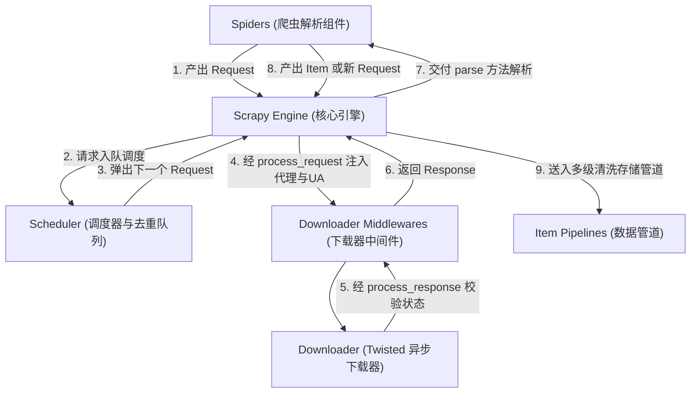
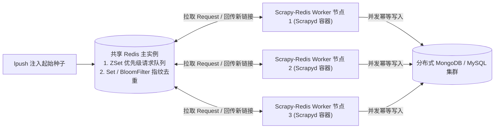

# Scrapy工业级异步爬虫框架实战

## Summary

为了实现大型爬虫工程的标准化、高内聚与可扩展，工业界普遍采用 Scrapy 框架。本章深入拆解基于 Twisted 异步引擎的 Scrapy 六大核心组件（Engine、Scheduler、Downloader、Spiders、Item Pipeline、Middlewares）及其数据流转闭环。通过实战项目脚手架搭建、`Spider` 与 `CrawlSpider` 全站规则抓取、`Item`/`ItemLoader` 数据封装、多级 `Pipeline` 数据库与多媒体文件异步入库、自定义下载器中间件（随机 UA、代理池、Playwright 集成）、`AutoThrottle` 智能限速，最终延伸至 `scrapy-redis` 分布式共享队列与 `Scrapyd` 集群可视化部署。

## Concepts Covered

This chapter covers the following 20 concepts from the learning graph:

| Concept | Concept Impact Score |
|---------|-----------------------|
| Scrapy工业级爬虫框架设计哲学 | 74 |
| Scrapy六大组件与数据流转拓扑 | 14 |
| Twisted异步网络引擎底层机制 | 1 |
| Scrapy项目脚手架与目录结构规范 | 59 |
| Spider基类编写与start_requests | 29 |
| Response选择器提取与yield生成器 | 14 |
| scrapy.Request翻页与meta上下文传参 | 9 |
| Item数据容器与ItemLoader清洗器 | 4 |
| CrawlSpider全站爬虫与LinkExtractor | 3 |
| Item-Pipeline管道与多级优先级编排 | 3 |
| Pipeline实现JSONL与数据库入库 | 1 |
| Files与ImagesPipeline多媒体下载 | 1 |
| Downloader-Middleware下载器中间件 | 5 |
| 自定义中间件随机UA与动态代理注入 | 3 |
| scrapy-playwright集成动态渲染 | 1 |
| settings.py全局并发与延迟调优 | 16 |
| AutoThrottle自动限速与HTTPCache | 1 |
| JOBDIR断点续爬与日志统计状态 | 14 |
| scrapy-redis分布式共享调度队列 | 4 |
| Scrapyd服务部署与集群可视化管理 | 3 |

## Prerequisites

This chapter builds on concepts from:

- [Chapter 1: 网络爬虫导论与数据合规基石](../01-intro-and-ethics/index.md)
- [Chapter 2: Web前端基石与HTTP通信原理](../02-web-and-http-fundamentals/index.md)
- [Chapter 3: Python网络请求核心编程](../03-python-http-requests/index.md)
- [Chapter 4: 静态网页结构化解析与正则提取](../04-static-html-parsing/index.md)
- [Chapter 5: 异步加载与Web接口逆向采集](../05-ajax-and-api-scraping/index.md)
- [Chapter 6: 动态渲染网页与Playwright浏览器自动化](../06-browser-automation-playwright/index.md)
- [Chapter 7: 反爬虫机制原理与工程对抗策略](../07-anti-scraping-and-countermeasures/index.md)
- [Chapter 8: 高性能并发与异步协程爬虫编程](../08-concurrent-and-async-scraping/index.md)
- [Chapter 9: 数据清洗流水线与多源持久化存储](../09-data-cleaning-and-storage/index.md)

---

## 1. Scrapy 架构哲学、Twisted 引擎与六大核心组件

在前面的八章中，我们已经学会了使用 `requests`、`aiohttp`、`parsel`、`Playwright`、`PyMySQL` 和 `Redis` 手工组装出一套异步高并发爬虫。然而，在企业级数据团队中，如果由 10 名工程师各自用 `aiohttp` 编写 50 个不同网站的爬虫脚本，很快就会陷入“面条式代码（Spaghetti Code）”的维护泥潭：每个人的目录结构千奇百怪、重试与代理切换逻辑混杂在页面解析函数里、日志与监控统计缺乏统一标准。为了解决这一工程痛点，全球 Python 爬虫工业界诞生了绝对的事实标准框架——**Scrapy**（安装命令：`pip install scrapy`）。

### 1.1 Scrapy工业级爬虫框架设计哲学与Twisted异步引擎

**`Scrapy`工业级爬虫框架设计哲学**可以浓缩为十二个字：**“控制反转（IoC）、关注点分离、全异步驱动”**。

1. **控制反转（Inversion of Control —— 好莱坞原则：“Don't call us, we'll call you”）**  
   在传统脚本中，是你自己编写 `while` 循环去调用请求库和入库函数；而在 Scrapy 中，整个抓取生命周期的调度大权由框架内核接管。你只需要在规定的“插槽”里编写少量的业务回调函数（例如：“网页下载回来后怎么用 XPath 提取字段”、“提取出的字典怎么存进 MySQL”），Scrapy 引擎会在恰当的时刻自动调用你的代码。
2. **极致的关注点分离（Separation of Concerns）**  
   在 Scrapy 项目中，**`Spider`（蜘蛛）只允许关心页面解析与链接提取**，绝不掺杂半行代理切换代码或 SQL 插入语句；所有的代理轮换、UA 伪装统一收敛在 **`Downloader Middleware`（下载器中间件）** 中；所有的数据清洗、去重与数据库入库统一收敛在 **`Item Pipeline`（数据管道）** 中。任何一个环节需要升级（比如把 CSV 存储换成 MongoDB），只需修改配置文件开启一个新的 Pipeline，Spider 解析代码一行都不用改！
3. **`Twisted`异步网络引擎底层机制**  
   为什么 Scrapy 不需要你自己写复杂的 `asyncio.gather` 和 `Semaphore`，却天生具备单机每秒数百页的超高并发吞吐量？因为 Scrapy 的底层网络底座建立在 Python 极其成熟的事件驱动异步网络框架 **Twisted** 之上（基于 **Reactor 反应器模式** 与 **`Deferred` 延迟回调对象**）。而且自 Scrapy 2.0+ 起，通过配置 `TWISTED_REACTOR = "twisted.internet.asyncioreactor.AsyncioSelectorReactor"`，Twisted 反应器已经与我们在第 8 章深入学习的 Python 原生 **`asyncio` 事件循环**实现了底层无缝打通，允许我们在 Scrapy 回调与 Pipeline 中直接使用 `async def` 和 `await`！

### 1.2 Scrapy六大组件与数据流转拓扑

要驾驭 Scrapy，首先必须在脑海中建立起清晰的 **`Scrapy`六大组件与数据流转拓扑（Six Core Components & Data Flow Topology）**。Scrapy 由五大功能组件与两层中间件（合称六大核心模块）围绕中央引擎呈星型拓扑连接：

1. **引擎（`Scrapy Engine` —— 中央总控大脑）**：负责控制数据在系统所有组件之间的流转，并在特定动作发生时触发事件信号（Signals）。**注意：所有其他组件之间绝不直接互相通信，一切 Request、Response 和 Item 都必须经过 Engine 中转！**
2. **调度器（`Scheduler` —— 待抓队列与去重守门员）**：接收 Engine 发来的 `Request` 请求对象，利用内置的 **`RFPDupeFilter`（基于请求方法、规范化 URL 及请求体计算的 SHA-1 指纹集合）** 自动过滤掉重复请求，并将唯一请求压入优先级队列等待调度。
3. **下载器（`Downloader` —— 异步网络客户端）**：基于 Twisted 高并发非阻塞模型，接收 Engine 分发的 `Request`，向互联网目标服务器发起真实的 HTTP/HTTPS 请求，并将拿回的响应封装为 `Response` 对象交还给 Engine。
4. **蜘蛛（`Spiders` —— 业务解析与链接发现器）**：由开发者编写的核心类。负责提供初始种子请求，解析 Engine 传回的 `Response`（使用内置 CSS/XPath 选择器），并向外 **`yield`（产出）** 两类对象：一是结构化业务数据（`Item` 或 `dict`），二是需要继续跟进的新链接请求（`scrapy.Request`）。
5. **项目管道（`Item Pipeline` —— 清洗、校验与持久化流水线）**：接收 Spider 产出的 `Item`，按配置的优先级顺序依次执行脏数据清洗、Pydantic/字段合法性校验、内容去重以及写入文件（JSONL/CSV）或数据库（MySQL/MongoDB/MinIO）。
6. **两层中间件（`Downloader Middlewares` & `Spider Middlewares` —— 双向钩子拦截网）**：
   - **下载器中间件（`Downloader Middlewares`）**：位于 **Engine 与 Downloader 之间**，是爬虫工程中最重要的一道切面！所有发往下载器的请求都会经过它的 `process_request()`（用于注入随机 `User-Agent`、挂载动态代理 IP、添加 Cookie 或调用 Playwright 渲染）；所有下载器拿回的响应都会经过它的 `process_response()`（用于检查 `403/429` 状态码、验证码识别与自动换代理重试）。
   - **蜘蛛中间件（`Spider Middlewares`）**：位于 **Engine 与 Spiders 之间**，用于预处理送入 Spider 的响应或过滤 Spider 产出的请求与 Item（如控制最大爬行深度 `DepthMiddleware`）。

在阅读下方的交互式架构图之前，请先梳理一次完整网页采集在 Scrapy 内部的 **8 步标准数据流闭环**：

- **第 1~2 步**：`Spider` 生成初始 `Request` $\rightarrow$ 经 `Engine` 送入 `Scheduler` 去重入队；
- **第 3~4 步**：`Scheduler` 弹出下一个 `Request` 交还 `Engine` $\rightarrow$ 经 **`Downloader Middleware (process_request)`** 注入 UA/代理后送达 `Downloader`；
- **第 5~6 步**：`Downloader` 完成网络下载生成 `Response` $\rightarrow$ 经 **`Downloader Middleware (process_response)`** 校验后交回 `Engine` $\rightarrow$ 转发给 `Spider.parse()`；
- **第 7~8 步**：`Spider.parse()` 解析页面并分流产出两路结果：**分支 A** 产出的新 `Request` 经 `Engine` 回流至 `Scheduler`（形成抓取闭环）；**分支 B** 产出的结构化 `Item` 经 `Engine` 送入 **`Item Pipeline`** 完成清洗落盘。

#### Diagram: Scrapy Six Core Components and Data Flow Architecture



<details markdown="1">
<summary>Scrapy Six Core Components and Data Flow Architecture</summary>
Type: workflow
**sim-id:** scrapy-architecture-dataflow<br/>
**Library:** Mermaid<br/>
**Status:** Specified<br/>
**Bloom Level:** Analyze<br/>
**Bloom Verb:** trace<br/>
**Learning Objective:** The learner will trace the 8-step lifecycle of `Request`, `Response`, and `Item` objects across Scrapy's six architectural components and diagnose which component handles specific engineering tasks.

**Prerequisites:** `Scrapy Engine`, `Scheduler` (`RFPDupeFilter`), `Downloader`, `Spiders`, `Item Pipeline`, `Downloader Middleware` (`process_request` / `process_response`) (all defined in Sections 1.1 and 1.2 above).

**Evidence of Mastery:** After clicking each of the 6 architectural nodes to inspect its input object, output object, and hook methods, the learner completes 3 architecture fault-diagnosis questions by clicking the responsible component node on the diagram. Mastery is answering all 3 diagnostic questions correctly within at most 2 attempts per question.

**Misconceptions:** (1) `Spiders` send HTTP requests directly to the `Downloader` or write `Items` directly to the `Item Pipeline` without passing through the `Scrapy Engine`. (2) Dynamic proxy IP rotation and User-Agent spoofing should be hardcoded inside `Item Pipeline` rather than `Downloader Middleware`. (3) URL fingerprint deduplication (`RFPDupeFilter`) happens inside the `Downloader` after downloading the webpage rather than inside the `Scheduler` before enqueueing.

**Instructional Rationale:** Analyze-level tracing on a hub-and-spoke architecture requires learners to follow how the central `Engine` routes different object types (`Request` vs. `Response` vs. `Item`) and identify the exact interception boundary for anti-scraping and persistence logic.

**Content:**

Workflow nodes and exact details revealed in the inspection panel when clicked:

| Node ID | Component Label | Primary Objects Handled | Key Hook Methods / Classes | Engineering Role & Responsibility (revealed on click) |
|---|---|---|---|---|
| `C1` | `1. 蜘蛛 (Spiders)` | 输入：`Response`<br/>输出：`Request` / `Item` | `start_requests()`, `parse()`, `yield` | 编写目标网站专属的 CSS/XPath 解析逻辑，产出新链接 `Request` 与业务数据 `Item`。 |
| `C2` | `2. 引擎 (Scrapy Engine)` | 中转：`Request`, `Response`, `Item` | 核心事件总线与 Twisted Reactor 调度中枢 | 统领全局数据流转与事件触发；所有其他组件互不直连，必须通过 Engine 路由转发。 |
| `C3` | `3. 调度器 (Scheduler)` | 输入：`Request`<br/>输出：去重后的 `Request` | `enqueue_request()`, `next_request()`, `RFPDupeFilter` | 计算 Request 的 SHA-1 指纹拦截重复请求，维护内存或 Redis 优先级待抓取队列。 |
| `C4` | `4. 下载器中间件 (Downloader Middleware)` | 双向拦截：`Request` & `Response` | `process_request()`, `process_response()`, `process_exception()` | 位于 Engine 与 Downloader 之间的切面防线：负责随机 UA 注入、动态代理 IP 挂载、429/403 重试与 Playwright 渲染拦截。 |
| `C5` | `5. 下载器 (Downloader)` | 输入：`Request`<br/>输出：`Response` | Twisted HTTP11ClientProtocol / 异步连接池 | 执行底层非阻塞 TCP/TLS 网络通信，并发下载网页源码并包装为 `Response` 对象。 |
| `C6` | `6. 项目管道 (Item Pipeline)` | 输入：`Item` / `dict`<br/>输出：已持久化记录或 `DropItem` | `open_spider()`, `process_item()`, `close_spider()` | 按优先级（`100~900`）依次执行脏数据清洗、Pydantic 强校验、内容去重及 JSONL/MySQL/MongoDB 入库。 |

Directed connections between nodes:
- `C1` -> `C2` (label: `Step 1 & 7a: yield Request (种子或翻页链接)`)
- `C2` -> `C3` (label: `Step 2: 转发 Request 请求入队与指纹去重`)
- `C3` -> `C2` (label: `Step 3: 出队调度下一个唯一 Request`)
- `C2` -> `C4` (label: `Step 4a: 发送 Request 经 process_request()`)
- `C4` -> `C5` (label: `Step 4b: 挂载 UA/Proxy 后交付下载`)
- `C5` -> `C4` (label: `Step 5a: 返回 HTTP Response 经 process_response()`)
- `C4` -> `C2` (label: `Step 5b: 状态校验通过后交回 Response`)
- `C2` -> `C1` (label: `Step 6: 分发 Response 至 Spider.parse() 回调`)
- `C1` -> `C2` (label: `Step 7b: yield Item (提取出的结构化字典)`)
- `C2` -> `C6` (label: `Step 8: 路由 Item 至多级 Pipeline 清洗落盘`)

Three diagnostic questions (fixed order):
- Question 1: "当我们需要为爬虫全局挂载『隧道动态代理 IP 池』并在遇到 HTTP 429 状态码时自动更换代理重新请求，这段拦截代码应该编写在哪个组件中？" -> Correct Node: `C4` (`4. 下载器中间件 (Downloader Middleware)`). Why: 下载器中间件位于 Engine 与 Downloader 之间，其 `process_request` 负责挂载 `request.meta['proxy']`，`process_response` 负责拦截 429 响应并重发请求，完全无需侵入 Spider 业务代码。
- Question 2: "Spider 的 `parse()` 方法在解析列表页时， accidentally `yield` 了两个指向同一篇详情页 URL 的 `scrapy.Request` 对象。哪个组件会通过 SHA-1 指纹比对自动拦截第二个重复请求，避免重复发起网络下载？" -> Correct Node: `C3` (`3. 调度器 (Scheduler)`). Why: 调度器内置 `RFPDupeFilter` 指纹过滤器，在 `Request` 入队阶段即完成去重拦截，绝不会让重复请求流向 Downloader。
- Question 3: "当 Spider 从网页中提取出商品标题与价格并 `yield item` 后，哪个组件负责剥离残留空白、校验价格必须大于 0 并将合格记录批量写入 MySQL 数据库？" -> Correct Node: `C6` (`6. 项目管道 (Item Pipeline)`). Why: Engine 会自动识别 Spider 产出的是 `Item` 对象而非 `Request` 对象，并将其路由至 `Item Pipeline` 的 `process_item()` 方法完成清洗、校验与持久化入库。

**Provenance:** Derived from Chapter 10 Section 1.2 ("Scrapy六大组件与数据流转拓扑").

**Rules:** Clicking any node (`C1`–`C6`) displays its detail card. In diagnostic quiz mode, clicking a component node submits it as the answer to the current question.

**Learner Activity:**

1. The learner clicks each of the 6 component nodes (`C1` through `C6`) to inspect the objects handled and hook methods in the side panel, following Steps 1 through 8 along the directed edges.
2. The learner activates the 3-question diagnostic challenge and clicks the responsible component node (`C4`, `C3`, `C6`) for each engineering scenario.

**Feedback:** 3 diagnostic questions in fixed order, 2 attempts per question. Correct: "定位精准！" followed by the `Why` explanation. Incorrect: displays the `Why` explanation exposing why the chosen component is not the right architectural boundary. After the second wrong attempt, the correct node is highlighted. Score counter: `Scrapy 架构诊断得分：n / 3`.

**Starting State:** Node `C2` (`2. 引擎 (Scrapy Engine)`) is highlighted at the center of the topology showing how all data flows through it, with the prompt: "点击图中六大核心组件查看其处理的 Request/Response/Item 对象与钩子函数，然后完成下方 3 道架构定位诊断题。"

**Chapter Anchors:** Matches the 6 components (`Engine`, `Scheduler`, `Downloader`, `Spiders`, `Item Pipeline`, `Downloader Middleware`) and the 8-step lifecycle in Section 1.2.
</details>

### 1.3 Scrapy项目脚手架与目录结构规范

理解了六大组件后，我们通过 Scrapy 提供的命令行工具（CLI）即可一键生成符合工业级规范的标准工程骨架——**`Scrapy`项目脚手架与目录结构规范**：

1. **创建项目**：运行 `scrapy startproject ai_corpus_crawler`；
2. **进入目录并生成蜘蛛**：运行 `cd ai_corpus_crawler` 与 `scrapy genspider arxiv_spider arxiv.org`；
3. **启动爬虫并导出语料**：运行 `scrapy crawl arxiv_spider -O papers.jsonl`（大写 `-O` 表示覆盖写入文件，小写 `-o` 表示追加写入）。

生成的标准项目目录树与各文件的职责边界极其清晰，每一个文件都精确对应我们在 1.2 节学习的某个核心组件：

```text
ai_corpus_crawler/
├── scrapy.cfg                 # 项目部署配置文件 (供 Scrapyd 打包部署读取)
└── ai_corpus_crawler/         # 项目核心 Python 包目录
    ├── __init__.py
    ├── items.py               # [数据契约层] 定义 Item 数据容器与 ItemLoader 处理器
    ├── middlewares.py         # [切面拦截层] 定义 Downloader Middleware 与 Spider Middleware
    ├── pipelines.py           # [数据持久层] 定义 Item Pipeline 清洗、去重与数据库入库逻辑
    ├── settings.py            # [全局配置层] 管理并发数、延迟、中间件/管道优先级、AutoThrottle 等
    └── spiders/               # [业务解析层] 存放所有自定义 Spider 与 CrawlSpider 爬虫模块
        ├── __init__.py
        └── arxiv_spider.py    # 具体站点爬虫实现
```

---

## 2. Spider 核心开发：请求调度、选择器、ItemLoader 与全站爬取

### 2.1 Spider基类编写、Response选择器提取与yield生成器

在 `spiders/` 目录下编写爬虫时，最基础也是最灵活的方式是继承 `scrapy.Spider`——即 **`Spider`基类编写与`start_requests`**。一个标准的 `Spider` 子类包含三个核心要素：

- **`name: str`（必填且全项目唯一）**：爬虫的唯一标识名（如 `name = "ai_news"`），执行 `scrapy crawl ai_news` 时即通过该名称启动。
- **`allowed_domains: list[str]`**：允许爬行的域名白名单（如 `["news.example.edu"]`）。开启后，`OffsiteMiddleware` 会自动拦截任何跳出该域名的外链请求，防止爬虫顺着友情链接跑偏到全网。
- **`start_urls` 或重写 `start_requests()` 方法**：如果初始种子只是简单的静态 GET 列表，直接定义 `start_urls = ["https://..."]` 即可；如果需要**在起始请求中携带自定义 Headers、Cookie、POST 表单，或从数据库/文件中动态读取种子 URL**，则重写 `start_requests(self)` 方法并通过 `yield scrapy.Request(url, callback=self.parse, headers=...)` 产出初始请求。

当下载器完成下载后，Scrapy 会自动调用回调函数 `parse(self, response)`，此时便进入了 **`Response`选择器提取与`yield`生成器** 的舞台：

1. **内置高性能选择器**：Scrapy 的 `response` 对象直接内置了我们在第 4 章学过的 `parsel` 选择器引擎！无需导入任何第三方解析库，直接调用 **`response.css("div.article h2::text").get()`**、**`response.xpath("//a/@href").getall()`** 或 **`response.json()`** 即可极速提取数据。
2. **`response.urljoin(relative_url)` 与 `response.follow()`**：网页中的详情页链接往往是相对路径（如 `href="/news/2026/101.html"`）。调用 `response.urljoin(href)` 会自动结合当前页面地址将其拼接为完整的绝对 URL；更优雅的是直接使用 **`yield response.follow(href, callback=self.parse_detail)`**，它不仅能自动拼接相对路径，还能直接接收 `<a>` 标签选择器对象！
3. **`yield` 生成器双路分流**：在回调函数中，我们绝不使用 `return` 一次性返回大列表，而是使用 **`yield` 关键字**将爬虫变成一个流式生成器——当 `yield` 出一个 `scrapy.Request` 时，Engine 会将其送往调度器排队抓取；当 `yield` 出一个 `Item` 或 `dict` 时，Engine 会将其送往 `Item Pipeline` 入库。

### 2.2 scrapy.Request翻页与meta上下文传参

在实际业务中，最经典的抓取链路是**“两级或多级跨页面采集”**：例如某新闻网站的**列表页（List Page）**上展示了文章的“所属分类标签（`category`）”和“列表页摘要”，而点击进入**详情页（Detail Page）**后只有“完整正文（`content`）”和“作者”，却没有显示所属分类标签。怎样才能把列表页提取到的半截数据安全地传递到几秒钟后才下载完成的详情页回调函数 `parse_detail()` 中，拼成一条完整的记录呢？

这就是 **`scrapy.Request`翻页与`meta`上下文传参（`cb_kwargs` & `request.meta` Context Passing）** 的核心使命！Scrapy 提供了两种跨回调传递上下文的方式：

1. **现代推荐方式：`cb_kwargs={"item_draft": draft_dict}`（Scrapy 1.7+ 首选）**  
   在构造详情页请求 `scrapy.Request(detail_url, callback=self.parse_detail, cb_kwargs={"category": cat_name})` 时，传入 `cb_kwargs` 字典；Scrapy 会在调用 `def parse_detail(self, response, category: str):` 时，将其直接作为同名关键字参数注入函数签名中，类型清晰、无副作用！
2. **经典通用方式：`meta={"key": val}`（兼具中间件通信能力）**  
   通过 `scrapy.Request(detail_url, callback=self.parse_detail, meta={"category": cat_name, "download_timeout": 5})` 传参，在下游回调中通过 `response.meta["category"]` 取出。
   - **重要工程区分**：`request.meta` 不仅能给下游 Spider 回调传参，它还是 **Spider 与 Downloader Middleware 之间通信的官方特殊通道**（例如设置 `meta={"proxy": "http://...", "playwright": True, "dont_redirect": True}` 会直接指揮下载器中间件改变下载行为）；而单纯的业务字段跨页传递则优先使用 `cb_kwargs`。
   - **浅拷贝陷阱提醒**：如果在同一个循环里把同一个可变字典放进多个请求的 `meta` 中，务必使用 `.copy()`，防止多个并发请求互相覆盖修改同一个字典引用！

### 2.3 Item数据容器与ItemLoader清洗器

虽然 Scrapy 允许直接 `yield dict`，但在多人协作的大型项目中，为了防止A工程师把标题字段拼写成 `"title"`、B工程师拼写成 `"Title"` 或 `"article_title"`，我们应当在 `items.py` 中定义 **`Item`数据容器与`ItemLoader`清洗器**：

- **`scrapy.Item` 与 `scrapy.Field()`（或 `@dataclass`）**：像定义数据库表结构一样预先锁死允许出现的字段名；如果拼写了一个未定义的字段名（如 `item["titl"] = "xxx"`），Scrapy 会立即抛出 `KeyError` 帮你提前抓出 Bug！
- **`ItemLoader` 与 `itemloaders.processors`（声明式输入输出处理器）**：网页上的某个字段可能在不同改版页面上位于不同的 XPath 位置，且带着大量首尾空白。使用 `ItemLoader(item=ArticleItem(), response=response)`，我们可以：
  - 通过 `loader.add_css("title", "h1.main::text")` 和 `loader.add_xpath("title", "//title/text()")` 添加多个备选提取路径；
  - 在 Item 字段中声明 **`input_processor=MapCompose(str.strip, remove_tags)`**（对提取到的每个片段依次执行函数清洗）与 **`output_processor=TakeFirst()`**（从默认的多值列表中取出第一个非空有效值），从而让 Spider 回调代码彻底告别满屏的 `.strip()` 与 `if...else` 判空！

下面这段代码完整演示了如何结合 **`Item` + `ItemLoader` 处理器**、**`start_requests()`**、**`response.follow()` 自动翻页** 以及 **`cb_kwargs` 跨页上下文传参** 编写一个标准的两级（列表页 $\rightarrow$ 详情页）工业级 Spider：

```python
from typing import Iterable
import scrapy
from itemloaders.processors import Join, MapCompose, TakeFirst
from scrapy.http import Response
from scrapy.loader import ItemLoader
from w3lib.html import remove_tags


# 1. 在 items.py 中定义强契约 Item 容器与 ItemLoader 字段清洗处理器
def parse_views_count(val: str) -> int:
    """将 '阅读：1.5万' 转换为整数 15000"""
    cleaned = val.replace("阅读：", "").strip()
    if "万" in cleaned:
        return int(float(cleaned.replace("万", "")) * 10000)
    return int(cleaned) if cleaned.isdigit() else 0


class AIArticleItem(scrapy.Item):
    url = scrapy.Field(output_processor=TakeFirst())
    category = scrapy.Field(output_processor=TakeFirst())
    title = scrapy.Field(
        input_processor=MapCompose(remove_tags, str.strip),
        output_processor=TakeFirst(),
    )
    views = scrapy.Field(
        input_processor=MapCompose(str.strip, parse_views_count),
        output_processor=TakeFirst(),
    )
    content = scrapy.Field(
        input_processor=MapCompose(remove_tags, str.strip),
        output_processor=Join("\n"),  # 将多个 <p> 段落合并为换行分隔的完整正文
    )


# 2. 在 spiders/ai_news_spider.py 中编写两级联动采集 Spider
class AINewsSpider(scrapy.Spider):
    name = "ai_news"
    allowed_domains = ["ai.example.edu"]

    def start_requests(self) -> Iterable[scrapy.Request]:
        """生成带分类标识的起始列表页请求"""
        categories = ["llm", "robotics", "cv"]
        for cat in categories:
            url = f"https://ai.example.edu/category/{cat}?page=1"
            # 使用 cb_kwargs 将当前分类名安全传递给 parse_list 回调
            yield scrapy.Request(
                url=url,
                callback=self.parse_list,
                cb_kwargs={"category_name": cat},
            )

    def parse_list(
        self, response: Response, category_name: str
    ) -> Iterable[scrapy.Request]:
        """第一级：解析列表页，提取详情页链接并执行自动翻页"""
        for card in response.css("div.article-card"):
            detail_href = card.css("a.detail-link::attr(href)").get()
            raw_views = card.css("span.views::text").get(default="0")
            if detail_href:
                # response.follow 自动拼接相对路径，并通过 cb_kwargs 将列表页字段传给详情页
                yield response.follow(
                    detail_href,
                    callback=self.parse_detail,
                    cb_kwargs={
                        "category_name": category_name,
                        "list_views": raw_views,
                    },
                )

        # 提取『下一页』按钮链接，递归回流给 parse_list 持续翻页
        next_page = response.css("a.next-page::attr(href)").get()
        if next_page:
            yield response.follow(
                next_page,
                callback=self.parse_list,
                cb_kwargs={"category_name": category_name},
            )

    def parse_detail(
        self, response: Response, category_name: str, list_views: str
    ) -> Iterable[AIArticleItem]:
        """第二级：解析详情页正文，使用 ItemLoader 组装并清洗完整 Item"""
        loader = ItemLoader(item=AIArticleItem(), response=response)
        loader.add_value("url", response.url)
        loader.add_value("category", category_name)
        loader.add_value("views", list_views)
        # 依次尝试主标题选择器与备选标题选择器
        loader.add_css("title", "h1.article-title::text")
        loader.add_xpath("title", "//title/text()")
        loader.add_css("content", "div.article-body p")

        # load_item() 自动触发各字段的 input_processor 与 output_processor
        yield loader.load_item()
```

### 2.4 CrawlSpider全站爬虫与LinkExtractor

如果我们面对的是一个结构规整的资讯站、高校官网或技术文档库，我们的需求是“自动提取全站所有符合 `/category/.*` 规则的栏目页并持续跟进，同时把所有符合 `/article/\d+\.html` 规则的详情页抓取解析出来”。如果每次都手动写 `response.css("a::attr(href)")` 去提取链接，代码高度重复。

为此，Scrapy 专门提供了继承自 `Spider` 的高阶全站通用蜘蛛——**`CrawlSpider`全站爬虫与`LinkExtractor`**（生成命令：`scrapy genspider -t crawl site_crawler example.edu`）。其核心在于声明一个类属性元组 **`rules = (Rule(...), ...)`**：

- **`LinkExtractor(allow=r"...", deny=r"...", restrict_css="...")`**：链接提取器。负责从页面中自动扫描所有 `<a>` 标签，只提取 URL 匹配 `allow` 正则表达式、不匹配 `deny` 正则表达式（如排除 `/login`、`/logout`）、且位于 `restrict_css` 指定 DOM 区域内的超链接，并自动完成相对路径补全与去重！
- **`Rule(link_extractor, callback="...", follow=True/False)`**：爬取规则路由。
  - 当一条规则代表**列表页或分类目录页**时，通常不设 `callback`（或设为 `None`），并设置 `follow=True`，表示“我不需要从这个列表页里提取业务 Item，但我需要顺着这个页面继续往深处提取新链接”；
  - 当一条规则代表**最终的文章/商品详情页**时，指定 `callback="parse_item"`（注意：**必须传字符串形式的方法名，且绝对不能将函数命名为 `parse`！** 因为 `CrawlSpider` 底层正是依赖自带的 `parse()` 方法来实现 `rules` 规则匹配分发的，一旦你重写了 `def parse()`，整个 `CrawlSpider` 的规则引擎就会彻底失效！）。

```python
from scrapy.linkextractors import LinkExtractor
from scrapy.spiders import CrawlSpider, Rule


class CampusFullSiteSpider(CrawlSpider):
    """使用 CrawlSpider + LinkExtractor 声明式规则全站抓取新闻与公告"""
    name = "campus_full"
    allowed_domains = ["news.example.edu"]
    start_urls = ["https://news.example.edu/"]

    rules = (
        # 规则 1：匹配栏目分页链接 (如 /list/ai?page=2)，不提取数据但持续跟进 (follow=True)
        Rule(
            LinkExtractor(allow=r"/list/[a-z]+\?page=\d+", restrict_css="div.pagination"),
            follow=True,
        ),
        # 规则 2：匹配文章详情页 (如 /article/2026/10582.html)，交由 parse_article 提取业务字段
        Rule(
            LinkExtractor(allow=r"/article/\d{4}/\d+\.html$", deny=r"/print/"),
            callback="parse_article",  # 注意：切勿覆盖自带的 parse 方法！
            follow=False,
        ),
    )

    def parse_article(self, response):
        """解析匹配规则 2 的详情页并产出结构化字典"""
        yield {
            "url": response.url,
            "title": response.css("h1.title::text").get(default="").strip(),
            "pub_date": response.css("span.date::text").get(default="").strip(),
        }
```

---

## 3. Item Pipeline 管道编排與 Downloader Middleware 反爬切面

### 3.1 Item-Pipeline管道与多级优先级编排及数据库/多媒体入库

当 `Spider` 通过 `yield item` 产出一个数据项后，Scrapy 引擎会将其送入 **`Item-Pipeline`管道与多级优先级编排** 流水线中。在 `settings.py` 的 `ITEM_PIPELINES` 字典中，我们可以同时开启多个职责单一的 Pipeline 类，并为每个类分配一个 **`0` 到 `1000` 之间的整数优先级权重（数值越小，越先执行！）**：

```python
# settings.py 中的多级 Pipeline 优先级编排示例
ITEM_PIPELINES = {
    "ai_corpus_crawler.pipelines.TextCleaningValidationPipeline": 100,  # 第1站：清洗与必填项校验
    "ai_corpus_crawler.pipelines.SimHashDeduplicationPipeline": 200,    # 第2站：内容指纹去重过滤
    "ai_corpus_crawler.pipelines.CustomImagesDownloadPipeline": 300,    # 第3站：多模态图片异步下载
    "ai_corpus_crawler.pipelines.MySQLAsyncUpsertPipeline": 400,        # 第4站：结构化数据幂等入库
}
```

每一个自定义 Pipeline 类都可以实现以下四个标准生命周期方法：

1. **`from_crawler(cls, crawler)`（类方法）**：在实例化 Pipeline 时从 `crawler.settings` 中安全读取数据库连接串（如 `MYSQL_URI`、`MONGO_URI`），避免在代码中硬编码配置。
2. **`open_spider(self, spider)`**：当爬虫启动时**仅自动调用一次**！这里是打开 `.jsonl` 文件句柄、初始化 MySQL/MongoDB 数据库连接池的最佳位置（绝不能在 `process_item` 里每来一条数据就新建一次数据库连接！）。
3. **`process_item(self, item, spider)`（核心必选方法）**：每当 Spider 产出一条 Item 时都会调用该方法（支持定义为 `async def process_item` 异步协程！）。该方法只有两种合法返回值：
   - **返回处理后的 `item` 对象**：将该 `item` 继续传递给下一个更高数值优先级的 Pipeline；
   - **抛出 `raise DropItem("丢弃原因")` 异常**：立即终止该条记录在后续所有 Pipeline 中的流转（例如发现标题为空或与历史指纹重复时直接丢弃）。
4. **`close_spider(self, spider)`**：当爬虫结束退出时**仅自动调用一次**，用于执行最后一批剩余数据的事务提交（`commit`）并安全关闭文件句柄或数据库连接池。

除了我们自己编写 **`Pipeline`实现JSONL与数据库入库** 外，针对图文多模态数据集采集，Scrapy 还内置了极其强大的 **`FilesPipeline`与`ImagesPipeline`多媒体下载**（依赖 Pillow 库：`pip install pillow`）。你只需要在 `Item` 中放入图片 URL 列表 `image_urls`并在 `settings.py` 中指定 `IMAGES_STORE = "./downloaded_images"`（甚至可直接指定 `s3://my-bucket/images/` 自动上传至 AWS S3 / MinIO 对象存储！），`ImagesPipeline` 就会在后台利用 Twisted 异步并发下载所有图片，自动转换为统一的 RGB `.jpg` 格式、自动过滤掉尺寸过小的广告图标（`IMAGES_MIN_HEIGHT = 100`），并自动按照第 9 章所讲的 **SHA-1 内容哈希生成防碰撞文件名**，将最终本地路径写入 `item["images"]` 字段中！

下面这段生产级 `pipelines.py` 代码，完整展示了“第 100 级清洗质检丢弃管道”、“第 200 级 JSONL 流式写入管道”以及“第 300 级基于 `aiomysql` 的异步连接池幂等 `UPSERT` 管道”的标准写法：

```python
import hashlib
import json
import aiomysql
from itemadapter import ItemAdapter
from scrapy import Spider
from scrapy.exceptions import DropItem


class TextCleaningValidationPipeline:
    """优先级 100：清洗文本空白并校验核心必填字段，不合格则抛出 DropItem"""

    def process_item(self, item, spider: Spider):
        adapter = ItemAdapter(item)
        title = (adapter.get("title") or "").strip()
        content = (adapter.get("content") or "").strip()

        if len(title) < 3 or len(content) < 20:
            raise DropItem(f"🚫 [质检拦截] 标题或正文过短，已丢弃: {adapter.get('url')}")

        adapter["title"] = title
        adapter["content"] = content
        # 计算 URL 的 32 位 MD5 唯一指纹供下游数据库幂等去重使用
        adapter["url_hash"] = hashlib.md5(adapter["url"].encode("utf-8")).hexdigest()
        return item


class JsonLinesExportPipeline:
    """优先级 200：在 open_spider/close_spider 中管理句柄，实时流式写入 .jsonl"""

    def open_spider(self, spider: Spider) -> None:
        self.file = open(f"{spider.name}_corpus.jsonl", mode="w", encoding="utf-8")

    def close_spider(self, spider: Spider) -> None:
        self.file.close()

    def process_item(self, item, spider: Spider):
        line = json.dumps(ItemAdapter(item).asdict(), ensure_ascii=False) + "\n"
        self.file.write(line)
        return item


class AsyncMySQLUpsertPipeline:
    """优先级 300：使用 aiomysql 异步连接池与 ON DUPLICATE KEY UPDATE 幂等入库"""

    def __init__(self, db_config: dict) -> None:
        self.db_config = db_config
        self.pool: aiomysql.Pool | None = None

    @classmethod
    def from_crawler(cls, crawler):
        return cls(db_config=crawler.settings.getdict("MYSQL_CONFIG"))

    async def open_spider(self, spider: Spider) -> None:
        self.pool = await aiomysql.create_pool(**self.db_config, charset="utf8mb4", autocommit=True)

    async def close_spider(self, spider: Spider) -> None:
        if self.pool:
            self.pool.close()
            await self.pool.wait_closed()

    async def process_item(self, item, spider: Spider):
        adapter = ItemAdapter(item)
        sql = """
            INSERT INTO crawled_articles (url_hash, url, category, title, views)
            VALUES (%s, %s, %s, %s, %s)
            ON DUPLICATE KEY UPDATE
                title = VALUES(title),
                views = VALUES(views)
        """
        assert self.pool is not None
        async with self.pool.acquire() as conn:
            async with conn.cursor() as cur:
                await cur.execute(
                    sql,
                    (
                        adapter["url_hash"],
                        adapter["url"],
                        adapter.get("category", "general"),
                        adapter["title"],
                        adapter.get("views", 0),
                    ),
                )
        return item
```

### 3.2 Downloader-Middleware下载器中间件与动态反爬注入

如果说 `Item Pipeline` 守卫着数据的出口，那么 **`Downloader-Middleware`下载器中间件** 就守卫着网络请求的入口与响应归途。每一个下载器中间件都可以定义三个核心钩子方法，其**返回值类型决定了请求/响应的命运走向**（这是 Scrapy 架构设计的精髓所在）：

1. **`process_request(self, request, spider)`**：当每个 `Request` 通过中间件发往下载器时调用。
   - **返回 `None`（最常见）**：表示放行！Scrapy 将继续调用后续权重的 `process_request` 直至交给下载器真正发起网络请求（我们在此处直接修改 `request.headers["User-Agent"]` 或 `request.meta["proxy"]` 后返回 `None` 即可）。
   - **返回一个 `Response` 对象**：短路拦截！Scrapy **不再向后续中间件或下载器发送网络请求**，而是直接把这个 `Response` 掉头送回给 Spider（常用于本地缓存命中或自定义无头浏览器渲染直接返回构造好的 `HtmlResponse`）。
   - **返回一个新的 `Request` 对象**：中止当前流程，将该新 `Request` 重新交回调度器（`Scheduler`）入队。
2. **`process_response(self, request, response, spider)`**：当下载器完成下载拿到 `Response` 返回给 Engine 时调用。
   - **返回该 `response` 对象**：验证正常，继续向上游传递给 Spider；
   - **返回一个新的 `Request` 对象**：当检测到 `response.status in (403, 429, 503)` 或网页正文变成“请输入验证码”时，直接在此处更换代理 IP、附上 `dont_filter=True`（防止被调度器当作重复请求拦截）并返回原 `request`，从而对 Spider 完全透明地实现自动重发！
3. **`process_exception(self, request, exception, spider)`**：当底层网络发生连接超时（`TimeoutError`）或代理断开异常时调用，可在此剔除失效代理并返回重发 `Request`。

### 3.3 自定义中间件随机UA与动态代理注入及scrapy-playwright集成

依托上述三大钩子，我们可以编写干净利落的 **`自定义中间件随机UA与动态代理注入`**。更令人振奋的是，当面对部分接口加密极其复杂或必须执行 JavaScript 才能渲染出 DOM 的页面时，我们无需抛弃 Scrapy 生态去重写一套独立的 Playwright 脚本，而是直接安装官方社区插件 **`scrapy-playwright`集成动态渲染**（安装命令：`pip install scrapy-playwright`）。

在 `settings.py` 中配置启用 `scrapy-playwright` 下载处理器后：

- 普通静态请求仍然走极速的 Twisted 原生 HTTP 下载器；
- 只有当某个请求显式声明了 **`yield scrapy.Request(url, meta={"playwright": True, "playwright_include_page": True})`** 时，该请求才会无缝移交给后台驻留的异步 Playwright 浏览器池进行动态渲染，甚至支持注入 `PageMethod("wait_for_selector", "div.loaded")` 等交互动作，渲染完毕后再将完整的 DOM 源码包装为标准 Scrapy `Response` 交回 `parse()` 方法！

下面这段代码展示了 `middlewares.py` 中“随机 User-Agent 与动态隧道代理池中间件”的完整实现，以及在 Spider 中按需激活 `scrapy-playwright` 的写法：

```python
import random
from scrapy import Request, Spider
from scrapy.http import Response


class RandomUAAndProxyMiddleware:
    """下载器中间件：自动轮换 User-Agent、注入动态代理 IP 并拦截 429/403 自动重试"""

    USER_AGENTS = [
        "Mozilla/5.0 (Windows NT 10.0; Win64; x64) AppleWebKit/537.36 Chrome/128.0.0.0 Safari/537.36",
        "Mozilla/5.0 (Macintosh; Intel Mac OS X 14_5) AppleWebKit/605.1.15 Version/17.5 Safari/605.1.15",
        "Mozilla/5.0 (X11; Linux x86_64; rv:129.0) Gecko/20100101 Firefox/129.0",
    ]

    def __init__(self, proxy_pool: list[str]) -> None:
        self.proxy_pool = proxy_pool

    @classmethod
    def from_crawler(cls, crawler):
        proxies = crawler.settings.getlist("PROXY_POOL_LIST", ["http://127.0.0.1:7890"])
        return cls(proxy_pool=proxies)

    def process_request(self, request: Request, spider: Spider) -> None:
        """请求发出前：注入随机 UA 与随机代理 IP，返回 None 放行"""
        request.headers["User-Agent"] = random.choice(self.USER_AGENTS)
        if self.proxy_pool and not request.meta.get("playwright"):
            request.meta["proxy"] = random.choice(self.proxy_pool)
        return None

    def process_response(
        self, request: Request, response: Response, spider: Spider
    ) -> Response | Request:
        """响应返回后：若遭遇 429/503 反爬限流，自动更换代理并重发 Request"""
        if response.status in (429, 503):
            retry_times = request.meta.get("custom_retry_times", 0)
            if retry_times < 3:
                spider.logger.warning(f"⚠️ 状态码 {response.status}，正在切换代理第 {retry_times + 1} 次重试: {request.url}")
                new_req = request.copy()
                new_req.meta["custom_retry_times"] = retry_times + 1
                new_req.meta["proxy"] = random.choice(self.proxy_pool)
                # 关键：必须设置 dont_filter=True，否则会被 Scheduler 的去重器直接丢弃！
                new_req.dont_filter = True
                return new_req
        return response
```

---

## 4. 工程调优、断点续爬、分布式 `scrapy-redis` 与集群部署

### 4.1 settings.py全局并发与延迟调优、AutoThrottle与HTTPCache

一个刚通过 `startproject` 创建出来的 Scrapy 项目，默认配置是相当保守的。在投入生产环境前，我们必须通过 **`settings.py`全局并发与延迟调优** 以及 **`AutoThrottle`自动限速与`HTTPCache`** 来释放性能并确保合规礼貌：

1. **三大并发与礼貌延迟核心参数**：
   - `CONCURRENT_REQUESTS = 32`（默认 `16`）：Scrapy 下载器全局同时处理的最大并发请求总数。
   - `CONCURRENT_REQUESTS_PER_DOMAIN = 16`（默认 `8`）：针对单个目标域名允许的最大并发数。
   - `DOWNLOAD_DELAY = 0.5`（默认 `0`）配合 `RANDOMIZE_DOWNLOAD_DELAY = True`（默认开启）：设置请求基础间隔为 $0.5\text{ 秒}$，Scrapy 会自动乘以 $0.5\sim 1.5$ 之间的随机系数（即实际间隔在 $0.25\text{ s}\sim 0.75\text{ s}$ 之间随机抖动），既保护目标服务器，又打乱固定机器指纹。
2. **`AutoThrottle`（基于服务器负载反馈的智能自适应限速扩展）**：
   固定写死 `DOWNLOAD_DELAY` 往往不够智能：凌晨服务器空闲时抓慢了浪费时间，白天服务器繁忙时抓快了容易把对方打挂。开启 `AUTOTHROTTLE_ENABLED = True` 后，Scrapy 会实时测量目标服务器每一次响应的真实网络延迟 `latency`，并根据目标并发数 `AUTOTHROTTLE_TARGET_CONCURRENCY = 4.0` 动态计算下一次请求延迟：当服务器响应变慢时自动加大等待间隔，当服务器响应飞快时自动提速！
3. **`HTTPCache`（开发调试阶段的本地磁盘缓存神器）**：
   在调试 `parse()` 中的 XPath/CSS 规则时，如果每改一行代码都要重新联网请求目标网站，不仅慢而且容易在调试阶段就把自己 IP 封掉。在开发环境中开启 **`HTTPCACHE_ENABLED = True`** 后，Scrapy 会把第一次请求过的所有网页响应原封不动地缓存在本地 `.scrapy/httpcache` 文件夹中；后续成百上千次重跑调试全部在 $1\text{ ms}$ 内直接从本地磁盘秒读，对目标网站实现 **0 网络请求打扰**！（注：正式上线采集实时数据时再将其关闭）。

### 4.2 JOBDIR断点续爬与日志统计状态

当一个单机 Scrapy 爬虫需要连续运行 12 个小时采集 50 万个页面时，万一中途遇到机房断电、网络升级或需要临时停机维护，难道重启后又要从第 1 页重新抓起吗？

Scrapy 内置了开箱即用的 **`JOBDIR`断点续爬与日志统计状态（Pause & Resume State Persistence）** 机制。启动爬虫时只需附加 `-s JOBDIR=...` 参数：

```bash
scrapy crawl ai_news -s JOBDIR=crawls/ai_news_state_01
```

- **如何优雅暂停**：在终端按 **一次 `Ctrl + C`**（发送 `SIGINT` 信号，切勿连按两次强制杀死进程！）。Scrapy 会等待当前正在飞行的几个请求处理完毕，然后将内存中尚未抓取的 `Scheduler` 队列、以及记录了所有已访问 URL 的 `requests.seen` 指纹集合全部安全序列化保存到 `crawls/ai_news_state_01` 目录下；
- **如何无缝续爬**：下次重新执行完全相同的命令，Scrapy 会自动读取该目录，从上次暂停的那一页无缝继续往下抓！同时，在爬虫结束时，Scrapy 的 `StatsCollector` 会在日志末尾输出详尽的工程统计指标（如 `downloader/request_count`、`downloader/response_status_count/200`、`item_scraped_count`、`finish_reason`）。

### 4.3 scrapy-redis分布式共享调度队列

单机 Scrapy 虽然快，但终究受限于单台服务器的网卡带宽、CPU 与单机内存。当我们面对需要 **10 台云服务器协同抓取 5,000 万个网页** 的大型工程时，如果直接在 10 台机器上分别启动原版 Scrapy，会发生什么？——10 台机器各自维护自己独立的本地内存 `Scheduler` 和本地 `RFPDupeFilter`，结果就是 **10 台机器把同一个网站一模一样地重复抓了 10 遍！**

要将单机 Scrapy 升级为真正的多机分布式集群，核心秘诀只有一句话：**“抽走每台机器私有的本地内存 `Scheduler` 与 `DupeFilter`，让所有爬虫节点共同连接同一个远端 Redis 实例的共享队列与共享去重集合！”** 这正是工业界最经典的分布式扩展库——**`scrapy-redis`分布式共享调度队列**（安装命令：`pip install scrapy-redis`）的核心原理。

改造一个现成的 Scrapy 项目升级为 `scrapy-redis` 分布式爬虫，**原有解析代码几乎一行不用改**，仅需三步：

1. 将爬虫类的基类从 `scrapy.Spider` 改为继承 **`scrapy_redis.spiders.RedisSpider`**，删掉静态的 `start_urls`，改为声明 **`redis_key = "ai_news:start_urls"`**（所有工作节点启动后都会自动挂起监听这个 Redis 列表键）；
2. 在 `settings.py` 中将调度器与去重器替换为 `scrapy_redis` 组件，并配置 `REDIS_URL`；
3. 在主控端通过 `redis-cli` 执行一行 **`LPUSH ai_news:start_urls https://ai.example.edu/list?page=1`** 推入种子网址，10 台服务器上的 Worker 进程便会立刻通过 Redis 原子操作争抢任务、共享去重指纹并协同完成全网采集！

```python
# 1. settings.py 中的 scrapy-redis 分布式改造核心配置
SCHEDULER = "scrapy_redis.scheduler.Scheduler"                # 启用 Redis 分布式共享调度器
DUPEFILTER_CLASS = "scrapy_redis.dupefilter.RFPDupeFilter"    # 启用 Redis 共享 SHA-1 去重集合
SCHEDULER_PERSIST = True                                      # 爬虫停止时不清空 Redis 队列，天然支持断点续爬
REDIS_URL = "redis://:your_password@192.168.1.100:6379/0"     # 指向中央 Redis 服务器


# 2. spiders/distributed_ai_spider.py：继承 RedisSpider 监听共享队列
from scrapy_redis.spiders import RedisSpider


class DistributedAINewsSpider(RedisSpider):
    name = "dist_ai_news"
    # 所有分布式 Worker 节点共同监听 Redis 中的该 List/Set 键获取起始种子 URL
    redis_key = "dist_ai_news:start_urls"

    def parse(self, response):
        for article in response.css("div.news-item"):
            yield {
                "url": response.urljoin(article.css("a::attr(href)").get()),
                "title": article.css("h3::text").get(default="").strip(),
            }
```

### 4.4 Scrapyd服务部署与集群可视化管理

当我们在生产环境的 10 台 Linux 服务器上运行分布式爬虫时，总不能每次修改代码后都手动用 `scp` 拷贝源码、再挨个打开 10 个 SSH 黑窗口去敲 `scrapy crawl` 命令吧？

在工业界生产运维（DevOps）中，标准流程是使用 **`Scrapyd`服务部署与集群可视化管理**：

1. **服务端守护进程 `Scrapyd`**（`pip install scrapyd`）：在每台爬虫工作服务器上启动 `scrapyd` 后台服务（默认监听 `6800` 端口）。它提供了一套标准的 **HTTP JSON API**（如 `/addversion.json` 上传代码包、`/schedule.json` 启动爬虫任务并返回 `jobid`、`/cancel.json` 停止任务、`/listjobs.json` 查看排队/运行中/已完成的任务状态及在线读取日志）。
2. **客户端打包投递工具 `scrapyd-client`**（`pip install scrapyd-client`）：在本地开发机修改项目根目录下的 `scrapy.cfg`，填入远程服务器的 `http://server-ip:6800/` 地址，随后在终端执行一行 **`scrapyd-deploy`**，即可自动将整个 Scrapy 项目打包成 `.egg` 字节码归档文件并一键推送部署到所有远端服务器上！
3. **Web 可视化集群管控平台（`ScrapydWeb` / `Gerapy` / `Crawlab`）**：为了进一步简化多机运维，工程师通常会部署一套 Web 可视化管理面板（如 `ScrapydWeb` 或 `Crawlab`），在一个浏览器大屏上同时连接管理几十台 `Scrapyd` 节点，实现**一键批量发布、Cron 定时调度（如每天凌晨 2 点自动拉起增量爬虫）、实时日志流查看、采集吞吐量曲线监控以及异常企微/钉钉告警**。

下表汇总了从单机开发调试到分布式生产集群的全套 Scrapy 工程配置与架构演进对照：

| 演进阶段 | 核心痛点与工程诉求 | Scrapy 标准解决方案与配置指令 |
|---|---|---|
| **1. 本地开发调试** | 频繁修改选择器规则，反复联网请求慢且易触发封禁 | 开启 `HTTPCACHE_ENABLED = True`，首次下载后直接秒读本地磁盘缓存 |
| **2. 单机礼貌高并发** | 固定延迟无法适应目标服务器峰谷负载波动 | 开启 `AUTOTHROTTLE_ENABLED = True` + `CONCURRENT_REQUESTS = 32` |
| **3. 长周期容灾恢复** | 单机数小时采集任务遭遇意外断网或维护重启 | 启动时指定 `-s JOBDIR=crawls/job01`，按一次 `Ctrl+C` 序列化保存状态 |
| **4. 复杂反爬与动态页** | 遭遇 UA/IP 封锁及 Vue/React 动态渲染页面 | 挂载自定义 `Downloader Middleware` 代理池 + 按需启用 `scrapy-playwright` |
| **5. 多机千万级横向扩展** | 单机带宽与内存见顶，多机独立运行会导致重复抓取 | 引入 `scrapy-redis`：替换共享 `Scheduler` 与 `RFPDupeFilter`，继承 `RedisSpider` |
| **6. 集群自动化部署运维** | 多台服务器手动上传代码与 SSH 命令管理效率低下 | 每台节点运行 `Scrapyd` 守护服务，使用 `scrapyd-deploy` 打包并通过 `ScrapydWeb`/`Crawlab` 集中管控 |

在结束本章之前，请通过下方的交互式 Scrapy 生产配置与分布式调优仿真器，亲自诊断并修复 5 个真实生产故障场景中的 `settings.py` 与中间件/管道优先级配置。

#### Diagram: Scrapy Production Tuning and Distributed Cluster Configurator



<details markdown="1">
<summary>Scrapy Production Tuning and Distributed Cluster Configurator</summary>
Type: microsim
**sim-id:** scrapy-production-cluster-configurator<br/>
**Library:** p5.js<br/>
**Status:** Specified<br/>
**Bloom Level:** Evaluate<br/>
**Bloom Verb:** diagnose<br/>
**Learning Objective:** The learner will diagnose and fix 5 production Scrapy configuration bugs involving `ITEM_PIPELINES` priority ordering, `CrawlSpider` method naming, `Downloader Middleware` retry filtering, `HTTPCache`/`AutoThrottle` tuning, and `scrapy-redis` distributed deduplication.

**Prerequisites:** `ITEM_PIPELINES` integer priority (`0`–`1000`, lower runs first), `CrawlSpider` `rules` & `parse()` reservation, `Downloader Middleware` `dont_filter=True` on retry, `AutoThrottle` & `HTTPCache`, `scrapy-redis` (`SCHEDULER`, `DUPEFILTER_CLASS`, `RedisSpider`) (all defined in Sections 2.4–4.4 above).

**Evidence of Mastery:** Across 5 production troubleshooting tickets, the learner inspects the broken code/configuration snippet and selects the exact corrective fix. Mastery is diagnosing and fixing at least 4 of the 5 production tickets correctly on the first attempt.

**Misconceptions:** (1) In `ITEM_PIPELINES`, a higher number like `900` executes before a lower number like `100`. (2) Defining `def parse(self, response):` inside a `CrawlSpider` subclass works normally alongside `rules`. (3) Returning a retried `Request` from `process_response` without setting `dont_filter = True` will be re-downloaded even though its URL fingerprint is already in the Scheduler's `RFPDupeFilter`.

**Instructional Rationale:** Evaluate-level diagnosis requires learners to inspect realistic Scrapy configuration and code defects, trace their impact on the framework's internal engine/scheduler/pipeline mechanics, and justify the exact fix.

**Content:**

Five production troubleshooting tickets presented in fixed order:

| # | Broken Configuration / Code Snippet Shown to Learner | Observed Production Symptom | Candidate Fixes | Correct Fix | Feedback & Explanation (Why) |
|---|---|---|---|---|---|
| 1 | `ITEM_PIPELINES = {`<br/>`  "proj.pipelines.MySQLInsertPipeline": 100,`<br/>`  "proj.pipelines.CleanAndValidatePipeline": 300,`<br/>`  "proj.pipelines.SimHashDedupPipeline": 500`<br/>`}` | 数据库中写入了大量包含 HTML 标签、空白标题和重复内容的脏数据，尽管 `CleanAndValidatePipeline` 和 `SimHashDedupPipeline` 确实抛出了 `DropItem` 异常。 | A. `将 MySQLInsertPipeline 的权重改为 800（大于 300 和 500），让清洗（100）和去重（200）先执行`<br/>B. `将所有 Pipeline 的权重全部设为 0`<br/>C. `在 Spider 中手动调用 Pipeline`<br/>D. `将 DropItem 替换为 return None` | `A. 将 MySQLInsertPipeline 的权重改为 800（大于 300 和 500），让清洗（100）和去重（200）先执行` | 在 Scrapy 的 `ITEM_PIPELINES` 中，**数字越小优先级越高（越先执行）**！原配置将 `MySQLInsertPipeline` 设为 `100`，导致脏数据在清洗（`300`）和去重（`500`）执行之前就已经被写进了数据库！ |
| 2 | `class DocsSpider(CrawlSpider):`<br/>`  name = "docs"`<br/>`  rules = (Rule(LinkExtractor(allow=r"/doc/\d+"), callback="parse"),)`<br/>`  def parse(self, response):`<br/>`    yield {"title": response.css("h1::text").get()}` | 启动 `CrawlSpider` 后，爬虫只抓取了 `start_urls` 首页，完全没有跟进任何 `/doc/\d+` 详情页链接，一条详情数据都没抓到。 | A. `将规则中的 follow 改为 False`<br/>B. `将自定义回调函数改名为 parse_doc（并在 Rule 中设置 callback="parse_doc"），绝不覆盖 CrawlSpider 自带的 parse() 方法`<br/>C. `删掉 LinkExtractor`<br/>D. `将 CrawlSpider 改回普通 object` | `B. 将自定义回调函数改名为 parse_doc（并在 Rule 中设置 callback="parse_doc"），绝不覆盖 CrawlSpider 自带的 parse() 方法` | `CrawlSpider` 的底层引擎正是依靠其基类自带的 `parse()` 方法来遍历匹配 `rules` 规则并分发链接的；一旦子类重写覆盖了 `def parse()`，整个规则提取机制就会被彻底架空！ |
| 3 | 在 `Downloader Middleware` 的 `process_response` 中检测到 `response.status == 429` 后执行：<br/>`new_req = request.copy()`<br/>`new_req.meta["proxy"] = get_new_proxy()`<br/>`return new_req` | 日志显示中间件捕获到了 429 并返回了 `new_req`，但下载器再也没有重新发出该请求，该网页直接丢失。 | A. `在 return new_req 之前设置 new_req.dont_filter = True，防止被 Scheduler 的 RFPDupeFilter 当作已访问过的重复 URL 拦截`<br/>B. `将 return new_req 改为 raise DropItem`<br/>C. `在 process_request 中返回 Response`<br/>D. `关闭 DOWNLOADER_MIDDLEWARES` | `A. 在 return new_req 之前设置 new_req.dont_filter = True，防止被 Scheduler 的 RFPDupeFilter 当作已访问过的重复 URL 拦截` | 该请求首次入队时，其 SHA-1 指纹已经被记录在调度器的 `RFPDupeFilter` 集合中。当 `process_response` 返回的新 `Request` 重新回到 Scheduler 时，若未设置 `dont_filter = True`，调度器会认为该 URL 已经抓过并静默丢弃！ |
| 4 | 团队在 8 台云服务器上限时部署同一个 Scrapy 项目采集 1,000 万商品页，每台服务器直接运行 `scrapy crawl product_spider`，未做任何分布式改造。 | 8 台服务器都在满负荷运转，但数据库中每件商品都被重复抓取并更新了 8 次，总采集进度并没有比 1 台机器快。 | A. `将每台机器的 CONCURRENT_REQUESTS 调成 1`<br/>B. `配置 scrapy-redis（替换 SCHEDULER 与 DUPEFILTER_CLASS 为 scrapy_redis 组件，爬虫继承 RedisSpider 共享同一个 Redis 队列与指纹库）`<br/>C. `开启 HTTPCACHE_ENABLED = True`<br/>D. `在每台机器本地新建独立的 SQLite 文件` | `B. 配置 scrapy-redis（替换 SCHEDULER 与 DUPEFILTER_CLASS 为 scrapy_redis 组件，爬虫继承 RedisSpider 共享同一个 Redis 队列与指纹库）` | 原版 Scrapy 的 `Scheduler` 和 `RFPDupeFilter` 存储在各自机器的本地进程内存中，8 台机器互不感知。必须使用 `scrapy-redis` 将待抓队列与去重指纹集中托管到共享 Redis 实例中，才能实现多机协同消费与全局唯一去重。 |
| 5 | 工程师在本地反复修改调试 `parse_detail` 中的 20 个复杂 XPath 表达式，每次运行 `scrapy crawl test` 都要重新等待 60 秒下载网页，且半小时后本机 IP 被目标网站封禁。 | 开发调试效率极低，且在代码还没写完时就触发了目标站点的访问频次封锁。 | A. `在开发调试阶段开启 HTTPCACHE_ENABLED = True（本地磁盘缓存响应，0 网络请求秒级重放调试），上线采集前关闭并开启 AUTOTHROTTLE_ENABLED = True`<br/>B. `将 CONCURRENT_REQUESTS 调高至 500`<br/>C. `删除 robots.txt`<br/>D. `每次修改代码后重装操作系统` | `A. 在开发调试阶段开启 HTTPCACHE_ENABLED = True（本地磁盘缓存响应，0 网络请求秒级重放调试），上线采集前关闭并开启 AUTOTHROTTLE_ENABLED = True` | 开启 `HTTPCACHE_ENABLED = True` 后，Scrapy 仅在第一次请求时访问网络并将响应保存在本地 `.scrapy/httpcache` 中；后续所有 XPath 调试运行均直接从本地磁盘秒级读取缓存，既快百倍又绝对不会触发网站封禁。 |

**Provenance:** Directly derived from the architectural rules and code listings in Chapter 10 Sections 2.4, 3.1, 3.2, 4.1, and 4.3.

**Rules:** Each ticket presents the broken configuration, symptom, and 4 candidate fixes. 1 committed attempt per ticket counts toward mastery.

**Learner Activity:**

1. The learner inspects Ticket 1 (`ITEM_PIPELINES` priority inversion) through Ticket 5 (`HTTPCache` & `AutoThrottle` workflow) in sequence.
2. For each ticket, the learner selects the candidate fix and clicks "提交修复方案 (Apply Fix)".
3. The configurator updates the simulated Scrapy log output from error state to clean pass state and displays the architectural explanation.

**Feedback:** 5 tickets in fixed order, 1 attempt per ticket. Correct: "🛠️ 故障修复成功！" followed by `Feedback & Explanation (Why)`. Incorrect: "⚠️ 修复无效（正确方案应为 <Correct Fix>）：" followed by `Feedback & Explanation (Why)`. Score counter: `Scrapy 生产排障得分：n / 5`.

**Starting State:** Ticket 1 is displayed showing the inverted `ITEM_PIPELINES` configuration (`100` for MySQL, `300` for Cleaning, `500` for Dedup) and the dirty database symptom, with the prompt: "请诊断以下 5 个 Scrapy 生产环境真实故障工单，并选择正确的配置或代码修复方案。"

**Chapter Anchors:** Matches Section 2.4 (`CrawlSpider` `parse()` rule), Section 3.1 (`ITEM_PIPELINES` priority `100` -> `200` -> `300`), Section 3.3 (`new_req.dont_filter = True`), Section 4.1 (`HTTPCACHE_ENABLED` & `AUTOTHROTTLE_ENABLED`), and Section 4.3 (`scrapy-redis`).
</details>

---

## 5. 本章小结与思考练习

### 5.1 核心要点回顾

- **六大组件与控制反转架构**：Scrapy 基于 Twisted 异步网络引擎（可桥接 `asyncio` 事件循环），围绕中央 **`Scrapy Engine`** 将 **`Scheduler`（含 `RFPDupeFilter` 指纹去重）**、**`Downloader`**、**`Spiders`**、**`Item Pipeline`** 以及 **`Downloader/Spider Middlewares`** 彻底解耦，实现了“业务解析、反爬切面、数据入库”的高度关注点分离。
- **Spider 开发与全站规则爬取**：使用 `response.css()` / `response.xpath()` 提取数据并通过 `yield` 流式产出 `Request` 或 `Item`；利用 `response.follow()` 与 `cb_kwargs`（或 `request.meta`）实现优雅的自动翻页与多级页面上下文传参；通过 `Item` + `ItemLoader` 声明式处理器规范字段清洗，并使用 `CrawlSpider` + `LinkExtractor` + `Rule` 实现零样板代码的全站规则爬取（切忌覆盖 `CrawlSpider` 自带的 `parse` 方法）。
- **多级 Pipeline 与中间件切面**：在 `ITEM_PIPELINES` 中按整数权重从小到大（如 `100 -> 200 -> 300`）编排数据清洗、去重、多媒体下载（`ImagesPipeline`/`FilesPipeline`）与异步数据库幂等入库，利用 `open_spider`/`close_spider` 管理连接池生命周期；在 `Downloader Middleware` 的 `process_request` 与 `process_response` 中集中实现随机 UA、动态代理注入、异常状态码自动重发（需设 `dont_filter=True`）及 `scrapy-playwright` 动态渲染集成。
- **调优、容灾与分布式集群**：善用 `HTTPCache` 加速开发调试、开启 `AutoThrottle` 实现自适应智能限速、通过 `-s JOBDIR=...` 实现长周期任务断点续爬；在千万级大规模采集中，引入 **`scrapy-redis`** 将调度队列与去重集合迁移至共享 Redis 实例，并配合 **`Scrapyd` + `scrapyd-deploy` + `ScrapydWeb`/`Crawlab`** 实现多机集群的一键打包部署与可视化运维。

### 5.2 思考与自测练习

??? question "思考题 1：在编写 Scrapy 的 `MySQLPipeline` 时，为什么我们必须把创建数据库连接池的代码写在 `open_spider(self, spider)` 方法中，而不是直接写在 `process_item(self, item, spider)` 方法内部？"
    因为 `open_spider()` 在整个爬虫启动时**只会被调用唯一一次**（同理 `close_spider()` 在爬虫结束时只调用一次），在此处初始化数据库连接池可以让后续成千上万条数据共享复用同一个长连接池。相反，如果把 `pymysql.connect()` 写在 `process_item()` 内部，那么 Spider 每抓到一条数据就会重新发起一次 TCP 三次握手和 MySQL 权限认证连接，当每秒产出上百条 Item 时，不仅写入速度极慢，还会瞬间耗尽 MySQL 服务器的最大连接数上限（`Too many connections`）导致数据库崩溃！

??? question "思考题 2：在 Scrapy 中，`request.cb_kwargs` 和 `request.meta` 都可以用来在列表页回调 `parse_list` 与详情页回调 `parse_detail` 之间传递参数（如文章分类名 `category`）。请问这两者在设计定位上有什么区别？什么时候必须使用 `meta`？"
    - **`cb_kwargs`（Callback Keyword Arguments）**：是 Scrapy 专为**纯业务数据跨回调函数传参**设计的干净通道。传入 `cb_kwargs={"category": "AI"}` 后，该键值会直接作为同名函数参数注入 `def parse_detail(self, response, category):` 中，不会污染中间件环境，可读性与类型安全性最佳。
    - **`meta`（Request Metadata）**：除了能通过 `response.meta` 在回调间传参外，它的核心定位是 **Spider 与 Scrapy 引擎及下载器中间件（Downloader Middleware）之间的控制指令通道**。当你需要为某个特定请求设置代理 IP（`meta["proxy"]`）、设置单次请求超时时间（`meta["download_timeout"]`）、禁止自动重定向（`meta["dont_redirect"]`）或启用无头浏览器渲染（`meta["playwright"] = True`）时，**必须使用 `meta`**，因为下载器中间件只会检查 `request.meta`！

??? question "思考题 3：当我们将一个单机 Scrapy 爬虫改造为基于 `scrapy-redis` 的 10 节点分布式爬虫后，如果此时仍然使用本地的 `JsonLinesExportPipeline` 将数据写入每台服务器各自的本地磁盘 `.jsonl` 文件中，会带来什么后期处理问题？在分布式架构下，Item 的持久化存储应该如何设计？"
    如果 10 台 `scrapy-redis` 工作节点各自往自己的本地磁盘写 `.jsonl` 文件，抓完之后数据会碎片化地散落在 10 台不同的服务器上，你还需要编写额外的运维脚本去 10 台机器拉取合并文件。在分布式爬虫架构下，数据出口也应当遵循**集中式或流式汇总原则**：
    1. **方案一（直连远端共享数据库/对象存储）**：各节点的 `Item Pipeline` 直接通过异步连接池将清洗好的数据幂等写入同一台远端 **MySQL / MongoDB 集群**，并将图片上传至统一的 **MinIO / S3 对象存储**；
    2. **方案二（启用 `scrapy_redis.pipelines.RedisPipeline` 或消息队列 Kafka）**：各节点将产出的 `Item` 统一序列化推入中央 Redis 的 `items` 列表或 Kafka 消息队列中，再由专门的下游入库消费者服务统一批量消费并归档为 `.jsonl` 或 `.parquet` 数据集。
