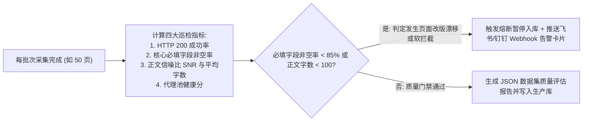
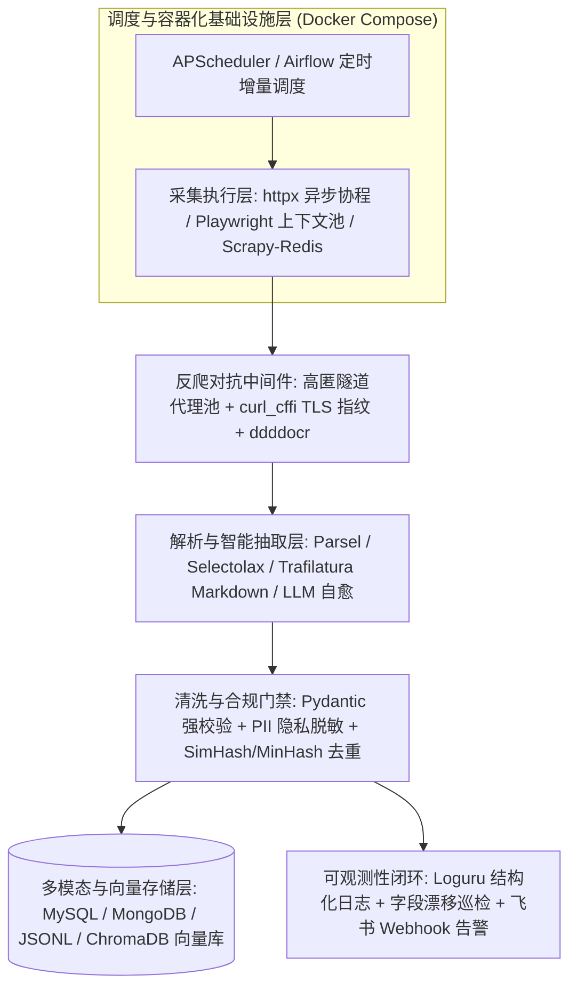

# 爬虫工程化运维部署与综合实训项目

## Summary

作为全书的收官与综合实训篇，本章将前面所学的单项技术融会贯通为完整的企业级数据采集工程。内容涵盖采集需求调研与目标站点技术勘察、工程配置解耦、Docker 容器化封装 Python 与 Playwright 环境、`APScheduler`/`Airflow` 定时增量调度、`Loguru` 结构化日志、飞书/钉钉 Webhook 异常告警、页面改版漂移巡检以及 AI 数据集信噪比质量审计报告。最后设置四个梯度递进的综合实训项目（新闻舆情混合采集、电商多模态动态采集、Scrapy-Redis 分布式社区爬虫、垂直领域大模型 RAG 端到端数据工程），全面锤炼学生的岗位实战能力。

## Concepts Covered

This chapter covers the following 12 concepts from the learning graph:

| Concept | Concept Impact Score |
|---------|-----------------------|
| 企业级采集需求调研与目标站点勘察 | 15 |
| 爬虫工程模块化结构与配置解耦 | 13 |
| Docker容器化封装爬虫与浏览器环境 | 2 |
| APScheduler与Airflow定时增量调度 | 3 |
| Loguru结构化日志与异常堆栈追踪 | 7 |
| 核心指标监控与飞书钉钉Webhook告警 | 6 |
| 页面结构漂移检测与自动化健康巡检 | 3 |
| 数据集质量评估报告与信噪比审计 | 2 |
| 实训一：新闻资讯与舆情混合采集系统 | 1 |
| 实训二：电商动态渲染多模态商品采集 | 1 |
| 实训三：Scrapy-Redis分布式社区爬虫 | 2 |
| 综合实训：垂直领域大模型RAG数据工程 | 1 |

## Prerequisites

This chapter builds on concepts from:

- [Chapter 1: 网络爬虫导论与数据合规基石](../01-intro-and-ethics/index.md)
- [Chapter 3: Python网络请求核心编程](../03-python-http-requests/index.md)
- [Chapter 4: 静态网页结构化解析与正则提取](../04-static-html-parsing/index.md)
- [Chapter 5: 异步加载与Web接口逆向采集](../05-ajax-and-api-scraping/index.md)
- [Chapter 6: 动态渲染网页与Playwright浏览器自动化](../06-browser-automation-playwright/index.md)
- [Chapter 7: 反爬虫机制原理与工程对抗策略](../07-anti-scraping-and-countermeasures/index.md)
- [Chapter 8: 高性能并发与异步协程爬虫编程](../08-concurrent-and-async-scraping/index.md)
- [Chapter 9: 数据清洗流水线与多源持久化存储](../09-data-cleaning-and-storage/index.md)
- [Chapter 10: Scrapy工业级异步爬虫框架实战](../10-scrapy-industrial-framework/index.md)
- [Chapter 11: 面向大模型与RAG的AI智能爬虫](../11-ai-powered-scraping-and-datasets/index.md)

---

## 1. 企业级爬虫工程架构、Docker 容器化与定时调度

能够写出一两个能在自己笔记本电脑上跑通的单文件脚本（`demo.py`），只是迈入了爬虫开发的门槛；而在人工智能数据工程岗位上，企业要求交付的是**能够 7×24 小时无人值守运行、配置与代码严格分离、容器化一键部署、遇到网站改版自动报警并产出质量审计报告的工业级数据采集系统**。

### 1.1 企业级采集需求调研与目标站点勘察

在动手写第一行代码之前，资深爬虫工程师都会先完成一份标准的 **企业级采集需求调研与目标站点勘察（Site Reconnaissance）** 清单，从源头避免技术选型返工：

| 勘察评估维度 | 核心核查项与探测方法 | 技术选型决策结论 |
| :--- | :--- | :--- |
| **1. 合规与版权边界** | 检查 `/robots.txt`、服务条款、是否涉及公民个人隐私（PII）、是否属于公开政务或授权站点 | 设定采集速率上限、配置 PII 脱敏掩码规则 |
| **2. 页面渲染模式** | 右键“查看网页源代码”搜索核心文本；打开 DevTools Network 观察是否有 JSON 接口或 SSR 水合数据 | 优先走 **API 协议直采**，其次 **静态 HTML 解析**，万不得已才用 **Playwright** |
| **3. 数据存量与增量规律** | 估算历史总页数（如 50 万条）与每日新增条数（如每日新增 300 条）；观察列表是否按发布时间倒序排列 | 历史全量采用分布式并发；日常增量采用定时任务只扫前 5 页（遇到已入库 ID 即停） |
| **4. 反爬防御等级** | 压测单 IP 连续请求 100 次是否触发 `429`；检查 TLS 指纹、加密参数 `sign`、WebFont 字体或滑块验证码 | 决定是否引入 `curl_cffi`、高匿隧道代理池、`ddddocr` 或浏览器 JSRPC |

### 1.2 爬虫工程模块化结构与配置解耦

告别把数据库密码、代理密钥、请求逻辑和解析代码全部堆在一个几千行 `.py` 文件里的作坊式写法。标准的 **爬虫工程模块化结构与配置解耦** 应当遵循高内聚、低耦合的分层目录规范，并使用 `pydantic-settings` 或 `python-dotenv` 从环境变量（`.env` 文件）加载敏感凭证（严禁将含有密码与 API Key 的 `.env` 提交到 Git 仓库！）：

```
ai-data-crawler/
├── .env.example              # 环境变量模板（提交到 Git）
├── .env                      # 真实数据库/代理/大模型密钥（加入 .gitignore）
├── Dockerfile                # 容器化构建镜像定义
├── docker-compose.yml        # 多容器编排（爬虫 + Redis + PostgreSQL/ChromaDB）
├── pyproject.toml            # 依赖包与版本锁定
├── src/
│   ├── config.py             # 基于 Pydantic BaseSettings 的强类型配置中心
│   ├── core/
│   │   ├── http_client.py    # 统一封装的重试、代理、TLS 指纹客户端
│   │   ├── logger.py         # Loguru 结构化日志与日志轮转配置
│   │   └── alerting.py       # 飞书/钉钉 Webhook 异常告警与巡检模块
│   ├── spiders/              # 各业务站点采集器模块
│   ├── parsers/              # 独立解耦的 DOM/JSON/LLM 解析器（便于单元测试）
│   ├── pipelines/            # Pydantic 清洗、PII 脱敏、数据库与向量库写入
│   └── scheduler.py          # APScheduler 定时增量调度入口
└── tests/                    # 保存静态 HTML 快照样本的离线解析单元测试
```

### 1.3 Docker 容器化封装与 APScheduler / Airflow 定时调度

在爬虫上线部署阶段，最令人头疼的莫过于“在我电脑上明明能跑，一放到阿里云 Linux 服务器上就报缺少系统字体或 Chromium 依赖库 `.so` 错误”。通过 **Docker 容器化封装爬虫与浏览器环境**，我们可以将 Python 运行时、第三方依赖库以及 Playwright 所需的浏览器内核与 Linux 底层图形依赖一次性打包成不可变的镜像（Image），实现“一次构建，到处运行”。

当镜像启动后，为了让爬虫按业务节奏自动执行（例如每天凌晨 02:00 抓取最新招投标公告，每 15 分钟巡检一次实时财经快讯），我们需要引入 **APScheduler 与 Airflow 定时增量调度**：
- **`APScheduler`（Advanced Python Scheduler）**：轻量级纯 Python 进程内定时调度框架，支持三种触发器：`interval`（固定时间间隔，如每 30 分钟）、`cron`（类 Linux Crontab 表达式，如 `hour=2, minute=0`）与 `date`（指定单次执行时间），内置 `AsyncIOScheduler` 可与 `asyncio` 异步爬虫无缝融合，非常适合中小规模采集集群。
- **Apache Airflow / Prefect**：当企业内部有数十个跨部门的爬虫任务，且存在严格的上下游 DAG 依赖关系（如“任务 A 爬取原始网页 → 任务 B 调用 Trafilatura 清洗去重 → 任务 C 计算 Embedding 写入 Milvus → 任务 D 产出质量审计报告”）时，则使用 Airflow 通过可视化 Web 界面编排整条数据工作流。

下面给出生产级 **Python + Playwright 官方底座 `Dockerfile`** 与 **`docker-compose.yml`** 标准配置：

```dockerfile
# Dockerfile: 基于微软官方 Playwright Python 镜像（已内置 Chromium 及全部 Linux 字体/图形依赖）
FROM mcr.microsoft.com/playwright/python:v1.48.0-noble

WORKDIR /app

# 设置时区为北京时间并关闭 Python 输出缓冲
ENV TZ=Asia/Shanghai \
    PYTHONUNBUFFERED=1 \
    PYTHONDONTWRITEBYTECODE=1

# 先复制依赖文件利用 Docker 层缓存加速构建
COPY requirements.txt .
RUN pip install --no-cache-dir -i https://pypi.tuna.tsinghua.edu.cn/simple -r requirements.txt

# 复制工程源码
COPY src/ ./src/

# 启动内置 APScheduler 定时调度守护进程
CMD ["python", "-m", "src.scheduler"]
```

---

## 2. 可观测性工程：结构化日志、Webhook 告警与漂移巡检

### 2.1 `Loguru` 结构化日志与核心指标 Webhook 告警

线上无头运行的爬虫一旦报错，如果没有完善的日志与告警，可能停摆了一周都没人发现。在日志层，我们使用开箱即用的 **`Loguru` 结构化日志与异常堆栈追踪** 替代繁琐的标准库 `logging`：只需一行 `logger.add("logs/spider_{time:YYYY-MM-DD}.jsonl", rotation="100 MB", retention="14 days", serialize=True, backtrace=True, diagnose=True)`，即可自动实现按文件大小/日期滚动切割、自动清理 14 天前的旧日志、输出便于 ELK 检索的 JSON 结构化格式，并在捕获异常时自动打印每一层调用栈的局部变量值！

在监控层，我们需要围绕 **核心指标监控与飞书钉钉 Webhook 告警** 建立实时观测闭环，重点监控四大黄金指标：**请求成功率（2xx 占比）**、**代理 IP 有效率**、**单页平均解析耗时**以及**关键字段非空率**。一旦连续失败次数超标，立即通过飞书（Feishu）或钉钉（DingTalk）群机器人的 Webhook 接口推送 Markdown 报警卡片。

### 2.2 页面结构漂移检测与数据集信噪比审计报告

除了网络报错，爬虫工程特有的“隐形杀手”是 **页面结构漂移检测与自动化健康巡检（Schema / Layout Drift Detection）**：目标网站今天做了一次前端样式升级，把商品价格的 `<span class="price-val">` 改成了 `<div class="new-price">`。此时 HTTP 状态码依然是正常的 `200 OK`，爬虫也没有抛出任何语法异常，但入库的 10,000 条记录里 `price` 字段全部变成了空字符串或默认值 `0.0`！

为了防御页面结构漂移，必须在入库管道中配置**字段完整度熔断阈值**：当一个批次（如最近 50 个页面）中某个核心字段的非空率跌破 `85%` 时，立即判定发生“页面结构漂移”，自动暂停任务、发送飞书告警，并可联动第 11 章的 LLM 自愈模块尝试生成新选择器。

最后，在将采集到的语料交付给大模型算法团队前，必须自动生成一份 **数据集质量评估报告与信噪比审计**，量化统计总文档数、平均字符/Token 长度分布、代码块与表格占比、MinHash 去重剔除率、PII 敏感词擦除次数以及有效正文信噪比（纯净 Markdown 字节数与原始 HTML 字节数之比）。

```python
import time
from typing import Any
import httpx
from loguru import logger
from apscheduler.schedulers.blocking import BlockingScheduler

# 配置 Loguru：按天轮转、保留 14 天、启用 JSON 序列化落盘
logger.add(
    "logs/crawler_{time:YYYY-MM-DD}.log",
    rotation="00:00",
    retention="14 days",
    encoding="utf-8",
    backtrace=True,
    diagnose=True,
)

def send_feishu_webhook_alert(webhook_url: str, title: str, markdown_body: str) -> None:
    """向飞书群机器人发送异常告警卡片"""
    if not webhook_url:
        return
    payload = {
        "msg_type": "interactive",
        "card": {
            "header": {
                "title": {"tag": "plain_text", "content": f"🚨 爬虫巡检告警：{title}"},
                "template": "red",
            },
            "elements": [{"tag": "markdown", "content": markdown_body}],
        },
    }
    try:
        httpx.post(webhook_url, json=payload, timeout=5.0)
    except Exception as exc:
        logger.error(f"飞书告警推送失败: {exc}")

def check_layout_drift_and_audit(records: list[dict[str, Any]], required_fields: list[str], webhook_url: str = "") -> dict[str, Any]:
    """
    执行页面结构漂移检测（字段非空率核查）与数据集质量审计报告生成
    """
    total = len(records)
    if total == 0:
        send_feishu_webhook_alert(webhook_url, "批次采集数量为 0", "请检查目标站点是否封禁 IP 或接口路由变更。")
        return {"status": "empty", "total": 0}

    field_fill_rates: dict[str, float] = {}
    drifted_fields: list[str] = []

    for field in required_fields:
        non_empty_count = sum(1 for r in records if r.get(field) not in (None, "", [], {}))
        rate = round(non_empty_count / total, 4)
        field_fill_rates[field] = rate
        # 若核心必填字段非空率低于 85%，判定发生页面改版结构漂移
        if rate < 0.85:
            drifted_fields.append(f"{field} ({rate * 100:.1f}%)")

    if drifted_fields:
        alert_msg = f"**检测到目标网页 DOM 结构漂移！**\n以下核心字段非空率跌破 85% 阈值：\n- " + "\n- ".join(drifted_fields)
        logger.warning(alert_msg)
        send_feishu_webhook_alert(webhook_url, "DOM 页面结构漂移预警", alert_msg)

    # 计算语料平均长度与信噪比审计指标
    avg_len = round(sum(len(str(r.get("content", ""))) for r in records) / total, 1)
    audit_report = {
        "status": "drift_warning" if drifted_fields else "healthy",
        "total_records": total,
        "avg_content_chars": avg_len,
        "field_completeness": field_fill_rates,
        "timestamp": int(time.time()),
    }
    logger.info(f"数据集质量审计报告: {audit_report}")
    return audit_report
```

#### Diagram: 页面结构漂移巡检与数据集信噪比质量审计仪



<details markdown="1">
<summary>Interactive MicroSim: 页面结构漂移巡检与数据集信噪比质量审计仪</summary>

Type: microsim

**sim-id:** ch12-drift-monitor-and-snr-auditor<br/>
**Library:** Chart.js<br/>
**Status:** Specified<br/>
**Bloom Level:** Evaluate<br/>
**Bloom Verb:** Audit<br/>
**Learning Objective:** The learner will audit real-time scraper telemetry streams by configuring field completeness drift thresholds, HTTP status anomaly ratios, and corpus Signal-to-Noise Ratio (SNR) metrics to trigger automated circuit breakers and Feishu/DingTalk webhook alerts before dirty data pollutes downstream AI vector databases.

**Prerequisites:** Loguru结构化日志与异常堆栈追踪, 核心指标监控与飞书钉钉Webhook告警, 页面结构漂移检测与自动化健康巡检, 数据集质量评估报告与信噪比审计

**Evidence of Mastery:**
- 能够根据字段非空率（Field Fill Rate）时序折线图的断崖式下跌识别“静默式前端 DOM 改版漂移”（此时 HTTP 200 成功率仍为 100%）
- 能够配置合理的熔断水位线（如必填字段非空率 `< 85%` 或正文平均字符数 `< 150`），阻断空数据覆盖向量库中已有的正确文档

**Misconceptions:**
- 认为只要监控告警里 `HTTP 200 OK` 比例是 100% 且没有抛出 Python Exception，爬虫产出的语料就一定是健康可用的
- 在定时增量更新 RAG 知识库时未做长度与信噪比校验，导致网站维护期间返回的“系统升级中，请稍候访问”短文本把知识库里的长篇技术文档覆盖掉

**Instructional Rationale:**
用双轴实时监控大盘展示线上爬虫在连续运行 24 小时内的四条关键曲线（HTTP 200 率、核心字段非空率、正文信噪比 SNR、MinHash 重复率）。学习者通过模拟注入两类典型线上事故（WAF 软拦截返回验证码假页面、前端重命名 CSS 类名），观察熔断器与飞书告警卡片的触发逻辑。

**Content:**
- 顶部时序监控图表：24 小时滚动窗口，展示 `HTTP 200 占比`（绿线）与 `price/content 字段非空率`（蓝线）的分叉现象
- 左下阈值配置台：必填字段非空率告警线（50%～99%）、最低正文字符数门禁（50～500 字）、连续异常批次熔断开关
- 右下飞书告警与审计报告预览器：实时渲染触发的 Markdown 告警卡片与 JSON 质量评估报告

**Provenance:** 依据本章第 2.1 与 2.2 节可观测性工程与质量审计规范设计。

**Rules:**
- 当注入“上午 10:00 目标网站前端改版”事件时，绿线（HTTP 200）依然维持在 100%，但蓝线（核心字段非空率）瞬间跌至 0%；若学习者开启了字段漂移熔断，系统在第 1 个批次结束时即刻暂停写入并弹出红色飞书告警卡片
- 当注入“网站返回 200 状态码的验证拦截短页”事件时，正文信噪比（SNR）与平均字数跌破门禁阈值，自动拦截脏数据入库

**Learner Activity:**
1. 观察默认只监控 HTTP 状态码时，前端改版产生的 5,000 条空记录是如何静默污染数据库的。
2. 启用“字段非空率 $\ge 85\%$”与“最小正文长度 $\ge 150$ 字”双重质量门禁，再次重放改版故障并检验熔断效果。

**Feedback:**
- 实时统计被成功拦截的脏数据条数、告警响应延迟（秒）以及最终入库数据集的综合质量评分。

**Starting State:**
默认展示前 8 小时平稳运行（各项指标 $> 98\%$），在第 9 小时处预置了一次前端 DOM 改版事件，等待学习者调整巡检阈值观察告警触发。

**Chapter Anchors:** 2.1 Loguru 结构化日志与核心指标 Webhook 告警, 2.2 页面结构漂移检测与数据集信噪比审计报告
</details>

---

## 3. 四大梯度综合实训项目（Capstone Projects）

为了帮助同学们将全书 12 章、240 个核心概念彻底内化为工程实战能力，本节设计了四个由浅入深、覆盖不同技术栈组合的综合实训项目。建议按顺序完成实训一至实训三，并将最后一个综合实训作为课程期末大作业或毕业设计课题。

#### Diagram: 企业级爬虫技术栈选型与故障巡检架构沙盒



<details markdown="1">
<summary>Interactive MicroSim: 企业级爬虫技术栈选型与故障巡检架构沙盒</summary>

Type: microsim

**sim-id:** ch12-capstone-architecture-designer<br/>
**Library:** p5.js<br/>
**Status:** Specified<br/>
**Bloom Level:** Create<br/>
**Bloom Verb:** Design<br/>
**Learning Objective:** The learner will design and validate end-to-end production scraping architectures for four real-world AI data engineering scenarios by assembling optimal request engines, anti-scraping middlewares, parsers, storage backends, and drift monitoring alerts.

**Prerequisites:** 企业级采集需求调研与目标站点勘察, Docker容器化封装爬虫与浏览器环境, 核心指标监控与飞书钉钉Webhook告警, 页面结构漂移检测与自动化健康巡检

**Evidence of Mastery:**
- 能够针对 4 类不同特征的目标站点（静态+API 混合新闻网、SPA 动态懒加载电商、百万级分布式问答社区、面向 RAG 的领域知识网）组合出最合理的技术栈蓝图
- 能够在模拟线上故障（如 HTTP 429 激增、DOM 类名改版导致字段空置率飙升）时配置正确的自动熔断、代理切换与 Webhook 告警策略

**Misconceptions:**
- 在任何项目里都无脑使用 Playwright 无头浏览器（导致百万级社区采集项目服务器成本暴增 20 倍且吞吐量极低）
- 仅根据 `status_code == 200` 判断爬虫运行健康，未配置核心字段非空率巡检导致入库大量空数据

**Instructional Rationale:**
提供一个交互式架构蓝图拼装画布。学习者从左侧组件库拖拽“请求层”、“反爬对抗层”、“解析与清洗层”、“存储与 AI 入库层”及“监控运维层”模块，通过运行压力仿真观察整条数据流水线的吞吐量（QPS）、硬件成本与故障自愈表现。

**Content:**
- 四大预设项目关卡切换器（对应本章 3.1 至 3.4 四个综合实训项目）
- 五层可插拔组件槽位：
  1. 请求层：`httpx.AsyncClient` / `curl_cffi` / `Playwright Context Pool` / `Scrapy-Redis`
  2. 解析层：`parsel (XPath/CSS)` / `selectolax` / `trafilatura (Markdown)` / `LLM Zero-Shot Schema`
  3. 存储层：`SQLite/CSV` / `MySQL (ON DUPLICATE KEY UPDATE)` / `MongoDB` / `ChromaDB/Milvus 向量库`
  4. 运维层：`APScheduler` / `Loguru` / `飞书 Webhook 漂移巡检` / `Docker Compose`
- 混沌故障注入按钮：一键模拟“目标站开启 TLS JA3 拦截”、“前端 class 改版漂移”、“代理 IP 欠费失效”

**Provenance:** 依据本章第 1、2、3 节全书综合工程体系设计。

**Rules:**
- 当学习者为“实训三：百万级分布式社区爬虫”选用了单机同步 `requests` + `SQLite` 时，仿真器亮黄灯警告并发瓶颈与文件写锁冲突，引导升级为 `Scrapy-Redis` + `PostgreSQL/MongoDB`
- 当注入“前端改版漂移”故障且已挂载“字段非空率巡检 + 飞书 Webhook”模块时，画布自动触发熔断保护并展示告警卡片

**Learner Activity:**
1. 依次选择四大实训项目，阅读站点勘察报告并完成五层架构组件拼装。
2. 启动仿真运行并点击“故障注入”，验证所设计的监控与容错机制能否成功拦截脏数据。

**Feedback:**
- 从吞吐性能、反爬韧性、AI 语料信噪比、运维可观测性四个维度给出架构设计评分与改进建议。

**Starting State:**
默认加载“综合实训：垂直领域大模型 RAG 数据工程”关卡，展示从异步采集、Trafilatura Markdown 抽取、PII 脱敏、语义分块到 ChromaDB 向量入库的标准参考架构。

**Chapter Anchors:** 1. 企业级爬虫工程架构、Docker 容器化与定时调度, 2. 可观测性工程：结构化日志、Webhook 告警与漂移巡检, 3. 四大梯度综合实训项目（Capstone Projects）
</details>

---

### 3.1 实训一：新闻资讯与舆情混合采集系统

- **项目背景与站点特征**：某行业人工智能研究院需要每日定时采集 5 家主流科技资讯站点的“人工智能与算力产业”频道。经勘察，其频道列表页采用 AJAX JSON 接口（含页码与时间戳参数）异步加载，而点击进入后的文章详情页则是传统的服务端渲染（SSR）静态 HTML 页面（部分老旧地方站点存在 GBK 编码）。
- **核心技术栈组合**：`httpx.AsyncClient`（异步并发请求） + `tenacity`（指数退避重试） + `charset_normalizer`（编码自适应） + `parsel`（XPath/CSS 混合解析） + `Pydantic`（字段校验） + `SQLite` / `MySQL`（基于 URL MD5 唯一索引幂等增量入库）。
- **核心架构与验收标准**：
  1. 编写异步列表采集器，通过调整 `page` 参数并发拉取前 10 页 JSON 列表，提取文章标题、发布时间与详情页相对链接（使用 `urljoin` 转为绝对 URL）。
  2. 利用 `asyncio.Semaphore(8)` 控制详情页并发度，提取正文段落、来源媒体与阅读量，使用 `Pydantic` 将发布时间统一标准化为 `YYYY-MM-DD HH:MM:SS`。
  3. 连续采集 500 篇科技新闻，实现断点重跑时不产生任何重复记录，字段非空率 $\ge 98\%$。

---

### 3.2 实训二：电商动态渲染多模态商品采集

- **项目背景与站点特征**：为训练零售领域的商品多模态图文检索模型，需要采集某电商导购平台的商品主图、标题、价格、核心规格参数及前 20 条用户评价。经勘察，该站点为重度 Vue SPA 动态渲染应用，下拉滚动触底时才懒加载后续商品卡片，且商品详情接口带有复杂的混淆 JS 签名。
- **核心技术栈组合**：`Playwright`（无头浏览器自动化） + `storage_state`（登录态持久化） + `page.route`（屏蔽冗余音视频与广告脚本） + `page.on("response")`（直接截获加密评论 API 的明文 JSON） + 图片内容 SHA-256 哈希命名与多模态对齐存储。
- **核心架构与验收标准**：
  1. 启动带反检测参数（`--disable-blink-features=AutomationControlled`）的 Chromium `BrowserContext`，通过 `page.route` 拦截字体与统计脚本提速。
  2. 模拟页面滚动触底触发懒加载， 동시에通过 `page.on("response")` 旁路截获商品列表与评论接口返回的原始 JSON 载荷，彻底绕过前端 JS 签名逆向。
  3. 异步下载商品高清主图，以图片字节流的 `SHA-256` 前 16 位命名落盘，并输出符合多模态训练标准的 `image_text_pairs.jsonl` 清单文件。

---

### 3.3 实训三：Scrapy-Redis 分布式社区爬虫

- **项目背景与站点特征**：为构建编程与数据科学领域的指令微调（SFT）问答数据集，需要对某大型技术问答社区的 10 万条历史技术贴进行全量分布式采集，并支持多台机器协同工作与随时暂停恢复。
- **核心技术栈组合**：`Scrapy` + `scrapy-redis`（分布式共享调度队列与去重集合） + 自定义 `Downloader Middleware`（动态隧道代理与 `curl_cffi` / 随机 UA 轮换） + `MongoDB`（`update_one(..., upsert=True)` 幂等文档存储） + `Alpaca` / `ShareGPT` SFT 格式导出器。
- **核心架构与验收标准**：
  1. 将标准 `scrapy.Spider` 改造为继承自 `RedisSpider`，通过 `lpush tech_qa:start_urls ...` 从 Redis 注入种子分类链接，启动 3 个并发 Worker 进程协同消费。
  2. 在解析层仅提取带有“已采纳（Accepted）”标识或点赞数 $\ge 5$ 的高质量技术回答，完整保留回答中的 Markdown 代码块。
  3. 在 `Item Pipeline` 中执行 PII 隐私擦除与 SimHash 近重复过滤，最终导出 5,000 条高质量 `sft_alpaca_dataset.jsonl` 微调语料。

---

### 3.4 综合实训：垂直领域大模型 RAG 端到端数据工程

- **项目背景与工程目标**：这是贯穿全书所有核心技能的旗舰级毕业实训项目。要求针对某一特定垂直领域（如“新能源汽车故障维修知识库”、“国家人工智能产业政策法规库”或“高校招生与教务智能问答助手”），从零构建一套**“定时增量爬虫 → Trafilatura 正文抽取与 Markdown 转换 → PII 隐私脱敏与质量审计 → 语义分块（Chunking） → Embedding 向量化写入 ChromaDB → 对接大模型实现可溯源 RAG 问答”**的完整闭环系统。
- **端到端核心参考实现代码**：

```python
import asyncio
import hashlib
from typing import Any
import httpx
import trafilatura
from loguru import logger

# 复用第 11 章的 PII 脱敏与 Markdown 语义分块逻辑，以及本章的质量审计模块
from pathlib import Path

class VerticalDomainRAGCrawler:
    """
    综合实训参考骨架：垂直领域大模型 RAG 端到端数据采集与知识库构建引擎
    """

    def __init__(self, concurrency: int = 5) -> None:
        self.semaphore = asyncio.Semaphore(concurrency)
        self.headers = {
            "User-Agent": (
                "Mozilla/5.0 (Windows NT 10.0; Win64; x64) "
                "AppleWebKit/537.36 (KHTML, like Gecko) Chrome/130.0.0.0 Safari/537.36"
            )
        }

    async def fetch_and_extract_markdown(
        self, client: httpx.AsyncClient, url: str
    ) -> dict[str, Any] | None:
        """异步抓取单页并利用 Trafilatura 抽取高信噪比结构化 Markdown"""
        async with self.semaphore:
            try:
                resp = await client.get(url, headers=self.headers, timeout=15.0, follow_redirects=True)
                resp.raise_for_status()
                raw_html = resp.text

                metadata = trafilatura.extract_metadata(raw_html, default_url=url)
                md_text = trafilatura.extract(
                    raw_html,
                    url=url,
                    output_format="markdown",
                    include_tables=True,
                    include_formatting=True,
                    deduplicate=True,
                )
                if not md_text or len(md_text.strip()) < 100:
                    logger.warning(f"页面有效正文过短，已跳过: {url}")
                    return None

                return {
                    "url": url,
                    "title": metadata.title if (metadata and metadata.title) else "未命名文档",
                    "date": metadata.date if (metadata and metadata.date) else "2026-10-25",
                    "content": md_text.strip(),
                    "snr_ratio": round(len(md_text.encode("utf-8")) / max(len(resp.content), 1), 4),
                }
            except Exception as exc:
                logger.error(f"采集失败 [{url}]: {exc}")
                return None

    async def run_pipeline(self, seed_urls: list[str], output_jsonl: str = "rag_knowledge_chunks.jsonl") -> dict[str, Any]:
        """执行从并发采集、结构漂移巡检到语义分块落盘的全流程"""
        async with httpx.AsyncClient(http2=True) as client:
            tasks = [self.fetch_and_extract_markdown(client, u) for u in seed_urls]
            raw_results = await asyncio.gather(*tasks)

        valid_docs = [doc for doc in raw_results if doc is not None]
        logger.info(f"成功采集并净化 {len(valid_docs)} / {len(seed_urls)} 篇领域文档")

        # 生成单块知识条目并附加溯源元数据
        all_chunks: list[dict[str, Any]] = []
        for doc in valid_docs:
            paragraphs = [p.strip() for p in doc["content"].split("\n\n") if p.strip()]
            for idx, para in enumerate(paragraphs):
                chunk_id = hashlib.md5(f"{doc['url']}#{idx}".encode("utf-8")).hexdigest()
                all_chunks.append({
                    "chunk_id": chunk_id,
                    "text": f"标题：{doc['title']}\n正文：{para}",
                    "metadata": {
                        "source_url": doc["url"],
                        "title": doc["title"],
                        "publish_date": doc["date"],
                        "snr_ratio": doc["snr_ratio"],
                    },
                })

        # 导出为 JSONL 供 ChromaDB / Milvus 向量化入库
        import json
        out_path = Path(output_jsonl)
        with out_path.open("w", encoding="utf-8") as f:
            for chunk in all_chunks:
                f.write(json.dumps(chunk, ensure_ascii=False) + "\n")

        return {
            "documents_collected": len(valid_docs),
            "total_rag_chunks": len(all_chunks),
            "avg_snr_ratio": round(
                sum(d["snr_ratio"] for d in valid_docs) / max(len(valid_docs), 1), 4
            ),
            "output_file": str(out_path.resolve()),
        }


if __name__ == "__main__":
    # 示例运行入口
    crawler = VerticalDomainRAGCrawler(concurrency=4)
    print("垂直领域大模型 RAG 数据工程管道初始化就绪。")
```

---

## 4. 章节复习与实战思考题

??? question "1. 为什么在企业级爬虫线上巡检中，仅监控 HTTP 状态码是否为 `200 OK` 和程序是否抛出异常是远远不够的？什么是“页面结构漂移（Layout Drift）”，应当如何设计自动化检测指标？"
    **参考解析**：
    当目标网站进行前端改版（例如修改了关键数据所在的 `div` 类名或调整了标签层级），或者当反爬系统返回了一张状态码同样为 `200 OK` 的“假数据/验证码拦截页”时，爬虫的网络请求不会报错，解析器（如 `xpath` 或 `css`）也只会静默返回空列表或默认值 `None`/`""`。
    这种因页面 DOM 结构变化导致解析规则失效的现象称为**页面结构漂移**。
    **自动化检测方案**：在入库管道（Pipeline）中按批次统计核心必填字段（如标题、价格、正文）的**字段非空率（Field Fill Rate）**与**文本平均长度**。一旦某批次核心字段非空率跌破预设水位线（如 `< 85%`），立即触发熔断暂停并通过飞书/钉钉 Webhook 推送结构漂移告警。

??? question "2. 在使用 Docker 容器化部署包含 Playwright 无头浏览器的 Python 爬虫时，为什么强烈建议直接基于 `mcr.microsoft.com/playwright/python` 官方镜像构建，而不是从零基于空白的 `python:3.11-slim` 镜像构建？"
    **参考解析**：
    Chromium 浏览器在 Linux 无头环境下运行需要依赖数十个底层操作系统动态链接库（如 `libnss3`、`libatk-bridge2.0`、`libdrm`、`libgbm`、`libasound2`）以及中文字体包（如 `fonts-noto-cjk`，否则网页截图中的所有中文都会变成豆腐块乱码）。
    基于空白 `python:3.11-slim` 手动安装这些系统依赖不仅构建极慢且容易遗漏，而微软官方维护的 `mcr.microsoft.com/playwright/python` 镜像已经预装了完全版本匹配的浏览器内核、全部 Linux 底层图形依赖及多语言字体，开箱即用且极其稳定。

??? question "3. 回顾全书所学，请总结当拿到一个全新的企业级数据采集需求时，如何按照“成本最低、速度最快、稳定性最高”的工程原则选择技术路线？"
    **参考解析**：
    遵循**“由轻到重、协议优先”**的四级递进决策树：
    1. **第一优先级（最快/最省资源）**：抓包分析是否存在移动端 H5 接口、小程序接口、公开 RESTful/GraphQL API 或网页源码 `<script>` 内嵌的 SSR JSON 状态树（如 `__NEXT_DATA__`）。若有，直接用 `httpx` / `curl_cffi` 走纯 HTTP 协议并发采集。
    2. **第二优先级（高吞吐静态解析）**：若数据直接渲染在服务端返回的 HTML 标签中，使用异步 HTTP 客户端配合 `parsel`、`selectolax` 或通用正文抽取器 `trafilatura` 高速提取。
    3. **第三优先级（混合自动化模式）**：若必须经历复杂登录、滑块验证或加密参数难以短期逆向，采用 `Playwright`（开启 `route` 屏蔽静态资源 + `on_response` 直接截获明文 JSON）或 `DrissionPage` 会话切换模式。
    4. **第四优先级（AI 赋能自适应提取）**：若面对成百上千个异构长尾站点，采用 `Trafilatura/Crawl4AI` 转 Markdown 配合 **LLM 零样本 Schema 提取 / XPath 自愈生成**，实现高信噪比的大模型与 RAG 语料供给。
