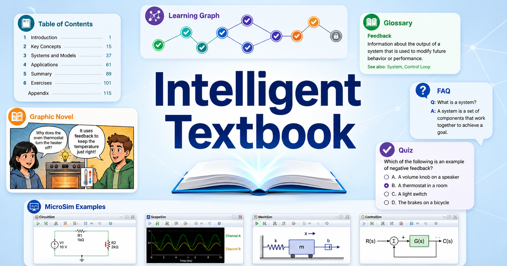
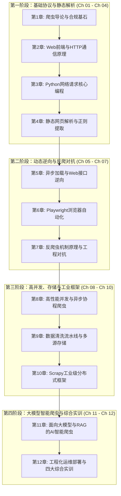

# 《网络爬虫技术》智能教材

欢迎来到 **《网络爬虫技术》（Web Scraping & Data Acquisition for AI）** 交互式智能教材！本教材专为高等职业院校**人工智能技术应用专业（专科）**量身定制，旨在帮助学生从零掌握互联网数据合规采集、动态网页逆向解析、高性能分布式爬虫架构，以及面向大语言模型（LLM）与检索增强生成（RAG）的高质量语料工程全流程。

---

## 核心特色与技术栈

- **紧扣 AI 专业数据底座需求**：告别脱离时代的陈旧案例，全书围绕“为大模型预训练、指令微调（SFT）与 RAG 知识库供给高信噪比数据”的主线展开。
- **主流 Python 3.10+ 工程实战栈**：全面覆盖 `requests`、`httpx`、`curl_cffi`、`BeautifulSoup4`、`lxml`（XPath）、`parsel`、`selectolax`、`Playwright`、`DrissionPage`、`ddddocr`、`asyncio`/`aiohttp`、`Pydantic`、`Scrapy`、`scrapy-redis`、`Trafilatura`、`Crawl4AI` 与向量数据库。
- **240 个知识图谱概念与交互式微仿真（MicroSims）**：全书基于无环依赖知识图谱（DAG）科学编排，每章均配备完整可运行的 Python 代码、对比决策表、Mermaid 架构流程图、2～3 个交互式微仿真实验规格及课后折叠思考题。

---

## 全书 12 章知识演进架构图

---

## 全书 12 章学习路线导航

| 章节 | 章节名称 | 核心技术模块 | 覆盖概念数 |
| :---: | :--- | :--- | :---: |
| **第 1 章** | [网络爬虫导论与数据合规基石](chapters/01-intro-and-ethics/index.md) | AI 数据生命周期、爬虫分类、`robots.txt`、法律合规红线 | 20 |
| **第 2 章** | [Web前端基石与HTTP通信原理](chapters/02-web-and-http-fundamentals/index.md) | HTML5 DOM 树、HTTP/1.1 与 HTTP/2、状态码、Cookie、DevTools 抓包 | 22 |
| **第 3 章** | [Python网络请求核心编程](chapters/03-python-http-requests/index.md) | `requests`、`Session`、`tenacity` 指数退避重试、`httpx` HTTP/2 | 22 |
| **第 4 章** | [静态网页结构化解析与正则提取](chapters/04-static-html-parsing/index.md) | UTF-8/GBK 乱码治理、正则 `re`、`BS4`、XPath、`parsel`、`selectolax` | 24 |
| **第 5 章** | [异步加载与Web接口逆向采集](chapters/05-ajax-and-api-scraping/index.md) | AJAX/Fetch、RESTful JSON、游标翻页、GraphQL、WebSocket/SSE | 20 |
| **第 6 章** | [动态渲染网页与Playwright浏览器自动化](chapters/06-browser-automation-playwright/index.md) | Blink 渲染路径、`BrowserContext`、`Locator`、`route` 拦截、`on_response` | 22 |
| **第 7 章** | [反爬虫机制原理与工程对抗策略](chapters/07-anti-scraping-and-countermeasures/index.md) | 分布式代理池、`curl_cffi` TLS 指纹、WebFont 字体解密、`ddddocr`、JS 签名逆向 | 22 |
| **第 8 章** | [高性能并发与异步协程爬虫编程](chapters/08-concurrent-and-async-scraping/index.md) | GIL、线程池、`asyncio` 事件循环、`aiohttp`、`Semaphore` 与令牌桶限流 | 18 |
| **第 9 章** | [数据清洗流水线与多源持久化存储](chapters/09-data-cleaning-and-storage/index.md) | `Pydantic` 校验、JSONL/Parquet、MySQL 幂等写入、MongoDB、Redis 布隆过滤器 | 20 |
| **第 10 章** | [Scrapy工业级异步爬虫框架实战](chapters/10-scrapy-industrial-framework/index.md) | Scrapy 六大组件、`Item Pipeline`、中间件、`scrapy-playwright`、`scrapy-redis` | 20 |
| **第 11 章** | [面向大模型与RAG的AI智能爬虫](chapters/11-ai-powered-scraping-and-datasets/index.md) | `Trafilatura` Markdown 转换、`Crawl4AI`、LLM 零样本解析、SFT 语料、RAG 分块 | 18 |
| **第 12 章** | [爬虫工程化运维部署与综合实训项目](chapters/12-engineering-deployment-and-capstone/index.md) | Docker 容器化、`APScheduler`、`Loguru`、飞书告警、漂移巡检、四大综合实训 | 12 |

---

## 快速跳转

- [课程教学大纲与学习目标（Course Description）](course-description.md)
- [240 概念知识图谱与质量评估（Learning Graph）](learning-graph/index.md)
- [章节总览（Chapters Index）](chapters/index.md)
- [核心术语中英对照表（Glossary）](glossary.md)
- [关于本教材（About）](about.md)
